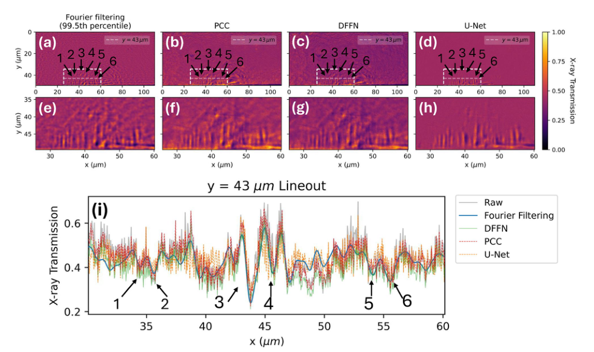
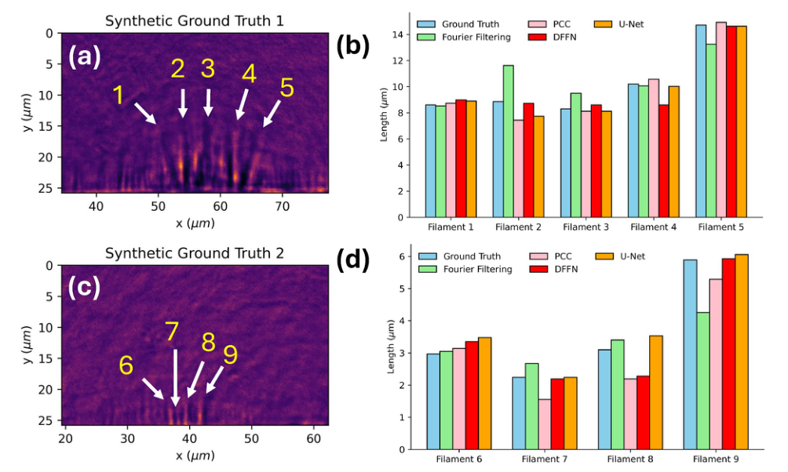
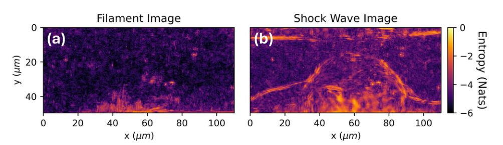
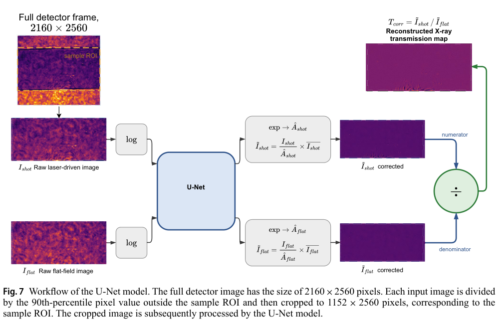

# 用物理引导U-Net去除XFEL成像结构伪影：中文笔记

## 0. 论文、版本和阅读范围

- Shao Xian Lee、Aashwin Ananda Mishra等24位作者；前两位共同一作，完整名单见台账及PDF首页。
- **Physics-guided deep learning for high resolution X-ray free-electron laser imaging**；[Scientific Reports，DOI 10.1038/s41598-026-80553-7](https://doi.org/10.1038/s41598-026-80553-7)。2026-04-24收稿、11-09接收、**11-17在线**。
- 实际阅读[19页出版社PDF](../pdfs/lee-2026-xfel.pdf)为 **Article in Press**，仍待最终编辑；不是最终VOR。早期作者稿2605.01543标题较短，属于同一作品别名，不另计论文。
- 全部布局文本已读；第2–9、12–16页及第15页公式放大图目视核查。公式文本层多处重复字符，以渲染页为准。MinerU历史认证失效、本轮未复测、零请求，使用本地文本和渲染回退。未训练网络、下载全量原始数据或复做实验。
- 证据层级：**真实MEC成像数据上的方法应用 + 两组合成注入检验 + 无独立真值的冲击波比较**。不是新的Weibel机制测量、电子速度真值验收或快点火效率实验。

## 1. 摘要：改善的是诊断重建，不是直接恢复全部物理量

作者针对CRL复合折射透镜引入、随炮次变化的结构纹理。传统驱动图／平场相除不能消去略有平移、缩放和失焦的纹理，纹理又与真实细丝共享空间频率。方法为每张图单独预测一个乘性伪影层，去除后再相除。

摘要的MSSIM提升0.345→0.906、0.0679→0.945来自两组合成注入，不能当全部实验图像的真实重建精度。集成模型的不一致可提示域外结构；正文同时展示细丝模型会消去一部分冲击波，故摘要关于确保OOD稳健性的措辞应按正文限制理解。

## 2. Introduction：为什么平场归一化失效

第一部分把问题定位在亚200 nm量级的定量XFEL成像。Be透镜密度不均一被成像到探测器上，束指向与中心能量／谱型改变其位置、放大率和焦点；这不同于独立像素白噪声，也不同于纯探测器响应不均。

第二部分说明应用：高强激光打固体产生快电子，快电子输运可能发生细丝化；XFEL可在皮秒尺度观察。相关快点火背景说明研究动机，不表示此工作实现了点火或独立识别了每条细丝的驱动机制。

### 2.1 乘性层模型及推导

把驱动图、平场图写成：

$$
I_s(x,y,t_1)=I_0(x,y,t_1)A(x,y,t_1)T(x,y),\qquad
I_f(x,y,t_2)=I_0(x,y,t_2)A(x,y,t_2).
$$

这里强度使用相同归一化标度，透射率与伪影因子无量纲；空间坐标取样品面。逐项相除得到：

$$
T_{\rm raw}=\frac{I_s}{I_f}
=T\frac{I_0(t_1)A(t_1)}{I_0(t_2)A(t_2)}.
$$

只有分子、分母的照明和伪影匹配时，最后的比值才等于1。取对数，乘性层变加性：

$$
\log I_s=\log I_0+\log A+\log T.
$$

这解释了对数域训练的物理直觉。但从单张图分离几个未知因子并不唯一，网络依赖训练统计、数据增强和可分离假设；并非由这个恒等式就能证明无偏恢复。引言把一般平场描述为无样品图，Methods的cold-shot训练集则明确有硅样品、无光学驱动，复现时应核对具体参考帧定义。

第三部分与既有PCA、pix2pixHD和环伪影方法比较。本工作称“physics-guided”是因为层模型、对数变换和增强来自成像物理；**损失函数没有嵌入PDE，不是PINN求解器**。在线处理及自主实验是潜在应用。

## 3. Results：实测图像与三种基线

### 3.1 Fig.1：平滑背景与保留信号是两个指标

来源：出版社PDF第4页Fig.1原图摘录。a–d是Fourier、PCC、DFFN、U-Net，e–h为同一区域放大；横纵坐标为样品面微米，色标为无量纲X射线透射率。i在**距表面43 μm**取横向剖面，标出6条细丝。U-Net减少细丝间纹理，同时较好保留1、2号等峰谷；Fourier会削弱部分细丝。真实图没有干净真值，视觉改善不是绝对精度验证。

作者在细丝ROI以外报告透射率标准差：raw 0.0650、Fourier 0.0392、PCC 0.0549、DFFN 0.0563、U-Net 0.0472。**U-Net并非该指标最小**；Fourier更小可能也反映真实结构／高频成分被削弱。因此不能仅按背景方差排名信号保真度。

PCC只补平移，无法补伪影放大和失焦；DFFN用平场基底合成动态参考，但本数据中的色差变化难以充分表示。结论只针对给定参数和数据，不是这些方法在所有光束线上普遍失效。

### 3.2 Injection test：两个人工参照的作用和边界

第5页Fig.2的两组细丝图与cold-shot图均排除在训练之外。作者先从驱动图提取并增强细丝，再乘入一张新背景：

$$
I_{\rm syn}(x,y)=I_{\rm cold}(x,y)S_{\rm fil}(x,y).
$$

这在**强度域**检验去伪影后的信号保持，并非从完整成像前向模型生成的端到端透射率真值。图2上下两组分别为较强、较弱细丝；空间轴μm，共用显示标度为a.u.，线剖面位于45.2和47.3 μm。U-Net恢复的峰／背景较接近注入参照，Fourier衰减幅度，PCC／DFFN残余峰较多。注入模板本身仍源于预处理实验图，不能保证没有模板残余或构造偏好。

第6页Table 1的ROI内指标如下；PSNR按dB理解，MSSIM和所用归一化MSE无量纲，数值保留表中的精度：

| 方法 | MSSIM1 | PSNR1 | MSE1 | MSSIM2 | PSNR2 | MSE2 |
|---|---:|---:|---:|---:|---:|---:|
| Raw | 0.345 | 17.0 | 0.0197 | 0.068 | 14.2 | 0.0377 |
| Fourier | 0.459 | 26.2 | 0.0024 | 0.295 | 23.8 | 0.0042 |
| PCC | 0.238 | 17.4 | 0.0180 | 0.369 | 16.3 | 0.0237 |
| DFFN | 0.500 | 18.5 | 0.0141 | 0.117 | 14.6 | 0.0346 |
| U-Net | **0.906** | **28.6** | **0.0013** | **0.945** | **29.0** | **0.0012** |

正文给MSE1=0.00138、MSE2=0.00125，表中显示0.0013／0.0012；这里不把两种显示精度混成额外实验。两测试个例没有提供跨实验置信区间。

### 3.3 Fig.3：把图像质量联系到细丝长度

来源：PDF第7页Fig.3。左图空间轴μm、编号1–9；右图横轴细丝编号，纵轴长度μm，不是误差百分比。蓝色ground truth是合成参照，橙色U-Net通常更接近它。作者沿丝方向取剖面并跨宽度平均，以极大／极小确定端点；这一端点规则也是误差来源。

作者报告长度RMSPE：U-Net 8.66%、Fourier 16.71%、PCC 15.73%、DFFN 11.3%。为理解该指标，可写一般定义（笔记补充）：

$$
{\rm RMSPE}=100\sqrt{\frac1n\sum_{j=1}^{n}
\left(\frac{L_j-L_j^{\rm ref}}{L_j^{\rm ref}}\right)^2}.
$$

长度单位在比值中消去，短细丝相同绝对误差会得到较大权重。这些是合成参照的长度误差，不是独立电子速度误差；速度还需延时、放大率及跟踪对应关系。

### 3.4 Generalizability：冲击波会被细丝模型误删

PDF第8页Fig.4使用晚时间真实冲击波图。空间轴μm、色标无量纲透射率；细丝模型把部分冲击波吸入伪影层，图像变得过平。换成初始48通道、用6块冲击波patch增强的模型后保留更多结构。这里容量和训练内容同时变化，尚不能分离二者贡献。

冲击波没有干净真值。文中0.629→0.708的MSSIM、26.1→28.5的PSNR以raw为比较对象；它们衡量与原图相似的程度，不能解释为对真实冲击波的准确率。

### 3.5 Deep ensembles：分歧可以提示风险，不能证明正确

来源：PDF第9页Fig.5。坐标μm；右侧色标直接标**Entropy (Nats)**，约−6至0，越亮表示模型预测方差越大。细丝位置略亮，冲击前沿更亮；这支持本例中的域外提示。该图并非“正确概率”，也不应再对负熵数值直接取对数。

作者独立训练10个不同随机初始化／数据次序的网络，预测透射率的均值、方差为：

$$
\mu(x)=\frac1M\sum_{m=1}^{M}\widehat y_m(x),\qquad
\sigma^2(x)=\frac1M\sum_{m=1}^{M}[\widehat y_m(x)-\mu(x)]^2,\qquad M=10.
$$

在像素预测近似高斯的假设下，原文式(2)为：

$$
h=\frac12\log(2\pi e\sigma^2).
$$

推导：将高斯密度代入微分熵的负对数期望，二次项的期望等于方差，得到常数项加半个对数方差。方差越大熵越大；微分熵可以为负，且依赖输出归一化尺度，并非离散分类熵。它主要反映**认知不确定性**，不包含完整光子噪声、标定系统误差或共享模型偏差。

正文给背景约−5.8至−5.2 nats、细丝−4.2至−3.5、冲击波−0.5至0，称方差增加超过100倍。作笔记自检，熵差对应方差比为：

$$
\frac{\sigma_b^2}{\sigma_a^2}=\exp[2(h_b-h_a)].
$$

例如取−5.5与−0.25可得约3.6万倍，仍满足“超过100倍”，但不是测得一个固定的100倍。本例未给域外检测ROC、阈值误报／漏报或覆盖率校准；十个网络也可能一起犯错。

## 4. Discussion：何时乘性可分离近似失效

讨论先回到共同频谱导致Fourier取舍、PCC缺缩放／失焦校正、DFFN平场子空间不足。其核心不是无限制去噪，而是学习本配置中结构伪影的统计规律。

吸收主导、细丝不强烈改变光线路径时，乘性层较合理；强折射等离子体会改变上游伪影的投影，物理信号与伪影非线性耦合。冲击波失败是实际展示的限制，不应把换模型后的外观改善视为消除了这个逆问题。

换光路或靶条件需要参考数据、复验及可能重训。十模型分歧可作为提示，不能替代样品真值、物理量联合反演或与其他诊断交叉验证。

## 5. Methods：数据、基线、训练与实现细节

### 5.1 实验与预处理

MEC/LCLS实验：硅靶沿X射线方向厚100 μm；光学驱动1 J、45 fs、800 nm、7 μm FWHM焦斑；9.5 keV XFEL在不同延时探测。未扰动样品区平均透射率约42%是归一化一致性检查，不等于全图绝对校准已闭合。第12页Fig.6展示驱动图、平场和相除图；前两者是a.u.强度，第三幅是透射率，不可混用色标。

### 5.2 三种基线的具体口径

Fourier分别处理驱动和平场：中心20像素低频mask与99.5百分位幅值阈值，逆变换后加常数恢复均值再相除。阈值按经验选择，比较依赖这些设定。

PCC由归一化互功率谱的逆变换峰估计亚像素平移，移参考图再相除；它不拟合缩放／仿射／色差。

DFFN先对平场做PCA：

$$
\widehat I_f=\overline I_f+\sum_{k=1}^{K}w_k u_k,\qquad
T=\frac{I_s}{\widehat I_f}.
$$

其中特征平场与均值具有同一强度标度，权重由归一化图的总变分优化得到。用100个人工矩阵的对应特征值95百分位选保留模；为避平凡缩放，目标乘估计平场均值。细丝ROI被遮掉，拟牛顿容差为十的负六次方，最多400次迭代。这是有特定mask的算法比较。

### 5.3 图7–8：先分别清图，再构造透射率

来源：PDF第14页Fig.7，不含下方Fig.8。流程没有数据坐标；数字2160×2560、1152×2560为像素尺寸。全帧按样品ROI外90百分位归一化，裁样品区后，对驱动和平场分别取log、共享U-Net预测、exp回强度域、除预测层并作均值缩放，最后二者相除。箭头仅是处理依赖，不能当测得的能量输运。

可将图示流程写成：

$$
\widehat A_s=\exp F_\theta(\log I_s),\quad
\widetilde I_s=\frac{I_s}{\widehat A_s}\overline I_s,\quad
\widetilde I_f=\frac{I_f}{\widehat A_f}\overline I_f,\quad
T_{\rm corr}=\frac{\widetilde I_s}{\widetilde I_f}.
$$

这是按图7整理的归一化强度表达；与实际物理单位的对应需固定输入归一化。乘原图均值本身并非严格保证任意图像逐像素均值守恒的数学条件，复现应核查代码及42%检查，不能仅凭措辞推断绝对标定。

Fig.8为三次下采样／对称解码、四尺度U-Net：32/64/128通道、256瓶颈，双3×3卷积与GELU、2×2 max-pool、转置卷积、同尺度拼接、1×1单通道输出，共1,925,025参数。图中尺寸指像素，不是物理网格。

### 5.4 加权L1及训练样本

197张cold-shot来自两组训练集，另100张来自第三组作验证。两张驱动图提供细丝patch，90%概率随机贴入背景；输出目标仍是未贴细丝的层，从而学习保留细丝。原文式(7)：

$$
\mathcal L=\frac1N\sum_{i=1}^{N}(1+\alpha M_i)|\widehat I_i-I_i|,\qquad \alpha=10.
$$

二值mask在粘贴区为1，所以这些像素权重11、其他为1；分母是像素数，并非权重和。图像在对数域预测层。Adam学习率为十的负四次方，参数0.9/0.999，20 epochs；A100训练单模型据作者少于20分钟。独立验证冷图并非跨配置物理真值验证，增强源图数量也很少。

### 5.5 Enhanced contrast extraction：原文公式待澄清

第15页／Fig.9先用无细丝ROI上半部估平移、对齐均值冷图，再取两个强度的对数差：

$$
R=\log(I_s+\epsilon)-\log(I_{{\rm cold,mean}}+\epsilon).
$$

**原PDF渲染确实印作**：

$$
S_{\rm fil}=\exp(R^2).
$$

它不是普通对数残差回强度域应有的指数形式；平方会消去正负号。这可能影响模板增强的含义，但本轮没有代码可对照，**不擅改为其他公式、不据此宣布程序错误**。第二模板又裁patch、归一化并按五倍增强，写作：

$$
I_{{\rm raw},GT2}=I_{{\rm cold,new}}(1+5P_{\rm fil}).
$$

这里的5是模板增强倍率，不是损失中的10。Fig.9各图均用μm空间轴、a.u.强度且不同色标；注入图不是独立获取的物理真值。

### 5.6 集成推理性能和数据声明

10个成员分别初始化、打乱次序，并按验证损失独立早停。作者报告单模型约2 ms、并行CUDA streams及batch集成约6 ms，推理部分只称SOTA硬件，没有完整数据搬运、预处理、双图和持续流水线吞吐benchmark。**毫秒延迟不等于已实现MHz逐帧处理**，也未在本地复测。

论文给部分数据Zenodo DOI 10.5281/zenodo.22130515，全数据需合理请求；代码声明将在发表时提供GitHub。此处仅记录论文声明，没有确认全量数据、可执行代码SHA或当前仓库可用性。

## 6. 对本库方向的意义与接续

这篇把HED束流输运中的仪器伪影与结构测量偏差联系起来，适合借鉴到PIC—合成诊断—图像重建的证据链。真正可证伪的迁移检验应固定光路和标度，分别注入已知弱信号、强折射结构及新频谱，检验幅度／端点、误删率、密度或速度反演误差。

后续需取得最终VOR、原始训练／测试分割和预处理代码；澄清指数平方、cold-shot／平场定义、均值恢复步骤及MSE显示差异；增加训练来源以外的真值／交叉诊断、集成阈值ROC与校准、完整流水线持续吞吐。本文没有验证转换靶γ谱、光核／中子产额、剂量或临床／防护性能。

## 7. 复习速记

先各自估计驱动图和平场图的乘性伪影，再相除，有助于保留细丝；两组合成注入显示改善，真实冲击波则展示模型误删和可分离假设的边界。集成分歧是提示层，不是物理真值证书。
