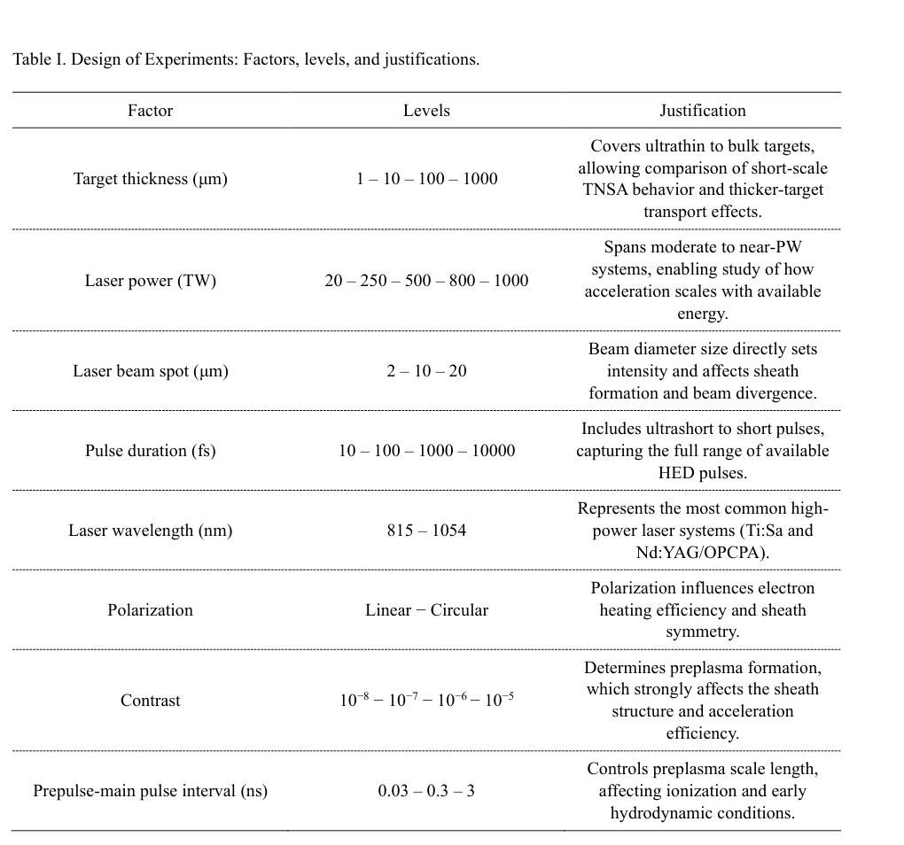
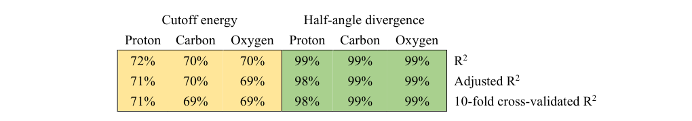
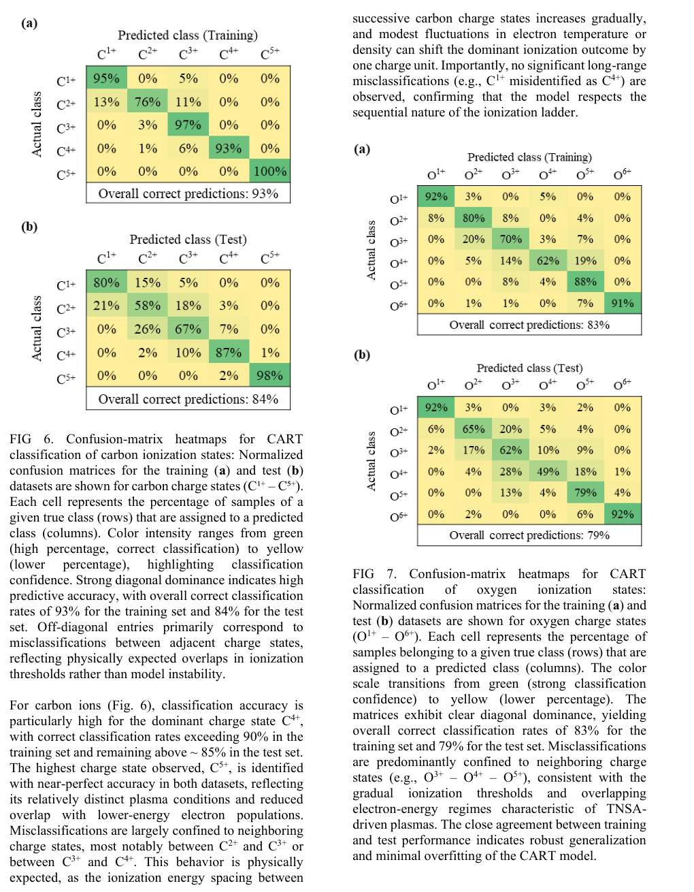
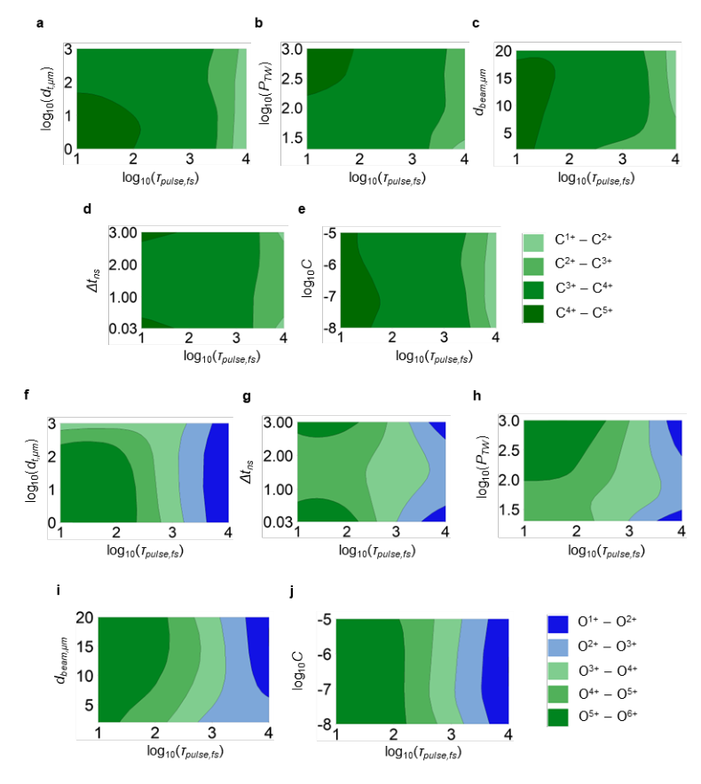

# TNSA质子／碳氧离子能量、散角和电荷态的多变量标度：中文笔记

## 0. 论文、版本和证据范围

- 作者：Vasiliki E. Alexopoulou，National Technical University of Athens，单作者。
- 正式题名：**Multivariate scaling of proton and ion energies, divergence, and charge states in laser-driven Target Normal Sheath Acceleration**；[European Physical Journal Plus，DOI 10.1140/epjp/s13360-026-08572-x](https://doi.org/10.1140/epjp/s13360-026-08572-x)，2026-11-18在线。
- 实际阅读：[24页作者PDF](../pdfs/alexopoulou-2026-tnsa.pdf)，[arXiv:2512.21279v1](https://arxiv.org/abs/2512.21279v1)，首投2025-12-24 16:58:25 UTC。作者稿标题没有“laser-driven”，作者、研究对象和摘要对应同一作品；**未取得或逐段核对11月期刊VOR**。作者稿没有另印明确内部日期，也没有附录；第22–24页包含可用性声明和参考文献。
- 出版社PDF入口本次返回HTTP200，却重定向到文章HTML，不能当PDF成功。本文的数值、公式和问题均指上述作者v1；不能假定期刊版沿用或已修正它们。
- 全部24页布局文本已读；源页1、5–8、11、13–17、19–22已渲染目视，共15页。Fig.4另放大核对。MinerU历史认证失效，本轮零请求／未复测，使用本地文本和页面渲染回退；未运行作者模型、统计代码、PIC或实验。
- **证据层级：解析多物理模型生成样本上的回归／CART统计研究。** 不是新增517组激光实验，也不是517组独立PIC。摘要“>95%”归属于引用的前作模型验证，与本文回归和分类性能不同。

## 1. 摘要：从计算样本提取可解释标度

作者希望同时预测质子、碳和氧的截止能量、发散半角以及碳氧最可能电荷态。输入包括靶厚、功率、光斑、脉宽、波长、偏振、对比度和预脉冲间隔。连续量采用对数多变量回归，离散电荷态采用Classification and Regression Trees（CART）。

摘要将前作多物理模型、本文拟合和应用愿景放在一起。阅读时须拆开：前作声称与多个装置达到95%以上一致；本文在**筛选后的合成样本**上做十折交叉验证；质子治疗、材料和核物理是背景用途，本文没有到靶能谱、绝对束荷、剂量或核反应产额验证。

## 2. I. Introduction：多阶段耦合与已有标度的局限

第一组段落按激光加热电子、电子输运和靶后鞘场、污染层离子加速介绍TNSA。引言对过程的概括并不能替代给定材料、靶厚和预脉冲条件下的机制诊断。本文涉及的靶厚是1–1000 μm，不覆盖所有超薄透明靶或RPA条件。

第二组段落依次讨论Zimmer、Simpson、Keppler等实验标度，强调样本少、装置相关性和只关注质子截止能量。它们是作者选择多参数计算扫描的动机；本文没有在统一独立测试集上重新比较这些实验标度，故不能据此判定其普遍优于全部既有模型。

第三组段落对解析、PIC、流体和Monte Carlo方法作比较，指出阶段分割与成本。作者引用前作[16]，即Research Square **10.21203/rs.3.rs-7562653/v1**，称其耦合热传导—流体—电磁，且在TITAN、TPW、OMEGA EP、ORION上有>95%预测一致性。**本篇没有给出该“95%”的误差函数、逐点实验表、误差条或完整交叉装置验证；本轮未补读[16]，不能独立认证该数字。**

引言最后提出用1700个参数组合提高覆盖度。这里“样本数大”指前向模型评估数量，不能自动增加模型与真实物理之间的独立证据。

## 3. II. Methods：标签怎样生成，样本怎样筛选

### 3.1 II.A：三模块前向模型及依赖关系

正文先按物理阶段组织：预脉冲加热／烧蚀→预等离子体电离／膨胀→主脉冲热电子与鞘场。Fig.1（PDF第4页）将它们映射到双温模型TTM、Euler方程与SESAME表、电磁模块。温度和烧蚀输出初始化流体，流体输出再初始化电子和鞘场部分。

这是一条**被特定模型闭合的计算链**。作者称“无经验输入”“全程自洽”，但本文只概要介绍，实际方程、耦合数值实现及验证主要在[16]；本篇仍明确采用Mora膨胀、越垒电离、横向冲量和重离子能量近似。不能把“无经验拟合输入”理解为“无模型假设”或已经解析全部反馈。

### 3.2 II.B.1–3：物种、鞘场参数与加速时间

模型输入包括热电子温度、靶后电子密度、鞘场演化和电子散角。论文使用物种质量以及核电荷数1、6、8，计算离子等离子体频率与声速：

$$
\omega_{pi,i}=\sqrt{\frac{Z_i q_e^2n_e}{\epsilon_0m_i}},\qquad
c_{s,i}=\sqrt{\frac{Z_i k_BT_e}{m_i}},\qquad
\tau_{\mathrm{exp},i}=\frac{6}{\omega_{pi,i}}.
$$

这里用正的元电荷符号区分电荷与后续公式里的自然常数；温度乘玻尔兹曼常数后为能量，密度用SI单位时频率为s⁻¹、声速为m/s。由准中性关系把离子密度换成电子密度时会出现一个电荷数因子。**本文这里使用核电荷数，后面能量却使用最可能电荷态；部分电离时二者如何保持一致，需实现说明。**

作者把有效加速时间估为：

$$
\tau_{\mathrm{acc},i}=\sqrt{\tau_{\mathrm{pulse}}^2+\tau_{\mathrm{exp},i}^2+
\left(\frac{r_{\mathrm{beam}}}{v_d}\right)^2}.
$$

三项都是时间平方，分别对应脉冲、膨胀和电子横向尺度／漂移时间。这是本文选用的组合模型，并非由量纲一致性就唯一推导出的规律。

**印刷式保留问题：** PDF第5页式(4)目视确实把归一化时间写为下式，分母为“2e”，没有根号：

$$
t_{p,i}=\frac{\omega_{pi,i}\tau_{\mathrm{acc},i}}{2e}.
$$

这里若将同一字母解释成元电荷，时间将不再无量纲；若解释成自然常数则量纲可成立，但正文没有清楚区分，且式(10)另有根号内“2e”。本笔记不擅自替换系数，也不把疑似印刷式当已验证求解器实现；须取得代码／期刊最终式澄清。

### 3.3 II.B.4–5：截止能量、前沿速度与重离子近似

质子截止能量用Mora型表达式：

$$
E_{\max,p}=2k_BT_e\left[\ln\left(t_{p,p}+\sqrt{1+t_{p,p}^2}\right)\right]^2
=2k_BT_e\operatorname{arsinh}^2(t_{p,p}).
$$

直观推导是：前沿速度为声速的两倍乘反双曲正弦；将其代入非相对论动能的一半质量乘速度平方，质子声速平方等于热电子温度能量除以质子质量，质量约去即得到上式。**这只是所用等温膨胀近似中的截止标度，不是测得的全谱，也不是自洽多离子竞争加速解。**

重离子截止能量另外直接近似为：

$$
E_{\max,i}=Z_i^*E_{\max,p}.
$$

星号电荷态由下述OBI给出，能量按每离子MeV标示，**不是MeV/u**。相同势差乘离子电荷解释其比例，但模型忽略了仅凭这一式不能表示的物种质量、注入时序、鞘场耗能和多物种耦合。不能将由此生成的C/O标签视为独立重离子基准。

后续Debye长度由电子温度／密度计算，前沿场随归一化时间衰减，速度和位置按自相似式生成。正文没有给出这些近似对所有517点的误差界。特别是重离子频率所用核电荷与OBI电荷的闭合，以及式(4)系数，都会传播到场强、OBI阈值和散角。

### 3.4 II.B.6–7：OBI电荷态与发散半角

对每级电离势，模型比较准静态鞘场与越垒电离阈值，取能越过的最高级数作为最可能电荷态；本文没有展示完整的碰撞电离—复合率方程或连续电荷态动力学。

散角用横向冲量估计：

$$
E_{r,i}=\sin\theta_e\,E_{\mathrm{front},i},\qquad
v_{r,i}=\frac{Z_iq_eE_{r,i}}{m_i}\tau_{\mathrm{eff},i},\qquad
\theta_{1/2,i}=\arctan\frac{v_{r,i}}{v_{\mathrm{front},i}}.
$$

电子展宽角决定横场比例；电场力除以质量得到加速度，再乘有效时间得到横速度，与前沿轴向速度比值给半角。质子有效时间取自身加速时间，重离子取质子加速时长和到达前沿时间的较小值。角度最终以度输出；它不是FWHM全角、RMS发射度或某能窗内实测角分布。

### 3.5 II.C：八因素DOE与两重筛选

来源：作者PDF第7页Table I原表。靶厚μm、功率TW、光斑**直径**μm、脉宽fs、波长nm、间隔ns，对比度无量纲；偏振为线／圆两类。表中范围分别为1–1000 μm、20–1000 TW、2–20 μm、10–10000 fs、815/1054 nm、0.03–3 ns，以及对比度10⁻⁸–10⁻⁵。这是离散候选网格，不代表这些区间被连续均匀采样，也没有每点实验支撑。

段落顺序为：定义八因素→从全因子候选集合无放回随机抽取1700点→以强度过滤为1002点→运行模型→以输出过滤为517点。强度按功率除以圆面积计算，保留10¹⁸–10²¹ W/cm²；光斑是直径，换算时必须包含半径因子和TW／μm到SI或厘米单位的转换。这个平均面积表达式没有单独明确高斯峰值／FWHM直径约定。

**可核对的计数问题：** 按Table I各因素4、5、3、4、2、2、4、3个水平相乘，全因子数是**11,520**；第6页却称需“数十万次”。此处仅做表内乘法核对，不判断作者实际候选程序是否另含未列水平。

第二重筛选剔除“无离子加速”或“质子截止能量超过85 MeV”的点。它既是应用窗口选择，也是**对响应变量的截断**；作者认为高能是非物理，但仅以85 MeV作统一上限不能独立证明每个高能点都非物理。517/1002约一半点被排除，必须取得被删点和规则才能评估幸存样本偏差。本文统计不能直接推广到加速失败概率或85 MeV以上束流。

作者随后说明过滤令DOE非正交，故用回归、Type III背景及VIF处理因素相关性。这可改善条件统计估计，**不能撤销响应筛选造成的分布改变**，也不能把相关性自动解释为因果机制。

### 3.6 II.D：对数回归、逐步删项与十折验证

用相对于规定单位的无量纲输入写，可避免直接对带单位的量取对数：

$$
\ln\frac{Y}{Y_0}=\beta_0+\sum_j\beta_j\ln\frac{X_j}{X_{0j}}+\epsilon,
\qquad
\widehat{Y}=Y_0e^{\beta_0}\prod_j\left(\frac{X_j}{X_{0j}}\right)^{\beta_j}.
$$

取对数把乘积变加和，回归斜率就是局部对数弹性；逆变换给出乘法标度。幂次只能在已筛选的参数分布里理解。直接指数化预测的是对数模型对应的典型值；若要无偏算术均值还需残差分布／回变换修正，本文未说明。

作者从完整模型开始，按最大p值逐步删除，阈值0.05；计算VIF筛查多重共线性，再随机分十份，用九份训练、一份测试轮换。文中未给随机种子、每折点表、逐步选择是否嵌套在训练折内、置信区间或区间预测。也未明确Fig.4的R²是在对数空间还是原量空间计算，**R²不能换成“百分之多少相对误差”**。随机十折主要检验同一合成设计内插；没有装置留出、参数边界留出或新模型留出实验。

### 3.7 II.E：离散标签的CART与降维图

CART以Gini不纯度分裂，声称十折交叉验证，输出类别比例、相对变量重要性和混淆矩阵。作者说树有约30–100节点，但没有给出可执行树、深度、剪枝／复杂度参数或每折类别支持数。将大树改画二维轮廓图和箱状区带使展示直观，却不等于完整多变量分类器。

## 4. III.A：连续输出结果与物理解读

### 4.1 显著性与VIF：模型内的条件相关性

Fig.2（第11页）六个输出均剔除偏振；波长对截止能量p=0.043–0.048，仅边缘显著，但**对三种散角p<0.001**。不能把“波长只边缘显著”同时套到全部输出。其余主要量显著，Fig.3／正文给VIF<1.3。低VIF表示线性预测量不严重共线，不能保证无模型偏差、无变量遗漏或因果可识别。

正文接着用热电子、预等离子体和鞘场解释多参数依赖，讨论波长与偏振。它是对合成模型输出的机制诠释；本文未给多机制消融或独立PIC／实验来区分解释。对于波长仅两个值、偏振仅两类，结果更不能推广为全波段／全TNSA的“不敏感定律”。

### 4.2 六条回归律：单位固定，质量约定要明确

令下式中的每个参数均表示除以表头单位后的数值：靶厚μm、功率TW、光斑直径μm、脉宽fs、间隔ns，对比度仍无量纲。输出能量为每离子MeV，半角为度。

$$
E_i=A_i\,d_t^{a_i}P^{b_i}d_b^{c_i}\tau^{d_i}C^{e_i}\Delta t^{f_i},\qquad
\theta_i=B_i\,d_t^{g_i}P^{h_i}d_b^{j_i}\tau^{k_i}C^{l_i}\Delta t^{m_i}.
$$

以下逐项转录PDF第13页式(20)–(31)，不是本轮重新拟合：

| 物种／输出 | 靶厚指数 | 功率指数 | 光斑指数 | 脉宽指数 | 对比度指数 | 间隔指数 | 815 nm前因子 | 1054 nm前因子 |
|---|---:|---:|---:|---:|---:|---:|---:|---:|
| 质子能量 | −0.36 | 0.78 | −1.29 | 0.58 | 0.05 | 0.25 | 3.19 | 3.67 |
| 碳能量 | −0.39 | 0.86 | −1.40 | 0.51 | 0.04 | 0.27 | 14.79 | 17.17 |
| 氧能量 | −0.44 | 0.95 | −1.48 | 0.48 | 0.04 | 0.28 | 19.34 | 22.78 |
| 质子半角 | 0.97 | −0.90 | 1.73 | −0.49 | −0.06 | −0.44 | 0.29 | 0.20 |
| 碳半角 | 0.95 | −0.89 | 1.77 | −0.45 | −0.06 | −0.46 | 0.06 | 0.04 |
| 氧半角 | 0.96 | −0.89 | 1.77 | −0.44 | −0.06 | −0.46 | 0.06 | 0.04 |

趋势是功率增大、光斑变小通常能量提高且半角减小；更厚靶能量下降而半角增大。它们与模型假设的加热、输运和几何响应有关；没有电荷、效率或通量共同约束，不能仅以能量最高直接宣布转换靶／中子源最优。离开筛选后DOE、变换单位或改为半径，前因子与预测均会改变。

### 4.3 Fig.4：本篇性能是R²，不是95%实验准确率

来源：作者PDF第14页Fig.4，原图百分数无量纲；列为质子／碳／氧能量和三个发散半角，行为三种统计指标。黄色能量部分低于绿色散角部分。放大目视确认首行质子为**72%**，不是70%。

| 指标 | 质子能量 | 碳能量 | 氧能量 | 质子半角 | 碳半角 | 氧半角 |
|---|---:|---:|---:|---:|---:|---:|
| R² | 0.72 | 0.70 | 0.70 | 0.99 | 0.99 | 0.99 |
| 调整R² | 0.71 | 0.70 | 0.69 | 0.98 | 0.99 | 0.99 |
| 十折交叉验证R² | 0.71 | 0.69 | 0.69 | 0.98 | 0.99 | 0.99 |

三个指标接近表明本设计下随机留出降幅小。作者将此解释为无过拟合、可迁移和物理依赖已获证实；这些结论过宽：同一生成模型内的随机留出不能检验前向模型误差、删点偏差或实验外推。散角本身由简化冲量公式生成，接近幂律的高R²可能部分来自标签结构，并不表示真实束流散角预测达到99%。

## 5. III.B：电荷态、分类与概率图

### 5.1 多项响应统计：517个模型点的频数

Table II（第15页）碳C¹⁺／C²⁺／C³⁺／C⁴⁺／C⁵⁺分别20／38／39／379／41点，C⁶⁺为0；C⁴⁺占73.3%。氧O¹⁺至O⁶⁺分别37／40／60／76／24／280点，O⁶⁺占54.2%。两列各合计517，**不是每个点内的离子产额比例**，也不是实验多炮电荷态分布。

作者随后用壳层和热电子能谱解释C⁴⁺、O⁶⁺占优。但这里有两项未闭合：其一，标签在II.B由准静态场OBI阈值产生，讨论却反复用碰撞电离与电子能谱重叠解释，没有给OBI到碰撞率的桥接计算；其二，正文列C⁵⁺／C⁶⁺电离势约392／490 eV，后文却称完整K壳剥离需要“数十MeV”电子。前述电离势不能直接推出该MeV要求，需电离截面、时长、密度或引用依据澄清。本笔记不将该解释采作定量设计依据。

### 5.2 相对重要性：归一化排序，不是能量占比

Fig.5（第16页）两物种均把脉宽设为100%的最大重要性。碳的厚度／功率约90.0／82.9%，氧约53.2／31.9%；间隔在氧为33.2%，在碳为39.1%但排序更后。**跨物种按各自最大项归一化后，不能因氧排名更靠前就说其绝对敏感度必然更大。** 这些是树分裂统计重要性，不是能量贡献率或独立因果响应。

正文称氧对预等离子体参数更敏感。可作为后续机制检查线索；要证明需受控参数扰动、包含误差的响应度与电离动力学。

### 5.3 混淆矩阵：总体分数掩盖稀有类短板

来源：作者PDF第17页Fig.6及Fig.7原图区域。横轴预测类别、纵轴真实**模型标签**，单元为该行百分比，不是校准概率或实验置信度。对角绿色越深，表示分类命中越高；两图包含各自训练和测试矩阵。

碳训练／测试总体准确率93%／84%，氧83%／79%。碳多数类基线约73.3%，氧约54.2%，因此不能只报“高准确率”而不提类别失衡。测试中C²⁺召回58%、C³⁺67%；O³⁺62%、O⁴⁺49%，弱于多数类O⁶⁺92%。O⁴⁺仅49%尤其值得保留，不能用总体79%代替全部电荷态可靠性。

大多错误发生于近邻类别，说明拟合在这一标签集合里的过渡较连续。作者据此证明电离机制顺序正确与无过拟合，仍不足：模型标签本就由阈值规则生成；相邻混淆不能独立验证真实碰撞电离。数据分折、样本支持数和置信区间未给出，也不能把单元颜色称为已校准“confidence”。

### 5.4 Fig.8与Fig.9：二维展示不等于联合概率

来源：作者PDF第19页Fig.8原图。所有横轴为以fs数值取十进对数的脉宽，1–4对应10–10000 fs；纵轴依次为靶厚对数（μm）、功率对数（TW）、光斑直径μm、间隔ns、对比度对数。上组绿阶为C¹⁺–C²⁺到C⁴⁺–C⁵⁺，下组蓝绿为O¹⁺–O²⁺到O⁵⁺–O⁶⁺。**颜色图例表示相邻电荷态范围，不是数值概率色条。**

脉宽变化主导横向分区，厚度等强因素令边界弯曲；对比度等弱因素的分区较接近竖直。边界来自分类模型／展示插值，不是实验确认的相变线。正文没有明确其他六因素如何固定、边缘化或加权；因此不能把每幅二维截面当完整八维的条件概率。

Fig.9（第20页，已目视）按线／圆偏振和815／1054 nm分组，用蓝色矩形标示脉宽对应的主导电荷态区。图上没有传统箱线图的中位数、四分位距、须线，也没有概率数值；其“box-plot probability map”名称需按实际**矩形区带示意**理解。

第21页建议把多幅图预测的相邻区间取交集，例如C³⁺–C⁴⁺与C⁴⁺–C⁵⁺取C⁴⁺。这是一种阅读规则，**没有给出联合似然函数，不能仅凭区间交集证明它具有最高联合概率**。用于设计前应取得完整树、联合输入和校准概率，而不是人工拼接二维图。

## 6. IV. Conclusions与可复现性

结论重申多变量依赖、能量约70% R²、散角>98% R²和C／O不同敏感性。可确认的贡献是：在特定解析前向模型及输出筛选条件下，给出了覆盖八因素的标度系数和电荷态分类图。本文没有公开独立实验测试来证明“通用、可转移”，也没有给出参数优化后的新束流实测。

第22页Data／Code Availability均为向通讯作者合理索取，并非公开仓库。本轮未获取517点数据、完整1700点及淘汰原因、模型实现、回归脚本、交叉验证分折或CART树。因此本笔记为全文阅读、印刷式／图表静态核对，不是数值复现或模型验收。

## 7. 对后续激光离子束应用的可操作线索

1. 先获取期刊最终稿，与2025作者稿逐式核对，优先解决归一化时间“2e”、核电荷与有效电荷、OBI与碰撞解释、全因子计数和“95%”定义。
2. 用完整含失败／高能点的扫描重建入选规则；将变量选择嵌套在训练折，做参数边界、波长／装置留出和独立实验测试，报告原空间误差与预测区间。
3. 对C/O电荷态补充速率模型、真实诊断响应、每类样本数、少数类召回和概率校准；二维区带只作导航。
4. 若用于转换靶、中子或材料应用，还需电荷／粒子数、能谱／角谱联合分布、到靶输运和核反应／剂量计算。本文只给截止能量和半角，尚不能闭合效率、产额或防护方案。

复习速记：**这篇研究是在被两次筛选的同一多物理模型样本上拟合TNSA标度；随机交叉验证的高R²与前作“95%”是不同证据，不能当真实装置的通用准确率。**
