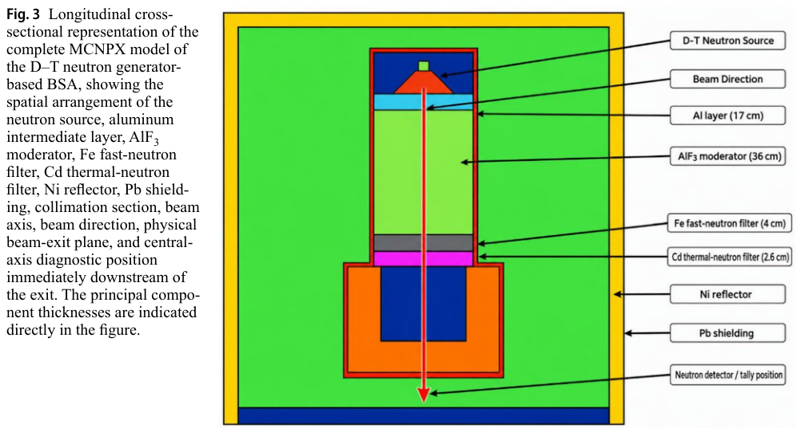
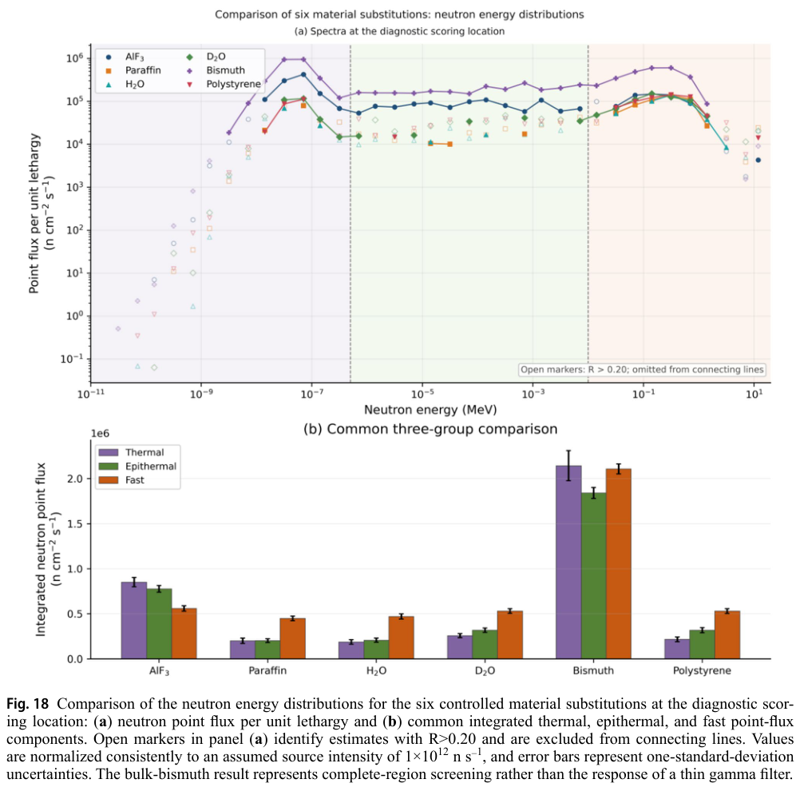
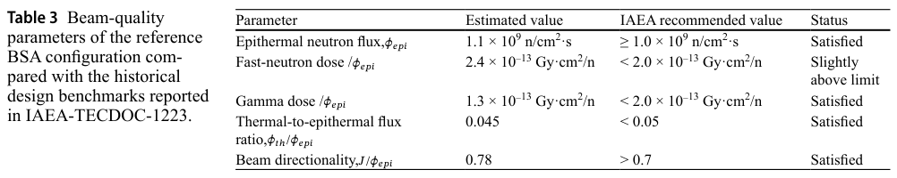
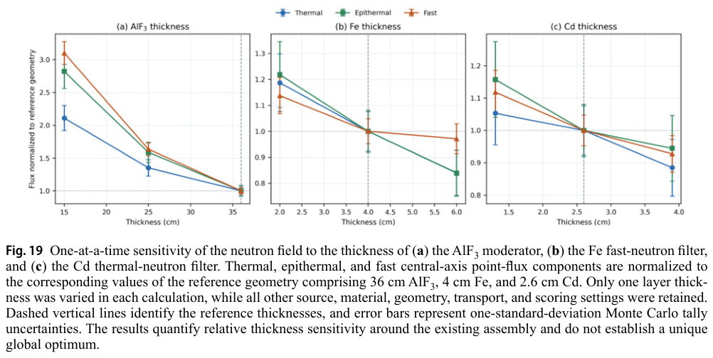

# D–T中子源BNCT束流整形的材料与厚度权衡：中文笔记

## 0. 论文、实际版本与阅读范围

- S. Asghari、M. Ghapanvary、A. Alavi、A. Ghalehasadi、V. Dehghani；作者顺序按PDF首页。
- **Monte Carlo assessment of a D–T neutron generator-based beam shaping assembly for BNCT: moderator effects on neutron spectrum and dose**；[Scientific Reports，DOI 10.1038/s41598-026-80838-x](https://doi.org/10.1038/s41598-026-80838-x)。2026-07-11收稿、11-11接收、11-18在线。
- 实际阅读[30页出版社PDF](../pdfs/asghari-2026-bnct.pdf)为 **Article in Press**，尚待最终编辑，不是最终VOR。全文布局文本、结论、数据可用性与参考文献已读，14个关键原页目视核查，保留4幅原图／表；坐标见[阅读记录](../research/asghari_reading.json)。
- 页面所链6页“Supplementary Information”实际是署名变更行政表单，**不是输运／数据补充材料**。仅识别类型，不转载表单内容、个人信息或图像，不计为科学补充阅读；本轮未取得科学补充或完整MCNPX输入。
- MinerU历史认证失效，本轮未复测、零请求；使用明确的本地布局文本及页面渲染回退。未运行MCNPX、复做剂量计算或开展实验。
- 证据层级：**理想源项下的MCNPX计算、保留参考结果与受控参数比较**。作者使用“validated reference”的称呼，但没有提供新的实体BSA束流测量，不能理解为已完成独立实验验证或临床资格认定。

## 1. 摘要：参考性能与新敏感性计算是两层证据

摘要首先说明14.1 MeV D–T中子需要经过多层束流整形组件（BSA），才能提高超热中子占比。本文保留一套参考性能计算，另做材料替换、有限源、出口孔径及逐个厚度变化；不能把所有结果都当同一套计算输出。

材料比较中，AlF₃在所选常规慢化剂中保留较多超热通量、快／超热比最低；石蜡和水对有用超热组的衰减更强。参考模型报告超热通量1.1×10⁹ n cm⁻² s⁻¹、方向性0.78，但快中子剂量／超热通量2.4×10⁻¹³ Gy·cm²/n仍比所采用历史设计值高20%。

有限圆盘源与点源差异未在95%水平统计分辨；放大出口提高透射，却未证明方向性改善。36 cm AlF₃、4 cm Fe、2.6 cm Cd是**既有模型的参考尺寸**，不是已证全局最优组合。

## 2. Introduction：为何不能只追求中子总数

开头由硼-10俘获反应产生α和锂-7短程带电粒子解释BNCT的局部能量沉积。治疗效果还依赖硼化合物分布；本文没有测量肿瘤硼浓度、细胞反应或患者结局。

随后几段依次解释束谱要求：超热中子进入组织后慢化，过多入口热中子可能提高浅表剂量，快中子与次级γ则带来额外剂量。因此要同时考虑超热强度、热污染、快／γ剂量及方向性，而非按总通量排序。

D–T发生器结构紧凑且具有高产额潜力，但14.1 MeV源能远高于BNCT所需能区，BSA必须兼顾强慢化与有用中子保存。慢化、过滤、反射、屏蔽和准直的作用相互耦合，单层的名义用途不能保证整机指标改善。

文献回顾逐项列出已有D–D／D–T BSA、铀倍增、多种氟化物慢化、Pb反射和模拟头模剂量研究，特别说明**D–T源及AlF₃慢化均非首次提出**。本文贡献定位为共同计算框架下的分步材料与几何评估；不同研究的源强、倍增器、计分方式不一致，文献数字不构成公平性能排行榜。

## 3. Materials and methods：源、几何、计分与归一化

### 3.1 理想D–T源与计算设置

MCNPX 2.6.0采用轴上各向同性、单能14.1 MeV点源，位置z=−5 cm。材料比较图的每源中子tally乘以**假设源率10¹² n/s**；这不是某台发生器实测产额，也未证明相应持续运行、占空比、靶寿命或热负荷可实现。

源尺寸敏感性只把点源换成半径1 cm、均匀取样的圆盘，保留10 cm出口；孔径敏感性则保留点源，把出口直径10→24 cm。圆盘半径不是实际氚靶的测量值，角分布和能谱宽度仍为理想化。

输运使用安装系统中的连续能量核数据；作者明确承认原始记录不足以确认**确切核数据库发布版**，不能自行填成某版ENDF或JEFF。中子与次级光子耦合用于参考γ加热；没有额外高能相互作用模型。p4印刷cutoff与NPS的可复现问题留到第7节逐项核对。

### 3.2 Geometry：不同计分位置必须分开

来源：出版社PDF第8页Fig.3原图／图注摘录。图是结构示意，**没有数值坐标轴或定量色标**；颜色区分材料／区域，红箭头表示束流方向，标注层厚单位cm。中心轴依次为Al中间层17 cm、AlF₃ 36 cm、Fe 4 cm、Cd 2.6 cm，外周Ni反射和Pb屏蔽，后接锥形准直段。该图帮助建立材料顺序，不能凭图中面积测量真实尺寸；反射／屏蔽边界须与Table 1及输入的布尔cell对应。

按p6–8及Table 1，主体z=0–161 cm、外半径52 cm，钢壳外半径57 cm；Al位于z=50–67 cm，慢化剂z=67–103 cm，Fe为103–107 cm，Cd为107–109.6 cm。锥段109.6–139.6 cm，入口／出口半径33／6 cm，其后空气出口孔半径5 cm。

**物理出口平面z=165.99 cm**的表面计分用于孔径面积平均通量、净流和角分布；轴上z=166.01 cm点探测器仅提供局部谱。材料替换序列的z=146 cm位于下游通道内部，仅为诊断位置，不能称为整机出口。Bi在完整参考几何中不是活动层。

### 3.3 三阶段参数研究及历史参考值

材料序列保持其余设置相同，把同一36 cm区域依次赋为石蜡、H₂O、AlF₃、D₂O、整块Bi-209或聚苯乙烯。Bi替换整个36 cm区域，**不是薄Bi γ过滤片**；Al的17 cm中间层仍在。

厚度研究只有7个配置：公共参考加6个逐变量变化。AlF₃取15／25／36 cm，Fe取2／4／6 cm，Cd取1.3／2.6／3.9 cm；每次只改一层，后续界面随之平移。它考察参考附近的输运权衡，没有覆盖多参数联合作用、所有材料顺序或Pareto前沿。

作者主要沿用IAEA-TECDOC-1223（2001）的历史设计参考，能区为热E<0.5 eV、超热0.5 eV–10 keV、快E>10 keV。文中也提到IAEA 2023出版物把相关量视为参考因素；本笔记只记录本文采用的框架，**没有独立复核当前法规或临床标准**。

### 3.4 Tally、公式及量纲

原文式(1)–(3)把微分通量对能区积分。令微分通量为n cm⁻² s⁻¹ MeV⁻¹，积分变量与上下限需使用一致能量单位：

$$
\Phi_{\rm epi}=\int_{0.5\,\mathrm{eV}}^{10\,\mathrm{keV}}\phi(E)\,dE,\qquad
\Phi_{\rm th}=\int_{0}^{0.5\,\mathrm{eV}}\phi(E)\,dE,\qquad
R_{\rm th/epi}=\frac{\Phi_{\rm th}}{\Phi_{\rm epi}}.
$$

两积分给相应组通量，单位n cm⁻² s⁻¹，比例无量纲。谱图绘制的是**单位lethargy通量**，不是每MeV谱密度；变量变换的幅值关系为：

$$
u=\ln(E_0/E),\qquad
\left|\frac{d\Phi}{du}\right|=E\frac{d\Phi}{dE}.
$$

这里u无量纲，图纵轴n cm⁻² s⁻¹；分组积分须按能箱／lethargy宽度一致处理，不能直接对对数能轴上的曲线高度求和。此式是帮助读图的变量变换，并非本轮重新积分作者数据。

原文快中子指标由谱与能量相关剂量响应构成；只给出一般方法，未明确响应表、参考组织及完整DE／DF卡，不能据此重建数值。用每源中子超热面通量f与每源剂量d表示，源率Q的取消过程为：

$$
\Phi_{\rm epi}=Q f_{\rm epi},\qquad
\dot D=Qd,\qquad
\frac{\dot D}{\Phi_{\rm epi}}=\frac{d}{f_{\rm epi}}.
$$

所以表内Gy·cm²/n是**剂量率除以通量**（或等价的每源剂量／每源注量），不是绝对总剂量。改变源率可线性改变通量与剂量率，但不会单独改善此比值。

γ指标使用MODE N P，在出口紧邻组织等效体积取光子F6加热，MeV g⁻¹／源中子先转Gy／源中子，再除以同参考配置出口孔径平均F2超热面通量：

$$
1\,\mathrm{MeV\,g^{-1}}=1.602176634\times10^{-10}\,\mathrm{Gy},\qquad
\frac{\dot D_\gamma}{\Phi_{\rm epi}}
=\frac{1.602176634\times10^{-10}h_\gamma}{f_{\rm epi}}.
$$

hγ为F6每源加热分数；Q消去。作者未显式输运次级电子，因此该数值是**局部能量沉积近似下的光子加热**，不是患者剂量计算，也不是完整生物加权剂量。

方向性原文式(6)为净前向流／通量：

$$
\frac{J}{\Phi}=\frac{J_+-J_-}{\Phi}.
$$

J±为同计分平面正／反向流，单位均n cm⁻² s⁻¹；比值无量纲，接近1表示偏前向，不等于“78%所有中子被收集”。表面平均通量、点探测通量及净流不能混作分子／分母。原文误差一阶传播忽略协方差；是否保守取决于相关性，不能仅凭“未加covariance”保证。

## 4. Analysis and comparison of results：材料、谱与参考束质

### 4.1 Preliminary screening：15 cm与36 cm属于不同模型

初步球壳模型把源放中心，比较径向计数响应，约15 cm作为慢化距离的筛选尺度。最终多层圆柱参考的AlF₃厚度为36 cm；15 cm既是早期筛选量，也出现在后续厚度敏感性点中，两者均不能替代最终参考尺寸。

### 4.2 Comparative performance：轴向图只支持宽尺度趋势

Fig.5–11依次展示六材料轴向点通量，共同源率及其他几何设置。石蜡／水显著降低下游响应，AlF₃较能保留有用组；D₂O与聚苯乙烯接近。轴向点相对误差R>0.10使用空心点且不连线，不能据其局部起伏断言窄峰、反射热点或最佳距离。

Bi整区替换给出最大绝对响应，但未通过全部tally稳定检查，仅为筛选个例。不能把“Bi总通量最大”升级成最佳慢化剂、薄过滤片表现或合格束质。

### 4.3 Spectral analysis：材料响应与Table 3保留参考不能互换

来源：PDF第26页Fig.18原图／图注。a横轴中子能量MeV、双对数显示；纵轴单位lethargy点通量n cm⁻² s⁻¹，淡色区标出热／超热／快能区。b横轴材料，纵轴能群积分点通量n cm⁻² s⁻¹，紫／绿／橙分别为热／超热／快。全部乘假设Q=10¹² n/s，误差棒为1σ；细能箱R>0.20空心显示且不用于识别窄结构。

图中AlF₃的绿色超热柱高于石蜡、水、重水和聚苯乙烯，但Bi筛选柱更高；“AlF₃最高”需限定常规慢化剂比较并保留Bi稳定性例外。该图说明共同诊断条件下的谱重分配，**不是面积平均出口束质，也不是治疗剂量**。

p15／22的AlF₃诊断三组约为8.51×10⁵（热）、7.77×10⁵（超热）、5.59×10⁵（快）n cm⁻² s⁻¹，快／超热比0.720。相对AlF₃，石蜡超热组降74.0%、快组仅降19.8%，使快／超热比升至2.217；水对应73.3%、16.1%、2.265。抑制总量并不等于改善污染比。

D₂O和聚苯乙烯超热点通量均约3.17×10⁵ n cm⁻² s⁻¹、快／超热比约1.67。这里“快／超热通量比”与快剂量／超热通量是不同指标：能谱的剂量权重不可省略。

作者把上述受控诊断序列与“独立保留参考性能”分开，材料图不替代Table 3。公开稿没有给出把两批计分结果、完整input／output与归一化逐项关联的材料；本轮不能凭图重现参考面通量。

### 4.4 Final configuration and beam metrics

来源：PDF第12页Table 3原表摘录，在此首次讨论最终束质时插入。表没有空间轴；各行分别给通量、剂量／通量和无量纲比值，单位按行读取。该表是模型的参考结果，右列“Satisfied”仅针对本文采用的2001历史设计值，不是临床／当前法规验收结论。

| 参考计算量 | 作者数值 | 本文采用历史值 | 读法 |
|---|---:|---:|---|
| 超热通量 | 1.1×10⁹ n cm⁻² s⁻¹ | ≥1.0×10⁹ | 依假设源率线性归一化 |
| 快剂量／超热通量 | 2.4×10⁻¹³ Gy·cm²/n | <2.0×10⁻¹³ | 比历史值高20%，主要未闭合项 |
| γ剂量／超热通量 | 1.3×10⁻¹³ Gy·cm²/n | <2.0×10⁻¹³ | F6局部加热近似 |
| 热／超热通量比 | 0.045 | <0.05 | 无量纲，须保持同计分定义 |
| 净流／超热通量 | 0.78 | >0.7 | 无量纲方向性指标 |

参考层次为AlF₃慢化、Fe快过滤、Cd热过滤、Ni反射、Pb屏蔽和锥形准直；Bi不在最终活动几何中。上述功能命名不替代逐层实际敏感性：Fe加厚在所试范围内反而更强地衰减超热组，因此不能靠“增加快过滤厚度”就保证解决问题。

### 4.5 Applicability：逐层厚度的透射代价

来源：PDF第27页Fig.19原图／图注。a／b／c横轴分别为AlF₃、Fe、Cd厚度cm；纵轴为各能群轴上点通量除以该能群参考几何值，无量纲。蓝／绿／橙为热／超热／快，虚线标参考36／4／2.6 cm、误差棒1σ。**三条曲线各自归一化**，不能由同一纵值断言三组绝对通量相同。

AlF₃从15→36 cm时，热／超热／快点通量分别降52.6%／64.6%／67.8%；增加慢化长度同时损失透射。Fe从2→6 cm时，超热降31.1%、快仅降14.6%，即有用组衰减更强。Cd从1.3→3.9 cm时三组分别降16.0%／18.4%／17.0%，未表现出仅按“热过滤器”名称推断的强选择性。

这些结果是固定其余设置下的相对敏感性，不证明单调规律适用于更大范围，也不构成多层全局优化。保留36／4／2.6 cm应理解为参考几何，不能写成最优设计推荐。

## 5. Uncertainty and sensitivity analysis

### 5.1 Statistical uncertainty：精度不等于模型正确或完整收敛

Table 4给超热通量、快剂量比、γ剂量比、热／超热比、方向性相对统计误差依次2.1%／3.3%／2.9%／3.0%／1.8%。它们不覆盖源率、核库、材料密度／组成、计分几何及剂量响应等系统误差。

厚度序列总点通量R为2.25%–3.88%，能群2.83%–8.08%；6个配置通过全部10项MCNP统计检查，Fe=2 cm仅通过9项、未通过FOM行为检查。作者明确没有独立多NPS扫描，因此不能把小R或多数检查通过写成完整收敛证明。

### 5.2 Source extent与aperture：无显著差异不等于可互换

半径1 cm圆盘相对点源的出口轴上超热、快、总通量变化分别+17.2%±12.0、+12.0%±6.8、+8.9%±5.4个百分点（1σ）。作者称这些差异均未在95%水平分辨；这只限定该圆盘和统计精度，不能证明任意源尺寸／真实角能分布不重要。

出口直径10→24 cm时，出口面积平均超热通量+148.3%±50.0个百分点，轴上超热+75.5%±14.7个百分点。净流／通量从0.584±0.164变为0.514±0.039，−12.0%变化未被统计分辨；增加面积透射并未证明方向性改善。孔径面积变化后仍应区分平均通量与穿过全孔的总粒子率。

24 cm孔前向超热流在μ=0–0.5／0.5–0.8／0.8–1区间的比例为15.9%±1.5／42.1%±2.1／42.0%±2.0。这里μ是方向余弦，比例属于**前向流**而非全部通量／净流；不能直接与Table 3的0.78当同一定义数值比较。

作者特别保留“孔径受控比较”与“Table 3参考”两批结果。原稿未给足公共输入／输出解释0.584基线与0.78参考之间的对应；需要明确两个run、计分面、能群和当前／通量定义，不能自行平均或择优合并。

## 6. Comparison与Conclusion

与前人只做定性比较：D–T高源能导致快污染抑制困难，AlF₃相对所试含氢替换更能保留超热组。文献引用包含头模剂量和铀倍增方案，但本文参考没有因此获得那些方案的实验或剂量证据。

结论再次把快剂量比超历史值20%作为主要限制，提出源尺寸／角能分布表征、多参数慢化–过滤联合细化、γ剂量验证、空间与孔径面映射及独立计算／实验基准。**没有患者照射、组织含硼剂量、生物学效应或临床资格证据**，也没有激光加速束—转换靶—中子—BSA完整链。

## 7. 静态核对发现与复现待办

以下均为**印刷稿／公开材料的静态检查**，不是本地MCNPX复跑后的程序错误判断：

1. **能量截止与热谱不能直接相容。**p4明确写中子cutoff=10⁻⁶ MeV，即1 eV；热组定义E<0.5 eV，Fig.14等还显示更低能谱。若该数确为全局输运终止能，需解释这些热计分如何获得；应索取真实CUT卡、能量网格和适用particle／region，不自行改成另一个指数。
2. **参考NPS表述冲突。**p4称最终参考9×10⁶ histories，p10称每reference计算10⁸，p9逐层至少9×10⁶。不同批次可能解释，但原稿未给run逐项映射；无法确认Table 3属于哪份输出。
3. **几何布尔区未闭合。**p6／Table 1同时把Pb与Ni列在R=33–52 cm，Ni又给z=5–107 cm，未明确Pb在该轴段如何排除。Fig.3的两材料图示也不足以重建cell。应以完整MCNPX输入和无重叠检查为准。
4. **诊断偏移小量不符。**165.99→166.01 cm实际差0.02 cm，但Table 1写0.01 cm。该算术核对不证明其对物理结果重要，仍需真实面卡／tally坐标确认。
5. **材料与参考结果的追溯不足。**内部点通量、外部面平均、保留参考及新敏感性须提供独立的input／output、Q与tally处理脚本；不能用材料图7.77×10⁵超热点通量替代Table 3的1.1×10⁹面通量，也不能将孔径基线方向性当Table 3复现。
6. **核库与剂量响应缺少精确身份。**需数据release、ZAID／温度、热散射处理、材料成分密度、快剂量转换响应、F6组织等效体积及光子设置；源码仅“合理请求可得”，未在此提供。
7. **误差与优化需补闭环。**逐个tally检查不等于多NPS／核库敏感性；同源比例协方差未给，误差一阶忽略协方差不能普遍保证保守。厚度7点研究不足以选全局最优或证明快污染目标可同时满足。
8. **科学补充未取得。**网页补充链接实际指向行政表单，不能用其充当输入、额外统计或剂量验证。仅保留类型误配记录，不转载表单。

## 8. 对当前研究的用途与复习速记

可借用的是**源项→逐层谱重分配→同一计分面的多指标→参数敏感性**这条工作方式。若用于激光驱动中子源，应以真实每发角能相关源项和重复率替换单能各向同性Q，保留同一归一化及探测／剂量定义，再单独检验脉冲、靶热负荷、屏蔽和束质。

速记：AlF₃在所试常规慢化材料中较好地保存超热组，参考快剂量比仍高于所用历史值20%；透射、污染比、方向性与临床可用性是不同结论。原始输入、截止能、NPS和参考／受控计分对应未闭合前，只能作为有边界的计算参考。
