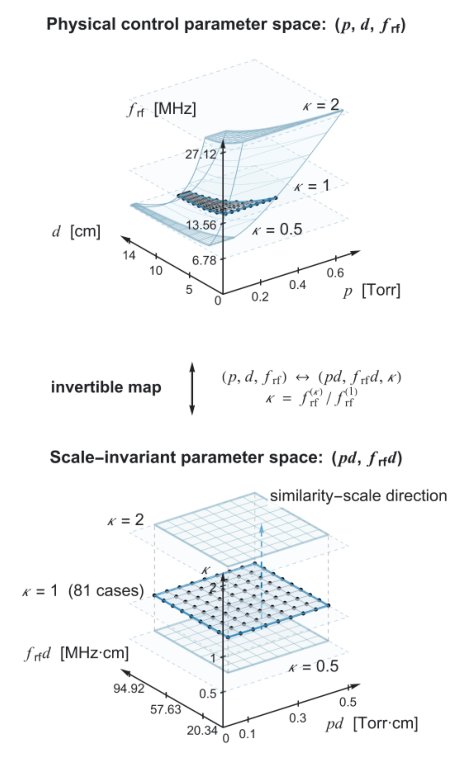
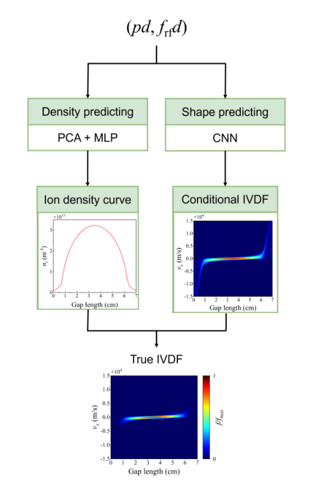
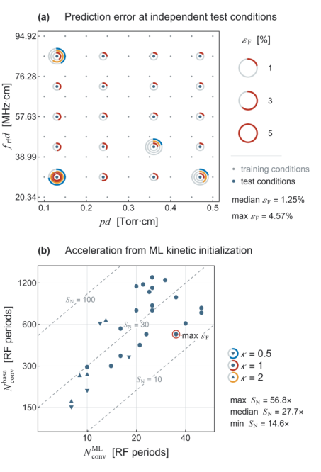
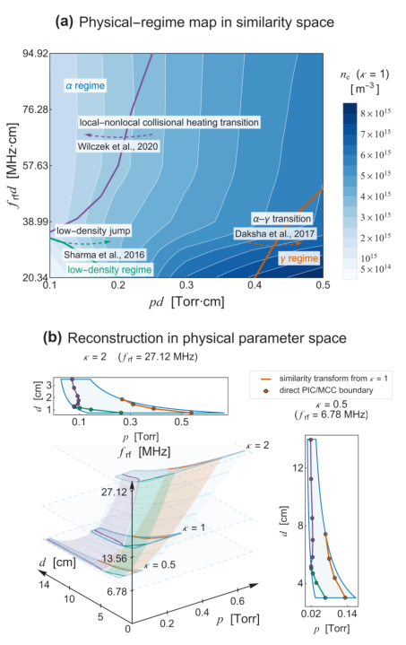

# 相似性降维与机器学习离子初始化：CCP动理学跨尺度加速笔记

## 0. 论文与实际版本

- Zeduan Zhang、Jianxiong Yao、Long Chen、Yangyang Fu、Feng He、Jiting Ouyang、Bocong Zheng，**Learning Similarity-Reduced Ion Kinetics across Scales and Regimes in Capacitively Coupled Plasmas**。
- [官方arXiv 2611.22165v1](https://arxiv.org/abs/2611.22165v1)，首投2026-11-17 03:57:11 UTC，11-18公告；PDF内部日期11-18。网页称“Submitted to Applied Physics Letters”，**是投稿，未核实接收或正式发表**；Crossref精确标题前3项没有同作品期刊版。
- 实际读[6页作者全文](../pdfs/zhang-2026-ion-kinetics.pdf)，含参考文献；第2–5页渲染目视，以下4幅均为对应原页裁图。MinerU历史认证失效未复测、本轮零请求，采用本地布局文本与渲染回退。
- 证据类型：**弱电离氩气1D3V静电PIC/MCC生成的数据、ML重建与同求解器数值检验**。没有新的放电实验、激光相对论PIC、光核产额或真实设备数字孪生验收；本轮未运行ASTRA或训练网络。

## 1. 摘要与引言：把慢离子弛豫作为初始化问题

摘要提出两层降本：先由放电相似性消除参数空间中的重复尺度，再预测接近稳态的离子动理学状态，让PIC/MCC继续自洽修正电子和电场。报告的27.7倍中位、56.8倍最大加速按后文是**达到收敛所需RF周期数比值**，不是包含数据生成、训练、推断与完整扫描的端到端墙钟时间。

引言第一段定位低压CCP的离子输运与电子加热问题：压力、间隙和驱动频率变化会跨越α–γ模式、局域／非局域碰撞加热及低密度跳变，需要大量动理学计算。第二段区分“同一个约化态在不同物理尺度的重复描述”和“约化空间内真正不同的动力学”；后者仍须计算。第三段解释为何只预测离子：离子弛豫慢，初态接近稳态可缩短等待，但预测本身不替代后续自洽求解。

作者所称跨尺度外推主要是沿已推导的相似性方向变化；不能直接理解成对任意电压、气体、材料、几何或新物理区域的外推。

## 2. 控制方程：相似律成立的条件

### 2.1 无碰撞Vlasov–Poisson的两个尺度自由度

原文式(1)–(2)采用静电体系：

$$
\partial_t f_s+\mathbf v\cdot\nabla_x f_s+
\frac{q_s}{m_s}\mathbf E\cdot\nabla_v f_s=0,
\qquad
\nabla_x\cdot\mathbf E=\frac{1}{\epsilon_0}\sum_{s=i,e}q_s\int f_s\,d^3v.
$$

其中分布函数速度积分为数密度（SI为m⁻³），电场V/m，位置m、时间s、速度m/s。令空间与时间分别按λ、μ缩放；为了使输运三项缩放一致，速度必须按λ/μ、电场按λ/μ²缩放。再要求Poisson方程成立，速度积分的Jacobian为(λ/μ)³，得到：

$$
x'=\lambda x,\quad t'=\mu t,\quad
v'=\frac{\lambda}{\mu}v,\quad E'=\frac{\lambda}{\mu^2}E,
\quad f_s'=\frac{\mu}{\lambda^3}f_s,\quad n_s'=\frac{n_s}{\mu^2}.
$$

最后一个密度式由分布函数的缩放乘上速度体积Jacobian得到，不能把分布函数的系数直接当成一般情况下的密度系数。

### 2.2 加入固定能量阈值的中性碰撞后，只剩一个尺度

弱电离Boltzmann–Poisson体系加入带电粒子与中性粒子的二体碰撞算子，假设激发／电离不显著耗尽中性气体。实际截面随碰撞能变化，电离阈值不随几何尺度改变；要在同一碰撞物理下保持相似，速度／能量尺度须不变，即λ=μ。定义κ=λ⁻¹，则：

$$
x'=x/\kappa,\quad t'=t/\kappa,\quad v'=v,
\quad E'=\kappa E,\quad f_s'=\kappa^2f_s,
\quad f_n'=\kappa f_n.
$$

碰撞项对带电与中性分布分别线性，故系数κ²×κ=κ³，与时间导数κ³一致。于是固定气温下：

$$
d'=d/\kappa,\quad f_{\rm rf}'=\kappa f_{\rm rf},
\quad p'=\kappa p,\quad n_s'=\kappa^2n_s,
\quad p'd'=pd,\quad f_{\rm rf}'d'=f_{\rm rf}d.
$$

物理直觉是缩小间隙同时提高频率与中性密度，保持碰撞长度与放电时间的相对关系；电势幅度由E'd'=Ed保持。pd的图示单位Torr·cm、频长积为MHz·cm，**不是天然无量纲量**。相似律要求几何、驱动与边界也同步缩放；中性数密度仅乘κ，而带电数密度乘κ²，故电离度随κ变化，极端κ可能破坏弱电离和固定中性背景假设。此处是根据原文缩放式的限制分析，未做新的计算验证。

来源：PDF第3页Fig.1。上图轴为p（Torr）、d（cm）、RF频率（MHz）；下图轴为pd（Torr·cm）、频长积（MHz·cm）和无量纲κ。黑点是κ=1的81个训练工况；13.56 MHz为基频，κ=0.5、2分别对应6.78、27.12 MHz。沿κ方向是相似缩放，平面内才是非平凡工况变化；该图不是额外81组三维独立训练或实验。

## 3. 式(3)与网络：分开学密度和速度形状

令ξ=x/d，u=vₓ（**u仍是有单位的速度**）。对横向速度边缘化后的离子分布写成：

$$
f_i^{(\kappa)}(\xi,u)=\kappa^2n_i^{(1)}(\xi)\psi_i(u\mid\xi),
\qquad\int\psi_i(u\mid\xi)\,du=1.
$$

ξ与κ无量纲；基尺度密度nᵢ为m⁻³，条件速度概率密度ψᵢ为s/m，fᵢ为数密度／速度。对u积分恢复κ²nᵢ，说明密度幅度与局部速度形状的乘积构成完整的纵向速度分布。这个式子不提供所有电子分布、场或完整三速度离子关联，后续仍由1D3V求解器调整。

原文第2页末先说明平滑密度用PCA+MLP，局部相空间结构用CNN。第3页继续：81个工况均匀采样于基尺度相似平面，**电压固定200 V、二次电子发射系数固定0.2**，数据来自自研ASTRA静电PIC/MCC。本文没有把这两个参数纳入已验证的泛化轴。

来源：PDF第3页Fig.2。输入为pd及频长积；左分支给离子密度（m⁻³）随间隙位置（cm），右分支为条件IVDF，速度m/s、位置cm；底图以各自f最大值归一化显示。流程图展示两部分相乘，不是独立实验测量或完整PIC替代。图示位置轴仍为具体cm，与推导的ξ坐标须在实现时明确转换。

第4页Table I：密度PCA保留5主成分，MLP隐藏层[32,64,32]、ELU、Adam学习率2×10⁻³、batch16、L1 loss；形状分支全连接[64,256,1024,2048,2048,1024]，反卷积通道16/8/4/1、4×4核、stride2，隐藏ReLU、输出LeakyReLU、Adam 10⁻³、batch32、MSE。本文未充分交代输入标准化、速度截断／网格、训练轮数、种子、数据切分和完整超参数选择。PCA逆变换及LeakyReLU也不自动保证密度／概率非负；ψ的归一化约束、负值处理和PIC粒子采样需代码确认。

## 4. Fig.3：重建误差与RF周期加速须分别读

来源：PDF第4页Fig.3。(a)横轴pd（Torr·cm）、纵轴频长积（MHz·cm），小点为训练工况、较大点为测试工况，三种环色对应κ=0.5、1、2；圆弧编码误差百分数。作者报告独立测试的IVDF误差中位1.25%、最大4.57%，较大的误差位于部分边界附近。论文未给出ϵ_f的明确范数、速度／空间权重及低密度区处理，因此这些数值只能按作者指标引用，不能转换成每个物理观测量的统一相对误差上界。

图(b)横轴为ML初始化后收敛RF周期，纵轴为均匀初始化后收敛RF周期，均是周期计数；虚线为相同比值。依据轴定义可写：

$$
S_N=\frac{N_{\rm conv}^{\rm base}}{N_{\rm conv}^{\rm ML}},
\qquad S_{N,\min}=14.6,\quad
\operatorname{median}S_N=27.7,\quad S_{N,\max}=56.8.
$$

这不是百分比误差公式，而是从图的周期比值定义解释加速。图中基准常需数百到上千周期，ML通常数十周期。即使周期比很大，仍需获得训练数据、训练模型、重建／采样初态并运行残余PIC；文章没有给出完整成本账本，也没有比较延续法、相邻工况warm start等更强基线。

正文称两种初始化使用同一收敛判据，但将其指向文献17；本次没有下载该参考全文，未核实判据数值、RF平均窗口或同时约束哪些观测量。电子与场初始化、初始不平衡瞬态、鞘边缘尾部分布误差和不同随机粒子种子的统计尚待复现。作者对“所有工况均严格受4.57%约束”的表述，只适用于这组有限测试；不是域外保证。

## 5. Fig.4：用相似性搬运模式边界

来源：PDF第5页Fig.4。(a)横轴pd约0.1–0.5 Torr·cm，纵轴频长积20.34–94.92 MHz·cm，背景是κ=1时平均电子密度（m⁻³），彩线标α–γ、局域／非局域碰撞加热及低密度跃迁边界；这些是给定氩气模型的模式分区，不是普适的有量纲压力阈值。(b)在p（Torr）、d（cm）、f（MHz）中画重建面；橙线为从κ=1缩放的预测，点为κ=0.5和2的直接PIC/MCC边界。线点接近支持所测尺度变换的一致性。

原文将这种表现称为robust cross-scale extrapolation。更精确地说，受测外推是沿理论限定的κ方向；平面内部有限工况上的一致性与跨气体／电压／边界条件外推不同。本文未给出边界定位的网格细化、置信区间或完整电子加热分解公式。非线性模式发生跃迁，并不意味着相似变换自动失效；其成立依赖前面控制方程与边界条件。反过来，相似变换成立也不能证明未知物理没有出现。

结论段提出把该策略用于更大参数扫描与数字孪生；数据声明为向通信作者合理索取，没有在本篇给出可直接固定版本的模型权重／输入／训练集下载。因此本库记录为有前景的数值初始化方法，并保留复现缺口。

## 6. 对本库方向的价值和下一步

对PIC方法的价值是“先解析消掉冗余尺度，再让ML只学习不可约状态，最后由物理解算器校正”。可借鉴其方法结构；对相对论激光、强场QED、非弱电离、磁场或多维输运，必须重新推导相似律并验证碰撞／辐射／边界尺度，不能搬用此文κ²因子与56.8倍数字。

复现优先取得固定ASTRA版本、完整网格／时间步／宏粒子／MCC截面、81训练工况和独立测试清单、ϵ_f与收敛判据。随后检查分布正性／归一化／尾部、离子通量与能谱、电子与场一致性和多种子统计，并用同误差墙钟时间、含训练成本的扫描总成本与延续法比较。当前只完成全文阅读、公式静态推导及原图核验，未本地验收作者的准确率或性能。
