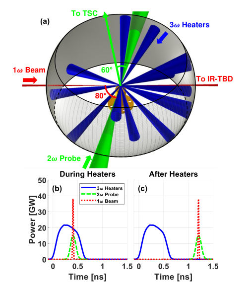
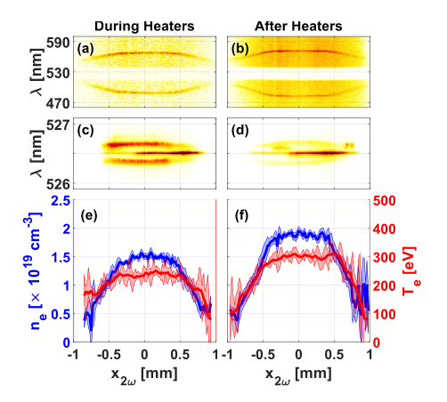
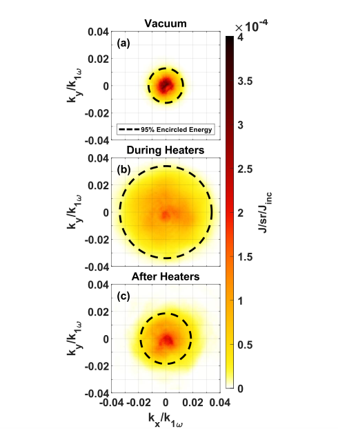
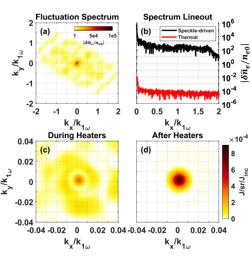

# 外部散斑密度涨落如何增强束喷散：OMEGA实验与非局域模型笔记

## 0. 论文、版本与阅读范围

- Kyle R. McMillen 等14位作者，**The role of externally-driven density fluctuations in the enhancement of beam spray**，作者完整名单见[元数据](../research/arxiv_selected_metadata.json)。
- [arXiv 2611.24914v1](https://arxiv.org/abs/2611.24914v1)，首投2026-11-18 18:47:57 UTC，11-19公告；实际读[7页作者PDF](../pdfs/mcmillen-2026-beam-spray.pdf)，含诊断附录与参考文献。网页写“submitted to Physical Review Letters”，不是已接收；有界Crossref标题前3项未核实同作期刊版。媒体所称“published in PRL”未获原始来源支持，不能升级状态。
- 全文布局文本阅读；第1–5页实际渲染目检，4幅原图按对应页裁出。MinerU历史认证过期未复测，本轮零请求，明确使用本地提取与渲染回退；哈希、页数等见[PDF校验](../pdf_validation.json)。未重跑作者的谱拟合、散斑生成或传播程序。
- 证据分层：**真实气体等离子体透射光分布和Thomson散射测量**；密度、温度依赖散射谱拟合；稳态涨落绝对幅度及非线性传播解释是模型结果。没有新的点火、粒子束转换靶、光核或防护验收。

## 1. 摘要与引言：平滑一束光，仍可能扰动另一束光

摘要报告351 nm散斑加热束存在时，另一束1053 nm光的角分布变宽。实验可直接约束“加热束开／关时的束喷散差异”；“长波长稳态密度种子远超热涨落”则来自随后建立的模型。

引言先指出LPI在有限时间和距离内生长，对初始涨落很敏感。相位板和偏振平滑减少相干增长，但相位板仍在焦区形成热点；既有理论预期热点的有质动力与热响应可挖出密度孔洞。作者把问题从同一散斑束自身的plasma-induced smoothing，转到其对另一束未作空间平滑的光的影响。

本文有意不用SSD，让散斑位置近似静止。因而结果针对有充分时间维持密度孔洞的条件，不能直接当作已使用SSD的所有ICF配置的定量预测。

## 2. 实验设置与时序（原文Fig.1）

来源：PDF第1页Fig.1。(a)是几何示意，无长度比例；蓝色14束351 nm加热光，绿色527 nm散射探针，红色1053 nm被测束，另标散射收集与透射诊断方向。(b,c)横轴时间ns、纵轴单束功率GW，比较约400 ps和1200 ps的探针／被测束到达时刻。图中的单加热束功率不能乘以交叉束数后再当成同一方向入射功率。

实验用Mach 5、出口直径2 mm的氮气喷嘴，喷口在靶室中心下2 mm。每束加热光10 J、500 ps FWHM，经f/6.7、SG5相位板与偏振旋转器形成660 μm FWHM的五阶超高斯包络；平均重叠强度约8×10¹³ W/cm²。无SSD，散斑不随时间快速移动。

1053 nm OMEGA EP束经f/50截光，真空焦斑40 μm FWHM，能量0.78±0.08 J、脉宽30±1 ps、强度1.4±0.14×10¹⁵ W/cm²，传播约1 mm等离子体。两个时刻分别在加热期间和加热结束后取样；它们不是同一发激光中同时测量的两个完全相同背景。

## 3. Thomson散射约束背景（Fig.2）

来源：PDF第2页Fig.2。上排电子特征、次排离子特征的纵轴为波长nm；下排横轴为沿527 nm探针的距离mm，蓝色左轴电子密度10¹⁹ cm⁻³，红色右轴温度eV，阴影为2σ。谱图颜色体现信号强度，不能直接读作密度涨落幅度。加热结束后背景更热、更密，说明对照并非仅改变散斑种子。

自动微分梯度下降拟合使用超高斯电子分布，阶数在加热期间／之后分别为2.86／2.80；中央约−0.5到0.5 mm的平台密度分别为(1.34±0.05)／(1.85±0.05)×10¹⁹ cm⁻³，温度222±13／299±11 eV，平均电离度均取5。相应背压44／51 psi不同。误差是拟合和采样口径，不能自然覆盖所有分布函数、轴对称与仪器系统误差。

附录说明探针2 J、100 ps；散射收集角60°，电子／离子谱分辨率1.2／0.03 nm，空间分辨率20 μm。所得条件是100 ps有效积分下的模型反演，不是对30 ps被测光沿途每一时刻的完整三维测量。

## 4. 实测喷散与角度定义（Fig.3）

来源：PDF第3页Fig.3。横纵轴分别为横向波数除以1053 nm光波数，均无量纲；色标为每球面度辐射能除以各次入射能量（J sr⁻¹/Jinc），并非各图按最大值归一化。虚线是诊断**收集到的能量**的95%包络，不能据此得到全空间透射率或总能量损失。

小角近似下，散射的横向动量转移给出：

$$
k_{1\omega}=\frac{2\pi}{1.053\,\mu\mathrm m},\qquad
\theta\simeq\frac{k_\perp}{k_{1\omega}},\qquad
\int_{|\mathbf k_\perp|\le k_{\perp,95}}I\,d\Omega
=0.95\int_{\rm collected}I\,d\Omega.
$$

波数单位m⁻¹，角度单位rad；最后一式是本笔记对原文95%定义的积分表述，假定以对应光轴为中心。由真空12.7 mrad、加热期间33.8 mrad、之后18.5 mrad，可静态算得33.8/12.7≈2.66、33.8/18.5≈1.83；原文“约2.7倍”以**真空**为分母，不是以无加热光等离子体为分母。相应特征横尺度约为波长除以角度，20–40 mrad对应约53–26 μm，系数量级取决于波数和长度定义。

作者另提较低强度3.4×10¹⁴ W/cm²数据，但未给图及完整扫描。强度依赖支持局部自聚焦／细丝化参与，尚不足以唯一排除所有背景和线性散射贡献。整束宽度对应声学时间约20 μm/(10⁵ m/s)=200 ps，大于30 ps；其最快增长波数还对应约0.1 rad，均不同于实测小角区。这个时间尺度比较支持整束慢响应受到抑制，不等于所有非线性响应都被排除。

IR-TBD角分辨率0.7 mrad、f/12.2收集、距靶1.1 m；简单几何半角约41 mrad，与95%角度相近。验收时需要收集孔径、边缘截断和发间重复性；本文未给出其对95%角完整系统误差的分解。

## 5. 稳态密度响应与非局域修正（原文式1–3）

热点的声学挖孔时间约351 nm/(10⁵ m/s)=3.5 ps，远小于加热脉冲，故先假设稳态。在原文傅里叶约定下：

$$
\frac{\delta\widetilde n_s(\mathbf k)}{n_{e0}}
=-\frac{m_ec^2}{2T_e}A_k\,\widetilde{|a_{3\omega}|^2},
\qquad
A_k=\frac12+Z\left(\frac{0.074}{\xi^2}
+\frac{0.88}{\xi^{4/7}}+\frac{2.54}{1+5.5\xi^2}\right),
\quad \xi=\sqrt Z\,k\lambda_{\rm mfp}.
$$

归一化矢势无量纲，温度在能量单位下与电子静能比较；Z无量纲、平均自由程为m、波数为m⁻¹。负号表示热点处电子密度下降：有质动力和非局域热响应在压力平衡下形成密度孔洞。该式中的傅里叶量还带变换体积约定，不能将图中的谱幅度直接读作局部百分比。

原文把最高强度散斑的Knudsen数估为10–100，而非局域阈值约0.06/√Z（Z=5时约0.027）。所以采用含非局域修正的拟合系数，而非直接用Spitzer热导。完整推导依赖所引非局域流体理论，本轮未重新求解动力学闭合；需保留长波零模、有限域、拟合适用范围及大幅度响应的检查，而非把线性稳态式当作任意强度定律。

作者用真实14束几何，在各自近场随机相位、Fresnel传播后叠加全局场，再由Gaussian场的Wick关系得到密度谱。原文式(3)印作：

$$
S_{\delta n_s\delta n_s}(\mathbf k)
\propto |A_k|^2\sum_{m,n=1}^{14}
|\widehat{\mathbf p}_m\cdot\widehat{\mathbf p}_n|\,S_{mn}(\mathbf k).
$$

同束项给散斑连续谱，异束项给交叉干涉结构。这里忠实保留印刷的偏振因子绝对值，**没有擅自改为平方**；其与交叉场谱定义及尚未发表Ref.50的关系须由代码／作者澄清。统计场假设、相位实现和偏振权重均是模型输入，不是直接实验测得的完整涨落谱。

## 6. 传播模拟如何与实验连接（Fig.4、式4–5）

来源：PDF第4页Fig.4。(a)在纵向波数为零的平面，横纵轴为横向波数／光波数，色标为傅里叶密度幅度；椭圆结构来自交叉束干涉。(b)沿另一横向波数也为零的线取谱，对数纵轴比较散斑驱动与零频热涨落；不能把该线当作全三维积分。(c,d)为模拟透射角图，色标仍为入射能归一化辐射能，加入外部密度种子后变宽。模拟图色标范围与Fig.3不同，不支持仅凭亮度进行绝对透射率验证。

低波数连续谱在0.02–0.04的角区高于热涨落，匹配实测喷散角量级。模型实空间体积平均绝对扰动为0.18±0.11，热背景为(1.04±0.79)×10⁻⁹；这些是模型统计量，**不是Thomson实测18%涨落或实验误差条**。零频热涨落与完整动态热噪声亦不同。

傍轴传播保留：

$$
\nabla_\perp^2 a+2ik_{1\omega}\partial_z a
=\frac{\omega_{pe0}^2}{c^2}\frac{\delta n_e}{n_{e0}}a,
\qquad
\delta n_e=\delta n_s+\delta n_t+\delta n_{1\omega},
\qquad
\frac{\delta n_{1\omega}}{n_{e0}}
=-\frac{m_ec^2}{4T_e}|a|^2.
$$

此式可由冷等离子体折射率的密度微扰代入Helmholtz方程、提出快速纵向相位并忽略包络二阶纵导数得到；等式两侧均为包络／m²。负密度扰动使折射率增大，利于局部聚焦。其适用前提包含小角傍轴和准静态响应，不能覆盖动态全波、多温流动和碰撞吸收的全部作用。

模拟用800 μm均匀平台、加热期间的密度温度，比较保留三项和去掉散斑项的结果；**没有分别重现两组实验的全部背景差异**。尤其作者用稳态被测束响应后，又施加等曲率、反符号的散焦相位抵消整束稳态聚焦，以近似30 ps短时条件。这是明确的模型修正，未等价于直接积分时间依赖声学动力学。本文证明模型能产生一致的趋势，未提供完整逐发残差、唯一机制反演或盲测预测精度。

## 7. 结论、待验证与速记

可采信的实验发现是：在本文静止散斑和两种已测背景下，加热光存在时，另一束光的收集角分布明显变宽。稳态非局域密度响应与傍轴传播提供合理机制链；其幅度、偏振谱权重、静态相位补偿与背景失配仍需独立诊断和动态模拟检验。

接续优先取得原始逐发透射数据、收集孔径响应及完整不确定度，固定相位／FFT约定与网格随机种子，澄清式(3)和零模处理；在相同密度温度条件下比较有／无加热散斑，再检验SSD和真实时变流动。对于LPI/PIC建模，本工作提示应检查外部束的有色种子，不能只调整数值热噪声；尚未提供可直接移植的统一噪声幅度。

速记：**33.8 mrad是收集能量95%角；约2.7倍相对真空；18%密度扰动来自模型；“投稿PRL”不等于已发表。**
