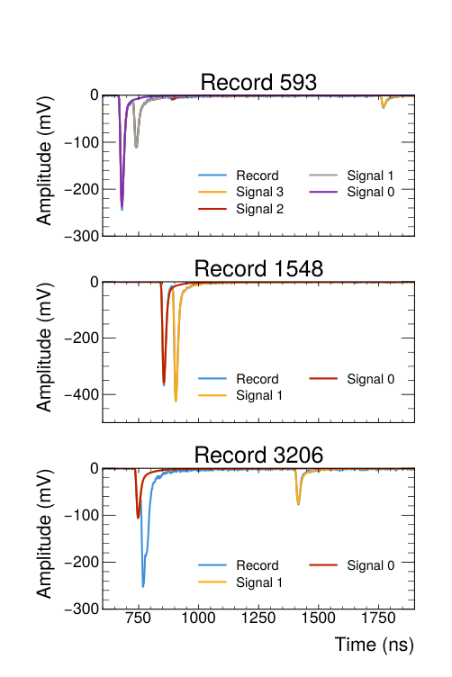
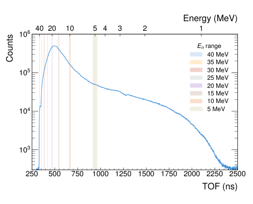
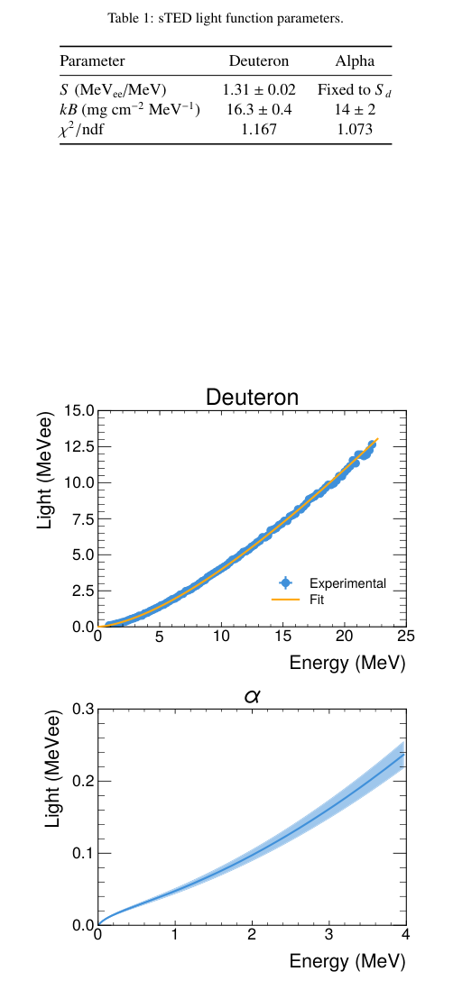
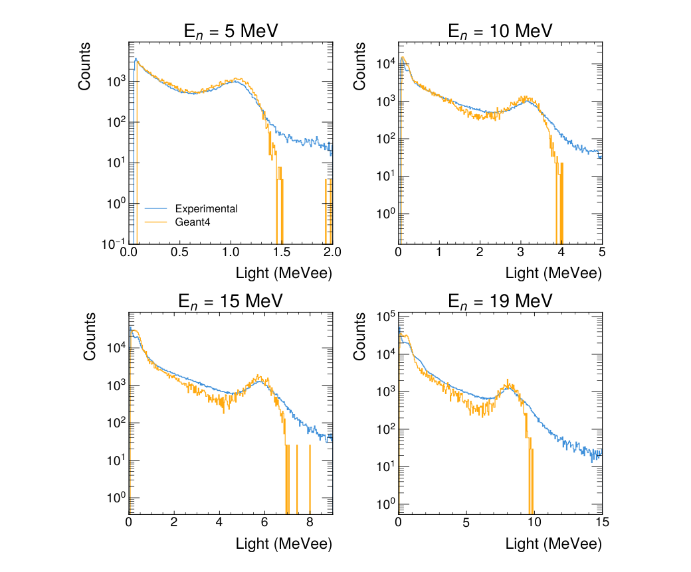
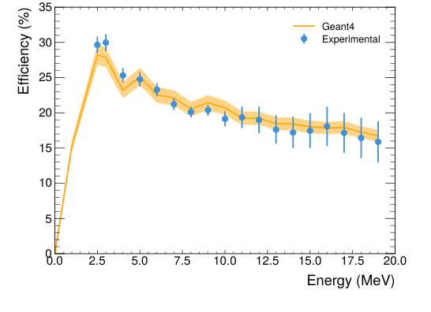
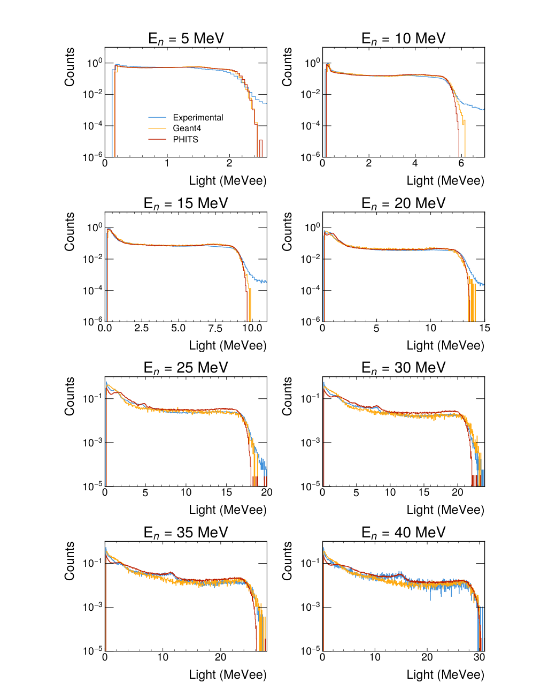
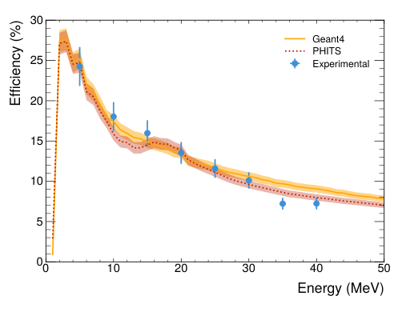

# NFS快中子液闪响应：MONSTER与氘代sTED的实验—MC边界笔记

## 0. 论文与实际阅读版本

- A. Pérez de Rada Fiol、G. del Río、T. Martínez、X. Ledoux、V. Alcayne、C. Ballesteros、D. Cano-Ott、I. Matea、P. Miriot-Jaubert、J. Plaza、A. Sánchez-Caballero、M. Vandebrouck、D. Villamarín，**Characterization of the fast neutron response of liquid scintillator detectors at NFS**。
- [arXiv 2611.24118v1](https://arxiv.org/abs/2611.24118v1)，首投2026-11-18 09:36:02 UTC，11-19公告，网页称投稿NIM A；有界Crossref精确标题前3项未核实同作期刊版。实际读[9页作者PDF](../pdfs/perez-2026-neutron-response.pdf)，不是已核实的NIM VOR。PDF与citation_author元数据均为13作者；网页自动“31 other authors”展示不能替代作者行。
- 全文与参考文献阅读，第1–7页渲染目检；保留7幅原图／表裁图。MinerU历史过期未复测，本轮零请求，使用明确记录的本地提取、渲染及图像核对。文件校验见[验证记录](../pdf_validation.json)，未本地运行Geant4、PHITS、SRIM或波形处理。
- 证据类型：**40 MeV氘束打Be产生连续中子束的真实TOF实验**，结合波形重建、经验光输出拟合及探测器Monte Carlo。其对象是探测器响应，不是新的激光中子源、光核源产额、临床剂量或屏蔽认证。

## 1. 摘要与引言：边缘拟合不等于完整响应已验证

摘要将两项工作分开：MONSTER的EJ301响应／效率检验延伸到40 MeV；sTED的EJ315首次获得该模块的氘核与α光输出函数，效率只报告到20 MeV。前者20 MeV以上Geant4与PHITS开始分离，后者积分效率较吻合但局部谱形仍不一致。

引言首先强调单能中子产生的是光输出分布，包含不同反应道、次级粒子逃逸和淬灭；同一个反冲边拟合正确，不能保证其他阈值或能段的效率。MONSTER服务β延迟中子和反应研究；低中子灵敏度的小体积氘代sTED主要服务俘获截面，其快中子响应是需建模的本底和扩展用途。

可把本工作所约束的前向链写为（本笔记的定义，不是新增实测公式）：

$$
C_i=N_{\rm inc}\int_{L_i}^{L_{i+1}}R(L\mid E_n)\,dL,
\qquad
\epsilon(E_n;L_{\rm th},\mathcal S)
=\int_{L_{\rm th}}^\infty R(L\mid E_n,\mathcal S)\,dL.
$$

入射中子数乘上每入射中子的响应密度（MeVee⁻¹）得到计数；效率无量纲，选择集包含PSD、pile-up和时间窗等。若响应被归一化成“已探测事件条件分布”，其积分为1，必须另乘探测概率，不能直接称效率。MeVee是电子当量光输出，**不是中子或反冲核能量**；单一效率曲线也不能代替展开所需完整响应矩阵。

## 2. 实验配置（原文第2节、Fig.1）

NFS以40 MeV氘束轰击厚Be，探测器在约30 m束轴位置。约88 MHz中选取每440个束团中的一个，得到约200 kHz／5 μs间隔；束流约0.1–0.2 μA以减少重叠，但瞬时率仍要求离线处理。碳样品共振用于TOF标定，无样品数据生成响应分布。

TOF能量来自飞行距离与扣除时零后的飞行时间；若采用非相对论近似，则速度平方给出能量：

$$
E_n\simeq\frac{m_n}{2}\left(\frac{\ell}{t}\right)^2,
\qquad
E_n=m_nc^2\left[\frac{1}{\sqrt{1-(\ell/ct)^2}}-1\right]
\quad\text{为相对论表达。}
$$

距离m、时间s、质量kg时能量为J，转MeV需除能量单位。第一式仅作物理推导示意；本文没有提供实际TOF脚本和高能段相对论处理，不能替作者声明使用哪一式。时零、飞行路径及束团宽度会共同影响能窗与反冲边。

²³⁸U PPAC用裂变监测谱形，产额以能量区间、积分氘电荷和立体角归一化；绝对效率仍依赖监测器截面及标定。主文未列完整绝对归一化协方差、束斑覆盖／固体角换算和活时间预算，不能据图重建高精度绝对通量。

MONSTER为EJ301配R11833 PMT；sTED为C₆D₆/EJ315配R11265U-100。后者本次偏压偏向低脉冲区，高脉高非线性限制结果到20 MeV。DAISY数字化14 bit、1 GS/s，保留完整波形；γ源Compton边标定MeVee与分辨率。原文Fig.1（PDF第2页）仅是装置照片，无轴和数值尺度，不能替代活性体积或几何模型尺寸。

## 3. 波形分解与准单能事件（第3.1–3.2节）

来源：PDF第3页Fig.2；横轴时间ns、纵轴幅度mV，三个记录分别叠加多个拟合脉冲。平均孤立中子／γ波形对齐并归一化后作为模板，以不同脉冲类别残差比较做判别，并拟合重叠事件。曲线“能拟合”不等于所有饱和或任意近邻脉冲都能恢复；效率计数还需失败事件与死时间评估。

来源：PDF第3页Fig.3；下轴TOF ns，上轴中子能量MeV，纵轴对数Counts，阴影为约5–40 MeV的窄能窗。时间与能量非线性对应，越高能的时间窗越窄。作者要求窗引入的反冲边展宽小于探测器光分辨率；这些是准单能分布，不是理想δ函数入射。阴影和计数谱本身未给出独立绝对效率。

## 4. 反冲运动学、Birks光输出与可辨识性（式1–2、Fig.4、Table1）

静止核靶的非相对论弹性正碰中，由动量与能量守恒，最大能量传递为：

$$
T_{R,\max}=\frac{4A}{(1+A)^2}E_n,
\qquad A=m_R/m_n,
\qquad T_{d,\max}=\frac89E_n.
$$

反冲核和中子能量同为MeV。质子质量比1时可吸收全部入射能；氘核比2时只能达到8/9，且实际角分布决定边缘附近形状。该式用于识别反冲能量上限，不能把全部光谱当作均匀单次弹性反冲。

作者用SRIM质量阻止本领和积分Birks式拟合：

$$
L_j(T)=S\int_0^T\frac{dE}{1+k_{Bj}s_j(E)},
\qquad
s_j(E)=\frac{1}{\rho}\left|\frac{dE}{dx}\right|_j>0.
$$

由微分光产额随线性能损淬灭的关系，对能量积分得到此式；阻止本领取正值，不能把带负号的粒子能量导数直接代入。L为MeVee，S为MeVee/MeV，质量阻止本领若为MeV·cm²/mg，则kB为mg·cm⁻²·MeV⁻¹，使分母无量纲。数值库若使用g而不是mg，要一致换算；这是质量形式，不能把kB原数直接塞入长度形式的Birks常数。

来源：PDF第4页Fig.4与Table1。图横轴反冲粒子能量MeV，纵轴光MeVee；氘核上图覆盖约0–25 MeV且有实验边缘拟合点，α下图只约0–4 MeV、蓝带为拟合显示，不能当作均匀采样的直接单α束测量。参数：S=1.31±0.02 MeVee/MeV，氘核kB=16.3±0.4 mg·cm⁻²·MeV⁻¹，χ²/ndf=1.167；α的S固定为氘核值，kB=14±2，同单位，χ²/ndf=1.073。

α信息来自¹²C(n,α)⁹Be基态通道结构，减去邻近低于阈值能窗估计的氘背景，并忽略强淬灭Be反冲。因此它依赖核反应谱及背景近似，不是独立测量的完整α光产额曲线。强淬灭极限下：

$$
k_{B\alpha}s_\alpha\gg1
\quad\Longrightarrow\quad
L_\alpha(T)\simeq\frac{S}{k_{B\alpha}}
\int_0^T\frac{dE}{s_\alpha(E)}.
$$

数据主要约束S/kB，故两参数高度相关，固定S后得到的kB误差是**条件误差**；不能把两种粒子kB接近理解成普适统一淬灭常数。作者另用近似关系由氘核推断质子函数：

$$
L_d(T_d)\simeq2L_p(T_d/2).
$$

其物理直觉是相同速度下近似相同单位长度能损、氘核总能量约质子的两倍；它是NRESP近似，用来定位潜在质子信号，未独立标定本次sTED质子全响应。

## 5. Monte Carlo是带光函数的探测器前向模型（第3.3节）

Geant4几何包括液体、铝壳／支架、光学部件和主要PMT结构；入射沿束轴、圆形源面半径13 cm。使用Shielding+ParticleHP及所引有机闪烁体碳反应扩展，涉及¹²C(n,n′3α)与¹²C(n,α)⁹Be。MONSTER另用PHITS的SCINFUL模式作对照。主文未给出可直接复跑的版本号、核数据库、运行卡、完整尺寸、统计量和分辨率参数文件。

每条带电粒子轨迹按进入／离开能量差计算光，再对同一事件求和并卷积分辨率：

$$
L_{\rm event}=\sum_{\rm tracks}
\left[L_j(T_{\rm before})-L_j(T_{\rm after})\right].
$$

此式由上节积分的可加能量区间得到。由于L对能量非线性，先把不同粒子沉积能相加再套单个光函数通常错误；粒子逃逸时也不能当作完全停止。其重要性是明确区分“沉积能量”与“可见光”，不是报告新的内禀中子产生效率。

## 6. sTED结果：积分吻合与局部谱差可并存（第4.1节、Fig.5–6）

来源：PDF第5页Fig.5，四图入射能量5／10／15／19 MeV；横轴MeVee、纵轴对数Counts。主反冲结构随入射能向高光输出移动，模拟在边缘以上更快下降，中间光区亦有差别。未给出可复算的逐窗曝光与谱归一化表，不能仅由重合曲线证明绝对通量标定正确。

碳多α道的总可用能量分给几个α后，会因非线性淬灭得到不同光输出；所以只校正总截面不能保证谱形。另一个可能缺失信号来自：

$$
n+d\rightarrow n+n+p,
\qquad E_{\rm th}\simeq\left(1+\frac{m_n}{m_d}\right)B_d
\simeq1.5\times2.2246\ \mathrm{MeV}\simeq3.34\ \mathrm{MeV}.
$$

阈值是由质心破裂能换到实验室入射能的非相对论结果，本笔记静态推导与原文约3.34 MeV一致。作者发现模拟带电残余产物产生不完整，可能少了质子光；但相空间允许范围不决定真实角／能谱和绝对权重，不能据此把全部谱差唯一归因于该反应。高光尾还可含残余pile-up、TOF展宽、周围材料反应和本底。

来源：PDF第5页Fig.6；横轴入射中子MeV、纵轴效率百分比，蓝点实验、橙线／带Geant4。约2.5–3 MeV达30%，随后下降，正文概括高能端约17%，图末端点约16%，均为读图近似。低能先因更多事件越阈值而上升，高能受相互作用概率、光分配与逃逸影响下降；不能把峰值30%推广到全部中子谱。

效率是对宽光区积分，局部误差可抵消，也可仍落在阈值之上；所以Fig.6较吻合与Fig.5谱形差并不矛盾。20 MeV上限来自本次PMT非线性，降低增益后的扩展需要新测量，不是本文已经完成的40 MeV sTED验证。

## 7. MONSTER结果：20 MeV以上的核模型差异（第4.2节、Fig.7–8）

来源：PDF第6页Fig.7；八幅横轴均为MeVee、纵轴标Counts且为对数，曲线数值明显经过尺度处理，主文／图注没有给出完整归一化公式。蓝为实验、橙为Geant4、红为PHITS；不能将该纵轴擅自标成每入射中子的概率密度。20 MeV以下主谱大致重合；更高能下碳产p/d等非弹性道变重要，局部谱与尾部仍不全吻合。与sTED不同，MONSTER的光函数沿用既有工作，此处是扩展检验，非本轮重新拟合全部光函数。

来源：PDF第7页Fig.8；横轴MeV、纵轴效率%，蓝点为实验，橙实线Geant4、红点线PHITS。原文称20 MeV以下约5%层面一致，**不是5个百分点，也未给出统一统计判定**。20 MeV以上模型分离、Geant4总体偏高；35／40 MeV实测低于两者，PHITS较近但仍非完美吻合。曲线画到50 MeV，实测只到40 MeV，40–50 MeV为外推模拟。

不能用sTED 80 keVee与MONSTER 180 keVee的效率高低直接比较材料优劣：阈值、尺寸、H/D含量、光函数和选择条件都不同。文中称结果已用于自然铈30.8 MeV弹性截面研究，但该引文的核反应结果未在本轮独立复核。

## 8. 结论、复用条件与速记

实验为两种液闪提供有价值的响应约束，尤其展示20 MeV以上碳反应模型的重要性。真正可移植的是方法链和需验证的通道；部署到激光短脉冲中子场时，仍需本地几何、角谱、阈值、瞬时率、PSD／pile-up、γ闪与监测归一化，不能直接套一条效率曲线推导总产额。

接续需取得原始波形／TOF能窗、绝对监测与活时间协方差、各谱归一化、完整探测器尺寸与PMT线性校验、固定Geant4／PHITS／核库与碳道改动，以及S—kB联合拟合。区分核反应误差、淬灭误差和电子学非线性后，才适合做响应矩阵与源谱展开。

速记：**MONSTER实测至40 MeV、180 keVee阈值；sTED至20 MeV、80 keVee阈值；MeVee不等于中子能量；积分效率吻合不保证局部响应已验证。**
