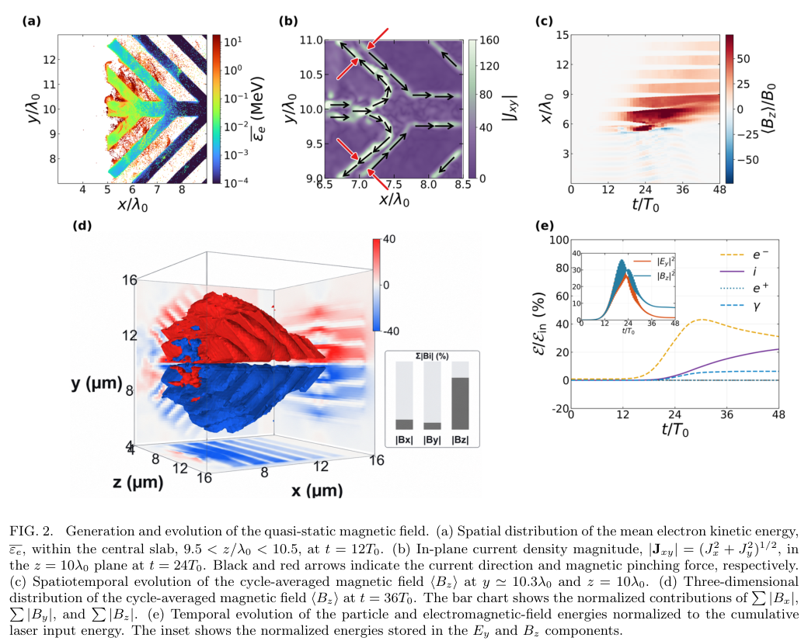
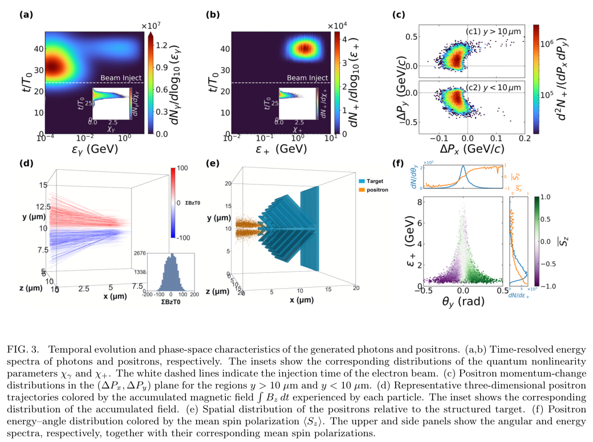
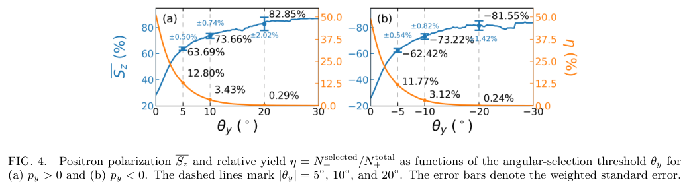
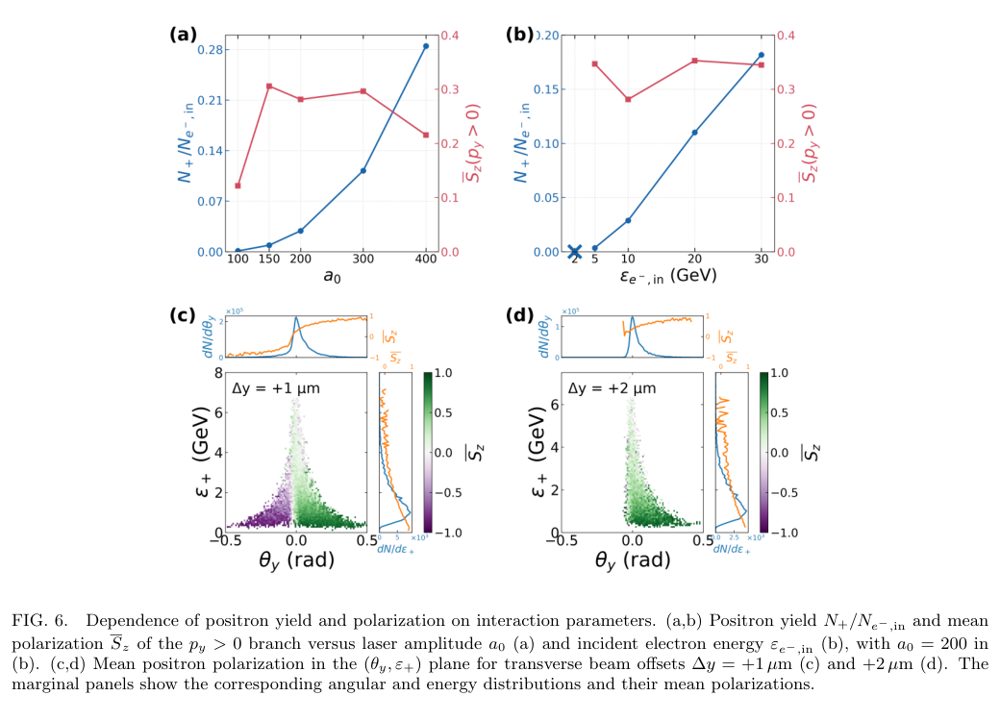

# 人字形等离子体靶的准静态磁场与偏振正电子：3D 自旋 QED-PIC 笔记

## 0. 论文信息与实际阅读版本

- Xian-Zhang Wu、Hui-Jing Li、Huai-Hang Song、Wei-Min Wang、Yan-Fei Li，**Polarized positron generation via laser-engineered quasistatic magnetic fields in a spatially extended herringbone target**。
- [官方 arXiv 2611.24069v1](https://arxiv.org/abs/2611.24069v1)，首投 2026-11-18 09:02:09 UTC，11-19 公告；PDF 内部日期 11-19。本轮未核实同作品的正式期刊版，按作者预印本记录。
- 实际阅读[11 页作者全文](../pdfs/wu-2026-herringbone.pdf)，包括 Methods、数据/代码可用性及参考文献；第 2–9 页渲染目视。以下 4 幅是经源页复核的原图裁剪。MinerU 历史认证失效未复测、本轮零请求，明确采用本地布局文本与渲染回退。
- **证据类型：collisionless 3D spin-resolved QED-PIC 数值方案。** 没有微靶制备、兆特斯拉场测量、偏振正电子实验或光核中子产额；本轮未运行 SPIRE、作者 QED 模块或任何新模拟。
- 阅读重点：摘要“63% 极化、每入射电子 0.007 个正电子”必须与 Fig.4 的两侧分支及分母定义一起读。两侧极化相反，不能把两支产额相加后仍当成一束 63% 净极化束；下文保留原文口径及静态核算差异。

## 1. 摘要与引言：把时间不对称换成空间分支

摘要提出：激光先驱动人字形靶的表面回流，建立上下两侧符号相反、空间延展的准静态磁场；延迟注入 10 GeV 电子，使其经非线性 Compton 辐射（NCS）产生光子，再经非线性 Breit–Wheeler（NBW）产生电子–正电子对。磁场同时关联自旋和偏转方向，因此可通过选择空间/角度分支获得非零平均极化。

引言先说明传统偏振正电子源依赖大型加速器、偏振光子转换或储存环辐射极化；这里的“激光驱动”仍需要外加高能电子束，不能理解成单一激光独立产生全部入射粒子。

接着说明纯激光场方向随光学周期翻转，积分后自旋不对称可抵消；双色脉冲、粒子预极化和等离子体准静态场是不同的破缺对称性方式。本文针对最后一条路线，用结构靶组织回流路径，而非把等离子体里自发出现的任意磁场都视为可用偏振器。

引言最后比较已有的束–固体、倾斜薄靶和鞘场方案，提出要同时获得强场、微米级作用区和较长寿命。**Fig.1（PDF 第 2 页）**上排是构型示意，下排在相同激光条件、同一时刻 36T₀ 比较人字形/平面/多箔靶；x、y 以 μm 标注，磁场色标采用归一化 Bz。人字形靶给出较连贯的上下两侧反号场，但这只是所选几何的数值对照，未覆盖等质量、等表面积或制造约束下的全局最优靶设计。

## 2. Results A：表面回流、场强与寿命

### 2.1 为什么光不能穿透，而回流仍能建立磁场

此处原文先比较相对论修正临界密度与靶密度。采用线偏振振荡的量级平均：

$$
\langle\gamma\rangle\simeq\sqrt{1+a_0^2/2}\simeq141,
\qquad n_{\rm rel}=\langle\gamma\rangle n_c\simeq141n_c<900n_c=n_e.
$$

其中 a₀=200 是激光归一化矢势，n₍c₎≈1.1×10²¹ cm⁻³ 为 1 μm 波长的经典临界密度。靶仍过密，主脉冲大部分反射；表面电子却能被加速并逃入真空/支枝间隙，留下电荷和电流不平衡，由薄层回流补偿。

相对论无碰撞趋肤深度及电流片的 Ampère 量级估计为：

$$
\delta_{s,\rm rel}=\frac{c\sqrt{\langle\gamma\rangle}}{\omega_{pe}}
=\frac{\lambda_0}{2\pi}\sqrt{\frac{\langle\gamma\rangle n_c}{n_e}}
\simeq63\ {\rm nm},
\qquad B_{\rm qs}\sim\mu_0K\sim\mu_0J\delta_s.
$$

这里 ω₍pe₎为经典电子等离子频率（s⁻¹），K 为表面电流（A/m），J 为体电流（A/m²）。推导是将薄层电流沿法向积分，再把 Ampère 环路两边的磁场差与表面电流联系；实际几何可能引入约 1 的系数，且此估计忽略位移电流。代入正文峰值 J≈8.5×10¹⁸ A/m² 和 63 nm，得到约 6.7×10⁵ T，与作者约 6.8×10⁵ T 的量级一致；这不是精确磁场反演或独立验证。

**来源与逐子图解释：PDF 第 3 页 Fig.2。** (a) 为 12T₀、9.5<z/λ₀<10.5 薄层的平均电子动能，位置以 λ₀ 归一化、色标 MeV 对数；高能电子集中在表面，而非均匀加热整靶。(b) 在 z=10λ₀、24T₀ 显示面内电流大小和黑色电流方向，红箭头为磁箍缩力；图内电流色标未给 SI 单位，因此 SI 峰值采用正文，不将色标数字直接写成 A/m²。(c) 是固定 y≈10.3λ₀、z=10λ₀ 的周期平均 Bz 时空图，纵轴 x/λ₀、横轴 t/T₀、色标 Bz/B₀；持续的红色区域说明局部磁场比光学振荡更慢。(d) 为 36T₀ 三维场分布，位置 μm；角落柱图是各分量的**绝对值空间求和贡献**，不是磁能占比，不能用其判断平方场能量份额。(e) 粒子与场能量除以**截至当时累计注入激光能量**，插图为 Ey、Bz 能量；不是均以最终激光能量归一，也不是正电子源的全系统效率。

### 2.2 结构靶如何延展场，寿命声明如何限定

回流沿斜支枝构成近似闭环，产生上下两侧相反的 Bz。正文用 J×B 指向支枝中心说明磁箍缩可压缩电流层；这是作者诊断支持的机制解释，未给出把该作用单独关掉的因果对照。

斜支枝把回流路径横向展开；正文将常规约 0.1 μm 场厚度与此处微米级作用区比较。在 |Bz|=10B₀ 的等值面阈值下，场区横向约 10 μm、纵向约 5 μm。磁场单位为：

$$
B_0=\frac{m_e\omega_0}{e}\simeq1.07\times10^4\ {\rm T}
\quad(\lambda_0=1\ \mu{\rm m}).
$$

因此峰值 100B₀ 约为 1.07×10⁶ T，所述持续场 50B₀ 约为 5.35×10⁵ T。**不能把“峰值超过 10⁶ T”和“50B₀ 持续超过 100 fs”合成“整个作用区始终超过 10⁶ T”。** 总模拟仅演化到 48T₀≈160 fs，寿命结论受该窗口与取样位置限制。

能量段落说明靶电子最高约 250 MeV，单独由它们辐射的光子尚不能产生显著对产额，因此需要外加 10 GeV 电子。正文称后期约 7% 激光能量保留在准静态场，且靶电子与辐射分别有显著能量份额；这里并未核实反射/出边界通量的完整逐项能量闭合，不能从图中部分曲线自行构造“总转换效率”。

## 3. Results B：先定义总产额，再讨论角选偏振

在以磁场为主且速度近似垂直于磁场时，量子参量可量级写为：

$$
\chi_e\simeq\gamma\frac{B_\perp}{B_S},
\qquad B_S\simeq4.41\times10^9\ {\rm T}.
$$

γ 是粒子 Lorentz 因子，B⊥是垂直速度的磁场，B₍S₎为 Schwinger 场对应磁场。由静止系场增强约 γ 推出此形式；它不是任意 E、B 方向下的完整不变量。250 MeV 靶电子在 100B₀ 下约 χ≈0.12，10 GeV 入射束约 χ≈4.75，说明后者更易发出足以成对的光子。NBW 的最终产额仍须由沿轨道的光子参量和概率积分给出，不能仅凭一个 χ 反算。

**来源：PDF 第 5 页 Fig.3。** (a,b) 横轴光子/正电子能量 GeV（对数），纵轴 t/T₀；颜色分别是每对数能量区间的粒子数，插图是 χ 分布，白虚线标记束注入。高能光子先于正电子增长，符合 NCS→NBW 序列；颜色不是能量效率。(c) 上下分别对应 y>10 μm、y<10 μm；两轴动量变化 GeV/c，颜色为二维粒子密度，显示反号横向偏转。(d) 代表性轨迹位置 μm、颜色为粒子积累的磁场时间积分；它不是无选择的全体轨迹平均。(e) 给出正电子与靶的相对位置。(f) 横轴 θy 为 rad、纵轴正电子能量 GeV，颜色是局部粒子权重平均 Sz（−1 到 1），边缘曲线为谱和极化；两侧反号表明将它们全收集会抵消。

作者得到 1.799×10⁷ 个物理正电子。总正电子产额和选择后的相对份额须分开：

$$
\eta_+=\frac{N_+^{\rm total}}{N_{e^-,\rm in}},
\qquad f_{\rm sel}=\frac{N_+^{\rm selected}}{N_+^{\rm total}},
\qquad\eta_{+,\rm sel}=f_{\rm sel}\eta_+,
\qquad\overline S_z=\frac{\sum_i w_i S_{z,i}}{\sum_iw_i}.
$$

粒子权重 wᵢ无量纲，Sz 是归一化自旋极化分量，±1 为完全相反方向极化。0.1 nC 对应约 6.24×10⁸ 个入射电子，故静态核算 η₊≈0.02882，吻合正文 0.0288。**这是数目比，不是激光至正电子能量转换效率。** 全部生成正电子的净极化仅 +1.83%。

**来源：PDF 第 5 页 Fig.4。** (a) 是 py>0 分支、(b) 是 py<0 分支；横轴是角阈值 θy（度），蓝色左轴为该选择内的平均 Sz（%），橙色右轴 η 是**所选正电子数除以全部生成正电子数**。曲线显示更大偏转提高 |Sz|，但急剧丢失粒子；误差棒是粒子权重标准误，不能代替网格/QED 模型误差。Fig.3、6 的角单位是 rad，此图是度，读取阈值时须转换。

按图中标注与总产额 0.0288 做**静态乘法**：

| 单侧角阈值 | 正侧 Sz / fsel | 负侧 Sz / fsel | 正侧/负侧每入射电子的正电子数 |
| --- | --- | --- | --- |
| ±5° 各向外选取 | +63.69% / 12.80% | −62.42% / 11.77% | 0.003686 / 0.003390 |
| ±10° 各向外选取 | +73.66% / 3.43% | −73.22% / 3.12% | 0.000988 / 0.000899 |
| ±20° 各向外选取 | +82.85% / 0.29% | −81.55% / 0.24% | 0.0000835 / 0.0000691 |

5° 两支数目之和约 0.00708/入射电子，接近摘要约 0.007；但它们自旋符号相反，因此**两支不作分离就没有 63% 净极化**。正文说“|θy|>10°，极化约 73%、产额 3.28%”，后一个数接近两侧相对份额的平均 (3.43%+3.12%)/2，既不是每入射电子 3.28%，也不是两支相加的 6.55%。这里保留原文与图中归一化差异，**没有作者原始选择脚本，不能确定摘要是否把两支可分离输出共同记作可用产额**。

更严格阈值的曲线尾端接近 90%，但图中明确标注的 20° 点约 82%；不能把“近 90%”与 5° 的约 0.007 同时作为一个运行点。大角选束还需要下游接受度、传输和偏振保持验证，原文没有提供完整束线。

## 4. Results C：出生极化、辐射增强、自能减极化与进动

本节依次分析四种作用。Fig.5（PDF 第 6 页）(a) 用母光子能量 k（GeV）和 Stokes 分量 ξ₃为坐标，左右对应靶两侧，色标为出生 Sz；(b) 是同一平面的正电子数分布及边缘谱，多数母光子 ξ₃≈0.4–0.6；(c–f) 坐标为正电子能量 GeV 和 Sz，颜色分别是辐射/非辐射造成的平均自旋变化，插图为相应粒子数。它显示大多数粒子辐射后极化增强，而较高能、少辐射的粒子可被自能项减极化；这些是作者蒙特卡洛/QED 模块诊断，不是测得的自旋历史。

### 4.1 原文式(1)的方向判据

ê₁沿正电子加速度，ê₂=êv×ê₁；在磁场主导、速度近似垂直 B 时：

$$
\hat{\mathbf e}_1\parallel\hat{\mathbf e}_v\times\mathbf B,
\qquad\hat{\mathbf e}_2\parallel
\hat{\mathbf e}_v\times(\hat{\mathbf e}_v\times\mathbf B)
=\hat{\mathbf e}_v(\hat{\mathbf e}_v\cdot\mathbf B)-\mathbf B
\simeq-\mathbf B.
$$

将式(1)按 ξ₁≈ξ₂≈0 简化，沿 ê₂ 的分量为：

$$
S_{+,2}=\frac{-\dfrac{\omega_\gamma}{\epsilon_+}
\left(1-\xi_3\dfrac{\epsilon_+}{\epsilon_-}\right)K_{1/3}(\rho)}{D_{\rm BW}},
\quad\rho=\frac{2\omega_\gamma^2}{3\chi_\gamma\epsilon_+\epsilon_-},
$$

$$
D_{\rm BW}=\left(\frac{\omega_\gamma^2}{\epsilon_+\epsilon_-}-2\right)K_{2/3}(\rho)
+\int_\rho^\infty K_{1/3}(x)\,dx-\xi_3K_{2/3}(\rho).
$$

ωγ 是母光子能量，ε±为成对两粒子的能量且和为 ωγ，Kν为第二类修正 Bessel 函数，χγ为光子量子参量；能量须用一致单位。此处按源页目视恢复分母括号，避免布局文本丢括号误读。在对称能量分享 ε+/ε−≈1、ξ₃<1、正概率分母下，S₊,₂为负，即出生自旋沿 −ê₂≈B。少量高 ξ₃且能量不对称的事件可令括号反号；不能把“所有正电子必沿 B”当精确规则。

### 4.2 原文式(2–3)：后续辐射通常增加沿场极化

记初始自旋向量为 −sᵢê₂，光子能量分数参数 u=ωγ/(ε+−ωγ)、u′=2u/(3χ₊)。把原文完整的自旋跃迁式(2)投影并相减，式(3)给出：

$$
\Delta\mathbf S^{R}=
\frac{u^2s_iK_{2/3}(u')-u(1+u-s_i^2)K_{1/3}(u')}{D_R}\hat{\mathbf e}_2,
$$

$$
D_R=-(1+u)\int_{u'}^\infty K_{1/3}(x)\,dx
+(u^2+2u+2)K_{2/3}(u')+us_iK_{1/3}(u').
$$

在正概率分母下，当 (1+u−sᵢ²)K₁⁄₃ 大于 usᵢK₂⁄₃，增量沿 −ê₂≈B，故沿场极化增强。这是条件性结论，图中仍有少数减极化事件；本文没有独立重积分这些跃迁率。

### 4.3 原文式(4–5)：不辐射分支和自旋进动

一圈自能项的方向因子为：

$$
\hat{\mathbf e}_2-\mathbf S_i(\mathbf S_i\cdot\hat{\mathbf e}_2)
\simeq(1-s_i^2)\hat{\mathbf e}_2.
$$

在原文正系数/概率条件下，增量沿 ê₂≈−B，降低沿场极化；sᵢ→1 时此项趋零。原文式(4)中的总率系数 Cᵣ未在本段完整定义，不能仅凭此文摘录数值重建模块。高能粒子通常辐射次数少，缺少辐射极化补偿，因而减极化较明显。

T–BMT 方程在近似 E 可忽略、速度垂直 B 时化为：

$$
\frac{d\mathbf S}{dt}\simeq\frac{e}{m_e}
\left(a+\frac1\gamma\right)\mathbf B\times\mathbf S\simeq0,
\qquad a=\frac{g-2}{2}.
$$

最后的近零来自 S 近似平行 B，并不是 B 很弱。偏离方向、有限电场及输运后进动均可能改变结论。使用的自旋/光子分辨强场概率引用 LCFA 相关文献及 SPIRE 模块，本文未展示对此靶内梯度、形成长度或高能尾部的近似有效性扫描，亦未与超出该近似的计算比对。

## 5. Results D：激光、束能量和注入偏移的有限参数扫描

**来源：PDF 第 8 页 Fig.6。** (a) 横轴 a₀，蓝色左轴为**总产生正电子数/入射电子数**，红色右轴为 py>0 分支的平均 Sz；不同曲线分母/选择不同。(b) 横轴入射电子能量 GeV，固定 a₀=200；同样区分总产额和单侧极化。(c,d) 横轴 θy（rad）、纵轴正电子能量 GeV，颜色为 Sz，分别为 +1 μm、+2 μm 横向偏移，边缘为谱和平均极化。偏移让正侧贡献占优，但可用粒子数减少。

激光强度段落显示所扫 a₀范围内产额单调上升，极化并非单调；更强场可能破坏结构和有序场。这一组点不足以证明最佳靶、最佳激光功率或普适标度。

电子能量段落显示高能入射束显著提高产额，约低于 2 GeV 时 NBW 被强烈压制。这是固定靶和激光配置下的数值趋势，不能当成通用成对产生能阈。

注入偏移 +1 μm 时全文平均极化 27.6%、py>0 分支 47.2%、总产额 0.023。偏移 +2 μm 时全体约 45%、正分支约 51%；对应总产额约 0.01、正分支产额约 0.007。这里的 0.007/51% 与摘要约 0.007/63% 是**不同选择/工况**。位移改变两侧粒子权重，减少抵消，并不意味着每个粒子的自旋增强到全体平均值。

## 6. Conclusion 与 Methods：复现条件与当前缺口

结论归纳的是数值可行性：结构靶创造长于光学周期的有序磁场，可把正电子自旋与横向偏转关联起来。能否成为实用偏振源还依赖微靶、激光对比度、外部高能电子束和下游选束。

Methods 中的主要输入如下，均为**作者指定的理想模型**：

| 对象 | 参数与定义 |
| --- | --- |
| 激光 | 沿 +x、y 线偏振，λ₀=1 μm、a₀=200；w₀=2λ₀为 1/e² 强度半径，焦点 x=5λ₀、中心 y=z=10λ₀；峰值功率约 3.4 PW |
| 时间包络 | 电场 Gaussian，截断长度 τL=36T₀、σt=τL/6=6T₀；强度 FWHM≈10T₀≈33.4 fs，36T₀并非强度 FWHM |
| 靶 | 完全剥离 Al¹³⁺，ne=900nc、ni=ne/13，离子质量 49572me；电子/离子初温 0 eV；支枝宽 0.4λ₀、间距 0.6λ₀、主干宽 0.6λ₀、角度 45° |
| 外加电子束 | 沿 −x、初始无极化；动能 10 GeV、0.1 nC、rms 能散 5%、rms 角散 4 mrad；Gaussian rms 尺寸 (2,1,1)λ₀，给定空间截断、10⁶ 等权宏粒子 |
| 注入处理 | 电子束初始中心 (20,10,10)λ₀，冻结到 24T₀≈80 fs 后再自洽演化；尚不是实际定时抖动或输运模拟 |
| 网格与时间 | 域 26×20×20 λ₀³、1248×960×960 单元、每胞电子 8/离子 1 宏粒子，四阶形状函数，96 时间步/周期，场和粒子均吸收边界；总时长 48T₀ |

电场 Gaussian 平方变强度 Gaussian：强度 FWHM=2√ln2·σt≈9.99T₀，这解释 Methods 的约 10T₀。由域/单元数静态算得各向网格约 20.8 nm，63 nm 趋肤深度约 **3.0 个单元**、0.4 μm 支枝约 19.2 个单元；论文未报告网格、粒子数、时间步及随机种子的产额/极化收敛扫描。四阶粒子形状函数可减噪，不能替代这些收敛证据。

所读 PDF 没有附录；Methods 后为参考文献和声明。本轮未取得另附的科学补充。数据与 SPIRE 代码均需向通讯作者合理请求，未提供本轮可取得的固定版本输入与原始选束脚本。制造误差、预脉冲与结构存活明确未包含；无碰撞冷致密 Al 模型还需评估碰撞、电离和初始预等离子体的影响。

## 7. 对本库研究方向的意义与待办

该文更适合作为“结构靶—回流拓扑—准静态场—自旋选择”的设计与诊断案例。它不是高 Z 转换靶韧致辐射方案，也未计算光核截面卷积、中子/核素产额、剂量或防护；需外加 10 GeV 电子束，不能仅按 3.4 PW 激光参数移植到低能 LWFA 实验。

优先后续核验：取得固定版本 SPIRE/输入和粒子权重；确认 Fig.4 的 θy 与两个分支的产额归一；复核网格/粒子数和 QED 概率近似；扫注入延迟/抖动、预等离子体和几何误差；最后把单分支数目、能谱、发射度、持续长度与下游接受度一起评估。本文暂未给出这些闭环数据，本轮也未补做模拟。

复习速记：强准静态场和高单侧极化不等于高全束极化。首先写清所选分支、数目分母与角接受度，再谈可用偏振正电子源。
