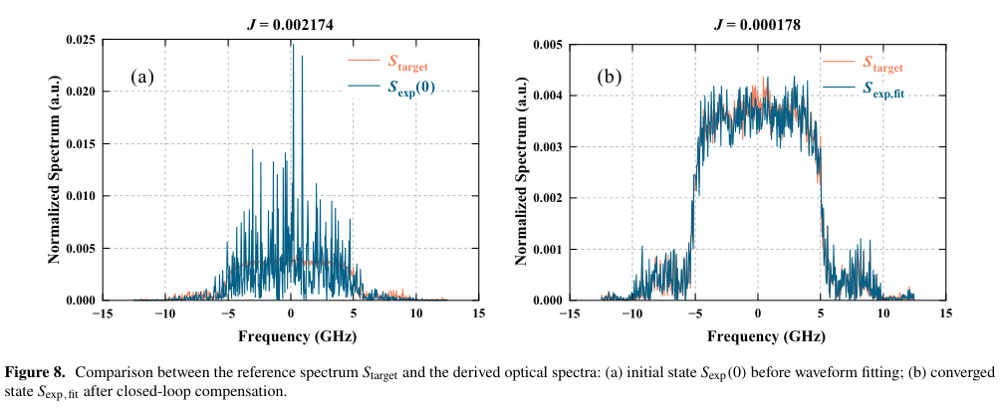
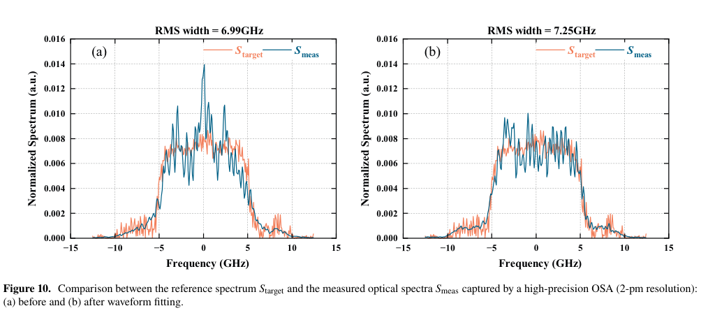
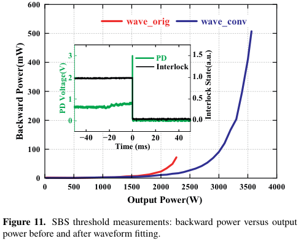
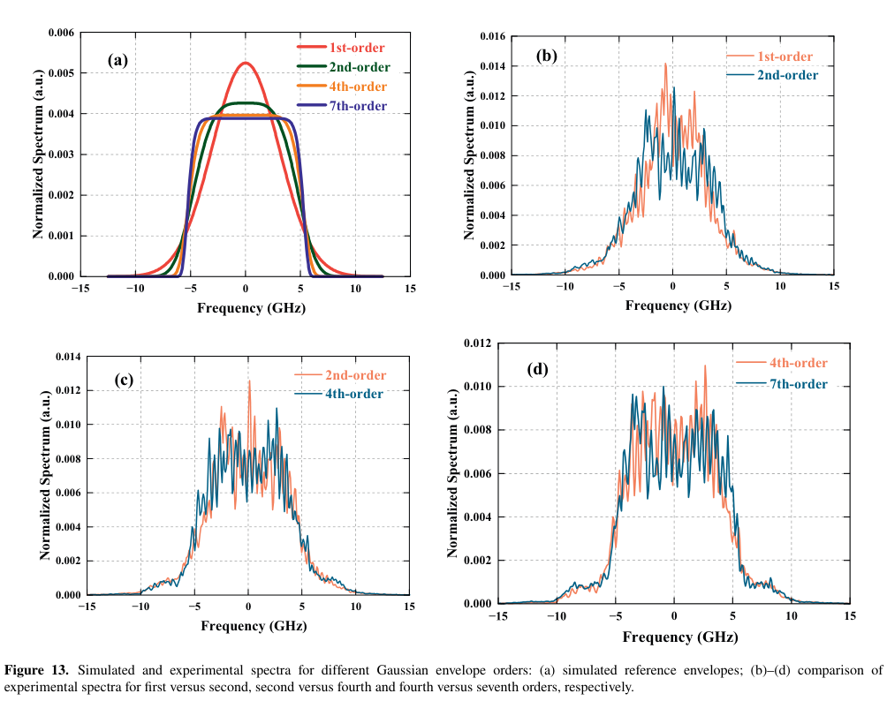

# 硬件补偿波形优化与光纤激光SBS阈值：正式论文笔记

## 0. 文献信息、版本和证据类型

- Xiong Xin、Yuyang Peng、Qiuhui Chu、Fang Li、Dongyang Zou、Wantao Wang、Benjian Shen、Yiwei Liao、Zhitao Peng、Honghuan Lin、Jianjun Wang、Rumao Tao、Chun Zhang，**High-fidelity spectral shaping via hardware-compensated waveform optimization for stimulated Brillouin scattering suppression in high-power fiber lasers**。
- [DOI／出版社](https://doi.org/10.1017/hpl.2026.10195)，*High Power Laser Science and Engineering* **14**, e105，12页。出版社明确在线日期 **2026-11-19**；PDF首页为收稿04-15、修订07-05、接收08-04。网页的年度卷元数据“2026/01”不能替代具体在线日。
- 实际阅读为[出版社排版全文](../pdfs/xin-2026-sbs.pdf)，具有卷号、文章号、正式版权和完整12页，没有accepted-manuscript标记，按出版社VOR记录。全文、参考文献均读；第1、3–11页渲染目检，以下4幅为原页裁图。MinerU历史认证失效未复测、本轮零请求，明确使用本地布局文本和页面渲染回退。
- 证据链是**硬件响应测量→数值波形优化→真实RF电压闭环→独立OSA光谱测量→真实光纤放大器阈值与束质测量**。不是等离子体SBS实验、激光加速或光核产额试验；本轮未复跑作者优化、控制程序或激光实验。

## 1. 摘要与引言：优化谱形，也要使真实硬件产生该谱形

摘要把问题定位为窄线宽光纤激光扩功率时的受激布里渊散射（SBS）。作者用频率相关RF链增益和相位调制器半波电压建立模型，再以示波器测得的实际驱动电压作闭环反馈，补偿线性响应模型未覆盖的谐波和互调失真。最终报告22/400 μm保偏掺镱光纤、3.5 kW输出、作者标称RMS线宽7.25 GHz和M²约1.21。

引言先说明相位调制展宽种子可降低单位频率功率，继而比较多级正弦、白噪声、PRBS等方法：展宽并不自动给出平顶谱；随机驱动、有限调制深度和硬件失真各有代价。文中引用的前人功率／FWHM不是本轮测量，不能与本研究的“RMS linewidth”直接排序。

后续段落指出，已有时域工程方法也会受到真实RF链和调制器的限制。因此本文贡献是把**可计算的目标波形**与**真实可实现的目标波形**接起来；算法不是神经网络或机器学习方法，而是逐坐标离散扫描加实验误差符号反馈。

## 2. 理论模型与硬件补偿优化

### 2.1 相位调制如何把电压谱变成光谱（原式1–6、Fig.1）

Fig.1（PDF第2页）是AWG→RF放大器→低通滤波器→相位调制器的电光链路；没有数据坐标或定量效率。种子是连续单频光，调制主要改变相位：

$$
E_{\rm in}(t)=E_0e^{i\omega_0t},\qquad
V_{\rm dri}(t)=\sum_{r=1}^{N}A_r\cos(\omega_rt+\varphi_r),
$$

$$
\phi_{\rm mod}(t)=\sum_{r=1}^{N}m_r\cos(\omega_rt+\varphi_r),
\qquad
m_r=\frac{\pi A_r}{V_{\pi,r}},\qquad
E_{\rm out}=E_0e^{i\omega_0t}e^{i\phi_{\rm mod}(t)}.
$$

其中电压A、半波电压Vπ单位V，角频率单位rad/s，调制指数m和相位无量纲。原式(3)把频率相关Vπ简写为对总波形的除法；严格使用时应如上逐频率分量作用，不能把一个随频率变化的量直接当统一时域常数。

由Jacobi–Anger恒等式，单一相位因子可展为各阶Bessel旁带；多个驱动分量的乘积给出：

$$
e^{im_r\cos\theta_r}=\sum_{k_r=-\infty}^{\infty}
i^{k_r}J_{k_r}(m_r)e^{ik_r\theta_r},
$$

$$
E_{\rm out}=E_0e^{i\omega_0t}
\sum_{\{k_r\}}\prod_r\!\left[i^{k_r}J_{k_r}(m_r)e^{ik_r\varphi_r}\right]
e^{it\sum_r k_r\omega_r}.
$$

物理直觉：旁带频率为载频加各驱动频率的整数线性组合，同一频率可能有多条组合路径，须相干叠加，因此驱动点值到功率谱是非线性映射。**上述推导补上了标准cos版本恒等式中的相位因子；原式(5)–(6)印刷没有i的阶数因子。**单频幅度平方可不受该全旁带相位差影响，但多频重合旁带的相干和一般需核实相位约定／实现；本文未取得作者代码，不能据印刷式判定实际算法错误。

### 2.2 受硬件约束的数值优化（原式7–10、Fig.2–4）

作者先固定目标谱和随机初始AWG电压，逐点扫描625个时间采样点，每点尝试256电平，保留使目标函数最小的电压，再多轮迭代。这是贪心坐标搜索；没有全局最优证明或独立多初值统计。

| 参数 | 原文值与含义 |
|---|---|
| AWG采样率、周期频率 | 25 GSa/s、40 MHz；静态相除得625点、25 ns周期 |
| 电压量化 | 8 bit，256电平，AWG输出±250 mV |
| 有效带宽 | 5 GHz；RF链在5–6 GHz急剧滚降，调制器名义10 GHz |
| 驱动限幅量 | Vsat=3.6 V；由作者采用的24 dBm额定功率约束设定 |
| 目标谱误差 | 单位总功率离散谱之间的RMSE |

Fig.2（第4页）展示扫描及收敛流程；Fig.3（同页）横轴频率GHz，左轴级联RF增益dB、右轴半波电压V：高频端增益下落且Vπ变化，说明AWG相同幅度不会产生相同调制深度。这里是**测得硬件响应**，不是光谱或SBS阈值曲线。

令离散傅里叶变换为F，则原式(8)的幅度响应为：

$$
\widetilde V_{\rm amp}(f)=
\mathcal F[V_{\rm gen}](f)\,10^{G_{\rm cas}(f)/20},
\qquad
\widetilde V_{\rm amp}(f)=0\quad(|f|>5\ {\rm GHz}),
\qquad
V_{\rm amp}=\mathcal F^{-1}[\widetilde V_{\rm amp}].
$$

dB功率增益先转功率比再开平方得到电压幅度比；原文的平方根与上述20分母等价。完整相位／群延迟、阻抗和频域校准数据未随文给出，复现时还需确认模型使用的S21约定。

原式(9)先用波形极值把电压线性缩放，再去均值：

$$
V_{\rm temp}(j)=
\frac{2V_{\rm sat}}{\max V_{\rm amp}-\min V_{\rm amp}}
\left[V_{\rm amp}(j)-\frac{\max V_{\rm amp}+\min V_{\rm amp}}2\right],
\qquad
V_{\rm dri}=V_{\rm temp}-\overline V_{\rm temp}.
$$

这一步同时改变全局调制深度，作者称采用改善目标函数才接受的try-and-revert策略。**静态边界：Vtemp的极值是±Vsat，但再去均值后，若均值非零，Vdri不一定仍严格处在该区间。**需代码说明是否再次限幅、重新归一化或施加更强约束；不能只由印刷式推得作者声称的严格幅限。3.6 V的峰值／RMS及负载约定也未展开。

电光映射后计算单位总功率离散谱及RMSE：

$$
S_{\rm sim}(j)=
\frac{|\mathcal F[E_{\rm out}](j)|^2}
{\sum_{m=1}^{L}|\mathcal F[E_{\rm out}](m)|^2},
\qquad
J=\sqrt{\frac1L\sum_{j=1}^{L}
\left[S_{\rm ideal}(j)-S_{\rm sim}(j)\right]^2}.
$$

推导上先求复振幅、取模平方，最后除总和；归一化去掉总光功率，只评价谱形。J因此不是瓦特误差，也不是激光转换效率；采样数、窗口和分辨率变化会改变数值可比性。Fig.4（第5页）依次显示J随迭代下降、单位功率光谱、驱动电压V随时间ns、驱动频谱：J从约0.0025降到0.000354，约7.1倍改善；只是数值优化结果。参考谱在约±5 GHz内近矩形，驱动谱限制在约±5 GHz，二者不能当成同一种谱。

### 2.3 真实电压闭环与派生光谱（原式11–12、Fig.5–8）

Fig.5（第6页）给出PC协调AWG与示波器的闭环，采样的是RF链输出电压。Fig.6（同页）给出误差符号控制：误差同号时按固定步长调整，过零时保持；实际同时更新整个周期的625点。δ须高于示波器噪声与RF漂移，但文中没有给具体值及全套时序。

预补偿以RF幅度传递函数的逆初始化：

$$
V_{\rm ctrl}(0)=\mathcal F^{-1}\!
\left[\frac{\mathcal F[V_{\rm target}]}
{10^{G_{\rm cas}(f)/20}}\right],
\qquad
{\rm MAD}=\frac1L\sum_j
|V_{\rm target}(j)-V_{\rm meas}(j)|.
$$

前式先消掉已知线性增益，后续反馈处理剩余失真；对于接近零增益的带外频率，逆滤波须限制频带或正则化，具体实现未公开。MAD单位V，且不同于光谱J。原图流程把初始上一轮误差设为0，又在误差乘积≤0时保持控制量，**若逐字执行，首轮会满足保持条件**；真实代码的首步例外／收敛条件需要澄清，图示不能直接充当可执行程序。

每控制周期约5 s，平均5次示波器读取，约30次／2.5 min达稳定，实验保持约5 min选稳定段最小MAD。这里的“实时反馈”是分钟级标定流程，不是纳秒光波形周期内重新优化。Fig.7（第7页）电压—时间曲线及5.6–6.6 ns局部图显示，MAD由0.5182 V降到0.1458 V，约3.55倍，峰顶仍留误差。

来源：PDF第7页Fig.8。横轴相对频率GHz，纵轴单位总功率归一化谱（a.u.）；红线为数值目标，蓝线是将实测电压代入Vπ模型后**计算得到的派生光谱**。两子图纵轴上限分别0.025、0.005，不能按画面高度直接比较幅度。补偿后J由0.002174降到0.000178，约12.21倍改善，但尚不是独立光谱仪的直接观测。

## 3. 实验验证

### 3.1 实验装置、实测谱与阈值（Fig.9–12）

Fig.9（第8页）是保偏MOPA装置：1064 nm、约10 kHz线宽、约20 mW的连续种子经相位调制，两级预放大到约20 W，再进入22/400 μm保偏掺镱主放大器，976 nm后向泵浦以控制横模不稳定。隔离器第三端口分光后用于回光功率、OSA光谱和高速PD时序；输出端测功率和束质。图是布局，不提供能量转换率。

来源：PDF第9页Fig.10。横轴相对频率GHz，纵轴归一化谱a.u.，OSA分辨率2 pm；参考谱先下采样并重新归一化以匹配仪器。与Fig.8的电压派生谱不同，这里蓝线是**直接实测光谱**。补偿后峰值更平，实测峰／参考峰比从1.61降到1.16，最大归一化偏差约0.006降到0.0025。图标RMS宽度6.99→7.25 GHz，因此闭环前后也不是严格等宽对照。

**线宽定义边界：**全文使用“RMS linewidth”，但没有给出积分窗口、噪声底扣除、谱中心、二阶矩到所报全宽的具体数学定义。一般二阶矩标准差与FWHM仅在指定谱形下有转换关系；本文近矩形／超高斯且有谱翼，不能把7.25 GHz直接写成FWHM，也不能擅自断言它等于单倍标准差。2 pm在1064 nm处约为0.53 GHz频率分辨率，这是波长微分换算，不能代替作者线宽定义或真实仪器响应标定。

来源：PDF第9页Fig.11。横轴输出功率W，纵轴隔离器第三端口测得的回光份额mW；红色wave_orig、蓝色wave_conv为同一七阶目标的拟合前后。插图是高速PD电压V和联锁状态a.u.随时间ms。作者明确该mW数值**不是总绝对后向散射功率**，不能据507 mW除3562 W求真实SBS反射率。阈值按PD出现自脉冲并触发安全联锁认定，不是统一回光mW阈值。

原文阈值为2269→3562 W，端口回光分别72、507 mW；静态相除得提升56.99%，即所称57%。这比较的是“闭环前失真谱”与“闭环后更平谱”，不是与未调制10 kHz种子或PRBS/WNS在同线宽下的直接实验比较。约1600 W附近补偿后的回光增长较慢；完整不确定度、重复阈值扫描和联锁带宽未给出，不能把示意插图当作解析出的快自脉冲波形。

Fig.12（同页右）横轴z位置mm、纵轴束宽μm，两个方向焦区拟合得Mx²=1.199、My²=1.212，均值1.2055，测量点在3.5 kW。它支持该输出功率处的近衍射极限束质，不等于在3562 W触发点或更高功率的长时间稳定／相干合束验收。

### 3.2 超高斯包络阶数扫描（Fig.13–14）

来源：PDF第10页Fig.13。各图横轴GHz、纵轴归一化谱a.u.；(a)为数值参考包络，(b)–(d)为相邻阶数实测对比，子图纵轴范围不同。阶数增大使中心更平、峰值降低；真实谱翼在约±5 GHz以外相互重叠，未完全复制理想参考。参考线宽统一称6 GHz，但实际测得RMS宽度不同：

| 包络阶数 | 实测RMS线宽（GHz，沿用作者标注） | 自脉冲阈值（W） | 阈值处端口回光（mW） |
|---|---:|---:|---:|
| 1 | 6.45 | 2955 | 326 |
| 2 | 7.07 | 3259 | 334 |
| 4 | 7.06 | 3462 | 404 |
| 7 | 7.25 | 3562 | 507 |

Fig.14（第11页）横轴输出功率W，纵轴端口回光mW，各阶曲线到自脉冲触发处终止。阈值增量304、203、100 W，与作者“趋近平顶后边际收益递减”的解释一致。四阶到七阶的归一化峰约0.011→0.010；这支持降低谱峰有利于SBS抑制的机制解释，但不是凭四点证明全局物理极限。

**两组比较必须分开：**一阶→七阶为2955→3562 W，约20.54%，RMS宽度同时增大12.40%；它不是前节57%的同七阶闭环前后比较。作者把更大收益主要归因于平坦度，数值和实测趋势支持该解释，但缺严格匹配实际线宽的控制组，不能独立量化谱形与展宽各自贡献。简单功率／作者宽度比约提升7.24%，也只是描述统计，不能作为这种因果分离。

## 4. 原文结论、可复现边界与接续

结论重申模型与闭环共同实现近矩形谱，并在该22/400 μm光纤系统获得3.5 kW、7.25 GHz标称RMS宽度、M²约1.21的真实测量。没有展示多机长期运行、完整壁插效率、闭环在线漂移追踪或实际CBC合束；更不涉及等离子体SBS、伽马转换或光核应用性能。

后续复现优先取得：625点最终波形及RF全复响应／Vπ标定、谱归一化与RMS宽度代码、式(5)–(6)相位约定、式(9)均值移除后幅限、Fig.6首轮及δ／终止逻辑、主放大器有效光纤长度与热／泵浦条件、PD与联锁带宽、阈值多次扫描及误差、同实测线宽包络对照。这里的疑点来自静态公式／图示检查，未验证真实程序行为。

复习要点：先用硬件约束模型找到可实现的目标电压，再让真实电压靠近它；最后必须用独立OSA与PD阈值测量闭合验证。**57%阈值提升、12倍派生谱误差改善和3.55倍电压MAD改善是不同对象、不同单位和不同证据，不能互换。**
