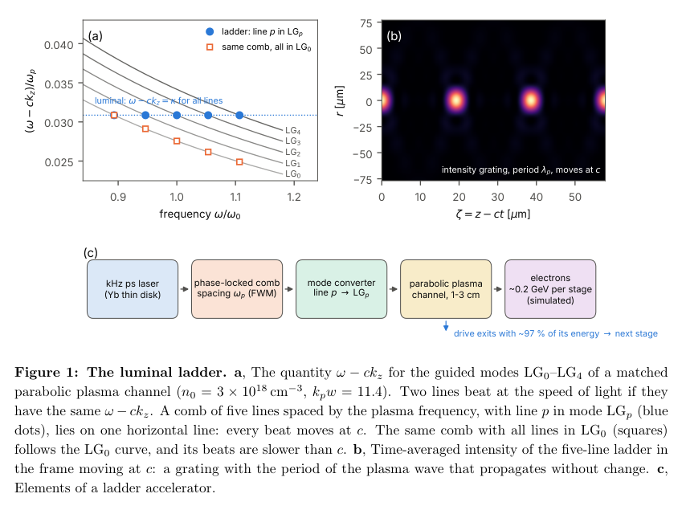
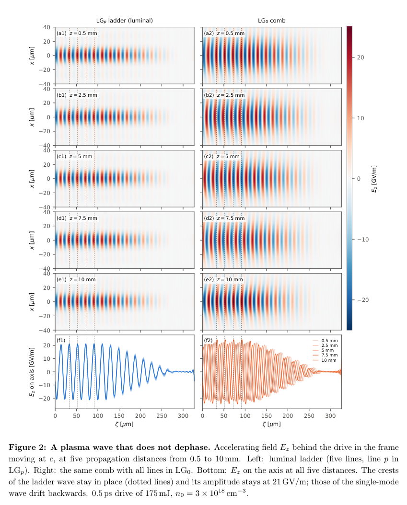
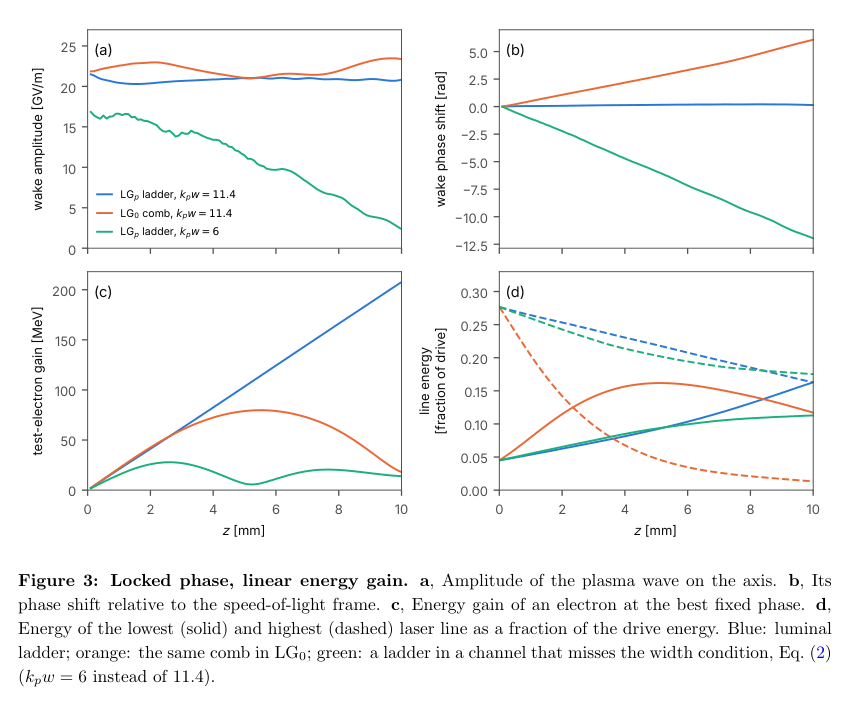
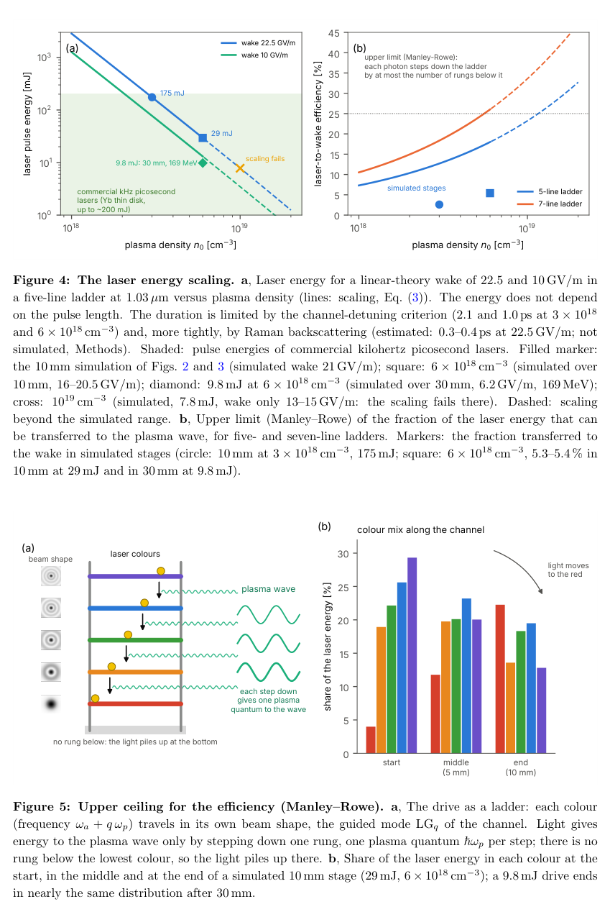
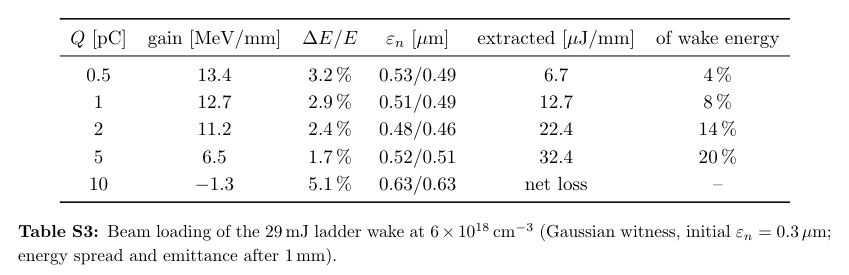
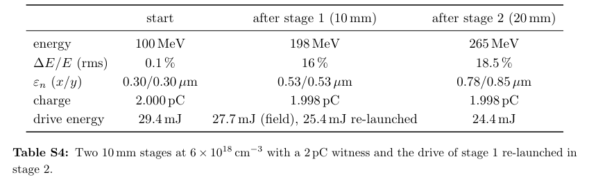

# 毫焦皮秒频梳的光速尾场：相位锁定、束载与效率的边界

## 1. 论文与实际阅读版本

Alexander Pukhov，*Dephasing-free plasma acceleration with millijoule picosecond lasers*，[arXiv:2611.26032v1](https://arxiv.org/abs/2611.26032v1)。2026-11-19首投、11-20公告，PDF正文日期11-20；实际读[29页作者全文](../pdfs/pukhov-2026-comb.pdf)，含主文、Methods、参考文献及S1–S10。未核实期刊接收／发表；Crossref精确标题查询前3项均非同作。

这是解析设计和作者运行的GEM-PIC-RZ模拟，没有加速实验或实际kHz运行。本轮读主文／方法／补充全文文本，目检15个关键源页，保留6幅原图表裁剪；[PDF验证](../pdf_validation.json)与[视觉来源](../research/visual_validation.json)记录哈希、页码与矩形。MinerU历史认证过期未复测、零请求，使用本地布局文本与渲染；未运行作者代码。p16声明作者在监督下使用Claude协助模拟、分析和写作；这不代替独立复现。数据声明只承诺提交时上Zenodo，本轮未取得并运行相应输入包。

**一句话判断：用频率—横模联合匹配降低失相，但“测试电子增益”“真实束流输出”和“激光到尾场效率”必须分开。**

## 2. 从拍频到光速条件：原文引言及Fig.1

来源：PDF p4 Fig.1。(a)横轴频率ω/ω₀，纵轴(ω−ckz)/ωp，均无量纲；蓝点为不同LGp模上的频梳，橙方块为全部放入LG₀的对照。(b)横轴ζ=z−ct、纵轴r，单位μm，颜色是强度结构、无绝对标尺。(c)是待实现装置链示意，不能视作已建成加速器。

普通长脉冲难以直接驱动短周期尾场，而同一横模中的拍频速度又小于c。本文令相邻谱线间隔等于轴上等离子体角频率ωp，第p条线放入LGp，并调抛物线通道，使各谱线共享κ=ω−ckz。因此Δω/Δkz=c，拍频源在ζ坐标中近似固定。

对n(r)=n₀(1+r²/Rch²)，色散关系为

$$
c^2k_z^2=\omega^2-\omega_p^2-\frac{4c^2(2p+1)}{w^2},\qquad
\kappa\simeq\frac{4c^2}{w^2\omega_p},\qquad
k_p^2w^2\simeq8\frac{\omega_a}{\omega_p}-4.
$$

ωa是最低谱线，w是匹配模半径。后两式是κ/ω的一阶设计式；模拟按精确色散微调宽度，使相邻拍频平均漂移接近零，仍存在未完全解释的残余漂移。还要求kpw≳2√Nτ、Nτ=cτ/λp，以免通道离轴密度导致长脉冲失谐；“光速匹配”本身不足以保证振幅稳定。

与库内[Palastro等2606.20298](https://arxiv.org/abs/2606.20298)同属导波模去相位路线，但本文把模间频差设为ωp，利用弱长脉冲共振积累，是不同作品。本文对旧方案约0.3 J的估计是Pukhov从旧式子推算，并非两篇在相同程序／误差下的独立成本比较。

## 3. 主要模拟与诊断定义：Figs.2–3

来源：p6 Fig.2。左为匹配阶梯、右为全部LG₀，横轴ζ、纵轴横向位置μm，色标Ez为GV/m；五行对应传播0.5–10 mm，底部为轴上场。左侧峰位较稳定，右侧持续滑移，约束的是当前理想通道中的模拟相位，而非实验容差。

来源：p7 Fig.3。所有横轴为传播z/mm；(a)GV/m、(b)rad、(c)MeV、(d)单谱线能量／初始总驱动能量。蓝色是kpw≈11.4的匹配阶梯；橙色是同能量LG₀对照；绿色是kpw=6的失配阶梯。绿色初场及模态不同，不能把它当作只改一个无关参数的实验误差条。

| 轴上密度／驱动 | 模拟区间与场 | 原文测试增益及边界 |
| --- | --- | --- |
| 3×10¹⁸ cm⁻³；175 mJ、0.5 ps | 10 mm，约21 GV/m，相位累计约0.15 rad | 208 MeV；同模对照在约5.5 mm达80 MeV后下降 |
| 6×10¹⁸ cm⁻³；29 mJ、0.5 ps | 10 mm，16–20.5 GV/m | 181 MeV；相位斜率0.047 rad/mm，细网格降至0.032 |
| 同密度；9.8 mJ、0.5 ps | 30 mm，约6.2 GV/m，末端约降10% | 169 MeV；0.049 rad/mm累计约1.5 rad，已接近加速聚焦窗口 |
| 10¹⁹ cm⁻³；7.8 mJ、0.4 ps | 3 mm，仅13–15 GV/m | 42 MeV；只有线性预测的57%–66%，原因未闭合 |

Methods把场幅定义为轴上窗口内kp傅里叶分量的模，**不是局部最大Ez**。测试增益为该复振幅沿z的积分模，等价于为选定窗口寻找最佳固定相位；不是已经追踪并俘获的实际电子束。30 mm时驱动包络后滑约105 μm，真实束须放在更后、较弱的尾场中，作者估计还损失约7%增益。把通道宽度偏置1%–2%以消除漂移是投影，尚未模拟证实；不能仅凭标题把该算例写成严格无相位漂移。

## 4. 标度与能量账本：Figs.4–5

来源：p10。Fig.4(a)横轴密度cm⁻³、纵轴激光mJ，均对数；曲线为线性标度，标记才是模拟，虚线为外推，10¹⁹处标出失效。Fig.4(b)纵轴是**激光到尾场**百分比，上方曲线是Manley–Rowe上界，下方标记是有限长度模拟。Fig.5(a)是逐级降频示意；(b)纵轴各谱线占初始激光能量%，横向分开始／5 mm／10 mm，显示能量在最低线堆积，不能将高线损失全部记入尾场。

在弱响应、匹配抛物线通道、固定谱线相对幅度下，固定场的驱动能量满足Edrive∝Ez n₀⁻⁵ᐟ² λ⁻³。脉长在该理想标度中消去，但不意味着任意长脉冲均可用；离轴失谐与后向散射另有限制。可支持区间限定到n₀≤6×10¹⁸ cm⁻³附近，不把10¹⁹处失效点继续画成已验证优化方向。

五线在3×10¹⁸与6×10¹⁸ cm⁻³的上界约12.7%与18%；实际175 mJ／10 mm激光到尾场约2.6%，29 mJ／10 mm和9.8 mJ／30 mm约5.3%–5.4%。这些均不是激光到电子束效率。30 mm仅约81%的驱动损失被尾场账本找回，不能写成全能量严格闭合。

## 5. 真实见证束与两级：补充S8

来源：p28 Table S3。列分别为pC、MeV/mm、相对能散、两个方向归一化发射度μm、μJ/mm及占尾场能量比例。初始100 MeV、σz=σr=1 μm、εn=0.3 μm。5 pC提取约32 μJ/mm、20%尾场能量，仅约0.11%初始激光能量／mm；10 pC过载，净能量降低。这里的1.7%能散只对应1 mm算例，不能搬到20 mm两级输出。

来源：p28 Table S4，无图轴；能量100→198→265 MeV，电荷2.000→1.998 pC；rms能散0.1%→16%→18.5%，εn由0.30/0.30增至0.78/0.85 μm。第二级只把五条线的能量重新放回各模，并重设束流相位，丢弃模外能量与包络畸变，**不是完整级间运输模拟**。总新增束能约0.33 mJ／29.4 mJ≈1.1%；没有把初始100 MeV注入能量计为新增转换。重新合成频梳、模式转换、同步与注入器成本均未计入。

补充还显示仅种下两条线、其余设极弱噪声时，不会自动长成五线阶梯；各阶须预先种入。高斯实用通道的结果只是横模本征值投影，尚无对应PIC验证；金属导管不满足同一模式假设。

## 6. 数值与可复现性判断

GEM-PIC-RZ为准柱坐标、前向传播框架，默认方位模m≤1，另有m=2控制。10 mm基线Δζ=0.033 μm、Δr=0.375 μm、Δz=1 μm，轴附近提高宏粒子数，移动质子；作者给短程网格／物种控制及6×10¹⁸ cm⁻³全长细网格比较。场幅和增益较稳定，但漂移从0.047变0.032 rad/mm，说明相位指标对数值色散敏感。

框架不含后向光及约30°以外侧散射。Raman后向散射只是噪声依赖估计：175 mJ算例预计反射0.2%–2%，与2.6%尾场转移同量级；低能算例估计较小，也未用能解析后向波的程序验收。碰撞抑制、宽度／密度约1%容差、光梳相位和模式纯度、真实通道及注入同步仍需联合测试。

对本库应用链，优先跟进**真实受载束的电荷、能散、发射度与整体效率**，再耦合转换靶。本文没有测量伽马、光核、中子、剂量或材料效应，也没有完成辐照诊疗／防护验证。
