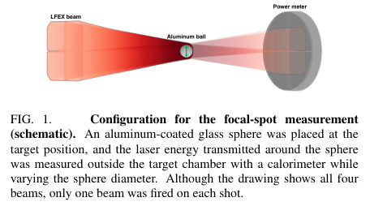
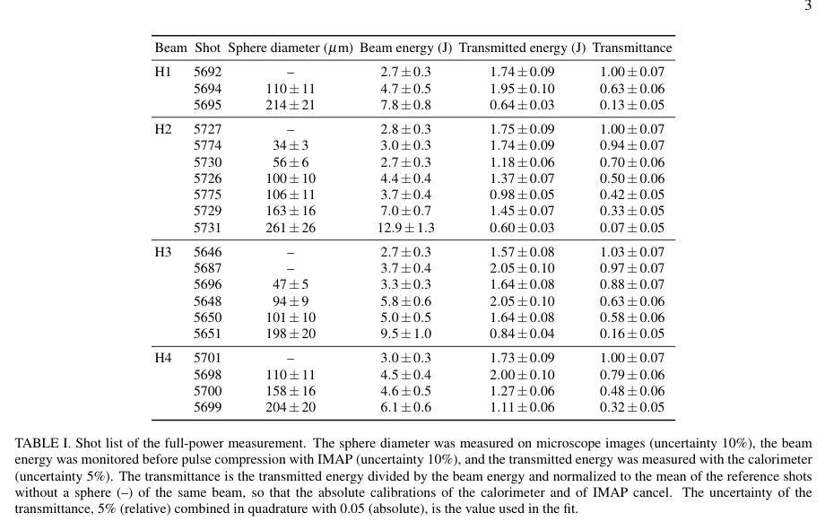
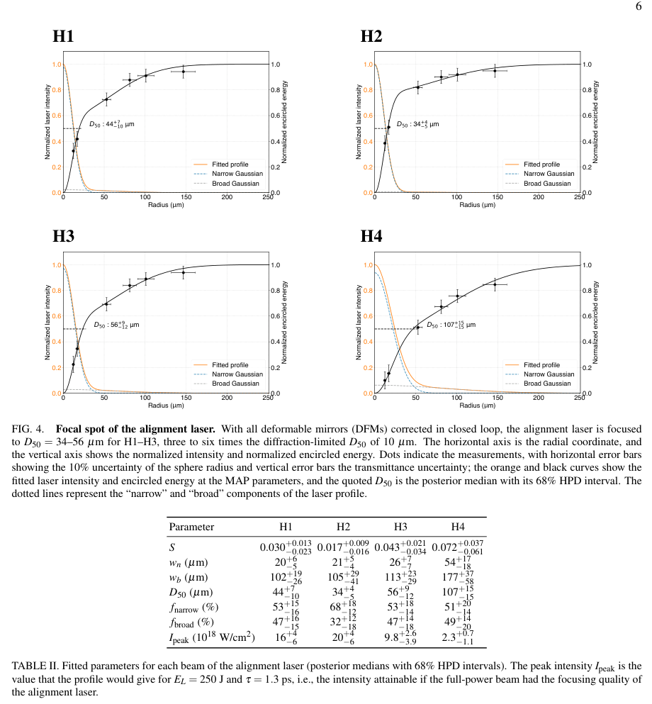
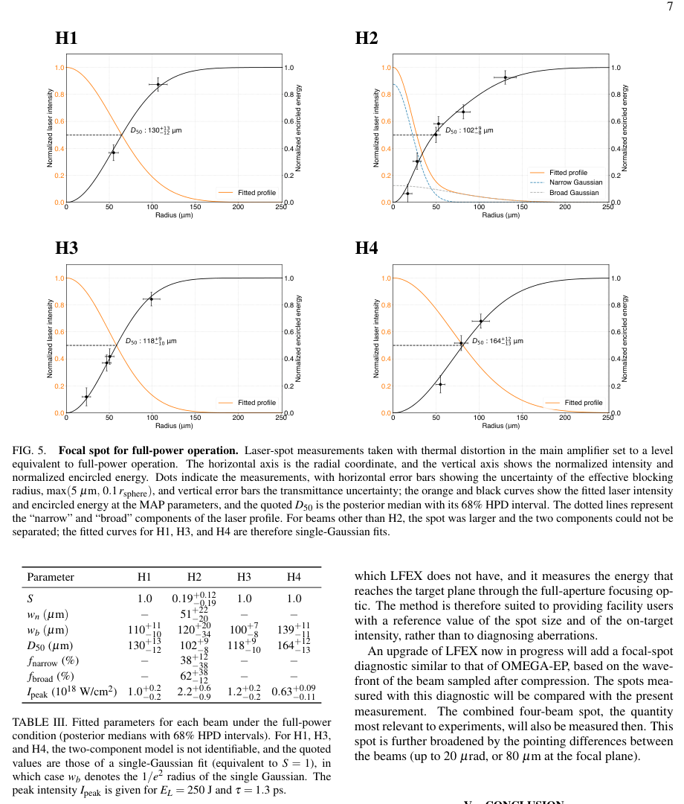
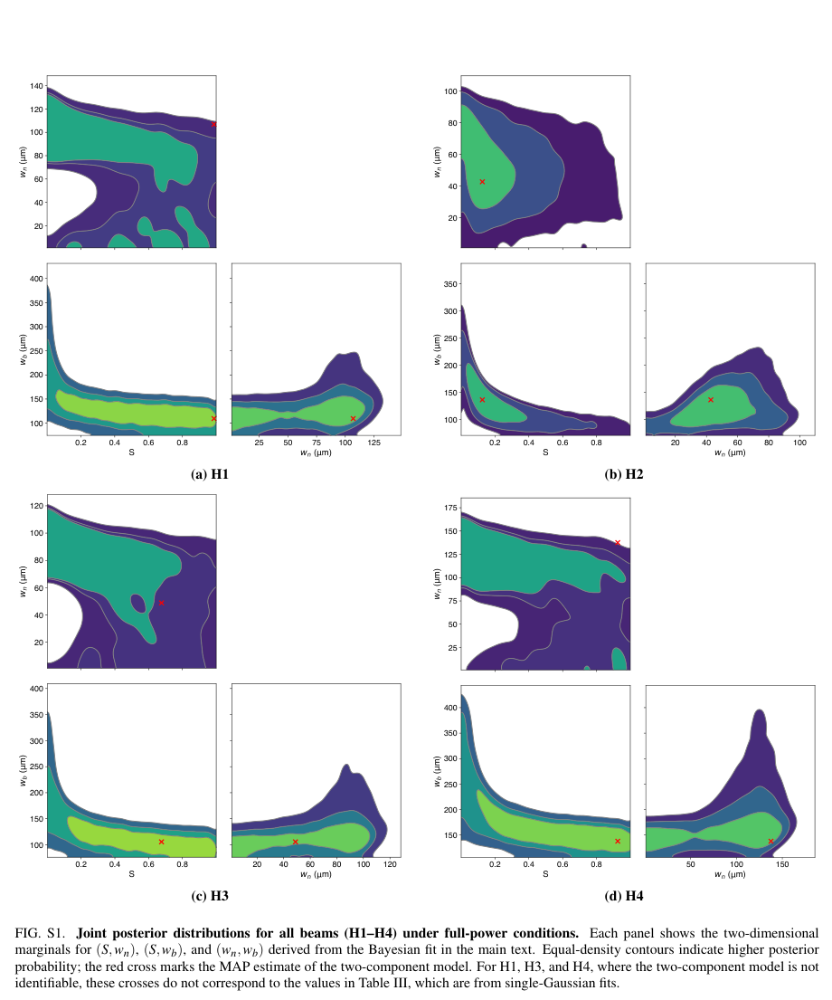

# LFEX发次焦斑的球遮挡诊断：测量、反演与标称强度

## 1. 论文、版本与证据

Ryunosuke Takizawa等12位作者，*Direct measurement of the on-shot focal-spot size of a kilojoule-class petawatt laser*，[arXiv:2611.25552v1](https://arxiv.org/abs/2611.25552v1)，2026-11-19首投、11-20公告；实际读[11页作者PDF](../pdfs/takizawa-2026-focus.pdf)，正文／补充后验占p1–9，p10–11参考文献。未核实期刊接收或发表，Crossref标题前3项无同作。

本轮读全文文本，目检p1–9，保留5幅原图表，来源见[视觉记录](../research/visual_validation.json)；[文件头／SHA／三路页数／逐页文本](../pdf_validation.json)通过。MinerU历史认证过期未复测、零请求，本地提取和渲染回退。未运行FLASH、PyMC或复做实验。

这是**实际球遮挡透射测量＋贝叶斯径向能量密度反演＋FLASH系统误差估计**。题名中的on-shot不代表每个用户靶发次都得到二维焦斑图，也不代表四束同时全能量的焦斑已测。

## 2. 光学链与到底测了什么：Secs.II–III

LFEX四束H1–H4在400 mm方口径、1 m级离轴抛物镜上共同聚焦，反射焦距4000 mm、λ=1.053 μm。本文用50%包围能量直径D50，而非FWHM；理想方口径D50约10 μm。H2独有压缩器前DFM400，其余束不能视作完全相同的光路对照；H4为遮挡损伤而限制口径。

来源：p2 Fig.1，装置示意，无比例坐标。焦面放直径25–300 μm的镀铝玻璃球，量热计收集绕球透射的光。图虽画四束，**每发只打一束，各束分系列测量**。镀铝用于防止成等离子体前玻璃透光。

主放大器按最大充电电压泵浦，以重现实用热畸变，但降低种子以保护量热计；Table I压缩前能量仅2.7–12.9 J（文中约2.7–13 J），不是每测量发250 J。作者根据泵浦热主导、全能量下增益饱和较弱与B积分约0.1 rad，认为低种子测得形状可代表全能量发次；这是有物理依据的等效性假设，尚非逐发全能量直接成像比较。

来源：p3 Table I，无图轴。球径μm、压缩前束能J、量热计透射能J；最后一列是无量纲透射率。先做同发透射能／IMAP束能，再按同束无球参照归一，故并非直接拿两列J相除。各球径只有一发；H1/H2/H3/H4分别2/6/4/3个有球点，H3另有2个无球点，其余各1个。不能据此给出大样本逐发焦斑分布。

球径误差10%、IMAP10%、量热计5%；拟合透射误差用5%相对与0.05绝对平方合成。共同无球参照带来的跨点协方差、IMAP如何进入归一误差仍需原始数据澄清。无球参照和有球发次不相同，绝对标定抵消不等于所有漂移抵消。

FLASH用半径25 μm铝球、实测时间包络和射线追踪，认为临界反射面扩张约≤5 μm；这是系统误差模型，不能称实测扩张。有效半径误差取max(5 μm,0.1rsphere)。该一几何模拟不足以单独证明全部球径／能量的系统差。

指向范围±10 μrad对应焦面±40 μm，作者按每轴σ=20 μm另拟合潜在位移；扣除后单发D50小于报告值不到10%，峰强高不到20%。主表保留指向影响，代表多发对靶有效聚焦；球定位本身约5 μm。四束相互指向可达80 μm的展宽未在本次全功率联合测量中闭合。

## 3. 径向模型与强度定义

量热计测的是时间积分能量，重建量首先是焦面径向**面能量密度**。作者假设空间形状在脉冲内不变，写成归一I(r)：

$$
I(r)=(1-S)e^{-2r^2/w_n^2}+Se^{-2r^2/w_b^2},\qquad w_n<w_b.
$$

S是宽分量的**轴上幅度权重**，不是宽分量总能量比例。定义A=(1−S)wn²+Swb²，则

$$
E_{\rm enc}(r)=\frac{(1-S)w_n^2(1-e^{-2r^2/w_n^2})+Sw_b^2(1-e^{-2r^2/w_b^2})}{A},
\quad f_{\rm broad}=\frac{Sw_b^2}{A},\quad E_{\rm enc}(D_{50}/2)=0.5.
$$

宽尾面积大，即使S很小仍携带显著能量。两高斯是核心／晕环的径向近似，不是完整二维像差分解。

p5 Eq.(6)明确采用Ipeak=EL/(τAeff)、Aeff=πA/2，EL=250 J／束、τ=1.3 ps FWHM；表中数值按此标称能量与脉宽换算，不是量热计直接读出的瞬时强度。若要改用给定时间波形的真正峰值，需用其时间积分形状因子，不能把FWHM默认等同有效积分时长。对单高斯，D50=√(2ln2)wb，按H1 wb=110 μm可得约129.5 μm，与130相容；这只是静态定义核对。

PyMC v5用弱均匀先验和wn<wb约束，表报后验中位数与68% HPD；图曲线用MAP。**中位数表项代入公式不必等于派生量中位数**，因为作者在每个后验样本上计算派生量；不得据此判成算术错误。先验上界、链长／有效样本量、横轴球径误差的完整似然与共同参照协方差仍待可复现输入确认。

## 4. 对准光与泵浦热畸变：Figs.4–5、Tables II–III

来源：p6。图横轴半径μm，左轴归一强度、右轴包围能量，均无量纲；黑点是由透射率换算的包围能量，橙线是反演形状，不是逐像素直接测得强度。表中强度按假想250 J、1.3 ps折算；对准光本身并无该能量。

来源：p7，坐标与Fig.4相同。横误差为有效遮挡半径误差，纵误差为归一透射误差。H1/H3/H4采用单高斯，H2保留双分量；相似D50不保证相同峰值或尾能比例。

| 束 | 对准D50/μm | 全泵浦D50/μm | 全泵浦标称Ipeak／10¹⁸ W cm⁻² |
| --- | --- | --- | --- |
| H1 | 44⁺⁷₋₁₀ | 130⁺¹³₋₁₂ | 1.0±0.2 |
| H2 | 34⁺⁴₋₅ | 102⁺⁹₋₈ | 2.2⁺⁰·⁶₋₀·₉ |
| H3 | 56⁺⁹₋₁₂ | 118⁺⁹₋₁₀ | 1.2±0.2 |
| H4 | 107±15 | 164⁺¹²₋₁₃ | 0.63⁺⁰·⁰⁹₋₀·₁₁ |

以上误差均为68% HPD。H2 D50由34到102约三倍，按作者同能量／时长定义峰强约降九倍；窄分量能量中位数68%→38%，后者下误差达到38个百分点。H2相对H1/H3约2.2／1.8倍的峰强改善与DFM400共现，但光路配置、拟合可辨识性不同，不是随机化、同束拆装的独立因果测量。H4的低性能也不能全归因热畸变，因为其口径不同。

## 5. 后验可辨识性与应用价值

来源：p9，各束的(S,wn)、(S,wb)、(wn,wb)二维边缘分布；S无量纲，宽度μm，红叉是双高斯MAP，颜色／等密度线反映后验密度、无绝对概率色标。H1/H3/H4宽广退化，因此Table III改报单高斯。红叉不能直接当成该表参数；R̂≈1、无发散只能说明采样行为，不能证明参数可识别。H2的窄能量分量也有宽不确定性。

球扫描直接约束“有多少能量进入某半径”，对PIC输入、靶尺寸、强度标度和跨装置比较很有用；但其径向平均丢失椭圆／热点／相位信息，小尺度受25 μm最小球和约5 μm扩张限制，不能替代二维全能量焦斑或同发时空诊断。原p4 Fig.3仅是对准光的二维图，不是全泵浦四束焦斑实测。

后续应优先获取原始发次、完整后验和泵浦等效性测试，联合压缩后波前／时间波形／指向核验；在转换靶研究中传播核心、晕环和指向误差，而非仅把D50换成一个FWHM。本文没有测量转换效率、伽马／中子产额或临床／防护效果。
