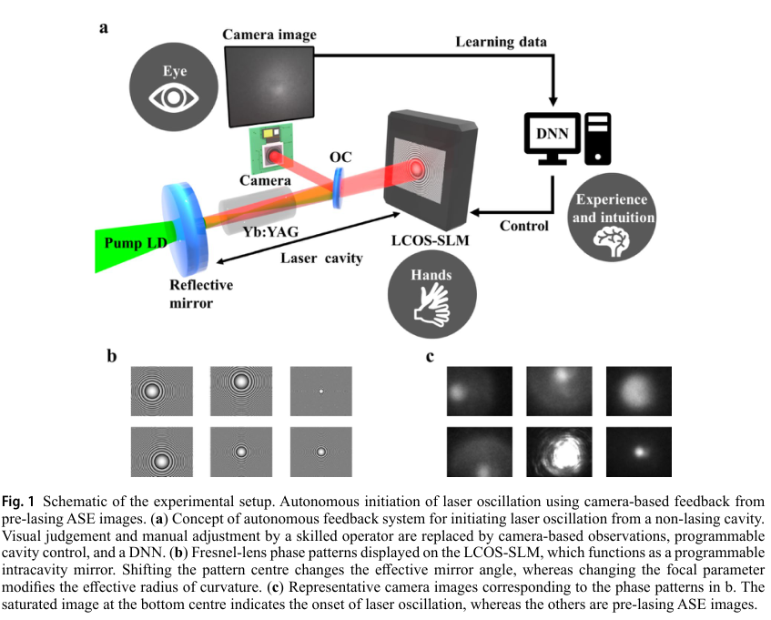
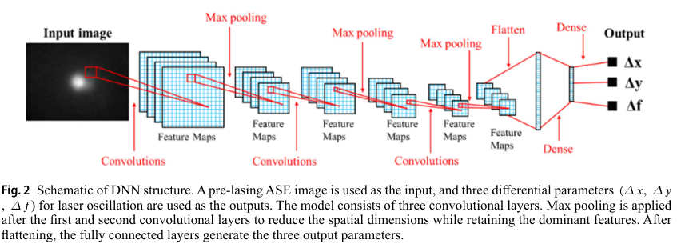
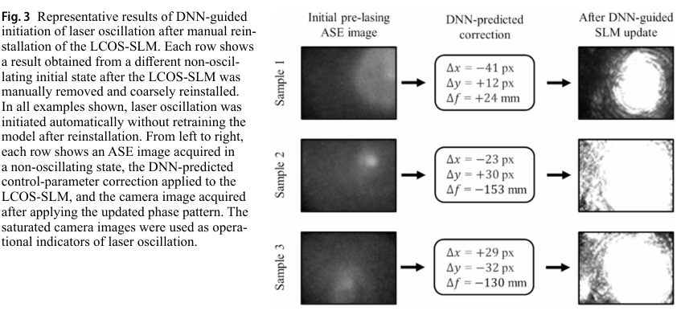
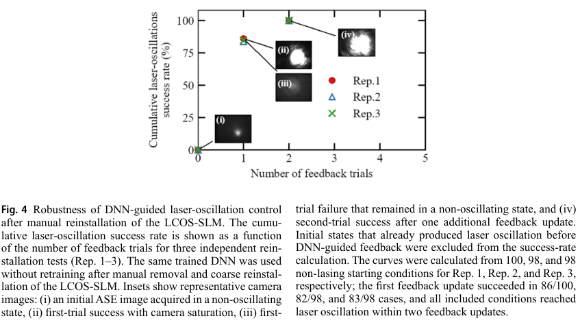
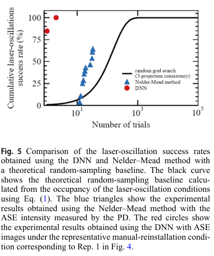

# 用未起振ASE图像引导激光起振：DNN与腔内SLM的实验闭环

## 0. 论文与阅读版本

- Ikeya, Yuki; Sekine, Takashi; Tani, Shuntaro; Endo, Tsubasa; Otsu, Toshio; Morita, Takaaki; Tamaoki, Yoshinori; Kato, Yoshinori; Kawashima, Toshiyuki; Kobayashi, Yohei。*Deep neural network-controlled autonomous laser oscillation*，Scientific Reports。
- [出版社／DOI](https://www.nature.com/articles/s41598-026-81760-y)：10.1038/s41598-026-81760-y。2026-07-29收稿、**11-17接收、11-21在线**。实际[14页PDF](../pdfs/ikeya-2026-control.pdf)首页明确为 **Article in Press**，不是最终VOR；正式已接收研究与最终排版分开记录。
- [13页科学补充](../pdfs/ikeya-2026-control-supp.pdf)含Notes 1–6、图S1–S6、表S1–S2。正文、方法与补充均读，引用未逐篇追溯；没有重训DNN或操作激光。默认“.pdf”返回HTML，采用出版社页面明确链接的“_reference.pdf”，没有把HTTP200当PDF成功。
- 证据类型：**真实Yb:YAG激光腔与DNN闭环实验**，含离线验证和有限重装泛化测试。主题关键词：machine learning，laser alignment，ASE，experimental feedback，LCOS-SLM。与本库高功率激光前端控制／诊断方法相关，相关性4/5；不是PIC代理或PW主激光的控制验收。

## 1. 摘要与引言：还没有激光输出时用什么反馈

作者先指出物理系统采样昂贵、隐含状态难以标注，再把问题限定到固体激光腔从不振荡到起振。无激光输出时，仍有自发辐射、荧光和放大自发辐射；这些弱光的空间图样包含增益重叠和腔损耗信息。DNN把图像映射成腔内SLM的三个控制增量，改变等效倾斜与曲率。

论文证明的是**开始振荡**，并未优化长期功率、M²、线宽、锁模或高能放大链。图像反馈信息多于单个光电二极管电压，是此比较的重要条件；不能把结果单独归因于“深度学习算法天生优越”。

## 2. Results：按原文三个小节阅读

### 2.1 装置与可观测量（图1，PDF2–4页）

图1a为相机→DNN→腔内LCOS-SLM的反馈链。b是Fresnel相位图：移动中心改变有效倾斜，改变参数f改变曲率；c是对应的相机强度图，未标绝对光强。底部饱和图用作起振操作判据，**饱和程度不能用来评价输出功率或束质**。

作者另在相同腔型、可产生饱和图的条件下测得约1030 nm窄峰（补图S1，光谱强度a.u.），支持将饱和作为起振指示；它是独立代表性检查，并非每次闭环同步测光谱。输入仅用未饱和ASE图像。

### 2.2 数据与网络：离线误差不是闭环成功率（图2，PDF4–5页）

网格扫描中心x=300–430像素、y=−240至−120像素，均步长10像素；f=100–500 mm，步长5 mm。14×13×81=14,742设置中94个起振，14,648个不振荡。局域代表起振区占网格约0.24%，包含约38.3%的起振点；不能把0.24%和94/14,742=0.64%混为一谈。

训练目标为当前设置到参考起振设置的**差值**。相机3280×2464像素降采样至66×50；不振荡数据随机80/20划分训练／验证。三卷积层和全连接层输出三个连续增量，评估14种候选网络后选择模型。

这是结构图，不是学得物理机制的直接成像。正文／图注称前两卷积层后池化，但示意图标了三处Max pooling；复现时需代码确认，笔记保留这个版本差异。验证集三个误差各自进入±5像素、±5像素、±20 mm的比例为99.83%、99.42%、99.39%，联合为98.67%。这里的容差作用于**预测残差**，不能解释成每次允许的控制动作只有±5像素，也不能当作98.67%的实机成功率。

### 2.3 实机验证与重装（图3–4，PDF5–7页）

原光学配置另取100个未参与训练／选模的初态，采用更细的1像素／1 mm设置，100/100一次起振。作者明确这是已采样参数域中的插值，不是任意新激光腔的外推。

每行左边是不同非振荡态，中间为预测的像素／mm增量，右侧为更新后的饱和图。它证明动作落地可触发起振，没有从图中测出绝对功率。本文泵浦工况下另测起振后输出约150 mW。

横轴反馈更新次数、纵轴累计成功率%。人工移走并粗略重装SLM后，同一模型不重训；每次生成100初态，先前已起振的排除，分母实际为100、98、98。第一次分别86/100、82/98、83/98，即86.0%、83.7%、84.7%；第二次均达该组全部成功。图中三条100%是有限样本结果，不能提升为未来无失败保证。

粗对准条件是ASE仍在相机视场内。7 mm/200 mm约2°是代表性导引光几何量，作者表述为总范围约2°／约±1°；并非扫描整个角域获得的成功边界。差分预测可能帮助抗重装变化是作者解释，尚未有绝对参数预测的匹配消融来单独验证因果。

## 3. Discussion：随机搜索、Nelder–Mead和训练成本

横轴尝试数为对数、纵轴累计起振率%。黑线是按扫描占据率计算的理论随机搜索，非额外随机实机试验；蓝点为28次Nelder–Mead启动、红点是重装Rep.1的100个DNN初态。随机搜索原文式(1)：

$$
p=\frac{94}{14742},\qquad P(n)=1-(1-p)^n.
$$

推导是独立均匀取样时，n次全失败概率为单次失败概率的n次方，取补集即至少成功一次。达到95%需约469次，这是本笔记代入占据模型的核算；若取样分布、可见ASE区域或独立性变化，公式不再给实际成功率。有限尝试不可能严格达到理论100%。

Nelder–Mead以负PD电压为目标，50迭代上限，18/28起振，约64.3%。正文报告成功所需12–32次，但**补表S2列test3-2为33次**；因此本笔记按逐项表格写12–33，并保留正文差异。DNN与该基线在图像／标量信息量、先验训练成本、初态集合及搜索区域上不等同，不能称普遍公平的全成本速度基准；一次simplex迭代也可能需多个目标函数调用。

作者称闭环约一秒内完成，而网格每设置采集最快0.88 s、完整14,742点按这个最快值折算约3.60小时，最终网络另训练27分钟；3.60小时是计算估计而非作者测得总耗时。低在线次数不应抹去离线采样／训练成本。未看到逐环节在线延迟分布或长期漂移运行统计。

## 4. Methods：可复现参数与公式解释

### 4.1 实验条件

线性腔265 mm，2 at% Yb:YAG陶瓷棒直径2 mm／长30 mm，22°C水冷。940 nm泵浦约25 W、固定9 A，泵斑约170 μm；SLM 1272×1024、像素12.5 μm，8 bit相位、0到2π、HDMI名义60 Hz。全采集链最快0.88 s，不能用1/60 s代表实际反馈周期。

### 4.2 式(2)：三参数怎样产生曲率和倾斜

按实际PDF印刷式和参数定义：

$$
\phi(x,y)=\frac{2\pi}{\lambda}\frac{d^2}{4f}
\left[(x-x_0)^2+(y-y_0)^2\right].
$$

像素坐标差乘d为物理位移，平方项除f给长度，再乘波数得到相位。展开一个方向：

$$
(x-x_0)^2=x^2-2xx_0+x_0^2.
$$

二次项控制曲率，中心变化产生线性相位项，故可改变出射倾斜；常数项不改横向梯度。此处遵循作者相位参数f与1/(4f)约定，不能未经反射几何／设备代码核验就换成一般透镜的1/(2f)，或把f直接等同于另一个腔镜曲率半径。

### 4.3 式(3)–(5)：训练损失与部署指标

Adam、学习率0.001、batch 16、300 epochs，RTX 6000 Ada训练约27分钟；未评估其他损失／优化器。式(3)对三个回归误差平方取平均：

$$
L=\frac{e_x^2+e_y^2+e_f^2}{3}.
$$

求平均仅改变总体尺度，不能自动消除像素与mm单位／量程差异。正文未充分给出输出缩放、全网络尺寸及权重，复现需实际代码；勿把“物理可解释三参数”理解为已加物理约束损失。

式(4)按各误差是否落入容差计数再除验证样本数，联合指标用三者逻辑交集；不能用三个边际比例相乘代替实测联合值。式(5)为Nelder–Mead在n次以内成功的启动数除28，不是只除已成功的18。

## 5. 补充材料：按Notes 1–6核对

- **Note 1／S1**：饱和相机图对应1030 nm窄谱，纵轴a.u.，验证操作判据，不测绝对输出功率。
- **Note 2／S2**：x–y色图用f(mm)着色，直方图计数；起振只集中于5个x–y格点，代表区为x=390–400、y=−180至−170像素、f=190–230 mm，覆盖约36/14,742设置。它是此网格的局部结构，不是全SLM连续可行域。
- **Note 3／S3**：loss–epoch曲线及三方向误差直方图；阴影带为部署容差，支持98.7%离线联合覆盖。训练／验证从同一网格随机拆分，不能替代跨日、不同泵浦功率或新器件测试。
- **Note 4／S4**：照片与几何估计解释粗重装。150像素×12.5 μm=1.875 mm，在f=150 mm、相机距离225 mm下对应约2.8 mm相机位移。它是ASE已入视场后的局部修正范围，不是完整人工重装容差；补充也明确几何推断不保证成功。
- **Note 5／S5**：同一代表重装条件比较2,500／5,000／14,648张数据模型；第一次73/98=74.5%、68/99=68.7%、86/100=86%；第5／4／2次分别95/98、99/99、100/100。样本增加未带来严格单调的第一次成功率，不能只写“数据越多所有指标越好”。
- **Note 6／S6、表S1–S2**：simplex的反射／扩展／收缩／缩小，系数1／1.1／0.5／0.7固定；目标为负PD电压，阈值−5。表S1是配置与成功数，未实际列出文字所称全部simplex偏移；表S2提供逐次首达数，并存在前述32与33差异。S6为x、y、f三维轨迹；重评相同参数使绘点数不等于迭代数。没有复跑优化。

## 6. 限制、研究连接与接续

真正值得借鉴的是把空间诊断图样转成有限、可落地控制自由度，并在新重装条件做实机检验。若迁移到高功率激光，需重新检验SLM功率承受、ASE可见性、器件漂移、控制权限、失效检测及人工接管；本文没有证明PW脉冲焦斑、对比度、辐射产额或机器安全联锁的闭环。

原文存在图2池化层数、NM最大首达次数及完整simplex偏移披露不足；公共代码宣告仍写“upon acceptance将公开”，但未给出可复现仓库／权重。原始图像和仪器接口需向作者索取，本轮未验证已公开。下一步优先取得原始训练划分、权重和控制时序，做匹配起态／相同信息源基线及跨日测试，再评价总成本优势。

## 7. 本轮核验记录

2026-11-22：14页正文和13页科学补充通过文件头／MIME／SHA／三路页数及逐页文本；正文10页、补充8页关键源页实际渲染，保留5幅主图摘录。MinerU历史401/A0211未复测、零请求，采用本地布局文本与页面渲染回退。未运行作者训练、优化、硬件或实验；本文结论仍属于作者的有限实机验证。
