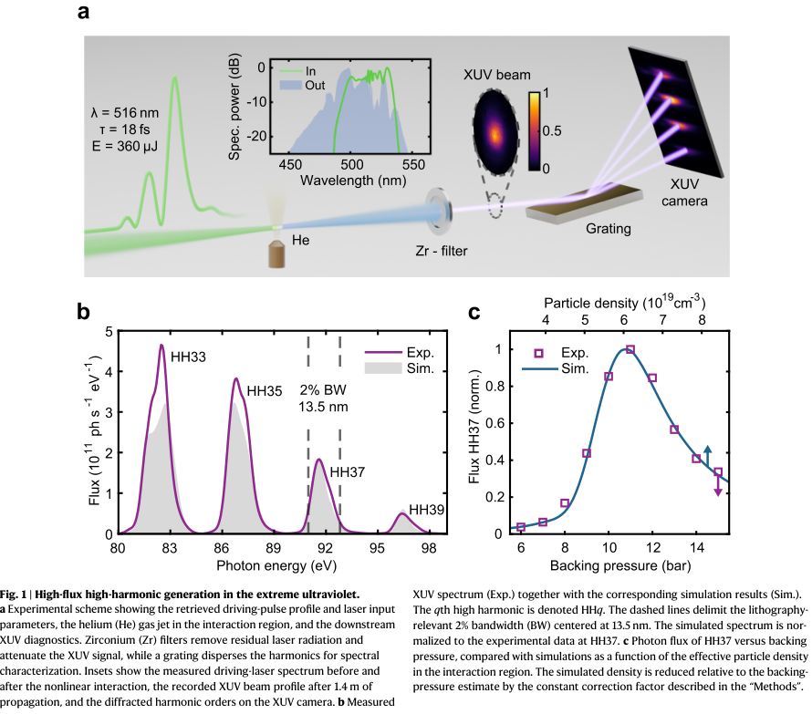
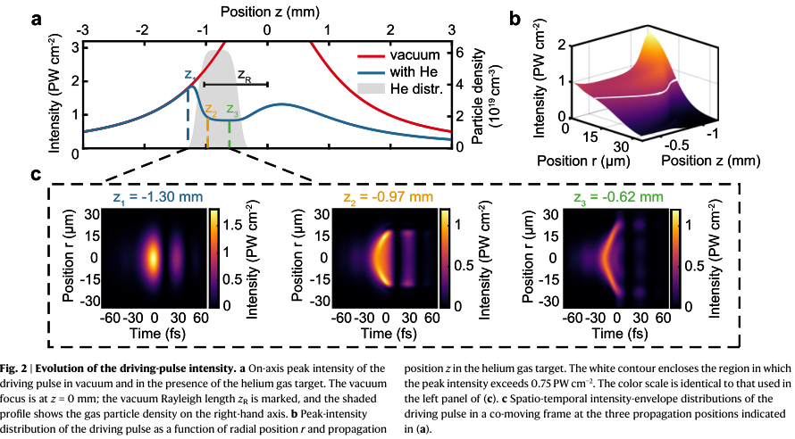
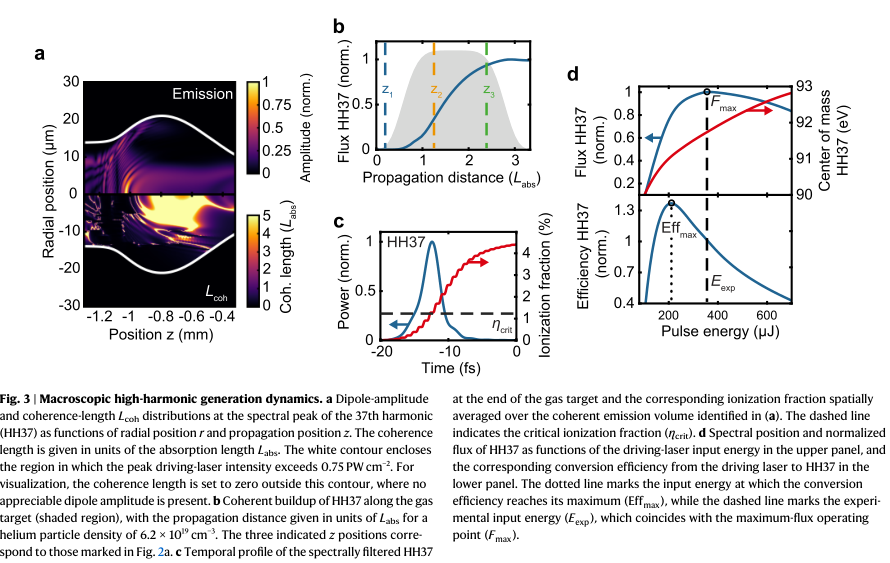
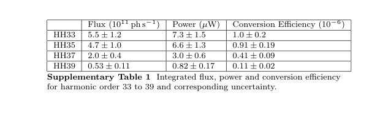

# 可见光驱动高通量极紫外高次谐波：等离子体芯自导引如何恢复相位匹配

## 0. 论文与实际阅读版本

- Karst, Maximilian; Gebhardt, Martin; Eisenbach, Lucas; Gierschke, Philipp; Sidiropoulos, Themistoklis; Klas, Robert; Rothhardt, Jan; Limpert, Jens。*Visible light drives bright extreme-ultraviolet high harmonics*，Nature Communications **17, 11879 (2026)**。
- [DOI／出版社](https://www.nature.com/articles/s41467-026-79615-1)：10.1038/s41467-026-79615-1。2026-08-24收稿、10-22接收、**11-21在线发表／VOR**。11-22当前页面明确列出Version of record，8页PDF为最终排版；搜索服务缓存仍显示早期版本提示，采用当前原始页面和实际PDF。
- 阅读：[正文PDF](../pdfs/hhg-2026-visible.pdf)，8页；[科学补充](../pdfs/karst-2026-hhg-supp.pdf)，7页。正文、Methods与Supplementary Notes 1–5均读；参考文献未逐篇核验。未下载透明评审文件，未重算作者源数据／Julia／COMSOL。
- 证据类型：**真实HHG实验＋标定反演光子通量＋传播／偶极／相干叠加模拟**。3 fs时宽、气体内强度与相位匹配空间结构来自模型；不是直接时间分辨实测。主题关键词：laser plasma，high harmonic generation，EUV，experimental diagnostics，phase matching。相关性4/5。

## 1. 摘要：先区分三个输出口径

实验用516 nm、18 fs的绿光，在氦中获得延伸至100 eV的谐波。最优13.5 nm工况的入射能量360 μJ、重复率20 kHz，即7.2 W；压缩器可用8.3 W／415 μJ不等于实际送入最优HHG点的功率。

| 量 | 实验报告 | 积分口径 |
| --- | --- | --- |
| 13.5 nm／HH37 | 1.8×10¹¹ photons/s，约2.7 μW | 中心91.8 eV的2%相对带宽 |
| HH37整条线 | (2.0±0.4)×10¹¹ photons/s，3.0±0.6 μW，效率(0.41±0.09)×10⁻⁶ | 补表1，整条谐波积分 |
| 最高单线效率HH33 | 7.3±1.5 μW，(1.0±0.2)×10⁻⁶ | HH33整条线，非13.5 nm带宽 |
| 80–100 eV总功率 | 17.7±3.7 μW | 多条谐波总和 |

因此摘要的“最高10⁻⁶”和“13.5 nm的1.8×10¹¹/s”对应不同口径。按2.7 μW/7.2 W复算，13.5 nm的2%带宽效率约3.75×10⁻⁷；这是本笔记的口径核算，不是新增测量。

## 2. 引言：单原子效率与宏观相干长度的矛盾

引言先从成像、谱学及EUV掩模检测的光子统计需求出发，再说明短驱动波长为何有利：单原子HHG产额有强烈的负波长标度；但电子有质动力能随强度及波长平方增加，短波长达到同一截止能需要更高强度。下面是解释三步模型的标准关系，非作者新增拟合式：

$$
U_p=\frac{e^2 I}{2m_e c\epsilon_0\omega^2},\qquad E_{\rm cut}\simeq I_p+3.17U_p.
$$

由平面波平均强度与电场幅值关系消去场强即可得到第一式；第二式来自回碰电子的最大经典返回动能。缩短波长有利于单原子响应，却增加到达约100 eV的强度要求。氦的高电离势有利于承受这一工况，但强电离产生的离焦和相位变化会限制宏观累积。

作者随后按长靶重塑、短靶瞬态匹配和等离子体芯自导引三类机制比较。本工作把气体放在几何焦点前，让几何会聚与等离子体离焦平衡，在初始重塑之后维持较长的稳定传播段；这里的自导引不应直接等同于Kerr自聚焦。

## 3. Results：从测得光谱走向模拟机制

### 3.1 实验输出与蓝移（图1，正文2–3页）

图1a为装置及脉冲、驱动谱、XUV光斑。氦喷嘴前的驱动为360 μJ、18 fs，XUV传播1.4 m后仍近高斯；报告发散为**1/e²半角0.8 mrad**，不是FWHM全角。b的横轴为光子能量eV，纵轴为每秒每eV光子通量；紫线是实验，灰区为模拟，**模拟在HH37处归一化到实测**，所以谱形一致不能独立验证绝对模拟效率。虚线界定13.5 nm的2%带宽。c下轴为背压bar，上轴为经模型修正的有效密度；通量按峰值归一化，不能从这一图读出绝对光子数。

516 nm基频的第37阶原应约88.9 eV，实测中心约91.8 eV。驱动穿过气体后的蓝移被谐波阶数放大，解释约2.9 eV的偏移；这不是谐波编号改变。

### 3.2 驱动场重塑与自稳定（图2，正文2、4页）

全部是传播模拟。a横轴传播位置mm，强度轴PW/cm²，右轴氦密度10¹⁹ cm⁻³；真空峰值超过4 PW/cm²，入气体瞬态峰值约2 PW/cm²，随后稳定段约0.9 PW/cm²，三者不能互换。b展示径向μm与传播mm上的强度；c为三位置的共动时间fs—半径μm图，初始近椭圆变为月牙形，后两位置近轴部分相对稳定。

物理含义是近轴电离更强、折射率降低更大，先产生相位提前和离焦；位于焦点前的会聚束流补偿离焦，形成自调节区。模型支持这一机制，实验直接测量的是谱、背压响应及出射光斑，尚不是气体内二维强度或电离分数的直接成像。

### 3.3 相干叠加、3 fs预测与效率最优点（图3，正文3–5页）

图3a上半部为归一化偶极幅度，下半部为相干长度与吸收长度之比；轴为半径μm、传播mm。白线只标出驱动超过0.75 PW/cm²的区域，区域外相干长度为便于显示被置零，不能解释成其真实数学值为零。b横轴用吸收长度归一化、纵轴为归一化HH37通量；峰值密度6.2×10¹⁹ cm⁻³时吸收长度308 μm，稳定段约跨两个吸收长度，累积趋于吸收受限。

局域近恒定失配时可用下式理解相位抵消，作为本笔记对作者数值相位定义的解释：

$$
\Delta k=\partial_z(\phi_{\rm dipole}-\phi_{\rm XUV}),\qquad
L_{\rm coh}=\frac{\pi}{|\Delta k|}.
$$

两个位置的源项相对传播相位差达到π时开始抵消；数值相位包含气体、等离子体、几何及偶极相位，不能只用中性气体色散一项代表全部。

c横轴共动时间fs，蓝线为滤出HH37的归一化时域功率、红线为发射体积平均电离率%；峰附近电离率约1.2%，预测脉冲FWHM约3 fs。它是**滤波单谐波的模型预测**，未作时域测量，也不是已测得孤立阿秒脉冲。d为仅改变输入能量的模拟；上图同时画HH37归一化通量与中心eV，下图为效率。最大通量点接近360 μJ，最高效率在更低能量；降低输入可减少无效月牙外围能量，同时保留相干芯区。

随后作者模拟缩短至10 fs：稳定强度增加约10%、HH37效率约翻倍且谱延伸至100 eV以上。此处不是额外实验。更高平均功率和掩模检测仍是应用前景，论文没有完成工业吞吐量或掩模缺陷验收。

## 4. Methods：标定链与数值假设

1032 nm光纤激光为22.4 W、20 kHz、280 fs；1 mm BBO倍频效率48%。氩气多程池10往返、0.8 bar，加色散镜压缩，得到18 fs、8.3 W、M²≤1.2。最优HHG经光阑取360 μJ，26 μm的1/e²直径；喷嘴约760 μm长、11 bar，靶中心位于焦点前810 μm，约0.8瑞利长度。喷嘴背压不等于作用区真实密度。

正文式(1)将CCD计数反演为生成通量：

$$
N_{\rm ph/s}=\frac{C_{\rm CCD}}{R_{\rm CCD}t_{\rm exp}\eta_g T_f R_{\rm GIP}}.
$$

计数等于入射光子数乘探测器响应、曝光时间和各传输／反射效率，故依次除去它们。CCD响应及光栅效率有PTB标定；滤片透射实测，掠入射板反射率采用光学常数计算。作者把光栅角度5%、板角度5%、滤片11%**线性相加**得到21%的保守相对上界，不是独立误差平方和，也不等于已证明的统计置信区间。

模拟采用径向对称Luna.jl驱动传播、修正电离率、强场近似单原子偶极及径向分步XUV传播，含衍射、吸收和复折射率。COMSOL气体轮廓近似五阶超高斯、宽度375 μm；相对背压理想气体估计的密度再除以4.4。没有直接密度诊断及误差传播的完整闭环，且模拟绝对谱已有HH37归一化。代码需向作者索取，本轮未运行。

## 5. Supplementary Notes 1–5：按补充顺序核对

**Note 1／图S1–S3**：TIPTOE重构18 fs，傅里叶极限17 fs；前基座和后脉冲使峰功率较变换极限低约35%，不能直接把总能量除18 fs当真实峰值。非线性传播模拟归因于色散镜的非理想GDD；支持15 fs是优化预测。S3给M²x=1.1、M²y=1.2及26 μm焦斑，空间图为归一化信号，非绝对强度图。

**Note 2／补表1**：

表的通量单位10¹¹/s、功率μW、效率10⁻⁶；HH33／35／37／39分列，按7.2 W入射归一化。Zr滤片在80 eV以下强吸收，作者仅定量HH33及更高阶。2%带宽与整条谱线积分的差异是真实定义差异，不能据此宣布正文和表矛盾。

**Note 3／图S4**：通过约101 eV的硅吸收边校准光子能量；横轴eV、纵轴无量纲透射率，实验每阶FWHM附近的透射点与含氧化层的表列模型比较。HH37位置不确定度±0.3 eV；模型使用80 nm硅及每面10 nm氧化层，不是独立厚度测量证明。

**Note 4／图S5**：同密度下515与1030 nm的稳定强度近似相同；为使长波相位匹配把密度增至4倍，稳定强度下降约0.2 PW/cm²。横轴传播位置按各自瑞利长度归一化、纵轴PW/cm²。比较同时按瑞利长度缩放靶长和位置，不能说固定真实几何的全部性能完全相同；参考515 nm峰功率仅为Kerr临界功率24%，支持几何会聚／等离子体离焦主导。

**Note 5／图S6**：最大通量与最大效率模拟点的谱分别归一化比较，中心位置蓝移不同；时域发射窗与相干区相似，低能量时外围月牙更小。图中谱形接近不是绝对通量逐点相等，更不是实验测得的全参数鲁棒性。

## 6. 对本库的价值、限制与下一步

优先读图1的实测口径和补表1，再读图2–3的模型机制。它提供相干EUV源及强电离传播诊断案例，可用于检查激光输入质量、气体有效密度、光谱响应与效率定义。与库内激光加热锡等离子体EUV研究是不同介质及辐射机制；不作内容重复。

后续若复现，首先取得绝对标定文件、源数据和代码，检验密度4.4修正与模型参数敏感性；之后才测试长时稳定性、更高平均功率及直接时域诊断。本文光子能量约100 eV，没有转换靶韧致辐射、MeV伽马、光核中子／同位素、临床剂量或防护结果。

## 7. 本轮校验与修订记录

2026-11-22：核验当前VOR及科学补充身份、文件头／MIME／SHA／三路页数／逐页文本；正文6页及补充5页关键内容实际渲染，保留4个原图表摘录。MinerU历史401/A0211失效未复测、零请求，明确使用本地布局文本和渲染回退。图表坐标、归一化及数值已对照；没有重新运行实验、传播或源数据拟合。文件哈希和裁框见同日验证JSON。
