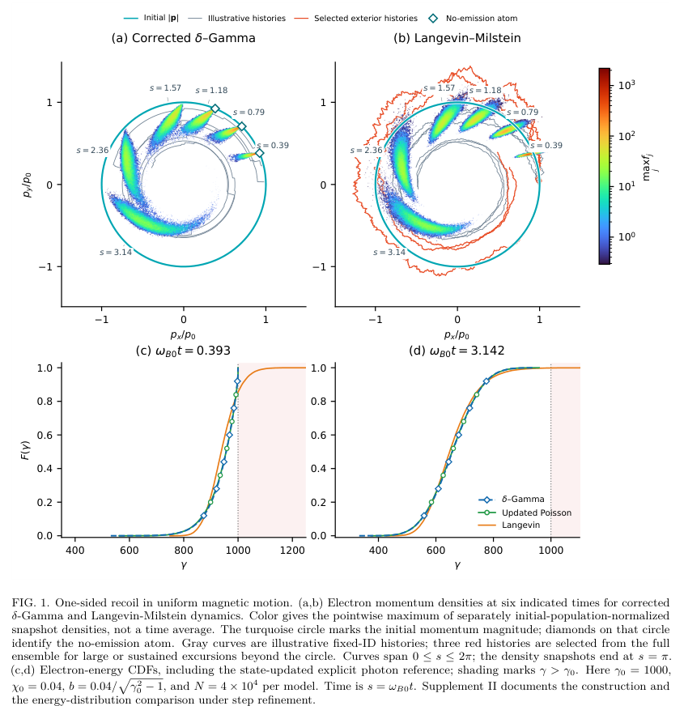
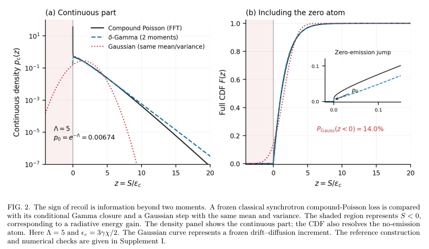
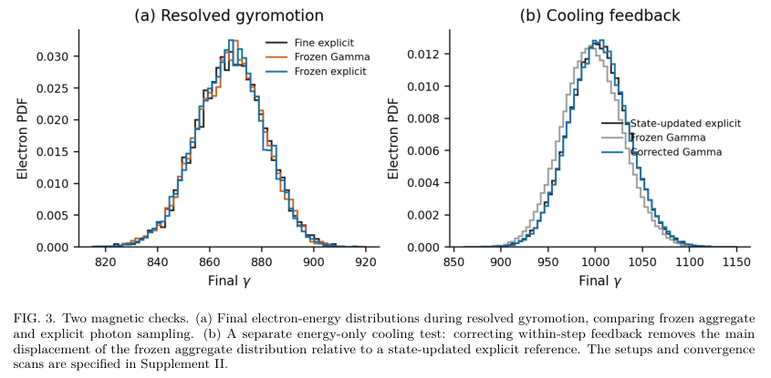
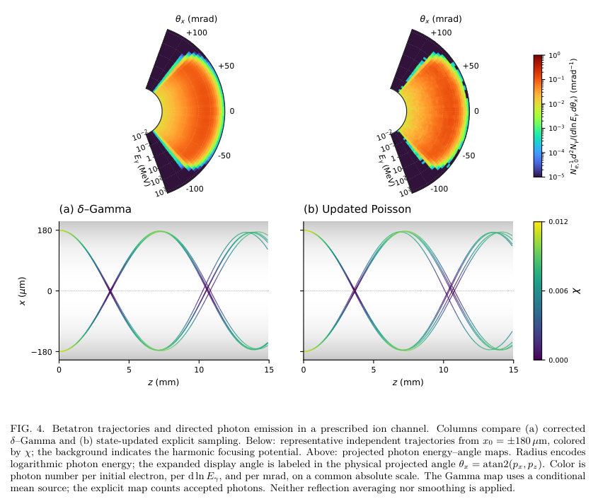
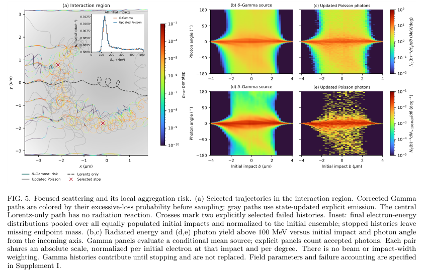

# 软光子反冲的正值有限步长聚合采样：Elkina–Pukhov 2026 中文笔记

## 0. 论文信息与本次阅读范围

- **原题**：Aggregating soft-photon recoil with a positive finite-step sampler。
- **作者**：Nina Elkina、Alexander Pukhov；Heinrich-Heine-Universität Düsseldorf。
- **来源**：[arXiv:2611.26402v1](https://arxiv.org/abs/2611.26402v1)，[DOI](https://doi.org/10.48550/arXiv.2611.26402)。首投 2026-11-19 16:51:10 UTC，11-20 公告；PDF 日期为 11-19。未核实同作期刊接收或正式发表。
- **实际全文**：[官方作者 v1 PDF](../pdfs/elkina-2026-recoil.pdf)，共 34 页：主文 PDF 1–7 页、Supplement I 的 13 页（PDF 8–20）、Supplement II 的 14 页（PDF 21–34），均已阅读全文文本。不是出版社 VOR。
- **方法性质**：解析推导、预设外场中的随机粒子数值测试、条件平均辐射源后处理；**没有新实验，也没有完成自洽 PIC、级联或集体等离子体集成验证**。
- **核验**：文件头、MIME、SHA-256、三种页数和逐页文本检查由本轮统一验证；实际目视主文全部科学图及两补充的图表关键页，保留五幅主文原图。MinerU 历史认证 401/A0211 失效本次未复测，零请求；明确使用本地布局文本和源页渲染回退。**未运行作者 C++、核表生成、随机采样或粒子计算**。

## 1. 摘要与引言：要保留的物理信息超过两个矩

强辐射反作用可同时改变电子运动和出射光子。若单光子很软，一个可分辨轨迹步内可能发射多个光子；逐光子抽样因此可能比电子运动需要更细。文章希望用一次正的总能量损失替代一包软光子，同时保留“不发射”的离散概率和总损失的前两个矩。

常见 Fokker–Planck/Langevin 近似保留平均冷却与涨落，却让有限步的高斯损失具有负值分支，即出现辐射导致的电子增能。纯磁场不做功，因而能把这个支持集错误直接显示为超出初始动量圆的电子。作者没有主张所有扩散可观测量都失效，而是指出两个相同矩不能保证同一物理支持集。

聚合是**同一 LCFA 局域单光子 Markov 模型的统计闭合**，不产生真正多光子 QED 振幅或相干概率。其误差至少包含四层：底层 LCFA/共线近似、冻结外场和轨迹分裂、Gamma 分布形状闭合、有限步内发射态反馈。不能只将两个冻结采样器互相吻合当作正确性证明。

## 2. 正的聚合反冲：主文式(1)–(4)

### 2.1 复合 Poisson 的矩为何使用“单光子原点二阶矩”

采用自然单位，电子/光子能量以电子静能为单位，实验室时间以 Compton 时间为单位。记局域发射率为 W、时间步为 h、单光子损失为 ε；原点矩为 mₙ。冻结本步初态后：

$$
N\sim\mathrm{Poisson}(\Lambda),\qquad \Lambda=Wh,\qquad
S=\sum_{j=1}^{N}\epsilon_j,\qquad m_n=\langle\epsilon^n\rangle.
$$

先条件于光子数，平均损失为单光子均值乘平均光子数。方差的全概率分解同时含单光子涨落和光子数涨落：

$$
\mathbb E S=\Lambda m_1=M,\qquad
\mathrm{Var}S=\Lambda(m_2-m_1^2)+\Lambda m_1^2=\Lambda m_2=V.
$$

因此不能把 m₂ 替换为单光子中心方差。等价的特征函数对数为复合 Poisson 形式，每一阶累积量等于光子数均值乘**单光子原点矩**。

$$
\log\mathbb E e^{iuS}=\Lambda(\mathbb E e^{iu\epsilon}-1),\qquad
\kappa_n(S)=hR_n,\qquad R_n=Wm_n.
$$

### 2.2 保留零原子并拟合正分支

令零损失分支概率为 p₀，其余概率为 q；非空包用形状 k、尺度 θ 的 Gamma 变量代替。

$$
p_0=e^{-\Lambda},\qquad q=1-p_0,\qquad
\widetilde S=\begin{cases}0,&p_0,\\\mathrm{Gamma}(k,\theta),&q.\end{cases}
$$

由全期望与全方差，正分支的均值和方差必须为：

$$
\mu_+=\frac{M}{q},\qquad
v_+=\frac{V}{q}-\frac{p_0M^2}{q^2},\qquad
k=\frac{\mu_+^2}{v_+},\qquad \theta=\frac{v_+}{\mu_+}.
$$

推导时使用正分支二阶原点矩等于总体二阶原点矩除 q，再减条件均值平方。Gamma 的均值、方差分别为 kθ、kθ²，因此得到末两式。这样精确保留**输入的**零分支、均值、方差，不能说精确重建复合 Poisson 的完整分布。

冻结模型的条件方差可写成两个非负项，所以构造有合法性基础；修正矩则仍须逐步检查有限性、正均值、正方差、正条件方差。数值上用 `-expm1(-Λ)` 避免小概率相减误差。非空步的单次抽样节省比例为：

$$
R_{\rm draw}=\frac{\Lambda}{1-e^{-\Lambda}}=\mathbb E[N\mid N\ge1].
$$

这是**正损失随机数次数比**，不是墙钟加速比。聚合窗口还要求本步平均冷却远小于剩余动能、局域核变化小、轨迹已分辨、越界风险可接受。

## 3. 磁场支持集与冻结损失分布：图1、图2

### 图1：纯磁场中能否超出初始能量圆

**来源**：PDF 第2页，主文 Fig.1。上两图坐标是归一化横纵动量，青圆为初始动量模；色标是六个分别按初始粒子数归一化的快照密度的**逐点最大值**，不是时间平均或快照求和。菱形单独标出未发射原子。灰轨迹为示例固定 ID；红轨迹特意选取大或长的越界历史，不能据此读发生频率。轨迹绘至一个初始回旋周期，密度快照只到半周期。

下图横轴为电子洛伦兹因子，纵轴为能量 CDF；初始 γ₀=1000、χ₀=0.04，每种模型 40000 电子。Gamma 和更新态显式光子参考跟随较近；早时 Langevin 在初始能量以上有明显质量。补充 II 中，八分之一周期时越界电子比例为 **14.5475% / 14.5775%**（1024/2048 步），单项二项标准误约0.176个百分点；这是瞬时比例，非“曾越界概率”。步长减半未消除该分支，说明它来自扩散近似的支持集，而非单纯数值积分步过大。该工况每粗步初始负载仅约0.0625光子，**不是高多重发射演示**。

### 图2：同均值方差仍可有不同的符号支持

**来源**：PDF 第3页，主文 Fig.2。横轴为损失除经典临界光子能，左图对数纵轴是连续密度，右图是含零原子的完整 CDF；阴影为负损失。取 Λ=5，零原子约0.006738，高斯负损失概率约**0.14036**，正的两种模型为零。Gamma 与精确冻结参考在小损失/尾部仍不重合，这恰好显示二矩闭合的形状误差。

这幅图是冻结经典软同步辐射分布构造；不是实测谱，也不是完整随态演化误差。Supplement I 的 Fig.I.3 再加入拟合三矩的**平移** Gamma：平移量约−0.18090（同一归一化能量），负损失概率仍有4.420%。增加一个矩不自动保物理支持。

## 4. 发射态反馈：冻结包的共同冷却偏差与图3

冻结包内后续光子仍按初态抽样。电子已经冷却后，发射核应变化；因而“精确抽冻结复合 Poisson”也会偏，不是只有 Gamma 分布有误差。

固定本地位置和外场，定义一次共线发射后状态为 Tεx，局域后向跳跃生成元为：

$$
(\mathcal Lf)(x)=\int_0^{\gamma(x)-1}[f(T_\epsilon x)-f(x)]w(x,\epsilon)\,d\epsilon,
\qquad A=R_1,\quad B=R_2.
$$

由局域半群展开，将函数取为电子能量，第一次作用给负平均冷却，第二次作用描述“先发一光子后发射率变化”，于是累计损失均值为：

$$
M_h=hA+\frac{h^2}{2}\mathcal LA+O(h^3).
$$

再将函数取为“相对固定起始能量的损失平方”，展开二阶原点矩并减均值平方，可得：

$$
V_h=hB+h^2\left(\frac12\mathcal LB+C\right)+O(h^3),\qquad
C=\int\epsilon[A(T_\epsilon x)-A(x)]w(x,\epsilon)\,d\epsilon.
$$

在形成中心方差时，原点二阶矩中的 h²A² 项抵消；不能遗漏 C。物理上平均冷却会改变下一次发射，能量离散也会改变平均冷却。把这两个修正矩代回正分支构造，保持一次聚合抽样。**并未证明完整 Gamma 转移律全局二阶准确**。

本地冻结场的辐射子步，在首个事件之前态不变，零事件概率仍是初态 W 的指数；若真实外场或非辐射轨道变化，应积分沿轨道发射率，固定中点只是一种外层分裂近似。

**来源**：PDF 第4页，主文 Fig.3。两图横轴均为终态 γ、纵轴为电子概率密度，但属于**不同设置**。(a) 分辨回旋时冻结 Gamma/冻结显式与细步显式相近；(b) 更强冷却的纯能量测试中，两个冻结模型共享向低能的偏移，修正 Gamma 靠近更新态参考。不能将(a)中两个冻结模型互相一致用作排除共同误差的证据。

在 γ₀=2000、χ₀≈0.002、归一化冷却时刻 u=1 的独立测试中，50步初始负载约21.6光子/步。冻结 Gamma 的终态均值996.76±0.13，修正后1003.95±0.13，二阶解析参考1003.732；更新态显式参考不同分网格给约1003.49–1003.67，均须保留 Monte Carlo、核表及解析截断误差口径。相对200步更新态参考，经验 CDF 距离从0.08755降至0.00568，**不是统一误差上界**。

### 聚合容量的两条预算

若允许平均相对冷却 δc、磁旋转 δφ，超相对论软同步辐射给出：

$$
\Lambda_{\rm cool}\simeq\frac{15\delta_c}{4\sqrt3\chi},\qquad
\Lambda_{\rm orbit}\simeq\frac{5\alpha\gamma}{2\sqrt3}\delta_\phi,\qquad
\Lambda\lesssim\min(\Lambda_{\rm cool},\Lambda_{\rm orbit}).
$$

第一式由平均单光子能量除电子能量约为4√3χ/15，代入冷却预算得到；第二式由每步回旋角约bh/γ与发射率的软极限结合得到。前者随χ变小可容更大聚合；后者限制本文共享的轨迹/辐射步，**不是损失概率律本身的内禀上限**。这些是容量估计，仍需矩合法性和总风险检查。

## 5. 从随机电子轨迹到定向辐射：图4

**来源**：PDF 第5页，主文 Fig.4。规定线性离子通道、电子密度3×10¹⁷ cm⁻³，γ₀=30000，初始横位置±180 μm，χ₀≈0.01107626。每模型2000个独立电子，左右各1000，252固定步覆盖一个初始 betatron 周期，49.81 ps，步长0.19765 ps；初始局部负载约**0.591**，本图不是每步几十光子的工况。全部轨迹和源合法性检查完成。

下图横轴z（mm）、纵轴x（μm）、曲线颜色为χ，显示辐射阻尼中的横向运动；两列是修正 Gamma 和更新态显式。上图径向编码对数光子能（0.01–1500 MeV），视觉展开角度对应真实投影角±120 mrad，并非图上扇形的度数。共同绝对色标单位是每初始电子、每对数能量、每mrad的光子数：

$$
\frac1{N_{e,0}}\frac{d^2N_\gamma}{d\ln E_\gamma\,d\theta_x},\qquad
\theta_x=\operatorname{atan2}(p_x,p_z).
$$

这不是每球面度密度，也没有按显示扇形面积归一化。未做镜像平均/插值/平滑；左右来自独立初态。

**Gamma总损失不包含每个光子的具体能量**。作者沿随机轨道重新评价完整核，构造能箱的条件平均光子源：

$$
R_{\mathcal A}(x)=\int_{\mathcal A}w(x,\epsilon)d\epsilon,\qquad
J_{\mathcal A}(x)=\int_{\mathcal A}\epsilon w(x,\epsilon)d\epsilon,
$$

$$
\Delta\overline N_{\mathcal A}=hR_{\mathcal A}+\frac{h^2}{2}\mathcal LR_{\mathcal A},\qquad
\Delta\overline E_{\mathcal A}=hJ_{\mathcal A}+\frac{h^2}{2}\mathcal LJ_{\mathcal A}.
$$

推导与能量矩相同：对瞬时源率沿跳跃态演化积分，首次修正由生成元作用给出。全能箱平均源能量与规定平均反冲在同阶局部期望上相符；**每条轨迹的实际抽样损失不等于条件平均诊断能量**。Gamma图更平滑是对条件光子分布积分的结果，不证明稀有硬尾更准确。显式图则计数接受的光子；同样的条件源估计器也可用于显式轨迹。

## 6. 聚焦对向束：图5定位上界风险

**来源**：PDF 第6页，主文 Fig.5。规定对向聚焦场，合成a₀=1000（各束500），光子能1 eV、波长1.23984 μm，聚焦参数50，**没有时间包络**。电子初始γ₀=1000，从归一化x=−40沿+x射入，终止时刻110。主图是41个有符号碰撞参数、每档256电子，共10496历史/模型；4400外步、步长0.025。

(a)坐标为位置μm，Gamma轨迹色标为抽样前**每步**过大损失概率；红叉两条特选停止历史、灰线更新态参考、虚线无辐射Lorentz轨道。(b,c)为初始碰撞参数b（μm）对出射光子角（度）的辐射能密度，(d,e)为100 MeV以上光子数密度。两两共用绝对色标，分别为每该档初始电子每度的MeV、每度光子数；没有束流剖面、碰撞参数宽度或立体角权重。

Gamma有正值支持，但尾部无上限。若抽到总损失超过剩余动能，轨迹不能继续。其抽样前概率为：

$$
p_{\Gamma,\rm over}=q\,Q\left(k,\frac{\gamma-1}{\theta}\right),
$$

其中Q为正则化上不完全Gamma函数。作者**停止并登记**越界历史，不截断、拒绝重抽或补另一条轨迹。主样本停止93/10496，约0.886%；所有活跃Gamma步条件风险之和93.53，与观察停止数相符。更新态显式全部完成。

风险和的期望等于Gamma分支停止计数的期望，但某条轨迹实现的风险和**不是该条轨迹的失效概率**。主图只积累完成更新的辐射源，失败步和未计算后续不补；端点和源保持初始总体归一化，停止使质量缺失。插图也不是存活者重归一化谱；另有端点均值仅对存活者计算，二者必须区分。终止有限时间仍有电子留在场区，因此不是普遍渐近散射谱。

### 小步长不自动清除尾部错误

在非空分支的单光子极限，Gamma只趋近单光子**二矩拟合分布**：

$$
k_1=\frac{m_1^2}{m_2-m_1^2},\qquad
\theta_1=\frac{m_2-m_1^2}{m_1},\qquad
p_{\Gamma,\rm over}(h\mid x)=hW(x)Q\left(k_1,\frac{\gamma-1}{\theta_1}\right)+O(h^2).
$$

每步风险随步长减小，但总步数增多，固定总时长的累计危险率可不消失。这与冻结态冷却偏差不同：反馈修正或步长加密能改进矩，不会把无上界Gamma变成有上界的真单光子分布。固定每步风险阈值也不保证固定累计风险。

## 7. Supplement I：构造、实现和外场控制，按原文顺序

### 7.1 单位、共同核与抽样表（PDF 8–9）

所有比较共享自旋平均、超相对论、共线 LCFA 常交叉场核，并截断单光子能量不超过剩余动能。一般场量子参数为：

$$
\chi=\sqrt{(\gamma\mathbf E+\mathbf p\times\mathbf B)^2-(\mathbf p\cdot\mathbf E)^2}.
$$

无量纲场以临界场归一，动量以mc归一；纯横磁场给χ=b√(γ²−1)。共同微分率可写成：

$$
s=\epsilon/\gamma,\quad z=\frac{2s}{3\chi(1-s)},\quad
\frac{dW}{ds}=\frac{\alpha}{\sqrt3\pi\gamma}
\left[\left(1-s+\frac1{1-s}\right)K_{2/3}(z)-\int_z^\infty K_{1/3}(y)dy\right],
\quad 0<s<1-\frac1\gamma.
$$

其中s是光子占电子总能量的比例，z为Bessel核自变量，α为精细结构常数；上限保证单光子后电子至少保留静能。对本式乘光子能的n次幂后积分，得到前述原点矩率Rₙ；这是有限动能截止的共同模型，软极限式只是其渐近检查。

率表覆盖χ从10⁻¹⁰到30，192个对数节点和6000个变换能量节点；另765点χ网格供矩计算。有限能量截断、插值和核表误差都属于共同数值模型，不因Gamma闭合而消失。

条件Gamma构造的条件方差在冻结情形可严格验证非负；辅助三阶矩可诊断形状误差，但不是主更新的额外保留矩。小Λ的正分支并不重建真实单光子谱。

### 7.2 固定网格、状态反馈与更新态显式参考（PDF 10–11）

一步为隐式中点Lorentz半步—辐射h步—Lorentz半步，辐射期间固定中点位置与场。反冲后用质量壳关系重建动量：

$$
\gamma'=\gamma-S,\qquad
\mathbf p'=\sqrt{(\gamma')^2-1}\,\frac{\mathbf p}{|\mathbf p|}.
$$

冻结显式控制抽Poisson个数并全按中点初态CDF抽能量；更新态显式参考采用uniformization：抽上界率Ω对应的Poisson提议数，每提议按当前W/Ω接受，接受后立即改变能量、χ、截止及核。**接受光子数一般不再是初始Wh的Poisson变量**。空提议不是拒绝非法光子的重抽。文中检查率上界和能量账本；其“局域精确”仅指数值核的固定场子步半群，外场冻结/共线/外层分裂仍在。

混合策略按Gamma尾部风险转向**冻结显式**，不是更新态显式；所以混合不保证完成。修正矩非法时，修正Gamma停止，修正混合回退；本文聚焦例的这类非法矩计数为零，与能量越界停止另记。

### 7.3 能量边界、容量和源后处理（PDF 11–14）

累计风险、单光子Gamma极限与容量预算已在主文相关位置推导。表I.1以平均冷却预算0.02、旋转预算0.1 rad说明：γ=2000、χ=0.002时冷却可容21.7光子，轨道仅2.11；γ=20000、同χ时两者约21.7/21.1。这是初步预算，非已证明普适误差准则。

源后处理用12个反冲积分节点，能箱能率做两点分位积分。作者的选定积分加密中，已占据箱计数变化至多约2.6×10⁻⁴；箱源能量与规定均值约3.1×10⁻⁴，细能箱约2.6×10⁻⁵。这里只是选点数值积分检查，并非全部稀有尾精度认证。

C++17 header-only实现以场回调推进动量，超相对论反馈查表含1025χ节点/256反冲节点；不适合χ随γ比例缩放时退至32节点局域场积分。选定场相对512节点检查，有限步均值/方差相对差约1.9×10⁻⁶/2.4×10⁻⁵；某些生成元系数本身误差达1.64%，但在步修正中权重小。未取得并复跑固定源码版本。

### 7.4 计算成本及低能离子通道对照（PDF 14–16）

冻结显式成本含公共轨道、计数抽样和Λ次光子能抽样；Gamma含公共成本、分支、q次Gamma及反馈额外成本。因而随机数次数减少不等价于相同幅度总耗时减少。

另一个**γ₀=20000**通道控制，与图4参数不同：密度同为3×10¹⁷ cm⁻³、单侧180 μm初态，63步、每步0.6455 ps，10000电子，覆盖40.67 ps。冻结显式786410光子，Gamma411580个正更新，正更新抽样比约1.91；所有轨迹完成，电子终态经验CDF差约0.009–0.012。最大步损失Gamma10.79%、Poisson10.70%，最大单光子占电子能8.37%，没有人为软光子截止。

**Fig.I.1（PDF16）**：上排终态电子能（GeV）概率密度及位置—横向动量相图，下排光子能（MeV）对数计数谱/能谱。源曲线来自完整核条件平均；表I.3的每初始电子平均源能与实际随机总损失接近，但本来就不是逐历史相等。修正Gamma终态均值8.48190±0.00352 GeV，冻结Gamma8.47550±0.00355 GeV；它们不是在此证明没有冻结偏差。

表I.2冻结源控制：每初始电子全能光子78.5042±0.0036（Gamma源）对78.6410±0.0881（显式）；100 MeV以上4.13205±0.00324对4.12570±0.01820；1 GeV以上Gamma源2.64×10⁻⁵、显式零观测，**不能把零观测当零概率或把光滑源当尾部已验证**。

三个交替四线程动力学计时，中位数比**1.237**。不含编译、建表、Python压缩、绘图和光谱后处理；比较的是**冻结Gamma/冻结Poisson**，不是修正Gamma/更新态参考，也不是图4定向诊断。高负载21.6的磁冷却演示没有配套这一速度比。

### 7.5 聚焦场、碰撞参数与混合停止控制（PDF 16–18）

主图设置见第6节。表I.4另用**9个非负碰撞参数×2048电子=18432**的独立端点控制，不能把其停止数与主图10496总体混用。

| 模型 | 步长0.025停止数 | 步长0.0125停止数 |
| --- | ---: | ---: |
| 冻结Gamma | 217 | 235 |
| 修正Gamma | 202 | 230 |
| 冻结Poisson | 9 | 6 |
| 更新态显式 | 0 | 0 |
| 混合，阈值10⁻⁵ | 59 | 93 |
| 混合，阈值10⁻⁶ | 9 | 10 |
| 修正混合，阈值10⁻⁶ | 12 | 10 |

两种最多一光子的Bernoulli控制均零停止，但这不使它们成为任意负载正确参考。冻结Poisson失败可来自各光子单独合法而**总和非法**；粗步9次失败含7个双光子、2个三光子事件。混合阈值10⁻⁵的累计活跃风险44.86→88.02，显示固定每步阈值不能固定总风险。

**Fig.I.2（PDF18）**按有符号初始b（μm）给有限终时电子能（MeV）和电子角（度）分布，色标按该b档初始粒子数/纵轴箱宽归一化；停止留下缺失质量。不含束流权重，也不普遍是渐近谱；存活者均值不能直接替代完整总体比较。

### 7.6 冻结高斯化和三矩平移控制（PDF 19–20）

Fig.I.3是主文图2扩展，见第3节。参考曲线用加零填充FFT卷积求冻结复合Poisson，不是用Gamma自证；网格减半检查CDF变化至多3.09×10⁻⁵（指定范围），精确矩与格点模型误差另记。Gaussian约14.0%负损失，平移Gamma约4.42%，零分支的CDF跳跃单独展示。精确冻结分布与正Gamma仍有可辨形状差。

## 8. Supplement II：同步辐射解析与独立磁场验证，按原文顺序

### 8.1 三个设置和软极限单光子矩（PDF 21–23）

三个测试分开：纯能量冷却γ₀=2000、χ₀=0.002/0.01/0.02至u=1；回旋聚合b=10⁻⁶、γ₀=1000至五初始回旋周期；支持集测试γ₀=1000、χ₀=0.04。它们解决不同问题。

Airy表示与Bessel表示通过变量变换相连，积分可导出软极限矩。用经典临界能归一的光子数密度为：

$$
\epsilon_c=\frac32\gamma\chi,\qquad
f_{\rm cl}(y)=\frac3{5\pi}\int_y^\infty K_{5/3}(u)du,\qquad y=\epsilon/\epsilon_c.
$$

交换两层积分顺序，再用Bessel Mellin积分可得：

$$
C_n=\int_0^\infty y^nf_{\rm cl}(y)dy
=\frac{3\,2^n}{5\pi(n+1)}
\Gamma\left(\frac n2+\frac{11}6\right)
\Gamma\left(\frac n2+\frac16\right).
$$

于是单光子原点矩约为Cₙεcⁿ。尤其必须区分两套归一化：

$$
\frac{m_1}{\gamma}\simeq\frac{4\sqrt3}{15}\chi,\qquad
m_2\simeq\frac{11}{12}(\gamma\chi)^2=\frac{11}{27}\epsilon_c^2.
$$

11/12与11/27不是矛盾，而是能量标尺不同。若把它们互换，将直接改变随机冷却方差。以自然实验室时间计的软极限原点矩率为：

$$
R_0\simeq\frac{5\alpha\chi}{2\sqrt3\gamma},\quad
R_1\simeq\frac{2\alpha\chi^2}{3},\quad
R_2\simeq\frac{55\alpha\gamma\chi^3}{24\sqrt3},\quad
R_3\simeq\frac{14\alpha\gamma^2\chi^4}{3},\quad
R_4\simeq\frac{1309\alpha\gamma^3\chi^5}{32\sqrt3}.
$$

物理每秒率需除Compton时间。作者实际采样保留完整量子核，不是只使用这些渐近式。

### 8.2 独立核积分和冻结包变换检查（PDF 23）

9个χ节点10⁻⁵至1，独立Bessel自适应积分对共同表的最大相对差约W为9.2×10⁻⁵、m₁为6.2×10⁻⁵、m₂为1.5×10⁻⁴，仅说明选定节点。

γ=2000、χ=0.002、Λ=3的30万冻结显式包，在六个Laplace参数点与独立核积分在0.47标准误内；Gamma的相应变换存在系统形状差。例如归一Laplace参数1时精确约0.56429、Gamma约0.55901。保持矩不能同时保证Laplace变换或尾部。

### 8.3 独立解析冷却参考与图II.1（PDF 23–25）

作者采用Baier–Katkov–Strakhovenko既有解析同步辐射矩，按初始χ₀展开至二阶，将时间定义为初始经典冷却时间的无量纲倍数：

$$
u=\frac23\alpha b^2\gamma_0\tau,\qquad H=1+u,\quad L=\ln H,\quad d=\frac{55\sqrt3}{48}.
$$

为避免符号误读，本式左侧为拉丁字母 **u**（归一化冷却时间），不是矩阶数ν。经典平均能为γ₀/H；一阶量子/随机修正和方差的主要结构为：

$$
\frac{\langle\gamma\rangle}{\gamma_0}=\frac1H+\chi_0\frac d{H^2}\left(2L+\frac uH\right)+O(\chi_0^2),\qquad
\frac{\mathrm{Var}\gamma}{\gamma_0^2}=\chi_0\frac{du}{H^4}+O(\chi_0^2).
$$

**推导关系**：从能量后向跳跃生成元按χ₀展开，分别作用于一阶和二阶能量函数，解相应矩方程；形成方差时同阶展开并减均值平方。二阶系数来自原文(II.18)–(II.26)，不能直接平方截断均值后保留其诱导三/四阶项。此处不把复杂二阶系数重新简化成未核验拟合。

只把量子抑制功率沿确定性轨迹积分，所得一阶平均修正与集合平均不同；差异是能量涨落反馈，不能把“量子功率因子”当作全部随机效应。

**Fig.II.1（PDF25）**三列χ₀=0.002/0.01/0.02；上排是平均能减一阶解析预测，下排是方差除领先解析项；黑曲线含二阶、虚线为一阶，误差棒为两倍Monte Carlo标准误。二阶参考既显示有限步偏差，也显示解析截断变化。χ₀=0.02、u=1时方差相对领先项约1.05177，约5%的变化是预期量子高阶贡献，不应全归为数值误差。

### 8.4 生成元反馈、步扫描和分布/分位数（PDF 25–29）

反馈推导见第4节。**Fig.II.2（PDF27）**横轴50/100/200步，上排平均能相对一阶基准、下排方差归一领先项；冻结偏差随加密减小，反馈修正已接近参考，但每点波动不能当作严格单调收敛或已测全局阶数。表II.2误差为单标准误，图棒为两倍，须分开。

**Fig.II.3（PDF28）**左图终态能量PDF，右图相对更新态显式的CDF差。冻结的明显偏移与修正接近零的曲线显示反馈改善的是整个已分辨分布，不只均值；参考步长/双率上界控制是独立样本而非逐历史同噪声匹配。

**Fig.II.4（PDF29）**三列初始χ，第一排终态分布，第二排相对4000步冻结显式参考的CDF差，第三排分位数差除参考标准差；2000步独立参考CDF距离约0.0040–0.0044。50步生成元修正的距离分别0.00573/0.00707/0.00380，全部9种修正场/步组合约0.00252–0.00780。

七个分位点为0.001至0.999。所有63个生成元修正分位数差区间含零；区间由97.5%次序统计区间相减，给至少95%的**逐点**覆盖，不是63点联合置信。最外端参考尾部约40粒子、聚合约60，不能据此认证更稀有能尾。中点/输运辅助近似在χ₀=0.02粗步有两个边缘排零，细步消失。

辅助中点/输运方案把漂移在半冷却能量处求值，并为方差加冷却收缩；不等同于完整生成元积分。主修正的独立磁场实现使用预计算积分/PCHIP，不能把其一次性建表与便携C++查表的成本混同。

### 8.5 轨道分辨率与图II.5（PDF 30–32）

b=10⁻⁶、γ₀=1000，五初始回旋周期约40.47 ps，初始回旋半径386 μm，每例10000电子。细参考3950步约330.505光子/电子。表II.4共享轨道步扩大时，每非空步光子数1.61→2.39→4.25→8.27→16.54，而同反冲历史上的纯中点相位误差0.232°→0.931°→3.74°→14.81°→63.38°。

**Fig.II.5（PDF32）**(a)步约0.199下终态电子能分布；(b)每非空步光子数；(c)对细参考平均能差及合成标准误；(d)同一反冲历史条件下的纯轨道积分相位误差。这证明更大多重性可先于轨道失败出现，也显示不能无限增共享步。该相位误差不是完整随机轨迹精度估计；均匀磁场率不依赖回旋相位，不能把冷却偏差归因于旋转相位错误。

### 8.6 扩散约定、高斯化与适用域（PDF 31–34）

支持集测试的数值CDF及归一化见图1说明。扩散方程中漂移为−R₁、Itô噪声幅度为√R₂；若正向算子写成二阶导数乘扩散系数，该系数为R₂/2。补充明确使用原点二阶率，避免把两个“扩散系数”约定混用。

冻结和的高斯化由**局部多重性**控制，其软极限偏度约3.68392/√Λ、超额峰度约19.47273/Λ。χ小意味着单个反冲软，Λ大意味着一包近高斯，两件事不同。即使两个矩相同，有限Λ高斯分布仍可有负损失支持。

结论支持在给定局域核、已分辨轨道、合法修正矩、可接受形状误差和累计越界风险窗口内聚合软光子。**没有证明一般强场、硬反冲、集体自洽场、自旋偏振、成对产生或完整PIC成本上的普遍优势**。

## 9. 与本库方向的联系及接续问题

对QED-PIC而言，可将这个算法看作一种候选辐射更新模块：它保留单向能流，且把冻结核误差与分布闭合误差分开诊断。但本文是预设场单粒子集合；还需粒子/场能量账本、自洽网格耦合、空间非均匀场、真实激光包络、不同硬尾风险及等精度总成本测试。

若用于伽马源预测，必须继续保留条件平均源/逐光子事件的差别。硬光子数、光子涨落、光子—电子关联、光核反应输入事件和探测器符合计数不能只从二矩总损失自动恢复；初始电子数归一的缺失历史也不能静默补成绝对产额。

优先接续：取得可追溯源码与参数清单/随机种子；对同一完整观测量比较修正Gamma、更新态参考和风险开关的误差—成本曲线；量化越界删失对辐射源的影响；测试有限上界正分布或转向更新态显式的混合；再讨论自洽PIC集成。本轮只是全文审读与记录，未运行这些计算。

## 10. 复习用速记

**正值二矩聚合能保单向能量损失，生成元反馈能减少冻结包共同冷却偏差；但Gamma无上界，缩步不保证消除累计越界，条件平均光谱也不是从每次聚合损失拆出的真实光子事件。**1.237倍只是另一冻结通道动力学计时，不能移植为高负载修正QED-PIC总加速。
