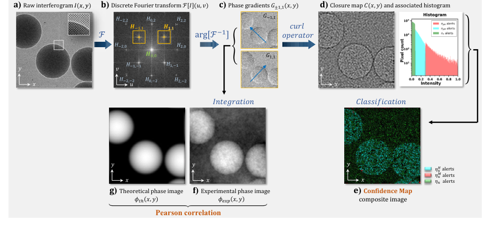
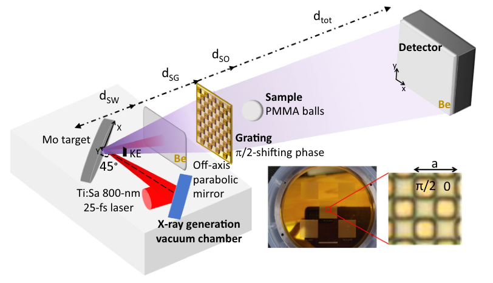
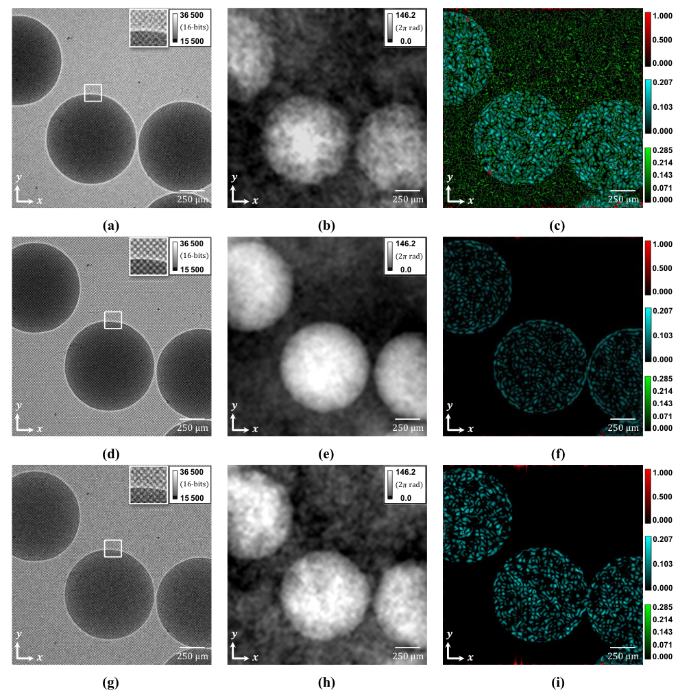
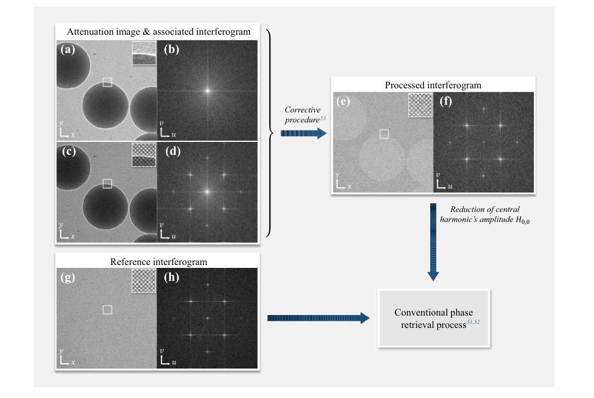
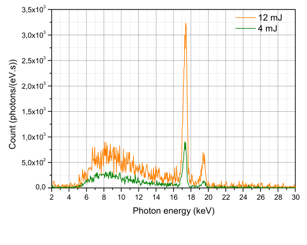
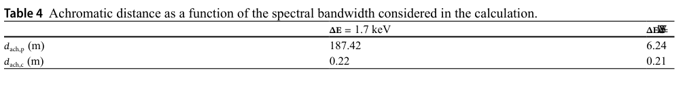
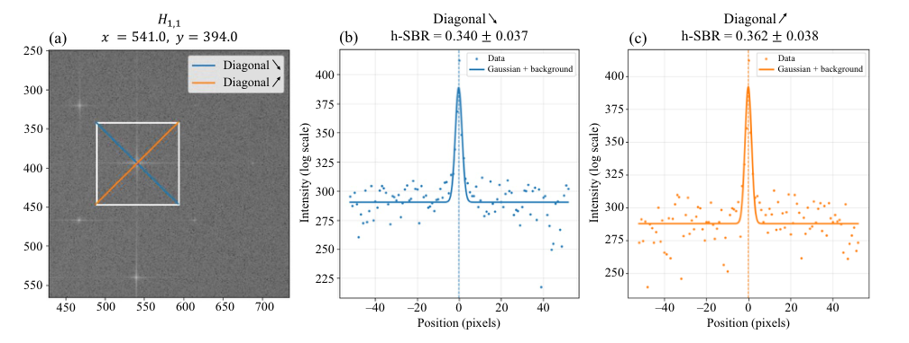
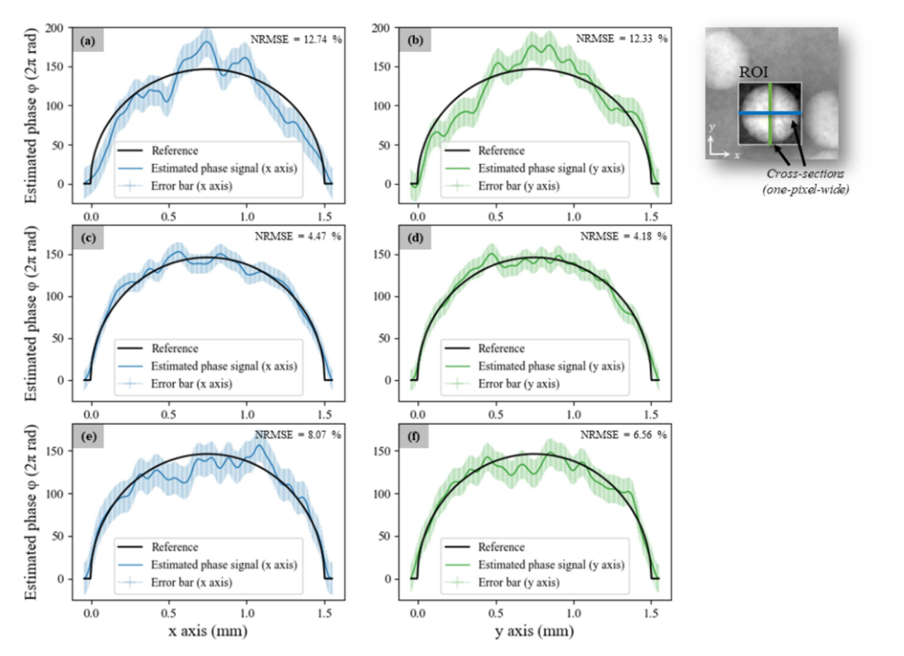

# 飞秒激光等离子体 Mo Kα 源的单光栅定量相衬成像

## 0. 论文信息与阅读边界

- Georges Giakoumakis、Amelie Ferré、Daria Gudz、Mouad Saliji、Jérôme Primot、Olivier Utéza、Raphaël Clady、Adrien Stolidi；前两位共同一作。
- *Quantitative evaluation of single-grating phase-contrast imaging with a femtosecond laser–plasma Kα X-ray source*，Scientific Reports，[DOI:10.1038/s41598-026-78588-x](https://www.nature.com/articles/s41598-026-78588-x)。2026-07-30收到、10-27接收、**11-22在线发表**。
- 实际读的是出版社 **21页 Article in Press**，[官方全文](https://www.nature.com/articles/s41598-026-78588-x_reference.pdf)／[本地PDF](../pdfs/giakoumakis-2026-phase.pdf)。首页明确最终编辑版将替换此版，不能称为最终VOR。全文含Methods、声明与参考文献；没有取得额外科学补充。
- 这是 **100 Hz激光固靶X射线源＋静态PMMA球的实测成像**，并使用几何模型、谱响应与重建算法。不是外置电子束转换靶实验，也未测MeV伽马、光核产额、动态HEDP样品、临床剂量或防护性能。
- 全文文本已读；关键公式、表格和七幅原图已渲染核对。MinerU历史认证失效本次未复测、零请求，使用明确的本地布局文本／原页回退。本文有原始排版／数值疑点，见相应位置及第8节；未复跑作者实验或重建程序。

## 1. 摘要

作者将多横向剪切干涉（MLSI）与Mo Kα激光等离子体源结合，用一块二维棋盘相位光栅同时编码多个方向的相位梯度，再积分成相位图。已知几何和组成的PMMA球提供理论参考。论文最高相关系数 **0.922±0.008仅对应[B]配置的y方向**，不是全图绝对相位误差或单发成功率。

实验分别比较近似等积分光子计数和等累计曝光条件，显示较小源斑对条纹载频的保真可超过提高通量的收益；但统计不足时该优势消失。飞秒描述驱动激光的时间尺度，**相位图实际通过480或1920 s累计曝光得到**。

## 2. Introduction：为何采用一块二维光栅

弱吸收材料的折射率实部偏差可远大于吸收项，因而相位提供比吸收更强的对比。以常用记号表示：

$$
n=1-\delta+i\beta,\qquad
\phi_{\rm lag}(x,y)=\frac{2\pi}{\lambda}\int\delta(x,y,z)\,dz.
$$

其中折射率、δ、β无量纲，波长和积分路径同单位，相位单位rad。相对于真空的传播相位也可记为负号；本文用正的相位延迟幅值，符号约定须统一。公式来自沿路径累积波数差，说明定量相位取决于**电子密度投影及绝对标定**，而不只取决于物体轮廓清楚。

自由传播成像结构简单，但反演常需材料、谱或先验信息。传统多光栅Talbot–Lau系统还受到对准、吸收和重复曝光限制。本文引用前人系统约11%的通量利用率作为背景；这个数不是本实验同条件对照。单棋盘光栅可同时编码多个梯度，并允许锥束几何调节采样。其Mo Kα线透过率大于85%，也**不是激光到X射线转换效率**。

## 3. Experimental parametric investigation：控制变量与指标

作者选12 mJ与4 mJ两个驱动点，而非连续全域寻优。源通量与源尺寸随强度增加的经验指数约1.4与0.34来自作者既有平台研究；本研究主要检验两个工作点的成像权衡。几何模糊满足：

$$
b=(M-1)S.
$$

S为源的FWHM横向尺寸，M为相应光学元件的几何放大率，b为探测面模糊。相似三角形给出该式；增大通量若同时扩大源斑，会抹掉干涉图中的高频载波。**源斑、物面分辨率、探测器像素及重建空间带宽是不同量。**

### 理论球、Pearson与Confidence Map

理论图按实验图像像素网格生成，球心由实验图亚像素质心配准。均匀整球的物理弦长推导为：

$$
z_\pm=\pm\sqrt{R^2-r^2},\qquad
t_{\rm full}=z_+-z_-=2\sqrt{R^2-r^2},\qquad
\phi_{\rm lag}=\frac{2\pi\delta}{\lambda}t_{\rm full}.
$$

R为球半径，r是相对球心横向距离，球外厚度为零。**原文p4却将投影厚度写成仅根号项，少了整球弦长的2；这里展示几何推导，未把原文静默改写为已澄清。** 原文采用R=750 μm、δ=8.73×10⁻⁷、17.48 keV；按整球公式中心约116 rad，而图2／7显示约146的数值及“2π rad”标签，尚未解释其绝对标度关系。形状相关不能解决这一疑点。

图3（PDF p9）从原始干涉图到FFT载频、两方向梯度、旋度闭合、Confidence Map及积分相位，最后与理论图做相关。FFT轴为空间频率；图中示意选择H₁,₁等载波窗口。Confidence Map绿色为噪声类，青／红为中／大幅欠采样类。它评价梯度**是否彼此相容**，共同的可积系统偏差仍可能旋度为零，因此不是独立绝对真值或完整误差上界。

## 4. Experimental setup

图1（PDF p5）为800 nm、25 fs Ti:Sapphire激光以45°照射Mo靶；100 Hz产生17.48 keV Kα源。出射经Be窗进入空气，光栅位于窗外以减轻碎屑污染。源到窗／光栅／样品／探测器分别约17／22／25.5／92 cm；刀口位于距源6 cm处测横纵源斑，假定高斯形状。PMMA球直径1.5 mm、供应商尺寸公差±2.5%；棋盘周期36 μm，Au高度1.7 μm，对17.48 keV给0／π/2相移。CCD为1024²、13 μm像素、16 bit。

| 驱动能量 | 标称强度 W/cm² | 源FWHM X／Y，μm | 光栅几何模糊 X／Y，μm | Kα源光子率 sr⁻¹s⁻¹ | 探测谱Kα计数占比 |
| --- | --- | --- | --- | --- | --- |
| 12 mJ | 1.2×10¹⁸ | 27／23 | 86／74 | 3.2×10⁹ | 27% |
| 4 mJ | 4.0×10¹⁷ | 16／13 | 51／42 | 8.0×10⁸ | 20% |

表1的光子率是每球面度每秒；除100 Hz可换成每球面度每发，不能直接称4π总产额。最后一列依赖全探测系统，**不是内禀源谱线纯度**。样品放大率约3.6，光栅放大率约4.2，每条纹约11.6像素；13 μm像素除放大率仅给物面采样间距，不等于已测系统分辨率。

## 5. 两组结果，按原文顺序

### 5.1 Fixed integrated photon-count：A对B

12 mJ源Kα率约为4 mJ四倍，因此作者令每帧30 s与120 s，各平均16帧，以近似匹配积分光子统计。谱组成与CCD响应仍有差别，不宜当作所有能道完全相同的噪声控制。

图2（PDF p7）上、中、下排依次A、B、C；左列原始16位信号，中列相位，右列闭合误差分类，物面标尺250 μm。中列保留原图“2π rad”单位与0–146.2色阶，绝对单位疑点未消除。各排同列采用相同显示尺度，有利于看B的噪声和红色残差减少；黑色区域不可理解为所有误差严格为零。

| 配置 | 能量 | 累计曝光（每类图像） | f-CNR | 平均行／列Pearson ρx／ρy | 噪声类闭合残差均值±标准差 |
| --- | --- | --- | --- | --- | --- |
| A | 12 mJ | 16×30=480 s | 1.937±0.324 | 0.809±0.007／0.806±0.007 | 0.150±0.128 |
| B | 4 mJ | 16×120=1920 s | 3.276±0.619 | 0.881±0.008／0.922±0.008 | 0.006±0.007 |
| C | 4 mJ | 4×120=480 s | 2.260±0.267 | 0.837±0.008／0.882±0.008 | 0.012±0.013 |

这些分别是表2／3的不同统计量；不能把所有“±”解释为独立多炮置信区间。B的ρy高于ρx与水平源斑更大、水平相干性更差相符；A噪声较强，可能掩盖这种各向异性。对角载频h-SBR只略升，而正交二阶载频提升较明显，说明源模糊对不同频率方向的影响不同。

### 5.2 Fixed acquisition-time：A对C

C只平均4张120 s图像，与A总曝光同为480 s。较低通量下，C仍有更高的ρx／ρy及较低闭合残差，支持在此范围内源斑收益超过光子损失。f-CNR均值也较高，但误差条有较大重叠，不能单凭这一项宣布显著优势。

同为4 mJ，B比C多四倍积分时间，进一步提高质量：这是曝光统计的作用。不能用B对A的最高相关系数宣称等时间性能提高。

## 6. Discussion与Conclusion

对角H±₁,±₁混合两个方向的信息；正交H₀,±₂／H±₂,₀对对应方向的空间相干更敏感。B中0.337与0.274的h-SBR差约22.3%以较小者为分母，体现方向差异，不是X射线通量差或转换效率差。

物理结论是保护条纹载频，而非最大化所有光子数。作者也报告4 mJ、单张120 s无平均时f-CNR约1.371±0.249、ρx／ρy约0.712／0.751，说明小源斑优势有光子预算下限。本文未给跨所有能量／曝光／样品的全局最优扫描，也未展示真正动态样品。

微结构靶、较高重复率、较长波长驱动和改良探测器是后续方向；机器学习去掉sample-only采集、暗场扩展属于建议，本文未训练模型。高重复率源文献的既有性能也不是当前平台已实现的结果。

## 7. Methods：还原“单光栅”背后的测量与误差

### 7.1 Phase retrieval and image acquisition procedure

棋盘光栅产生多个倾斜波前副本，傅里叶分离载频后取复振幅之差的相位，再按几何灵敏度转换为梯度，最后用两个正交梯度积分。以已经标定的梯度gx、gy为输入，一般最小二乘积分的物理形式为：

$$
\widetilde\phi(k_x,k_y)=
\frac{-i[k_x\widetilde g_x+k_y\widetilde g_y]}{k_x^2+k_y^2},\qquad (k_x,k_y)\ne(0,0).
$$

这是由傅里叶导数定理及最小化梯度残差得出的说明式，**不是声称已复现作者代码**。k为角空间频率，g单位rad/长度；零频常数不能靠梯度确定。载频窗口有限，限制可恢复空间带宽。

图4（PDF p13）依次比较仅样品、样品＋光栅、仅光栅与校正后FFT；校正用加权扣除吸收／相位曲率强度以降低H₀,₀对邻近载频的污染。**这套实验要三种独立采集**，单块光栅不等于单曝光、免参考或单发。表3时间是相应数据流的累计曝光，不能直接当作含所有参考／校正、移动及读出开销的总流程时间。

### 7.2 X-ray spectra：源项与响应

源发射谱通过CCD单光子模式、⁵⁷Co校准及自有分析恢复，积累最多约十发、约200 eV能量精度；通过限制每像素每发的计数避免堆积。

图5（PDF p13）横轴光子能量keV，纵轴探测计数密度photons/(eV·s)，橙12 mJ／绿4 mJ，**未放样品与光栅**。可见17.48 keV Kα、约19.6 keV Kβ及低能连续谱。75 cm空气、800 μm Be窗和CCD量子效率共同改变谱形；CCD在5–6 keV最灵敏、30 keV低于2%，17.48 keV整个探测响应约7%。因此这些低能计数不等于内禀低能辐射占比，也不能把7%称为纯几何或窗透过率。

作者称扣除中央谐波后相位信号主要由Mo Kα贡献，但探测总计数Kα只占20%／27%、Kβ约4%／5%；“准单色”不表示无韧致背景或已完成逐能道相位响应验证。

### 7.3 Optimization of the experimental geometry

原文式(1)–(3)为：

$$
d_{\rm ach,p}=\frac{a^2}{\Delta\lambda},\qquad
\frac{\Delta\lambda}{a}d_{\rm ach,c}
=a\frac{d_{gs}+d_{\rm ach,c}}{d_{gs}},\qquad
\frac1{d_{\rm ach,c}}=\frac1{d_{\rm ach,p}}-\frac1{d_{gs}},\quad d_{gs}=-d_{sg}.
$$

a为光栅周期，Δλ是波长宽度；平面式来自色散引起的图样位移达到一周期，锥束式加入表观周期的几何放大；将前式除以a和距离即可得到倒距离关系。距离单位必须统一，负号来自作者的有向几何约定。

**PDF p15正文写1.78 m／20 cm，表4却写187.42 m／0.22 m（1.7 keV宽度）**。用a=36 μm、17.48 keV及Δλ≈hcΔE/E²做窄带算术，约得187.9 m；与表量级相符。只做了公式算术核查，未改写原文或确认其全谱权重。表列全探测带宽25 keV时6.24 m／0.21 m；第二列表头在原PDF也重叠，笔记依据正文说明其含义。光栅到探测器70 cm大于上述锥束距离，但不能借此消除相位绝对标度疑点。

另一个待澄清点：原文称缩短光栅—探测器距离改善采样，而给出的采样式为：

$$
N=\frac{aM_g}{S_{\rm pix}},\qquad M_g=\frac{d_{\rm tot}}{d_{sg}}.
$$

在固定源—光栅距离和像素时，缩短该距离会降低放大率和每周期像素数。其“改善”可能指其他分辨率权衡，文字与直接采样口径不能直接等同。本文实际N≈11.6，超过作者要求至少6像素／周期。

### 7.4 Raw data analysis

条纹拟合与FFT峰拟合分别定义：

$$
I(x)=I_0+A_f\cos(2\pi x/a+\phi_f),\quad
\mathrm{f\!\! -CNR}=\frac{A_f}{\sigma_{\rm res}},
$$

$$
H(x)=B_h+A_h\exp[-(x-x_0)^2/(2\sigma^2)],\quad
\mathrm{h\!\! -SBR}=\frac{A_h}{B_h}.
$$

前者取调制幅值除正弦拟合残差标准差；后者取FFT载频拟合峰高（扣基底）除基底。两者无量纲，但分母不同，不能互换。f-CNR来自十处、各三像素宽的条纹截线，误差条表示空间变异；h-SBR来自两个对角截线，误差表示方向变异。h-SBR小于1表示峰增量小于基底，并非不可能的负信号。

图6（PDF p16）左为FFT对数强度图及以H₁,₁为中心的方形ROI；中／右横轴距峰位置的像素，纵轴原图标注对数强度，点为数据、实线为高斯＋背景拟合。示例h-SBR约0.340／0.362说明提取过程，不是表2全部结果的独立重测。

### 7.5 Pearson correlation与截线误差

作者逐行、逐列求相关后平均：

$$
\rho=\frac{\operatorname{cov}(\phi,\phi_{\rm ref})}{\sigma_\phi\sigma_{\phi_{\rm ref}}},\qquad
\bar\rho_x=\operatorname{mean}_{\rm rows}\rho_i,\quad
\bar\rho_y=\operatorname{mean}_{\rm columns}\rho_j.
$$

Pearson对整体偏置和正倍数缩放不敏感，故高相关本身不能确认绝对相位幅值。作者用供应商直径D±2.5%重建两套理论图、中心差分求敏感度：

$$
\frac{\partial\rho}{\partial D}\simeq
\frac{\rho(1.025D)-\rho(0.975D)}{0.05D},\quad
u_D=\frac{0.025D}{\sqrt3},\quad
u_\rho=\left|\frac{\partial\rho}{\partial D}\right|u_D.
$$

公差假设矩形分布给出√3；因此表3的±0.007／0.008主要是**理论球径公差传播**，没有包括所有源抖动、标定、算法系统差。实验质心配准误差、PMMA纯度与相位标定误差被作者视为可忽略，尚非独立验证结论。

图7（PDF p18）横轴x／y坐标mm，纵轴沿用原文“Estimated phase φ (2π rad)”标签；黑为理论、蓝／绿为测量，浅色为误差，分别对应A／B／C。NRMSE依次为x／y：A 12.74%／12.33%，B 4.47%／4.18%，C 8.07%／6.56%。归一化分母是**相应理论截线最大减最小**：

$$
\mathrm{RMSE}=\sqrt{\frac1N\sum_i(\phi_{{\rm th},i}-\phi_{{\rm exp},i})^2},\qquad
\mathrm{NRMSE}=\frac{\mathrm{RMSE}}{\max\phi_{\rm th}-\min\phi_{\rm th}}.
$$

误差条将球径传播误差与图外100×100像素噪声ROI估计合成，假设独立后平方相加再开方。NRMSE是特定中心球截线指标，不能当作全场最大误差、空间分辨率或动态成像精度。原图标度疑点也限制对这些绝对量的二次使用。

### 7.6 Confidence map

二维连续二阶可微相位满足：

$$
C=\partial_x g_y-\partial_y g_x=0.
$$

非零闭合残差通过广义高斯混合模型分为噪声与欠采样，再做空间正则化。大幅欠采样通常在锐利边缘出现窄高峰，中幅类更宽，图内纹理区也可出现。分类依赖模型和门槛；零闭合不保证无幅值偏差，也不保证对新的未知复杂材料成立。

## 8. 数据、接续验证与速记

数据声明为向通讯作者合理申请提供；本轮未取得原始图像、权重系数或重建代码。要复现，应先取得三种采集的原始16位帧、暗场／平场与逐帧统计、刀口拟合、全响应和处理窗口，再澄清球弦长因子、图2／7相位单位／标度及正文—表4距离冲突。之后才适合评估绝对相位、真实总采集成本、单发或动态能力。未因高相关而宣称绝对幅值已校准。

对本库的价值：它把**源斑—载频调制度—反演自一致性**连成可检验链条；通量增加不保证更好的定量图像。对HEDP或材料应用仍需实际样品、合适能谱与时间门控验证，不直接外推到光核／临床／屏蔽场景。

原图1–7及表4均摘自上列DOI的Article in Press，©作者2026，[CC BY 4.0](https://creativecommons.org/licenses/by/4.0/)；这里只裁剪、放大，未改动数据、标签或补画缺项。[阅读及裁图来源记录](../research/imaging_reading.json)。
