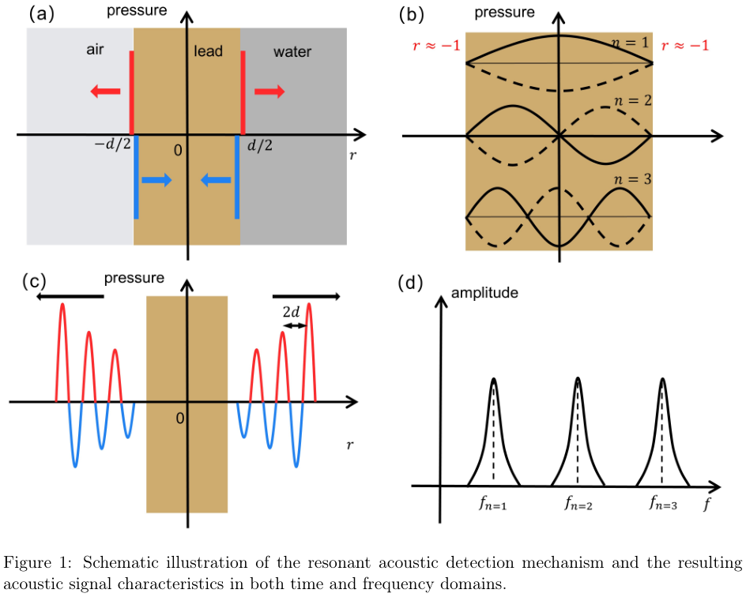
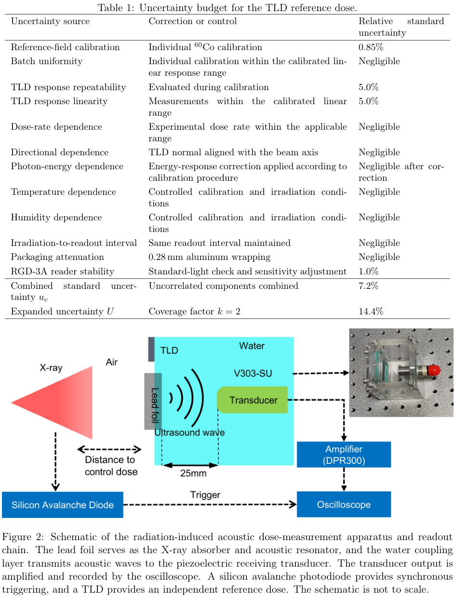
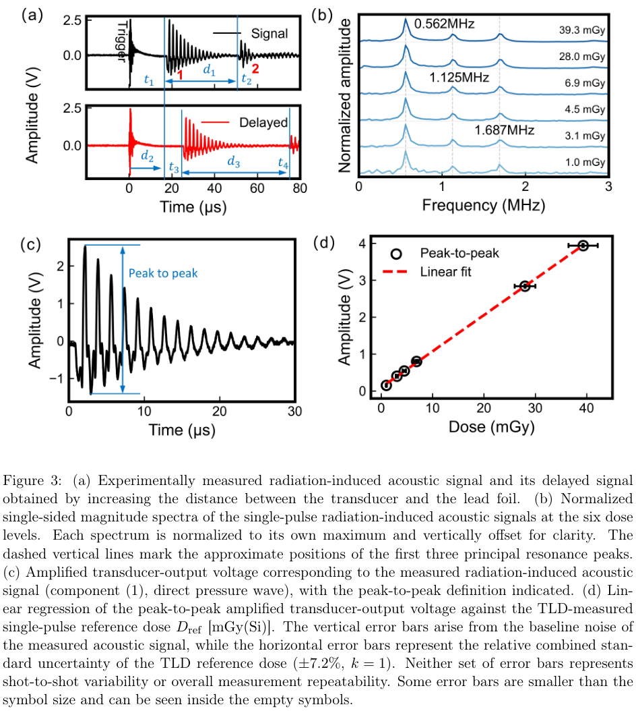
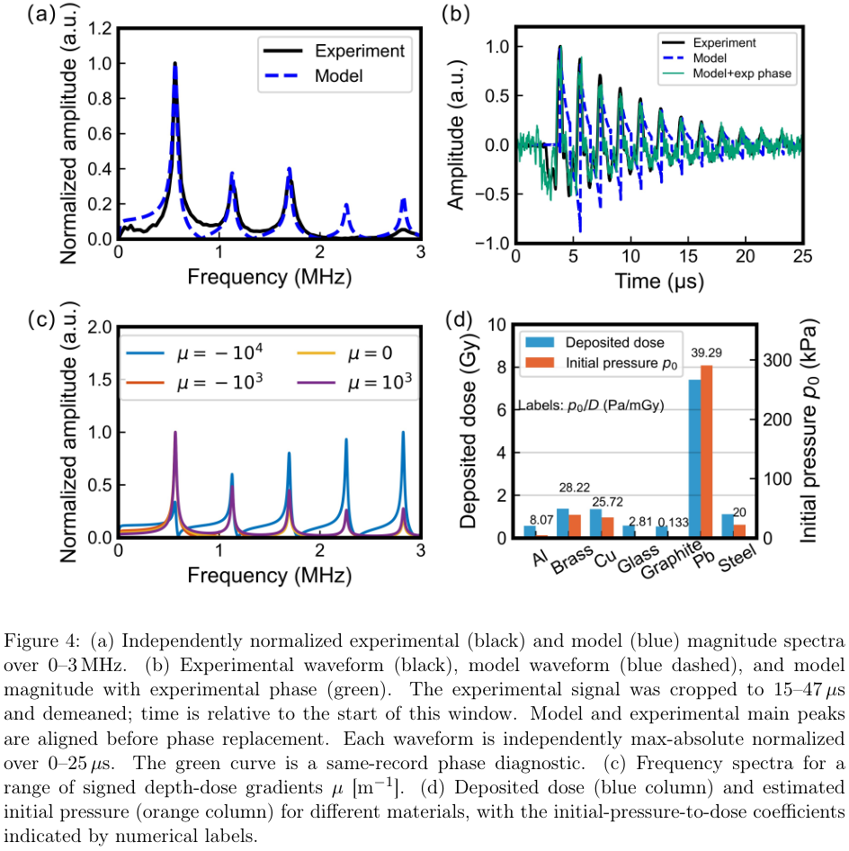

# 铅箔谐振声学单脉冲剂量计：六发UHDR X射线的概念验证

## 0. 论文信息与实际阅读

Qihang Han、Ke Chen、Chenghao Hua、Haoran Chen、Lili Ding、Changhui Li、Xiaoping Ouyang、Chenhui Wang、Wei Chen、Wenjun Ma，*Single-Pulse Dosimetry for Ultra-High-Dose-Rate X-Ray Pulses Based on Radiation-Induced Acoustic Signals*。[arXiv:2611.27772v1](https://arxiv.org/abs/2611.27772v1)，2026-11-20 16:02:54 UTC首投，11-23公告。[本地17页全文](../pdfs/han-2026-acoustic.pdf)来自官方版本化PDF。

实际读完正文、理论、结论及参考文献列表，目视9个关键源页和全部4幅原图。PDF首页有IEEE版权声明，但官方页面没有同作期刊DOI；精确标题Crossref前3仅命中相关旧文，**不能由版权行认定已正式发表**。MinerU历史401/A0211认证失效本轮未复测、零请求，明确用本地布局文本／渲染回退；未复跑TOPAS、声学模型或实验。

## 1. 摘要与Introduction

摘要提出用薄金属层同时吸收X射线与形成声谐振腔，把快速沉积能量转为可测电压。实验是六个剂量水平、**每点一发**，约1–40 mGy(Si)，最高瞬时剂量率约10⁶ Gy/s。峰峰电压与TLD参考剂量近似线性；这是固定配置下的单发可探测性与标定试验。

引言先说明10–100 ns脉冲源在HEDP成像、辐射效应中的需求，再逐项比较离线RCF/TLD、离子室复合、半导体非线性和光学串扰。声学读出不依赖电荷收集，但仍受吸收谱、温度、声耦合和接收链响应影响；不能据此宣称无剂量率依赖。

随后回顾辐射致声的热弹性过程，强调本工作的三个要点：铅箔的窄带振铃、在强瞬态电磁干扰后分时读取，以及一维分层介质的频域／时域解析模型。与既往临床声学成像的比较属于背景，本文没有FLASH生物实验。

## 2. Resonant acoustic signals from the interfaces

来源PDF第4页原图1。横向为空间示意，没有长度实测刻度；红／蓝表示压缩／稀疏声波，(b)为理想驻波形状，(c)为往返波列，(d)为示意频谱，不能把示意峰高当实测灵敏度。

铅—空气与铅—水声阻抗差使两端压力反射近反相。由压力／法向速度连续可得从铅入外介质的压力反射系数：

$$
r_p=\frac{Z_o-Z_i}{Z_o+Z_i},\qquad Z=\rho v.
$$

Z是声阻抗，ρ为密度、v为纵波声速。用铅25.65 MRayl、水1.50 MRayl得到约−0.89，空气411 Pa·s/m则近−1；图示两端r≈−1是理想化。每次往返的相位相加给出

$$
T_{\rm rt}=\frac{2l}{v_i},\qquad f_n=\frac{n v_i}{2l}.
$$

l为箔厚，n为正整数。实测l=2.00 mm、vᵢ=2262±8 m/s，得到往返约1.77 μs，前三模约0.566、1.131、1.697 MHz。注意单程穿箔0.884 μs与往返周期不同。

## 3. Experimental setup and results

### 3.1 装置、同发参考与不确定度

来源第6页原表1与图2。2 mm铅箔隔开空气和水，25 mm水程后用直径13 mm、1 MHz非聚焦浸没探头；图的距离变化控制源到整个探测器的距离，箔与接收器内部几何保持。图中照片是装置，示意非按比例。

探头−6 dB带宽59%、估计接收灵敏度4.05×10⁻⁶ V/Pa（近1 MHz）；放大50 dB，−3 dB带宽1 kHz–3 MHz，100 MS/s采样、100 μs窗，不平均波形，RMS基线噪声8.44 mV。

“晨光”电子韧致辐射源的平均光子能200 keV、端点1 MeV，脉宽25 ns。通过整体平移改变约1–40 mGy单发剂量，最高剂量／25 ns约1.6×10⁶ Gy/s；这是**脉冲内瞬时**量，不是长期平均剂量率。室温约25°C。

GR-100M LiF(Mg,Ti) TLD贴铅箔上中部，同一发同时读参考，先在⁶⁰Co场独立标定，并报告为**硅吸收剂量mGy(Si)**。这不等于铅的局域吸收剂量或水／人体剂量。表1将各项视作独立，0.85%、5%、5%、1%平方和开方约7.2%，k=2扩展为14.4%；多项“可忽略”是作者校准／适用条件判断，未独立验证其能谱和UHDR修正。

### 3.2 用传播时间区分声与电磁瞬态

来源第8页原图3。(a)横轴μs、纵轴V，零时刻电磁干扰约10 μs后回背景，首声16.7 μs后到达；25 mm/1500 m/s=16.7 μs，回声额外33.3 μs。探头远移约12 mm时首声延后8 μs、回声间隔增16 μs，是声传播来源的独立几何检验。

(b)横轴MHz，六条**各自最大值归一且竖移**的电压幅值谱，不能比较绝对剂量或声功率；前三峰0.562、1.125、1.687 MHz接近厚度谐振。(c)定义直接声波正峰减负谷的峰峰电压，消除常量基线偏移；该图时间以所截声波窗起点为参照，不能与(a)的触发零点混淆。(d)横轴虽简标Dose(mGy)，正文明确为mGy(Si)；横误差为TLD标准不确定度±7.2%，纵误差仅基线噪声，**均非逐发散布或整体重复性**。

### 3.3 热压与标定的量纲和边界

25 ns远短于0.884 μs，满足箔厚尺度应力约束；忽略脉冲内热扩散时，先由吸收剂量Dₚᵦ（J/kg）得体积能Q=ρᵢDₚᵦ，再由热弹性转换得

$$
p_0=\Gamma\rho_i D_{\rm Pb},\qquad
\Gamma=\frac{\beta v_i^2}{C_p}.
$$

β为体膨胀系数K⁻¹，Cₚ为比热J/(kg·K)，Γ无量纲，ρD单位J/m³=Pa。文中铅参数给约39.29 Pa/mGy的**初始压力／铅剂量**比；它不是放大电压／硅参考剂量斜率。

对六个同发配对点做自由截距普通最小二乘，作者得到

$$
V_{pp}[\mathrm V]=0.09803\,D_{\rm ref}[\mathrm{mGy(Si)}]+0.0940.
$$

R²=0.9998、残差标准误0.0257 V，斜率95%区间[0.09602,0.10004] V/[mGy(Si)]。这是条件性回归区间，不能代替包括横轴标定误差、逐发波动和系统漂移的总不确定度；原文OLS没有作为误差变量模型处理横轴误差。0.0940 V截距约等效0.96 mGy，低端不可强制过零；也不能仅用噪声与斜率宣称检出限。

标定后可按电压反算参考剂量，但当前是在离线分析中建立曲线。16.7 μs声延迟和100 μs采样窗支持未来在线读出，数据传输／处理／闭环的端到端延迟尚未测定。

## 4. Theoretical model and analysis

### 4.1 模型假设、波动方程与边界求解

箔位于−l/2至l/2，横向均匀、一维线性声学，能量只在箔内沉积。实验是空气／铅／水，解析式却以**水／铅／水**对称外半空间近似，依据是两种外介质相对铅都低声阻抗；这会丢失真实两端泄漏差异，不能当精确界面模型。

热源驱动声波方程为

$$
\left(\partial_z^2-v_i^{-2}\partial_t^2\right)p
=-\frac{\beta}{C_p}\partial_t H,\qquad
H=Q_0e^{-\mu(z+l/2)}g(t),\qquad \int g(t)dt=1.
$$

H单位W/m³，Q₀=ρᵢD₀为入射侧沉积能密度。μ是**有符号拟合深度梯度**m⁻¹，非必须为正的光子吸收系数；μ<0表示向接收侧沉积增加。取短脉冲g=δ(t)，按正指数时间傅里叶约定，时间导数变−iω，右端因此为+iωβQ₀/Cₚ。

由于指数源的二阶空间导数给μ²，特解系数为

$$
p_i(z,\omega)=\frac{i\omega\beta Q_0}{C_p(\mu^2+k_i^2)}e^{-\mu(z+l/2)}
+P_1e^{ik_i z}+P_2e^{-ik_i z},\qquad k_i=\omega/v_i.
$$

外侧只留向外行波。在两个界面施加压力连续与ρ⁻¹∂zp连续，得到四个线性方程，解出P₁、P₂及两侧辐射幅值；因此无需把自由系数当拟合参数。若令q=Zᵢ/Zₒ、φ=ωl/vᵢ，接收侧响应的谐振分母为

$$
\mathcal D=2q\cos\phi-i(1+q^2)\sin\phi,\quad
|\mathcal D|^2=4q^2+(q^2-1)^2\sin^2\phi.
$$

由此分母在φ=nπ最小，给半波谐振频率；**实际峰是否强还由源耦合分子决定**。均匀对称热源抑制反对称偶数模，非零μ破坏对称性并激发偶数模。原式(8)还包含指数源耦合及水程相位，须连同原式(9)使用，不能只凭分母预测各峰幅值。

最终对复频谱逆变换得到时域压力。模型包含界面声辐射，但没有材料衰减、散射、非理想耦合或探头／放大器复传递函数。

### 4.2 与实验比较：独立归一和同记录相位诊断

来源第12页原图4。(a)横轴MHz，测得电压与模型压力**分别按0–3 MHz最大值归一**，前三峰位置接近，归一谱RMS差0.0605；不验证绝对压力或绝对剂量。TOPAS以Koch谱估深度沉积并拟合μ=−764 m⁻¹，故本构形沉积向铅—水侧增强；这是模型输入而非直接深度剂量实测。

(b)横轴μs，以实验15–47 μs截窗、去均值后起点作零，并先对齐主峰，各曲线在0–25 μs独立max-absolute归一。直接模型与实验RMS差0.3220；把模型幅度乘**同一实验记录**的相位后降至0.0909。2–8 μs窗口负／正峰比−0.8809→−0.5662，实验−0.5209。该替换说明相位误差重要，属于同记录诊断，不能算独立预测验收。

$$
P_{\rm swap}(\omega)=|p_R(\omega)|e^{i\varphi_{\rm exp}(\omega)}.
$$

### 4.3 深度梯度和材料选择

原图4(c)以μ扫描m⁻¹改变峰相对振幅，频率结构主要仍由箔厚／声速决定；μ=0时偶数模受对称性抑制。(d)左轴沉积剂量Gy、右轴估算初压kPa，标签为初压／局域剂量Pa/mGy，比较铅、铝、钢、铜、黄铜、玻璃、石墨。铅39.29 Pa/mGy、石墨0.133 Pa/mGy；同时高Z吸收改变沉积量，柱高不能只归因于Γ。它是MC＋热弹性初压设计比较，不是所有材料制成探测器后的实测接收电压／最优临床材料认证。

## 5. Conclusions与后续验证

作者结论限定为固定光谱、几何、温度下的概念验证。源能量改变会改变能谱与深度沉积；脉宽可破坏应力约束；温度会改变声速、热参数和耦合。需要每点重复发次、长期漂移、独立校准／测试集、总不确定度和接收链复响应，再测全链在线延迟及不同源条件的可迁移性。

对激光电子—高Z转换靶链，这篇提供一种抵御瞬态电磁干扰的诊断思路，但其源是常规脉冲电子韧致辐射。未在飞秒激光伽马束、混合中子场、组织剂量或临床FLASH中验证；瞬时10⁶ Gy/s本身不说明生物学FLASH效应。

速记：铅箔把一次X射线沉积转为延迟声振铃，六个单发剂量点给出可用线性关系；高R²与谐振吻合不替代重复性、绝对剂量和在线闭环验收。
