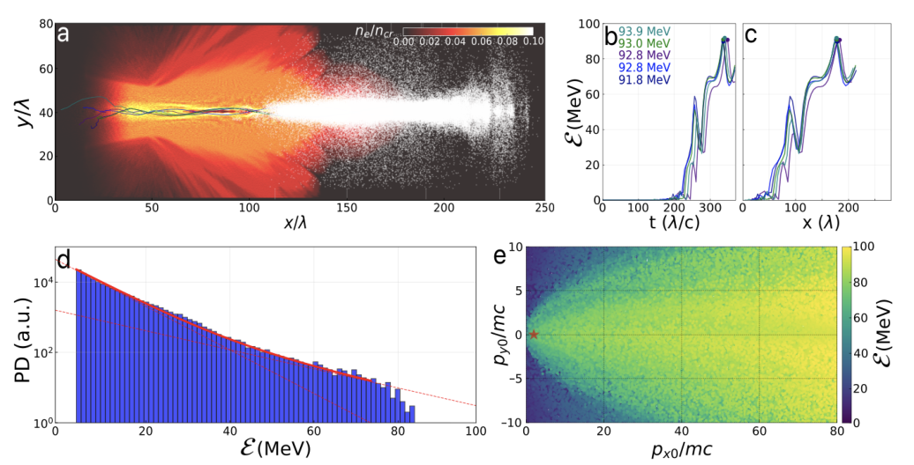
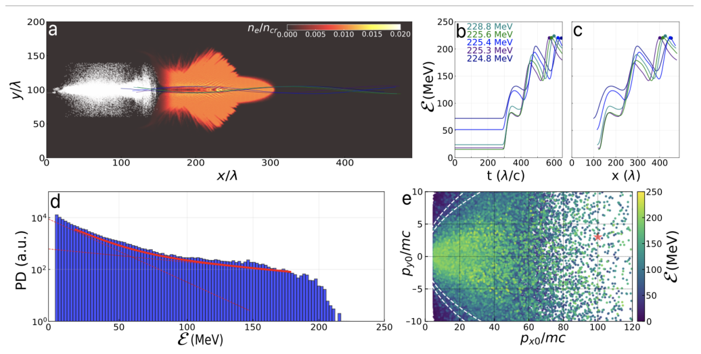
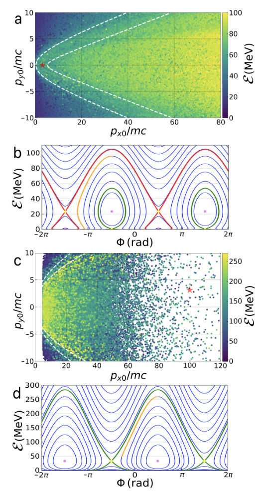

# 两级直接激光加速电子的可行性：密度、通道相速和级联代价

## 0. 论文信息与阅读范围

- **原题**：Feasibility study of two-stage direct laser acceleration of electrons。
- **作者**：E. Starodubtseva、S. Solntsev、I. Tsymbalov、A. Savel’ev；莫斯科大学、俄罗斯科学院核研究所等。
- **来源**：[arXiv:2611.27857v1](https://arxiv.org/abs/2611.27857v1)，[DOI](https://doi.org/10.48550/arXiv.2611.27857)。2026-11-20 17:05:38 UTC首投，11-23公告，PDF内部日期11-23；本轮未核实同作品期刊接收／发表。精确标题Crossref相关性前3并未给出同作期刊记录。
- **实际全文**：[9页官方作者v1](../pdfs/starodubtseva-2026-staged-dla.pdf)，SHA-256：`ff28613c2cc2b0a3a02cbcc0f498ddbbb1090e866e2d7837e5bde126a5382fe9`。
- **方法与边界**：Smilei圆柱方位模准三维PIC＋给定通道场中的二维单电子模型；属于数值可行性研究。不是两级DLA实验，也没有新光子／中子产额、转化靶温升、治疗或屏蔽验收。
- **本轮读取**：按全文顺序阅读9页（正文至p8，参考文献pp8–9），目视原页pp1–7及3幅原图。MinerU历史401/A0211令牌失效本轮未复测、零请求，明确使用本地布局文本和原页渲染回退。没有运行作者Smilei或轨道程序。图来源和裁框见[阅读记录](../research/staged_dla_reading.json)。

## 1. 摘要：提高截止能量，同时保留高阈值电荷

作者把一束氮气DLA产生的宽谱电子注入第二束激光形成的氢等离子体通道。摘要给出首级最高约94 MeV、第二级约225 MeV，超过5 MeV的首级电荷6.04 nC、第二级保留电子4.55 nC。第二级本底自注入另有1.14 nC、最高123 MeV，须与来自首级的电子分开。

“两温度”指能谱双指数斜率，不表示束团处于两种热平衡温度。相对于单独第二级自注入的较低截止，预加速电子更易进入适合高初能的DLA轨道；这一比较支持级联可行性，但没有在相同**总激光能量**下证明全局最佳性能。

## 2. I. Introduction：单级限制与级联动机

开头两段把LWFA的纵向尾场与DLA的横向激光场做功分开。LWFA主要受去相位和泵浦耗尽限制；DLA还受通道寿命、betatron与多普勒激光共振及相空间轨道可达能量限制。即使把理想通道无限延长，电子也可能进入回吐能量的相位。增加功率或长度不自动保证持续加速。

随后作者回顾已实现的两级**LWFA**实验，用它们说明同轴级间耦合有先例；这些引用不是本文的DLA实验。文中的高电荷／焦耳和23%转化效率是背景参考文献的结果，也不是此次两级计算测得的效率。

接着，作者引用自己先前的级联解析方案，提出各级分别选择适合低初能和高初能电子的通道参数。本文新的证据是有限束宽、有限通道的PIC以及修正模型比较。它与仓库已有Pukhov的luminal频率模阶梯去相位尾场方案物理机制不同，不能因都出现“多级／去相位”而去重成同一作品。

引言末尾给出代表参数并说明选择理由：足够形成通道、计算资源可承受，以及未来10 Hz级实验可探索。10 Hz是潜在激光系统的运行设想，本文没有测量稳定性、平均功率、连续运行或两级重复频率。

| 量 | 第一级 | 第二级 | 口径 |
| --- | --- | --- | --- |
| 激光归一化幅度、脉宽 | 6，200 fs FWHM | 6，200 fs FWHM | 波长均0.8 μm |
| 束腰 | 4λ＝3.2 μm | 8λ＝6.4 μm | 论文称FWHM |
| 气体与原子密度 | N，0.008 ncr | H，0.01 ncr | 原子密度第二级并不更低 |
| 全电离电子密度 | 0.056 ncr | 0.01 ncr | N的7个电子全部电离，实际电子密度降低5.6倍 |
| 峰值功率 | 约9 TW | 约36 TW | 第二级增大束腰而保持幅度，功率增4倍 |
| 激光能量 | 原文1.8 J | 按相同脉形约7.2 J | 第二级能量为由面积缩放得到的估算，非新测量 |
| 计算域 | 250λ×40λ | 490λ×100λ | 纵向×径向 |
| 模拟总时间 | 370λ/c，约0.99 ps | 650λ/c，约1.73 ps | 不是全装置周期 |

上述能量估算沿用首级1.8 J的脉形约定：固定幅度和脉宽时功率与束腰平方成正比，所以总驱动约9 J，约为首级的5倍。94→225 MeV的约2.4倍截止增益不能当成能量转化效率增益；还需要积分电子总能量和完整入射能量预算。

## 3. II. First-stage acceleration：氮气注入和94 MeV宽谱束

### 3.1 数值设置与密度定义（pp2–3）

Smilei采用圆柱方位模分解，仅保留m＝0、1；作者以先前研究支持轴对称问题中两模的充分性，本文没有展示完整模式数／网格／每格粒子数的收敛系列。纵向网格为λ/32，径向λ/8，时间步λ/(48c)。200 fs较长脉冲用于维持DLA通道，同时限制模拟体积和激光能量。

氮气原子密度沿纵向先高斯爬升，再进入平台：

$$
n_a(x)=
\begin{cases}
0.008n_{cr}\exp\!\left[-\left(\dfrac{x-41\lambda}{15\lambda}\right)^2\right],&x<41\lambda,\\
0.008n_{cr},&x\geq41\lambda.
\end{cases}
$$

这里临界密度为相应激光频率的等离子体临界密度；氮原子经ADK电离后给出电子密度0.056 ncr。摘要将氢“较低密度”与原子密度并列容易误读：降低的是**电子密度**。作者称更低密度加速较弱、更高密度抑制通道形成，但未提供可供重做优化的完整扫描表。

### 3.2 原图1：轨道、谱和测试粒子不是同一个总体

来源：PDF p4 Fig.1原图裁取。a的横纵坐标均以λ归一，密度色条为电子密度／临界密度；轨迹来自最有能量的5个电子，白点表示最终纵向动量超过5mc、供转交第二级的群体。b为MeV对归一时间，c为MeV对纵向位置，峰值圆点落在不同时间／位置。d横轴MeV，纵轴“PD (a.u.)”为任意单位对数谱，不能从柱高直接重算nC。e横纵坐标分别为初始纵、横动量／mc，颜色是最高能量MeV；白虚线给解析区域边界。

通道的低密度轴和外围高密度鞘提供自注入，选中电子发生明显betatron振荡。约150λ/c的加速时间和140λ的传播距离是这些代表轨道的过程尺度；并非整束电子均有同样路径或相同增益。首级报告6.04 nC、能量大于5 MeV，最高约94 MeV。

作者拟合能谱：

$$
\frac{dN}{d\mathcal E}=A_1e^{-\mathcal E/T_1}+A_2e^{-\mathcal E/T_2},
\qquad T_1=7.0\ {\rm MeV},\quad T_2=16.0\ {\rm MeV}.
$$

变量A为拟合幅度，T为能量斜率。若一个指数项占优，对数谱斜率等于负的逆T；由此才可解释“较热尾部”。两项重叠时局部斜率不是固定温度。p3正文把16.0 MeV重复写为T1，Fig.1图注清楚标作T2，笔记依图注注明这个排印差异。

低权重测试电子取纵向位置25–27λ、径向0.5λ、注入时间200λ/c。初态是参考PIC自然注入轨道选择的，权重很小以避免改变场；e图显示适合低初能的加速区域。它是**给定场条件下的初始动量探针**，不能替代高电荷束载、任意注入相位或全束捕获率。

## 4. III. Second-stage acceleration：展宽激光和预加速电子

第二级改为氢电子密度0.01 ncr，爬升位置移至171λ，以容纳约150λ纵向长度的输入束。激光幅度与脉宽不变，束腰扩大到8λ，计算域和总模拟时间也增大。首级电子的相空间直接转交第二级；本文没有模拟可工程实现的两束激光合束镜、真空间隙、级间等离子体镜、能量选择器或传输线。

p3解释先说第二级需要**较低**通道相速，紧接着又说更宽束腰导致相速**增加**；两句方向冲突。后文实际用于模型的相速由1.0161c降低至1.0016c，笔记保留此原文问题，不把相反措辞合并成已证实因果链。

来源：PDF p5 Fig.2。a空间坐标以λ归一，色条电子密度／临界密度，白点为初始输入群体；b、c分别画MeV随时间／纵向位置，d为任意单位对数谱，e是初始动量扫描及最高能量色条。与图1相比，高初能电子在低密度／大通道中进入较高能量区域；d仍是宽谱而不是单能束。色条范围、时间窗和谱的任意单位均不同，不可把两图像素亮度当绝对电荷比较。

正文报告最高约225 MeV，谱斜率18.4和88.3 MeV，超过5 MeV的来自首级电子电荷4.55 nC。图2b图例有一条228.8 MeV轨道，高于正文约225 MeV；因此225是作者反复使用的代表数值，不应视为经统一筛选定义到个位MeV的精确最大值。第二级自注入电子另报最高123 MeV、超过5 MeV的电荷1.14 nC。

阈值电荷之比4.55/6.04约0.753，但不能直接命名为75.3%装置捕获效率：图中转交筛选是**纵向动量超过5mc**，而电荷统计是**动能超过5 MeV**，两种切选不同。仅当无横动量时，前者对应约2.10 MeV动能；没有原始粒子ID和入／出边界台账，无法闭合实际转交总体、损失、升穿阈值和俘获的分母。第二级自注入1.14 nC也不能混进“保留首级电子”分子。

e图显示一些电子未明显增能：作者归因于大横向动量导致离开通道，或落入减速相位。该图说明初始相空间的选择性，尚未给出注入延迟、束心偏移、激光指向、密度及脉冲参数抖动的容差分布。

## 5. IV. Comparison with the DLA model：有限通道模型及其可信边界

### 5.1 横向中性轮廓为何带高斯衰减（p5）

旧二维模型假设无限宽通道和轴上起点，无法直接描述宽输入束。作者把电荷／轴向电流轮廓设为：

$$
\rho(r),\ j_x(r)\ \propto\ e^{-r^2/r_0^2}\left(1-\frac{r^2}{r_0^2}\right).
$$

r为径向距离，r0为特征通道半径。这个轮廓是简化模型，并非本文证明的唯一自洽平衡解。令u＝r²/r0²，则全截面积分正比于下式：

$$
\int_0^\infty r e^{-r^2/r_0^2}\left(1-\frac{r^2}{r_0^2}\right)dr
=\frac{r_0^2}{2}\int_0^\infty e^{-u}(1-u)du=0.
$$

这是笔记对其整体电荷／电流补偿性质的直接推导。有限半径内的积分则正比于r²exp(−r²/r0²)，因此圆柱Gauss／Ampère关系给出的径向场形状正比于r exp(−r²/r0²)。近轴退化为线性恢复力，远离通道后减弱，避免无限线性通道对大振幅轨道的过强约束。

原文式(2)在Gaussian单位约定中给出横电场、磁场，其幅度分别含背景与通道内电子密度差、通道内电流。这里不把其电荷符号约定转换成已验证的数值输入；要复现必须明确电子电荷的正负、回流电流和磁场方向。

### 5.2 激光、Lorentz方程与原文式(4)疑点（pp5–6）

激光用无限均匀平面波近似，横电场幅度为归一化幅度乘mcω/e，磁场与电场幅度之比为c/vph（原文Gaussian单位）；忽略了真实脉冲横包络、演化和全自洽通道反馈。其时间相位为ωt−kx，波相速可大于c，并不意味着粒子或信息超光速。

**目视p6确认的排印／约定问题**：原文式(4)把含横向电场的式子标成纵向动量导数，而仅含横向速度×磁场的式子标成横向动量导数，且横向磁力符号与常用坐标约定不能直接对应。按文中激光沿x、E沿y、B沿z，采用电子电荷−e、e为正数及Gaussian单位，标准关系应为：

$$
\frac{dp_x}{dt}=-\frac{e v_y B_z}{c},\qquad
\frac{dp_y}{dt}=-eE_y+\frac{e v_x B_z}{c},\qquad
\frac{d(\gamma mc^2)}{dt}=-eE_yv_y.
$$

上述是由向量Lorentz力和做功率逐分量展开的**笔记物理核对式**，不是替作者修订的源码，也未证明作者轨道积分实际用了哪个版本。它说明DLA的净能量来自横电场做功，磁场改变动量方向而不直接做功。式(4)疑点应在取得原始程序后核实，不能从最终彩图倒推“公式与实现均无误”。

### 5.3 有限通道不变量与相轨道（p6）

作者式(5–6)写出新的不变量和通道系数：

$$
I_0=\gamma-\frac{p_x}{\eta mc}
+\mathcal C\left[e^{-y^2/r_0^2}-1\right],\qquad
\mathcal C=\frac{\pi e^2r_0^2}{mc^2}
\left[(n_{e\mathrm{in}}-n_e)+\frac{n_{e\mathrm{in}}}{\eta}\right],
\qquad\eta=\frac{c}{v_{ph}}.
$$

n_e为背景电子密度，n_ein为通道内电子密度，η为模型中的折射指标；这里沿用源文表达，尚未从存在符号问题的印刷式(4)独立证明其全部系数。近轴展开指数，新增项近似为负的通道系数乘y²/r0²，恢复旧模型的二次势形式。离轴起点则改变初始不变量，即使动量相同也可属于不同轨道，说明动量二维图本身隐含固定或选定的初始位置。

在WKB及快振荡平均下，作者把能量与相位联系为：

$$
\sin\Phi=F(\mathcal E)-\alpha,\qquad
\Phi=\omega t-\int\omega_bdt-kx+\Phi_0,\qquad
\alpha=F(\mathcal E_0)-\sin\Phi_0.
$$

相位是激光相位减去betatron相位。其时间变化近似为ω−kvx−ωb，接近零时可维持相干能量交换。给定初态，可达能量还必须满足下式：

$$
\left|F(\mathcal E)-\alpha\right|\leq1.
$$

这解释相图中的有界轨道和分离曲线。本文没有重列F的完整形式及临界不变量公式，而是指向参考文献22；因此仅凭这9页不能独立重建其解析边界。笔记不虚构缺失的F或数值推导。

### 5.4 原图3：用PIC反演参数比较，仍有有限寿命差别

来源：PDF p7 Fig.3。a、c横纵轴是初始纵／横动量除以mc，色条MeV；白虚线为解析区界，红星是代表初态。b、d横轴相位rad、纵轴能量MeV，蓝线是相轨道、橙线为所选轨道。a/b对应首级，c/d对应次级；源文p6把第二级最高能图指为3b是交叉引用错误，实际是3c。

首级使用电子密度0.056 ncr、相速1.0161c、半径3λ及150λ/c积分窗，代表初动量(3,0)mc、离轴0.5λ；第二级用0.01 ncr、1.0016c、半径6λ及300λ/c积分窗，代表初动量(100,3)mc、离轴3.5λ。半径、相速和初态直接从PIC选取，因此这是受PIC约束后的模型一致性比较，尚非对未知装置的独立盲预测。

作者报告区域和能量的大体一致。相图允许首级代表电子接近200 MeV，而PIC约90 MeV就停止，归因于高密度通道较早耗散。用预制放电通道延长寿命仅是作者建议，没有在本文完成相应模拟或实验。该差异也提醒：无限平面波／静态通道相图的上限不等于有限脉冲必达能量。

## 6. V. Conclusion、数据和接续

结论重申两种DLA初能区域可用于级联，提高宽谱束截止并保留nC级阈值电荷。证据支持特定参数下的准三维可行性；“比LWFA更高电荷／更松同步要求”主要来自机制与背景文献，本文没有以相同激光成本、孔径、能散、发射度和容差作公平对照。数据声明是向通讯作者合理请求，未在该PDF给出可直接下载的输入文件、粒子台账或扫描数组。

后续应先闭合三件事：原式(4)与实际轨道源码、级间转交筛选与全粒子ID电荷／能量账、双束激光总成本与同成本单级基线。再做网格／方位模／宏粒子数收敛及密度、相位、位置抖动扫描，包含实际真空间隙、束斑扩展、级间光学和束载。若用于转化靶，还须将输出全相空间与靶响应连接，不能直接由225 MeV截止推断γ亮度、中子产额或防护条件。

复习时抓住：第二级优化的是高初能电子所见的通道相位与有限孔径；这里的增益用更多激光能量并付出相空间选择代价，完整性能必须靠阈值、总体和成本一致的台账判断。
