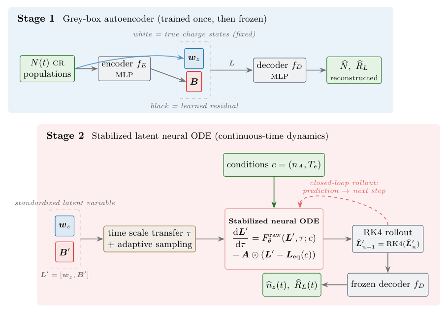
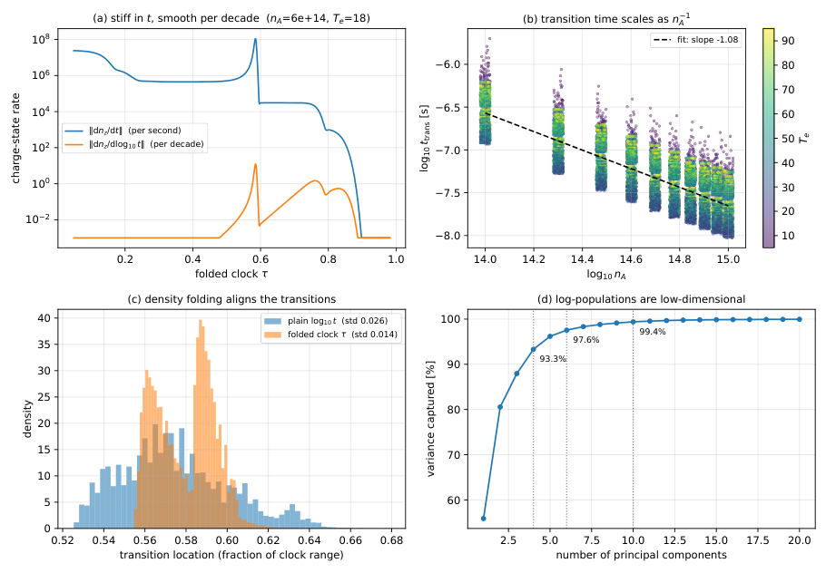
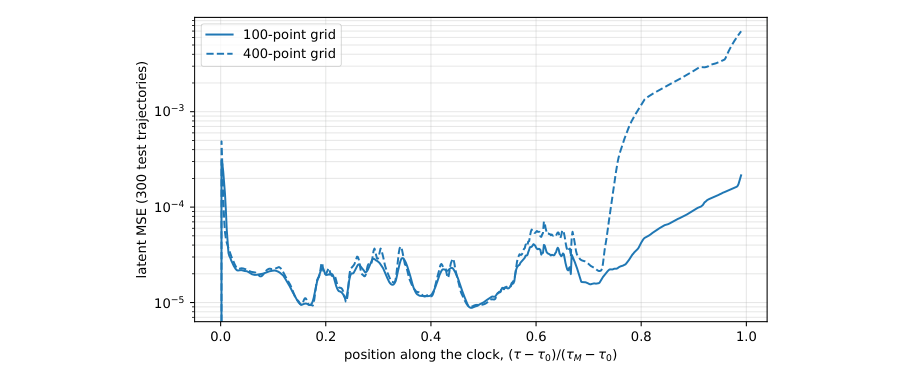
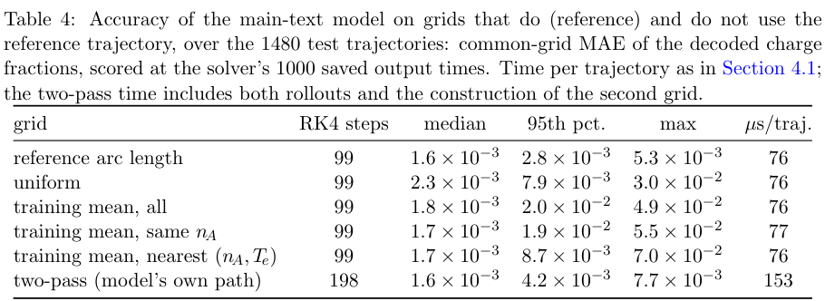
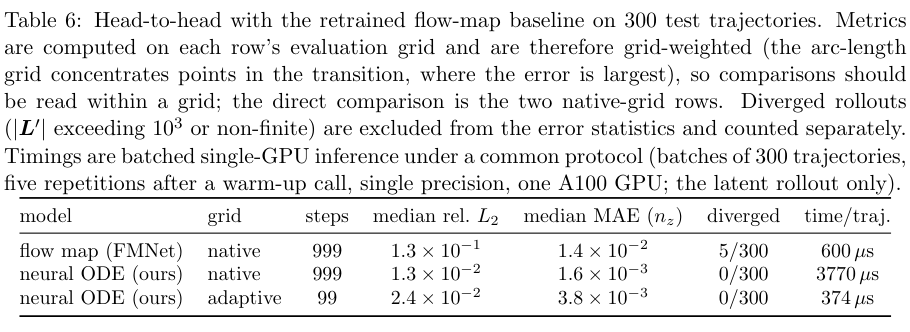

# 刚性碰撞–辐射动力学的守恒潜空间神经 ODE

## 0. 论文信息与本次阅读范围

- 原题：*A conservative latent neural ODE for stiff collisional–radiative plasma kinetics*。
- 作者：Xuping Xie、Xian-Zhu Tang、Qi Tang；Old Dominion University、Los Alamos National Laboratory、Georgia Institute of Technology。
- 实际全文：[官方 arXiv:2611.27027v1](https://arxiv.org/abs/2611.27027v1)，2026-11-20 02:58:17 UTC 首投，11-23 分类公告；[本地32页PDF](../pdfs/xie-2026-latent-cr.pdf)。本轮未核实同作品期刊接收或发表，精确标题 Crossref 前3命中为相关旧作，不能当作本文正式出版。
- 证据类型：锂原子94能级碰撞–辐射（CR）参考计算数据上的机器学习替代模型、消融与数值诊断。没有实验测量，也没有在输运代码内运行验证。
- 阅读：按摘要、§1–5、数据声明及参考文献顺序阅读全文；32页无附录。MinerU历史401/A0211令牌失效本次未复测、零请求，明确采用本地布局文本、PDF公式及关键原页目视回退。目视源页和5份有效原图/表裁框见[阅读证据](../research/latent_cr_reading.json)。本次没有复跑作者训练、CR求解或性能测试。

## 1. 摘要：把连续轨迹拟合与物理动力学分开

作者把94维锂能级布居压到10维，其中4维直接取电荷态比例、6维由编码器学习，再用连续时间潜空间神经ODE推进，解码时用正值归一化保证总布居为1。摘要报告1480条留出轨迹的电荷态比例MAE中位数为0.0042；这是比例区间[0,1]上的绝对误差，不是0.42%的逐态相对误差。

摘要中的76 μs是A100上1480条轨迹一起计算的**潜空间推进摊销吞吐**，主结果用参考解提供时间分布的弧长网格。可部署的“模型先跑一遍再自建网格”方案为153 μs，仍不包括整个编码–解码–数据搬运链。末态阻尼未产生吸引子，本文的可靠性限于训练时钟内；不能从标题“conservative”推断全局稳定、能量守恒或任意条件下的准确性。

## 2. §1 Introduction：CR的刚性与前作的区别

**非平衡原子物理段。** 电子碰撞激发/去激发/电离、三体复合、自发辐射、辐射与双电子复合共同改变能级布居。原文式(1)为

$$
\frac{d\mathbf N}{dt}=\mathbf M(\mathbf N;n_A,T_e)\mathbf N,
\qquad n_A=\sum_iN_i.
$$

这里布居密度向量有94个分量，背景条件是总锂密度与Maxwell电子温度；电中性将电子密度与瞬时电荷态联系起来。因此即使背景固定，速率矩阵也依赖状态：单电子过程给二次项、三体复合给三次项，不能把它当成固定矩阵指数的线性系统。

**刚性与应用段。** 不同原子过程的时间尺度相差巨大，隐式参考求解需反复Newton迭代和线性系统求解。作者将CR视为边界/偏滤器输运中的局部高成本模块，锂是低Z面向等离子体材料的示例；本文并没有模拟具体SOLPS-ITER放电，也没有给出实际多物理计算的加速比。

**前作与贡献段。** 既有Xie等文献[32]把相同灰箱自动编码器接到离散flow map；本篇保留灰箱思想，改用条件化连续潜空间向量场。原文在§4.7将前作模型按相同数据、划分、潜表示和近似容量重训，属于新方法研究而非仅将旧稿换标题。固定步映射的误差积累和软守恒是动机，但新模型也存在时钟依赖、参考网格辅助和末态不稳定等限制。

## 3. §2 Related Work：结构约束不能代替动力学检验

**降阶与神经ODE段。** 作者把本方法放在刚性化学/原子动力学的自动编码器、神经ODE及潜空间学习路线中。它直接拟合积分后的轨迹，不从原方程唯一识别一个等价动力学闭合；另一路可直接学习条件–时间到状态的算子。本文只量化比较重训FMNet，没有同数据下的算子模型比较。

**阻尼与守恒段。** 线性阻尼借鉴稳定化神经ODE，但作者明确承认本模型的末态并非吸引点。质量归一化是对输出分布施加的代数约束；能量收支、反应速率和辐射损失仍依赖数据拟合。后文失败例说明“归一化后看起来是分布”可以掩盖潜变量已经失真。

## 4. §3 Proposed Approach：表示、时钟、向量场与数据

### 4.1 §3.1 灰箱自动编码器

**标准化段。** 每个能级、各电荷态比例和辐射损失先取以10为底的对数，再做逐通道z-score。对数下限为10⁻³⁰；条件输入是分别标准化的密度对数和温度。均值方差来自训练数据并固定用于测试，避免以大布居通道压过小布居通道。

**结构段。** 潜变量的前4维是经过对数标准化的真实电荷态比例，后6维编码能级内分布。前4维的“固定”指物理定义和训练标签固定，并不代表预测时它们不演化或被真值不断纠正。Stage 2推进全部10维；推断只从初态编码开始，后续没有注入真值状态，但主网格仍从参考轨迹获得时间信息。

**原图1（p6）解读。** 这是流程图，没有数值坐标轴或物理单位；上半部分蓝/红区分直接指定的4个物理坐标和6个学习坐标，下半部分显示条件化时钟ODE、RK4闭环及冻结解码器。图中的“Stabilized”是结构命名，不能覆盖§4.6的反例。图内未画出最后的正值归一化；图中的闭环只是模型自身递推，不是实验反馈闭环。

**正值与守恒的推导。** 解码器先给出标准化对数布居，再反变换、归一化（原式(7)）：

$$
u_i=10^{\widehat W_i\sigma_i+\mu_i}>0,
\qquad\widehat{\widetilde N}_i=\frac{u_i}{\sum_j u_j},
\qquad\widehat n_z=\sum_{i\in I_z}\widehat{\widetilde N}_i.
$$

先指数化保证正性，再除同一个正总数保证总和为1，各电荷态由能级子集求和继承二者。仅有“总和为1”本身不能保证非负；本文的正性来自指数参数化，质量来自归一化。结论受浮点舍入及指数有限性限制，不能将其推广为白色潜变量的守恒或CR方程的能量守恒。

**训练段。** Stage 1同时拟合能级对数布居、辐射损失，并对归一化前总和的对数施加平方惩罚。惩罚使投影前的输出接近物理范围，解码时的代数层提供最终保证。自动编码器训练后冻结；不会在Stage 2随轨迹损失继续调节。

### 4.2 §3.2 条件化潜空间神经ODE

**为什么学习场而不是直接推导场。** 若把原方程经编码器链式变换，需要每次计算原CR右端和编码Jacobian，失去主要省时目的；不同物理状态压到同一潜变量还可能没有唯一导数。作者因此学习积分后的潜空间轨迹，不能据此声称识别出唯一原子动力学规律。

**密度折叠时钟（原式(12)–(13)）。** 中性比例下降的时刻大致随密度倒数变化，因此定义

$$
\tau=\frac{\log_{10}(tn_A)-a}{b-a},\qquad
 t(\tau)=\frac{10^{a+(b-a)\tau}}{n_A},\qquad
 \frac{dt}{d\tau}=(b-a)\ln(10)\,t(\tau).
$$

常数a、b是数据中乘积对数的上下界。对原方程用链式法则得

$$
\frac{d\mathbf N}{d\tau}=\alpha(\tau)\mathbf f(\mathbf N;c),
\qquad \alpha(\tau)=\frac{dt}{d\tau},
\qquad J_\tau=\alpha(\tau)J_t.
$$

所以时间重参数化把所有本征值同倍缩放，不改变本征值比值，**没有在谱意义上消除刚性**。它使已有轨迹在每个对数时间段的变化更均匀；能以显式RK4推进的是学习后的10维场，与94维原方程的稳定界不能混为一谈。对数中的有量纲乘积采用数据约定数值单位，复现须明确密度/时间单位与相应a、b。

**弧长采样（原式(14)）。** 对已保存参考潜轨迹计算

$$
s(\tau)=\int_{\tau_0}^{\tau}\left\|\frac{dL'}{d\tau'}\right\|d\tau',
\qquad \rho(\tau)\propto\left\|\frac{dL'}{d\tau}\right\|+0.05\,\bar\rho.
$$

在累计弧长中等间隔取点，再反映射到时钟，使转变快的区域更密。参考值在保存样本之间按时钟线性插值，首末点固定。原图2（p8）横轴为无量纲时钟，蓝线为步长、红线为电荷态变化大小，体现快变区细化。它是状态速度采样，不是局部误差控制，也不是稳定性证明。

**主结果的信息边界。** §4主结果、76 μs计时以及加密测试所用网格从**该测试参考轨迹自身**的潜空间弧长建立；后续没有读入真值状态值，但转变在何时发生的信息进入了网格。只有§4.5的固定训练平均网格或模型两遍网格可以在没有完整参考轨迹时部署。两种口径必须分别比较。

**向量场与阻尼（原式(15)–(16)）。** 向量场MLP读入10个潜坐标、2个条件及4对固定正弦余弦时钟特征，共20维输入：

$$
\frac{dL'}{d\tau}=F_\theta^{\rm raw}(L',\tau;c)-A\odot\big[L'-L_{\rm eq}(c)\big],
\qquad A=\operatorname{softplus}(a_A)>0.
$$

这不是Fourier变换或拟合频谱。阻尼系数为正只保证所加线性项收缩，完整Jacobian仍为原网络Jacobian减去对角阻尼，可能有正实部本征值。在锚点处原网络项也不要求为零，因此锚点既未必是不动点，也未必吸引。潜坐标中与初态有关的微小末态布居还使仅靠条件预测的锚点只能作近似。

**积分与训练段。** 每对相邻输出点之间只做一步经典RK4，无内部自适应子步。训练窗口从真实潜状态启动，窗口长度逐渐由2增到56；每个epoch每轨迹抽4窗，batch1024，通过RK4计算图直接反传。主模型2760epochs约4小时A100，最佳验证checkpoint为2740。原式(17)分别计算白/黑坐标、锚点和白坐标总和对数损失；相同系数按标量均值加权，不能解释为4维块和6维块具有相同总权重。窗口真值启动和完整自由递推之间的差异由长窗口课程与全程验证缓解，而非被严格消除。

### 4.3 §3.3 数据结构及可压缩性

**数据段。** 10个密度、37个温度、每点40初态，共14,800轨迹。每个条件下的40初态只沿布居空间一条直线取点，并非任意94维初始分布。主测试1480条属于已有训练条件上的新轨迹；各条件均出现在训练中，不能据主测试宣称新温度/密度泛化。

**时间范围疑点。** p11写参考解从10⁻¹⁶到1 s，1019个保存点中1000个对数点止于0.1 s，之后19个线性点止于1 s，并称本文全程只用对数部分；摘要和计时却称完整“16个数量级”轨迹。按10⁻¹⁶到0.1 s端点计算是15个数量级。此处保留原文口径差异，待数据/源码确认，不能替作者静默改成一致版本。

**原图3（p12）逐子图。** (a) 横轴为时钟，纵轴比较每秒与每log₁₀时间段的电荷态变化范数；蓝线的高动态范围变为橙线局部尖峰，说明重分配分辨率，不说明原方程本征值谱改变。(b) 横轴为密度对数，纵轴为中性比例首次低于1/2的转变时间对数（s），颜色为电子温度（eV）；拟合斜率−1.08接近密度倒数关系。(c) 横轴为转变占时钟区间的位置，纵轴为分布密度，折叠后位置标准差0.026→0.014，仍有散布。(d) 横轴为主成分数，纵轴为解释方差百分比，4/6/10维约93.3/97.6/99.4%；PCA方差解释率支持压缩，不是动力学误差界，也不证明微小能级可以忽略。

**末态与辐射段。** 大多数电荷比例在末端近似静止，但2%轨迹的末50点漂移超过0.001，均在低温低密度处，最大0.092；不能把全数据视为已收敛平衡。小布居的终值还依初态。辐射损失对数与布居对数的线性拟合约R²=0.97，支持共同解码但不是精确闭合。

**密度单位疑点。** p4将布居密度写为m⁻³；p24原图13却明确标密度轴为10¹⁴ cm⁻³，温度轴eV。其他图常只给数值未附密度单位。本文笔记按原图标记保留，未把m⁻³与cm⁻³数值混用或自行补10⁶换算；复现折叠时钟和参考速率时必须向作者/数据核实。

## 5. §4 Numerical Results：准确性、成本与失败模式

### 5.1 §4.1 训练与推断成本

**训练曲线段。** 原图4（p15）横轴epochs，纵轴分别为验证/潜坐标MSE和窗口长度；全程验证降至约5×10⁻⁵，白坐标较易拟合，锚点MSE约0.012不妨碍区间内轨迹准确。但不能据此判断是阻尼有效还是网络补偿了锚点偏差。

**计时段（p14）。** 58,526参数仅包含场网络、锚点网络和10个阻尼量，不计冻结解码器。一次1480轨迹批次做99步RK4，共396次顺序场评估，113 ms，摊销76 μs/轨迹；A100、fp32、一次热身后10次同步计时。排除了初态编码、解码、主机设备传输、预计算并缓存的参考网格及训练；无运行波动数据。批次减到300后约112 ms，摊销374 μs/轨迹，因此76 μs不能叫单条延迟。论文没有测原始隐式CR求解器的同硬件端到端加速比。

**Stage 1基线段。** 自动编码重构MAE为0.00161，但在全部1480×1000原生采样点上取均值；完整递推0.0042是在每轨迹弧长100点上取均值后再跨轨迹取中位数。两者采样/聚合不同，2.6倍只作量级参考，不能严密分解“表示误差＋动力学误差”。

### 5.2 §4.2 电荷态轨迹和误差定义

**扫温、扫密度、扫初态段。** 原图5–7（p16–18）横轴为物理时间s的对数，纵轴为4个无量纲电荷比例的对数，上方可给密度相关时钟。点是CR参考，线是从初态完整递推后的**解码能级子集和**。扫温主要改变终态主电荷，扫密度移动转变时刻，扫初态改变极小布居底。小n₃平台出现振荡，不能因对数图总体重合忽略其逐态误差。

**总体误差段。** 原图8/Table3（p19）按温度分组的通道聚合相对L₂中位数约3.1%，绝对MAE中位数0.0042、最大0.013，RMSE中位数0.015、最大0.063。相对L₂先按电荷态求范数再相加求比，避免某个近零通道独自放大分母比值；并非每个电荷态各有3.1%误差。每个弧长点同权，约三分之一点集中在转变，故相对均匀时钟/物理时间积分更强调转变。

### 5.3 §4.3 辐射损失

**解码与曲线段。** 原图9–11（p20–21）横轴为物理时间s，纵轴辐射损失采用参考求解器输出单位，论文未给出统一SI量纲，不应擅自标成W或W/m³。曲线早升–急降–复合/线辐射峰–末态平台的非单调结构由同一潜状态解码；Stage 1不显式接收条件，条件信息通过潜状态分布承载。

**误差段。** 轨迹平均的辐射损失对数绝对误差中位数0.0099decades、95分位0.025、最大0.053；单点最大误差按轨迹取中位数0.23、全体最大0.78decades，不能只报平均。物理时间积分到电荷转变结束的辐射能相对误差中位数0.4%、最大12%；全窗中位数1.4%、最大23%。早期峰高度误差中位数0.18decades、95分位0.56，初始瞬态仍明显较差。辐射误差更多来自解码表示而非潜递推，两种误差不可简单相加。

### 5.4 §4.4 守恒、网格加密与末端漂移

**守恒段。** 解码电荷比例由归一化能级和得到，白色潜坐标的反变换则是另一套比例估计。后者虽更准（MAE中位数0.0011），沿程总和最大偏离1的中位数0.014、最大0.19；两套估计沿程最大差中位数0.11、最大0.43。不能用白坐标精度和解码守恒拼出一个同一输出的更好指标。

**原文守恒数值不一致。** p19 Table3给中位数0、最大3.6×10⁻⁷；同页§4.4正文却给中位数6×10⁻⁸、最大6×10⁻⁷；结论写4×10⁻⁷以内。均为浮点量级，但准确最大值未闭合，笔记逐处保留，不宣称严格数学零误差。

**原图12（p22）。** 横轴是归一化时钟位置，无量纲；纵轴是300测试轨迹平均潜空间MSE的对数。实线100点、虚线400点在初期及电离转变大致重合，晚期约75%后分离，到99%位置约2×10⁻⁴与7×10⁻³。正文/图注对早期重合终点有70%/80%表述差异；共同结论是晚平台未网格收敛。图中截去末1%，不应把画到的终点当真正终态。

**加密与长推断段。** 100/200/400点的弧长加权电荷MAE约0.0045/0.0046/0.0046，并不能排除潜空间平台漂移，因为平台点权小。50点递推非有限；并非任意输出步数都能安全使用。时间窗内到达接近参考末态是有限测试表现，后续§4.6直接否定全局动力稳定。

### 5.5 §4.5 可部署网格、留出条件与消融

**原表4（p23）。** 各行均在独立统一的1000个保存输出时刻计分；列为RK4步数、电荷比例MAE中位数/95分位/最大，以及与§4.1相同的大批次摊销μs。参考弧长网格的共同网格MAE为0.0016/0.0028/0.0053，76 μs；均匀网格为0.0023/0.0079/0.030，76 μs。训练平均等固定网格有更坏尾部，不能只凭接近的中位数称等价。

**两遍方案段。** 先在训练平均网格上跑，再用模型预测路径自建弧长网格重新跑，198步，153 μs，MAE0.0016/0.0042/0.0077。它不需要测试真值全轨迹，计时包含两次递推及第二网格构建，但仍排除编码/解码/传输。固定平均网格的最坏白比例和达到3×10⁵，归一化输出仍是合法分布；两遍方案将该最大偏离降到2.9，也不等于白变量本身已精确守恒。

**全条件留出段。** 从370条件网格中随机留出37测试、37验证点，均来自内点；所有40初态一起留出。剩296点再留出10%轨迹以比较同模型的已见条件表现，训练10,656条并从头重训两阶段。未见条件1480条MAE中位数0.0038、最大0.0066；已见条件1184条为0.0037、最大0.0098。原图13（p24）颜色区分原模型、新模型已见点、新模型未见点；纵轴电荷比例MAE，带为5–95分位，横轴温度eV/密度原标cm⁻³。结论是单次随机内插测试，不是范围外外推、多随机种子或任意初态验证。

**重训稳健性段。** 首次全条件留出重训在Stage 1第395epoch因指数溢出失败，之后加入梯度裁剪和惩罚内部对数布居上限2才完成；成功版本与主模型配置并非逐字完全相同。图14–15（p25–26）示例仍有小n₃平台振荡和低温末态偏差。

**积分误差段。** 同场改用双精度Dormand–Prince5(4)，容差10⁻⁷/10⁻⁹，MAE中位数0.0043接近RK4的0.0042，但两种积分结果的沿程最大差可达0.26；自适应方案中位3556次场评估，对照RK4为396。模型经特定离散算子训练，不能任意更换积分器后沿用验收结论。

**消融段。** 去阻尼MAE0.00425对完整0.00419；训练改均匀网格为0.00420，均未给出可测中位精度收益。去掉4对时钟特征、改纯标量时钟后验证损失约高12倍并出现非有限推断。每变体只训一次，尾部小差异未做随机性统计，不能把消融说明成普适必要性证明。

### 5.6 §4.6 末态Jacobian、重启与扰动

**锚点段。** 条件网络解码后的末态比例可很准确，但推断末端潜状态并不等于锚点，末态潜距离中位数分别约0.03（到真实末态）和0.28（到锚点）。好的末态解码不代表锚点吸引。

**场与Jacobian诊断段（p26）。** 真实末态处场范数仍约沿程场范数中位数的12%。包含阻尼的Jacobian在99%测试轨迹的末态有正实部本征值，最大实部中位数0.95、最大22；在沿程约三分之二网格点也有正实部。因场显含时钟，作者诊断直接说明“到达末点”不能解释成自治平衡吸引，不能据正阻尼写长期稳定。

**超窗段。** 时钟再延长四分之一区间、25步，解码比例沿程变化中位数0.029、95分位0.78，白比例和可达125。原文明确禁止超过训练时钟范围。另88%轨迹至少少数步的步长乘本征值模超过RK4负实轴界2.785；这只是该谱诊断口径，复杂本征值仍需完整稳定域判断，不能作为全局稳定性的充分或必要判据。

**重启与扰动段（p27）。** 用真实中途状态且保留该轨迹原时钟可重启；把时钟清零后17–72%轨迹非有限，其余MAE中位数0.15–0.24。模型不能直接替代输运步后任意状态的局部CR更新器。随机潜扰动可暂增，最坏增长26倍；因这些扰动态无CR参考解，测试的是模型敏感度，不是物理准确性。

### 5.7 §4.7 与重训FMNet比较

**同网格比较（p27）。** 300测试轨迹、原生999步，FMNet相对L₂/MAE中位数0.13/0.014、600 μs，5/300发散；NODE为0.013/0.0016、3770 μs、0/300发散。同网格时NODE更准但耗时约6.3倍。发散FMNet已从误差统计剔除，不能把其余295条的中位数当全300条无失败结果。

**压缩网格比较。** NODE换参考弧长99步后0.024/0.0038、374 μs；相对FMNet999步更快，但网格、误差权重及参考信息改变。原图16（p28）横轴时钟位置、纵轴潜MSE，FMNet递归误差总体积累，NODE硬区误差更局域；FMNet的5条发散曲线同样被排除。不能用“76 μs对600 μs”直接算公平速度比，因为两者批次不同，本文公平计时应读同为300批次的表6；也不能仅跨网格比中位误差便声称同误差优势。

## 6. §4 Limitations、§5 Conclusions与开放问题

**原文限制。** 只处理单物种锂、固定密度/温度、固定初态族和训练时窗；密度变化会改变时钟自身，温度变化会改变固定条件假设。因此接入输运代码需状态定义时钟或物理时间场、变条件数据及受输运扰动状态的参考检验。这是当前公式结构限制，不能仅以“未来再测试”轻描淡写。

**数据与复现。** 数据仅称可向通讯作者合理索取；本次未取得训练数据、权重及运行源码，没有复现CR、训练、消融或计时。未来比较应固定数据划分与单位、初态编码、网格构建、解码和传输，并同误差比较原CR/算子法/flow-map全成本，记录失败轨迹而非只统计成功者。

**可以引用的结论。** 本文展示固定条件锂CR的有限轨迹学习，在给定数据范围内以正归一化输出和小型潜空间ODE重建电荷与辐射演化；可部署两遍网格接近参考辅助网格精度。守恒保证与误差、时间局部性、网格和失败率各自需要验收。对PIC/HEDP应用，本篇提供可追溯代理模块设计思路，尚不构成PIC耦合、能量闭合、实验原子谱或实际装置的验证。

**速记。** 四个物理坐标、六个学习坐标，参考弧长网格帮助找准转变；两遍自建网格需约双成本。正值归一化守住分布，守不住潜空间准确和长期稳定；末态不是吸引点，重启必须带原时钟。
