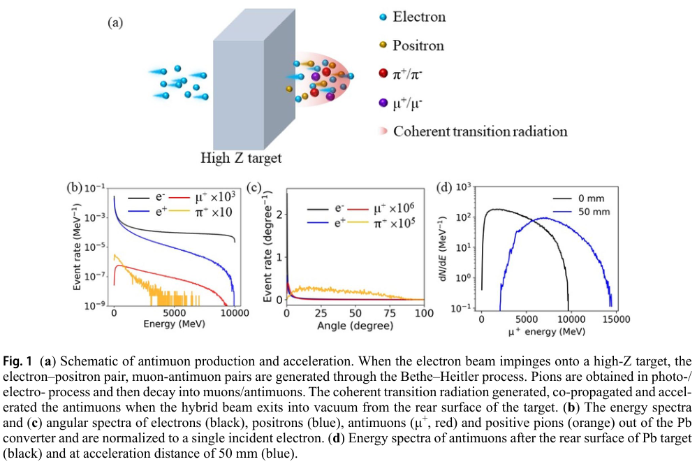
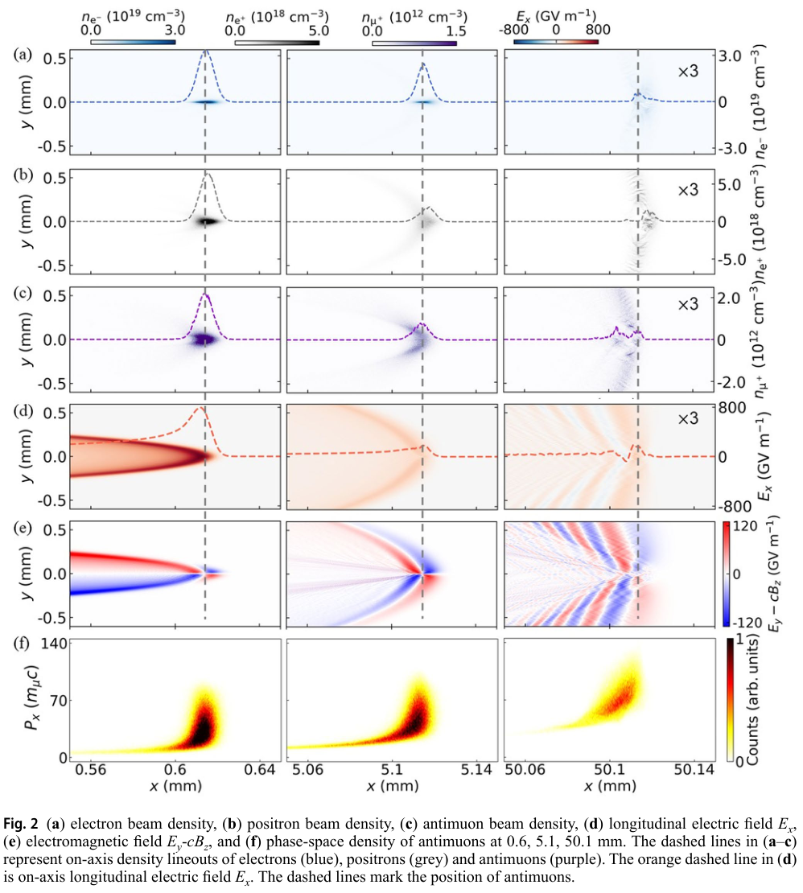
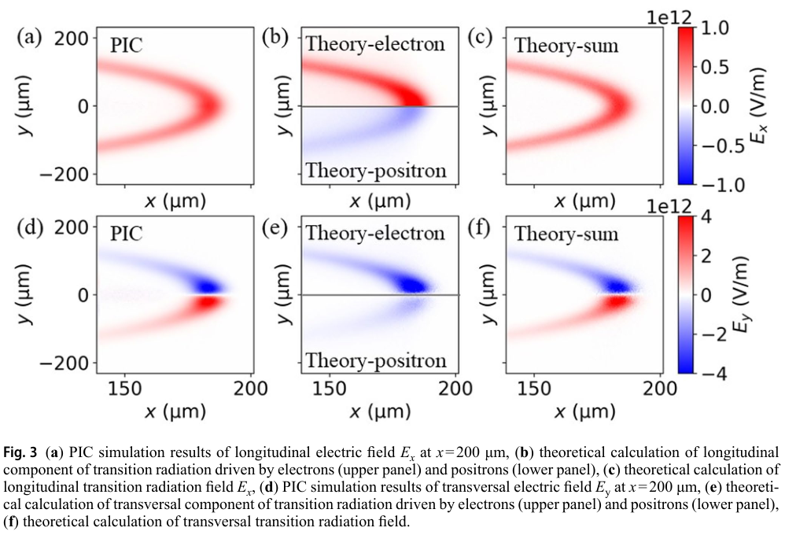
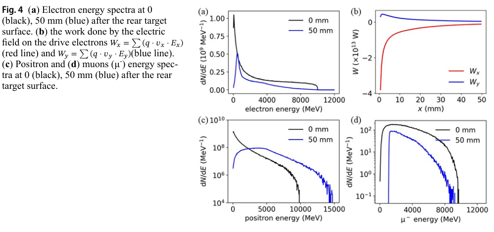
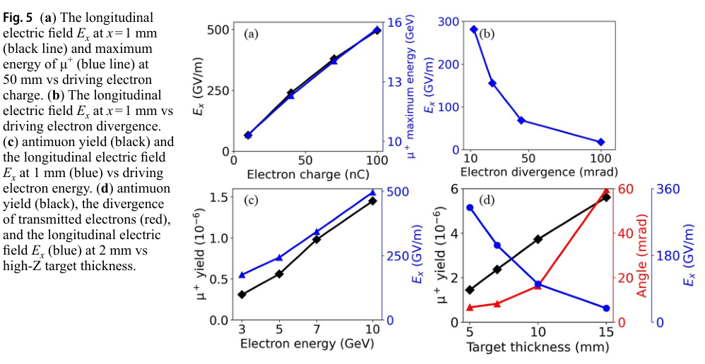
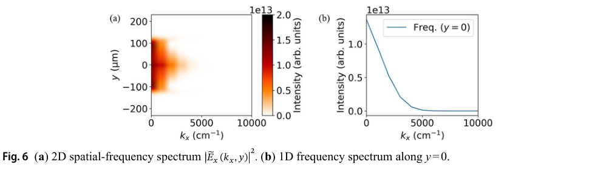

# 电子束驱动相干渡越辐射加速反μ子：转换靶产额与加速场的折中

## 0. 论文与阅读版本

Zhangli Xu、Xiaomei Zhang、Baifei Shen，*Antimuon acceleration via electron driven coherent transition radiation*，Scientific Reports，[DOI 10.1038/s41598-026-81462-5](https://doi.org/10.1038/s41598-026-81462-5)。2026-11-16接收，11-23在线；实际读的是 **12页出版社 Article in Press**，不是最终VOR。[本地PDF](../pdfs/xu-2026-antimuon.pdf)来自[文章实际下载锚点](https://www.nature.com/articles/s41598-026-81462-5_reference.pdf)，与页面名义PDF地址分开记录。

全文正文、方法和附录已读，9个关键源页及6幅摘录已目视；公式按原页核对。MinerU历史认证失效，本轮零请求、未复测，明确用本地布局文本和页面渲染回退。以下为作者MC/PIC结果及本文阅读推导，未重跑Geant4/EPOCH，未取得实验数据。

## 1. 摘要

作者把高Z靶内反μ子产生、出靶和渡越辐射加速放进同一方案：100 nC、10 GeV电子打5 mm铅靶，出靶反μ子最高9.7 GeV，二维PIC传播50 mm后最高15.7 GeV，留下42 fC、报告角度38 mrad。10 nC驱动的最大增益为0.7 GeV。这里“集成”指分阶段MC→PIC数值流程，不能写成激光实验已产生15.7 GeV反μ子。

## 2. Introduction：为什么选反μ子与CTR

引言先从μSR、透射成像、磁矩和对撞机解释μ子用途，再区分宇宙线、π/K衰变以及GeV电子打高Z靶的产生路线。已有激光设施的μ子产生实验是背景，不能转移为本方案加速实验。

随后讨论负μ子的尾场加速与正μ子的困难：质量大导致相位滑移，常规电子空泡对正电荷有横向散焦，需要特殊结构或注入。CTR（coherent transition radiation）在束流出导体／等离子体边界时自然出现，对正电荷提供可用场；但同靶大量正电子也会取能、抵消部分场，因此需同时研究产生与加载。

## 3. Results and discussion

### 3.1 Overview：从转换靶到加速段

来源PDF第3页原图1。(a)是几何示意，非实验照片；(b)横轴能量MeV、纵轴每入射电子的微分事件率MeV⁻¹；(c)角度使用degree，曲线含明确展示倍率，μ⁺在能谱乘10³、角谱乘10⁶，π也有各自倍率，不能凭线高比较物种总产额；(d)纵轴为μ⁺能谱计数密度，0与50 mm间向高能移动。辐射／BH产生由Geant4算，后续相干场由EPOCH算。

### 3.2 Simulation of antimuon production：偏置采样要还原权重

出靶电子数约入射的2.8倍，平均1.7 GeV，携带初始能量47.6%，发散从3.9增至7.2 mrad，30 fs变32.6 fs；反μ子平均2.1 GeV、最高9.7 GeV、发散33.2 mrad。正电子平均418.4 MeV、约占初能6.8%；低能宽角π衰变μ子较易失相，本文主要追踪BH通道。

原文称抽样10⁷电子产生140,000个μ⁺，同时给产额1.4×10⁻⁶；须结合Methods中 **gmumuFactor=10,000** 理解。若每个偏置事件按此因子还原，

$$
Y_{\mu^+}=\frac{1.4\times10^5}{10^7\times10^4}=1.4\times10^{-6},\qquad
Q_{\mu^+,0}=100\,\mathrm{nC}\,Y_{\mu^+}=140\,\mathrm{fC}.
$$

这是计数归一的一致性核算，不是对Geant4偏置实现的独立验证。源码、权重方差及无偏／偏置对照未公开核实，不能用原始计数比0.014作真实效率。

### 3.3 Simulation of acceleration：场峰值、平均梯度与留存不同

来源第5页原图2。三列为约0.6、5.1、50.1 mm，坐标x、y为mm；各物种密度色标分别采用10¹⁹、10¹⁸、10¹² cm⁻³，不能直接横比色深。(d)为纵向电场GV/m，(e)为横向组合场；(f)横向位置x、纵向动量以μ子质量乘光速归一，计数色标为任意单位。末列一些线标×3用于显示，不能当作实际增强。低能粒子会掉入后续周期或离开窗口，末态能谱有选择效应。

原文报告0.6 mm处峰值789.5 GV/m，50.1 mm仍超62.2 GV/m，最高能增6 GeV、几何发射度0.51 mm·mrad。42/140=30%是模拟窗口末态留存比例；没有统一孔径／能带、全三维50 mm统计与误差收敛，不能升级为束线交付效率。

能量方程来自洛伦兹力做功，磁力不做功：

$$
\frac{d\mathcal E}{dt}=q\,\mathbf v\!\cdot\!\mathbf E,
\qquad
\Delta\mathcal E\simeq q\int E_x\,dx,
\qquad
\frac{6\,\mathrm{GeV}}{e\,(50\,\mathrm{mm})}=120\,\mathrm{GV/m}.
$$

最后是按两端最高能差计算的等效平均梯度，不是789.5 GV/m局部峰值，更不证明两端端点属于同一粒子。摘要／引言的120 GV/m应与此口径及下文800 GV/m局部场分开。

### 3.4 Theoretical calculation：相干场为何被正电子削弱

单电荷场分为洛伦兹收缩库仑项与边界辐射项。原式(1)的辐射纵向分量可写为

$$
E_x^{\rm TR}=-\frac{e}{4\pi\varepsilon_0}
\frac{2\beta\sin^2\theta}{R(1-\beta^2\cos^2\theta)}\,\delta(ct-R).
$$

其中e是式中带符号约定的电荷幅值，β为速度/c，R是出界点到观察点距离，θ为观测角；δ是理想瞬时边界产生的分布。有限束团需对出界时刻、位置及电荷分布叠加，不能把δ值当有限峰值。辐射幅值随1/R衰减，超相对论驱动的库仑纵场有γ⁻²抑制；在粒子相位一致时幅值与净相干电荷成正比，强度才与电荷平方成正比。

来源第6页原图3。x、y用μm，电场用V/m。(a,d)为三维PIC的局部截面；(b,e)人为分开电子与正电子理论场，(c,f)叠加。电子纵场约+1200 GV/m、正电子约−400，合成约800 GV/m，库仑项小约三数量级。该小窗口三维核查支持近出界场形状，**不等于50 mm全程三维加速验证**。

### 3.5 Discussion：能量、束流与厚靶折中

来源第7页原图4。各谱横轴MeV、纵轴微分粒子数；功图横轴传播mm、纵轴以10³ J展示，分别画纵／横电场贡献。电子谱给损失583 J，而按电场功分析正文给453 J；相差130 J，本文保留这一未闭合预算，不能把全部损失认作进入μ⁺。图注将功简写为电荷×速度×场之和，实际功必须含时间积分。正电子最高能9.8→15.1 GeV，负μ子被减速。

人为去掉正电子时μ⁺平均能8.9 GeV，比有正电子高1.5 GeV且窗口数增13.2%；这是理想删除对照，未提供实际去除器。更薄靶降低正电子加载与散射，但也降低μ⁺产额。

来源第7页原图5。(a)电荷nC对1 mm处场GV/m与50 mm末态**最高**能GeV；正文同段写“平均”与图注“最大”冲突，按图注解读且保留疑点。(b)发散mrad增加，场下降；(c)电子能GeV增加时产额／场上升；(d)靶厚mm增加时产额上升、透射电子角mrad增大而2 mm处场下降。场评价位置不同，不能拼成同一全局最优效率曲线。原文“field strength scales as Q²”应区分前句的场幅与辐射强度；不能把电场也写平方标度。

15 mm铅靶的μ⁺产额约5 mm的3.8倍，场却约低一数量级。10 nC、10 GeV的小驱动仍给0.7 GeV最大能增益（等效14 GV/m），但尚无现实激光束流的联合能散、角散、荷量及时间抖动闭环。100 nC×10 GeV对应约1 kJ电子束能量，远高于把“10 GeV电子”单独拿来判断可行性。

## 4. Conclusion、Methods与Appendix

结论是未来大荷量GeV束流的候选正μ子方案，应用仍需束流冷却、能散控制与真实源条件验证。它没有给出成像、稀有衰变、核诊断或对撞机的端到端结果。

Geant4用QGSP_BERT并启用GammaToMuPair，在靶前1 mm放10⁷个电子，记录靶后粒子的坐标、动量、能量和global time，再由particle-from-file导入PIC。PIC中电子280 nC、正电子160 nC、μ⁺/μ⁻各140 fC；用150 μm厚、7×10²¹ cm⁻³等离子体重新激发出界场，并不是在PIC中再穿5 mm铅并重算核过程。主运动窗200 μm×2000 μm、1000×2000网格，背景每格5宏粒子；附加三维窗60×400×400 μm³、360×400×400网格只作局部场核查。

来源第10页原图6。横轴是空间波数cm⁻¹而非Hz，(a)纵轴y为μm、强度任意单位；(b)轴上线。波数约5×10³ cm⁻¹对应

$$
\lambda_c=\frac{2\pi}{k_x}\simeq12.6\,\mu\mathrm m>9.8\,\mu\mathrm m.
$$

这支持选定近场快照与束长的相干解释。k=0峰来自近场单极／亚周期结构，不能把它当可直接提取的远场单色辐射功率或全频相干证明。

## 5. 接续与速记

优先索取MC偏置权重、原始全相空间和EPOCH输入，做二维／三维长程、网格／宏粒子及边界收敛，并闭合583/453 J能量差。还需真实宽谱DLA/LWFA束团、预脉冲／靶形变、发散角定义与接受度。本文没有复跑、没有激光→电子→靶→μ⁺全链能量转换率，也没有防护或临床验收。

速记：薄高Z靶既产反μ子又保留电子的相干出界场；加速能量来自驱动电子，正电子是抵消场和竞争取能的双重负担。最高15.7 GeV是带理想驱动条件的数值结果。
