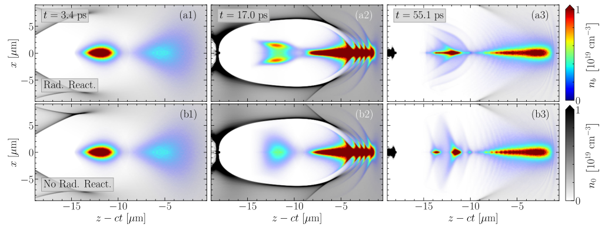
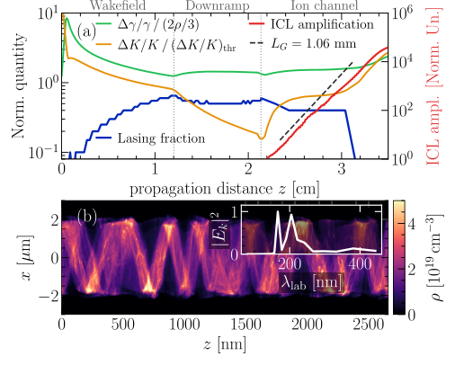
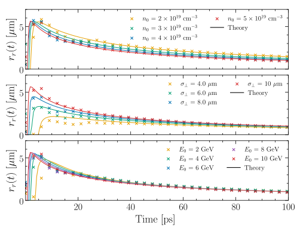
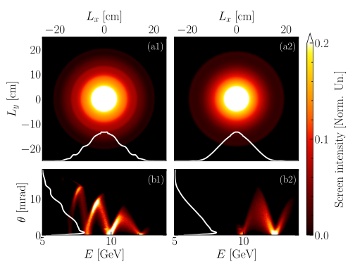

# Betatron 冷却驱动尾场电子束相空间成环与离子通道激光起振：中文笔记

## 0. 论文与实际阅读版本

- **原题**：Phase-Space Shaping Due to Betatron Cooling in Wakefield Accelerators and the Onset of the Ion-Channel Laser。
- **作者**：P. J. Bilbao、T. Silva、L. O. Silva。
- **正式记录**：Physical Review Letters **137, 225001 (2026)**，[DOI:10.1103/k67h-dvxp](https://doi.org/10.1103/k67h-dvxp)。出版社PDF首页明确：2025-10-14收到、2026-08-24修订、2026-10-30接收、**2026-11-24发表**。
- **实际全文**：[APS官方harvest最终VOR](https://harvest.aps.org/v2/journals/articles/10.1103/k67h-dvxp/fulltext)，[本地9页PDF](../pdfs/bilbao-2026-betatron-cooling.pdf)，包含末尾End Matter附录A–C；不是只读5页主文。[同作作者稿2510.24567v2](https://arxiv.org/abs/2510.24567v2)只用于作品身份核对，未替代最终版。
- **方法与证据**：解析的慢冷却平均模型、OSIRIS轴对称PIC、解析输运后接二维slab辐射放大PIC，以及合成屏像／能谱。本文没有新测得的环形电子束或ICL激光实验。
- **提取边界**：MinerU本轮共享可用性探测返回401、`user token expired`，本篇明确使用本地布局文本与原PDF页面渲染回退。9页原页全部目视，4幅原图裁摘实际重开。额外在线Supplement入口返回403 HTML，**未获得补充全文**；主文9页中的End Matter已读，不能与该在线Supplement混为一谈。

## 1. 摘要：冷却也能产生分布函数的正梯度

摘要先提出工况变化：高电荷、短束团可在约10¹⁹ cm⁻³或更高密度中驱动尾场，强横向聚焦使betatron辐射不再只是弱的附加光源，而能反过来改变电子束动力学。

第二步是本文核心：辐射阻尼依赖振荡幅度，大幅度粒子冷却更快，使原来平滑的横向分布在某个有限幅度附近堆积，形成环状相空间与振荡幅度的“布居反转”。这里指分布函数对振荡幅度存在正梯度，不是原子能级的激发态反转。

最后，作者把这种束流用于离子通道激光（ICL）起振：满足足够窄的能散和振荡强度散度后，二维辐射PIC出现微聚束和指数放大。**“可起振”是指定计算链中的结果，不能写成已在FACET-II观测ICL。**

## 2. 引言：为何不能只用发射度阻尼描述

引言第一组段落从现有等离子体加速的高梯度、高电荷和多GeV束流出发，说明在更高密度下聚焦场和辐射同时增强。厘米级高密度源、束流驱动尾场及高能束流的既有实验为参数选择提供背景；它们不是本文预测机制的实验验证。

第二组段落区分既有工作和本工作：此前常研究平均能量损失、发射度降低，本文追踪整个横向分布函数。即使二阶矩随时间平滑收缩，分布内部也可能变成环、螺旋和多个投影峰，因此仅报RMS发射度会遗漏可驱动集体不稳定性的正梯度。

第三组段落建立直觉：横向加速度随振荡幅度变化，辐射反作用对大幅度粒子的阻尼更强。这种非线性把相空间压向有限幅度的窄区域，类似作者此前的磁场同步辐射冷却机制，但此处聚焦由离子通道提供。

## 3. 单粒子模型：加速、辐射与横向振荡的竞争

### 3.1 Blowout 场、经典辐射与归一化

作者把粒子运动约化到一个包含纵向和横向的平面，以ξ表示相对空泡中心的纵向坐标，以x表示横向位移。理想空泡内的电磁场给出线性聚焦力，超相对论电子的横向运动近似谐振子。

量子参数估计为

$$
\chi\simeq0.1\left(\frac{n_0}{10^{20}\,\mathrm{cm}^{-3}}\right)
\left(\frac{A_\perp}{10\,\mu\mathrm m}\right)
\left(\frac{E_b}{10\,\mathrm{GeV}}\right).
$$

n₀是背景电子密度，A⊥是物理横向振幅，Eᵦ为电子束能量。这里将原文该估计式中的幅度A写成A⊥，以免与后文经过γ缩放的作用量幅度混淆。本文主体采用经典Landau–Lifshitz约化反作用；χ接近1时随机光子发射产生扩散，作者只推测定性结构可能延续，未用这段经典推导证明一般量子区结论。

原式(1)保留沿动量方向的主导辐射摩擦。以下采用作者式(2)的等离子体归一化：长度c/ωₚ、时间ωₚ⁻¹、动量mₑc、能量mₑc²；其中rₑ也应理解为以c/ωₚ归一化后的经典电子半径。方程为

$$
\dot x=\frac{p_x}{\gamma},\qquad
\dot p_z=-\frac{\xi}{2}-\frac{r_e}{6}\gamma p_zx^2,
\qquad
\dot p_x=-\frac{x}{2}-\frac{r_e}{6}\gamma p_xx^2.
$$

纵向第一项为尾场加速，横向第一项为离子聚焦；反作用项均沿动量反向，并带x²因子。粒子在离轴最远、横向受力最强处辐射最显著。动量主要沿纵向，故辐射同时消耗纵向能量，不能把横向冷却当作“免费提高束质”。

**原文量纲疑点**：第2页式(1)后给出的有量纲简化力系数印为含ωₚ²；把同页线性聚焦场平方代回式(1)，该处应出现ωₚ⁴。原文归一化说明还印有e²=rₑ/(mₑc²)，而其前文定义rₑ=e²/(mₑc²)对应e²=rₑmₑc²。这些是实际PDF中的印刷／量纲疑点；本笔记使用明确给出的归一化动力学式(2)，不据这些有量纲简写直接实现求解器，也未取得源码裁决。

### 3.2 纵向平衡点与加速可达性

对一周期平均，净纵向加速为零的位置满足

$$
\xi_{\rm eq}=-\frac{r_e}{3}\gamma p_z\langle x^2\rangle_\beta.
$$

推导只需对纵向方程取betatron周期平均并令其为零。处于更负ξ一侧的粒子能从尾场取得超过辐射损失的能量；反之净损失。空泡半径还需大于平衡偏移绝对值，才存在可加速区。此条件说明高密度、高能量和大横向振幅不能分别无限提高：辐射损失可能把加速窗口挤出空泡。

### 3.3 作用量幅度、相位平均及冷却映射

作者定义

$$
A^2=\gamma^{1/2}\left(x^2+\frac{2p_x^2}{\gamma}\right),
\qquad x=\gamma^{-1/4}A\cos\phi,
\qquad A_\perp=\gamma^{-1/4}A,
\qquad \omega_\beta=\frac{\omega_p}{\sqrt{2\gamma}}.
$$

A²与betatron作用量成正比，故只有缓慢加速、没有辐射时近似守恒；A⊥仍可因γ上升而缩小。A的缩小因此比单看物理束斑缩小更能隔离真正的辐射耗散。

原式(3)为

$$
\frac{dA^2}{dt}=\frac{\dot\gamma}{2\gamma}A^2\cos2\phi
-\frac{r_e}{3}\gamma^{1/2}A^4\cos^2\phi\sin^2\phi,
\qquad
\dot\gamma=\mathcal E-\frac{r_e}{6}\gamma^{3/2}A^2\cos^2\phi,
\qquad\mathcal E=-\xi/2.
$$

这里𝓔是归一化纵向加速率，不是激光电场，也不是以GeV表示的束能。推导平均阻尼时，不能把γ̇直接当作与相位无关的常数：平均cos2φ为零，但辐射损失与相位相关，平均cos²φ cos2φ为1/4，平均cos²φ sin²φ为1/8。因此两项分别贡献−rₑ√γ A⁴/48与−rₑ√γ A⁴/24，相加得到

$$
\left\langle\frac{dA^2}{dt}\right\rangle
=-\frac{r_e}{16}\sqrt\gamma\,A^4,
\qquad
\tau(t)=\frac{r_e}{16}\int_0^t\sqrt{\gamma(t')}\,dt',
\qquad
A(t)=\frac{A_0}{\sqrt{1+A_0^2\tau(t)}}.
$$

对A²求倒数可直接积分，得到最后的映射。大A₀粒子比小A₀粒子更快收缩，并逐渐趋近A_lim=τ⁻¹ᐟ²的上边界，这是相空间堆积的单粒子原因。

若进一步假定净能史可近似为γ₀+𝓔t，则

$$
\tau=\frac{r_e}{24\mathcal E}
\left[(\gamma_0+\mathcal Et)^{3/2}-\gamma_0^{3/2}\right].
$$

这个闭式需要近似的线性能史；在先强烈损失后加速的工况，应使用能史积分。相位平均还要求betatron振荡快于冷却，不能将慢冷却闭式无条件推广到强冷却、强失配、任意能散的束流。作者把更一般强冷却细节放入本轮未获得的在线Supplement。

## 4. 分布函数、成环时间与匹配／失配束

### 4.1 为什么摩擦冷却能提高有限幅度处的分布

在A–φ坐标，面积元含A，因此守恒式的径向项必须带Jacobian：

$$
\frac{\partial f}{\partial t}
+\frac1A\frac{\partial}{\partial A}(A\dot A f)
+\omega_\beta\frac{\partial f}{\partial\phi}
+\mathcal E\frac{\partial f}{\partial\gamma}=0.
$$

冷却是可压缩相空间流，不是无耗散Hamilton系统的相空间体积守恒。原文在式(4)前写“df/dt=0”应结合上面的守恒方程理解，不能据此漏掉摩擦流的压缩因子。

利用反映射A₀=A/√(1−A²τ)，面积守恒给出A₀dA₀/(AdA)=(1−A²τ)⁻²，因而原式(5)的关键形式为

$$
f(A,\phi,t)=
\frac{f_0\!\left(A/\sqrt{1-A^2\tau},\,
\phi-\Phi_\beta(t),\,\gamma-\mathcal Et\right)}
{(1-A^2\tau)^2},
\qquad
\Phi_\beta(t)=\int_0^t\omega_\beta(t')dt'.
$$

**表达范围**：原文式(5)把相位移写成tωᵦ；上式显式写累计相位，恒定ωᵦ时才化为该形式。能量回推γ−𝓔t仍沿用上节近似，并非任意辐射能史的严格全分布解。解的支持域满足A²τ<1。Jacobian的增大允许分布在有限幅度处出现正梯度；这并不意味着粒子数凭空增加。

### 4.2 高斯初始分布的环半径及时间尺度

取初始横向相空间高斯f₀正比于exp[−A²/(2σ²)]。对最终分布的对数按A求导，可得

$$
\frac{\partial\ln f}{\partial A}
=-\frac{A}{\sigma^2(1-A^2\tau)^2}
+\frac{4A\tau}{1-A^2\tau}.
$$

将其非零极值点设为零，原式(6)为

$$
r_r(\tau)=\frac{\sqrt{4\tau\sigma^2-1}}{2\tau\sigma},
\qquad
\tau>\frac1{4\sigma^2},\qquad
\tau_r=\frac1{2\sigma^2},\qquad r_r(\tau_r)=\sigma.
$$

rᵣ是作用量幅度坐标中的峰位置，不应直接当成以μm为单位的物理圆环半径；物理振幅还需乘γ⁻¹ᐟ⁴。这里的正梯度针对相空间密度f，而径向粒子数概率还带面积权重，二者的峰定义不能互换。

在能量变化不大时，作者给出成环时间和长度标度

$$
t_r\simeq\frac{8}{r_e\gamma_0\sigma_\perp^2},
\qquad
L_r\simeq4.6\,\mathrm{cm}
\left(\frac{n_0}{10^{19}\,\mathrm{cm}^{-3}}\right)^{-2}
\left(\frac{E_b}{10\,\mathrm{GeV}}\right)^{-1}
\left(\frac{\sigma_\perp}{5\,\mu\mathrm m}\right)^{-2}.
$$

该式的归一化时间乘ωₚ⁻¹后才是秒。密度平方的强标度说明高密度有利于缩短冷却长度，但还必须在驱动束耗尽前成环，故需耗尽长度不小于Lᵣ。文中估计所选参数的两长度比约8，是模型工况的量级，不是通用设计保证。

### 4.3 图1：匹配束的环与失配束的螺旋

原图1位于PDF第4页左上，展示解析式(5)在4tᵣ时的分布。匹配束形成较清晰的环；失配束初始动量散度减半后，在相位混合形成螺旋的同时也产生幅度堆积。对x和pₓ分别积分，螺旋会投影为多个空间／动量峰。因此，多条径向条纹不能自动解释为多个独立纵向微束；还应核对横纵坐标、投影方式和betatron相位。

## 5. 自洽成环PIC与下坡输出（原图2）

作者随后用2D圆柱轴对称OSIRIS比较有／无辐射反作用的双束工况。驱动束在上坡聚焦并形成空泡，尾随束在平顶内产生横向结构；下坡出口仍有多个横向峰。无反作用对照没有相同成环形态，支持机制来自幅度相关辐射损失。

**图源与坐标**：最终VOR PDF第4页Fig.2。横轴z−ct、纵轴x，均为μm；彩色为束密度nᵦ、灰度为背景密度n₀，各自以10¹⁹ cm⁻³标示，不能把两色条直接当相同种类粒子或辐射强度。上排开启、下排关闭辐射反作用；三列为3.4、17.0、55.1 ps，依次位于2 mm上坡、13 mm平顶、2 mm下坡过程。

**参数与解读**：驱动束1 nC、横向RMS 5 μm、纵向RMS 2 μm；尾随束约0.25 nC、纵向1 μm、横向5 μm；两束初始10 GeV、归一化发射度300 mm·mrad。高密度平顶中有反作用的尾束先分出离轴双瓣／环截面，出界后形成多峰；关闭反作用时相应环状调制缺失。图注密度1.6×10¹⁹ cm⁻³与附录A的1.66×10¹⁹ cm⁻³按原文分别记录，视为近似／精确输入口径，不擅自合并。

**证据限制**：m=0轴对称计算排除了非轴对称模式；二维截面中的离轴双瓣是轴对称环的截面。实用束线是否保留结构，还要加入三维非对称、输入抖动、诊断分辨率与背景。本文的对照证明该数值工况中辐射项的作用，未完成实验唯一机制鉴别。

## 6. ICL 起振条件和分段放大计算（原图3）

出现幅度反转是必要条件，作者还要求能散和振荡强度散度足够小：

$$
\frac{\Delta\gamma}{\gamma}<\frac{2\rho}{3},
\qquad
\frac{\Delta K}{K}<\frac{2+K^2}{2K^2}\rho,
\qquad
K\simeq\frac{\langle A\rangle\gamma^{1/4}}{\sqrt2}.
$$

ρ为Pierce参数，K为离子通道等效wiggler强度。物理上，能量和振幅散度都会使电子的共振频率不同；即使横向成环，如果共振失谐大于增益带宽，也无法集体放大。关于ρ和相干条件的完整推导位于尚未取得的在线Supplement，本文笔记不补造其系数。

受算力限制，作者没有对整个尾场—下坡—放大链执行全尺度自洽辐射PIC，而是先用式(2)解析跟踪一个2.5 μm尾束切片，再将所得相空间加载到Lorentz提升系的二维Cartesian slab离子通道PIC中。

**图源与坐标**：VOR第5页Fig.3。(a)横轴传播距离cm；左轴是按阈值归一化的能散、K散度及蓝色lasing fraction，右轴红线为**任意归一化单位**ICL场能量。虚线为理论增益长度1.06 mm对应斜率。(b)横轴z为nm，纵轴x为μm；色标实际写ρ[10¹⁹ cm⁻³]，图注称charge density而该轴标采用数密度量级，电荷归一化未另解释，不能误读成带C的电荷密度单位。插图为归一化横向电场平方谱，横轴实验室波长nm。

**结果口径**：约50%是选定束流中满足两项发光条件的粒子分数，不是激光能量转换效率，也不是50%的驱动束能量变成相干光。阈值判断有局部／选粒子口径，不能要求图中全束RMS曲线直接等同于该分数。放大区出现纳米尺度微聚束和场能指数增长，谱峰约166 nm。

共振与增益长度采用

$$
\lambda_{\rm lab}\simeq
\frac{\sqrt2\pi c}{\omega_p\gamma^{3/2}}
\left(1+\frac{K^2}{2}\right),
\qquad
L_G=\frac{2c}{\sqrt3\rho_{\rm2D}\omega_\beta}
\simeq1.06\,\mathrm{mm}.
$$

共振式可从betatron周期和相对论前向多普勒压缩理解：轴向辐射波长因γ增大缩短，但大K的横向摆动降低轴向速度并增大波长。这里的数值是放大阶段的局部冷却后γ、K，而不是把初始10 GeV直接代入。附录A称网格按λ₁=161 nm设计，图3的实际谱峰约166 nm，两者用途与数值分开记录。

原文最后提出LWFA高电荷10 GeV束可作高密度尾场驱动，或PW激光在更高密度介质开通道；这些是延伸场景。其χ可达量子区，更不能用本文经典计算替代完整QED-PIC、激光输入和实验可行性验收。

## 7. 结论、数据与End Matter

结论是betatron冷却可以由非线性耗散产生振幅布居反转，并在指定束流条件下为ICL提供有利分布。对科研应用，最值得保留的是“从单粒子幅度映射到分布函数正梯度，再到集体增益”的机制链，而不是单独摘取冷却后发射度或一个输出波长。

### 7.1 附录A：数值参数及几何分工

成环阶段采用OSIRIS二维圆柱几何、仅m=0方位模。移动窗52×102(c/ωₚ)²，2500×5000网格，纵向步长0.0208c/ωₚ，时间步0.012ωₚ⁻¹；64粒子/格，三次插值，二阶FDTD及标准滤波。背景电子冷、离子固定。两束初始能散1%、横向热动量散度约60mₑc。本文没有列出网格／粒子数收敛曲线，不能把精确网格参数当作已证明收敛。

ICL预处理尾场密度9×10¹⁹ cm⁻³、长度1.23 cm，然后1 cm下坡，放大离子通道5×10¹⁹ cm⁻³、长度1.4 cm。提升系γᵦ=31.2，加载16λ₁切片，1024×320网格、每λ₁ 64格，约3×10⁷宏粒子、二次插值；静态均匀离子柱。所加载束标称1 nC、纵向RMS 5 μm，发光核心γ约2.2×10³、K约101、能散和K散度各约0.3%。这些局部核心参数与初始整束10 GeV和1%能散不同。

**单位提示**：附录A写ωₚ约2.25×10¹⁴ Hz；ωₚ按前文定义为角频率，严格单位应按s⁻¹／rad·s⁻¹处理，不能再误乘或漏乘2π。该行也不应当作独立测得的频率。

### 7.2 附录B与图4：13组扫描的验证范围

参数扫描使用**不耗尽且密度远高于背景的理想驱动束**，保证空泡可容纳约10 μm宽的尾束。尾束横向匹配、方位对称、纵向极薄，约0.1c/ωₚ，均放在指定平衡点一侧。初期宽束先辐射掉约一半能量，随后才由尾场加速，因此能史明显偏离简单的γ₀+𝓔t。

**图源与坐标**：VOR第8页Fig.4，横轴时间ps，纵轴物理环半径μm；三排分别扫描密度2–5×10¹⁹ cm⁻³、横向束宽4–10 μm、初始能量2–10 GeV。叉号为PIC，实线为解析，曲线先长大后收缩，不是束流长期保持恒定半径。

**关键验证限定**：解析曲线把**同一次PIC模拟的平均能量历史**代入τ积分，再将作用量半径乘平均γ⁻¹ᐟ⁴换成物理半径。作者称无自由拟合参数，在13组中t>tᵣ的半径相对RMS偏差5–9%；但使用了模拟提供的能史，因此是“给定真实能史后的幅度模型验证”，不是仅凭初态完全先验预测全链动力学，也不是实验误差或全分布误差。早期环弱且半径定义不稳，作者明确不把t≲tᵣ作为同一精度范围。

### 7.3 附录C、图5与图6：诊断可见性仍是合成结果

图5位于第8页右上，重建图2平顶末端尾束的相空间。开启反作用时可见环／螺旋及幅度分布峰；关闭时不存在相同堆积，给出从原始粒子分布到空间截面的中间证据。

**图源与坐标**：VOR第8页Fig.6。上排是出界100 cm下游的合成发光屏，坐标Lₓ、Lᵧ为cm；颜色为**归一化任意单位**屏强度，白线为投影，不是绝对电荷密度。下排横轴能量GeV、纵轴发散角θ（mrad）；有反作用时出现与环相关的分叉／脊结构，无反作用对照更平滑。

**可见性边界**：这些图经过背景扣除以隔离尾随束信号；不是含全部驱动束、噪声、动态范围和屏响应的真实原始测量。图6说明在作者合成模型中结构可保留，不证明真实仪器必然可分辨，更不能将屏上环直接当相干光。

数据声明给出[Zenodo DOI:10.5281/zenodo.15555537](https://doi.org/10.5281/zenodo.15555537)。本轮未下载大体量数据、未复跑OSIRIS、解析跟踪或合成诊断。第9页称诊断细节在“Zenodo [78]”，但本PDF参考文献止于[77]；很可能是编号残留，仍需对照正式数据说明确认，不能虚构一个[78]条目。

## 8. 尚未闭环的问题与可复现检查

1. 取得最终版在线Supplement、对应输入卡、OSIRIS版本及解析跟踪脚本，核对有量纲反作用简式、归一化说明和相位累计写法；现有量纲疑点未获作者／代码确认。
2. 对相同初态以真实能史与自洽能史分别评价环半径和全分布误差，报告能量损失、驱动耗尽及增益的统一能量账，不能只看局部lasable fraction。
3. 用完整三维模、可动离子、网格／粒子／窗口扫描检验成环，并跟踪全束穿过下坡与放大段。m=0成环、slab放大及解析拼接的适用范围需要单独评估。
4. 将诊断加入驱动背景、屏非线性、空间分辨率和发散角接受度，再设计与无反作用／相位混合等竞争机制的可证伪对照。
5. 若推广到χ约1的密集靶或激光开孔，需包含量子随机扩散和实际激光—靶演化；本文经典结果不是γ源、光核产额、临床或辐射防护的端到端验证。

## 9. 复习用速记

幅度越大的betatron粒子冷却越快，有限幅度附近的相空间堆积可产生正梯度，并在满足窄带条件的局部束流中触发ICL增益。本文的成环PIC、给定能史扫描、解析拼接二维放大及扣背景合成诊断是四种不同证据口径，须分别引用。
