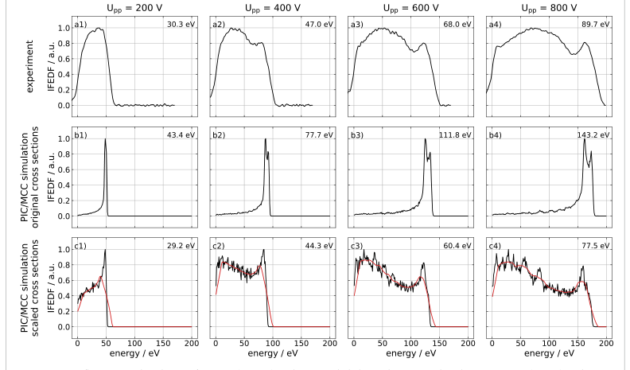
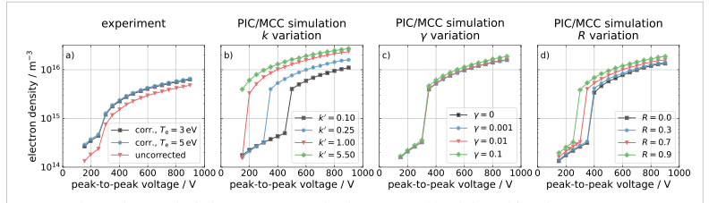
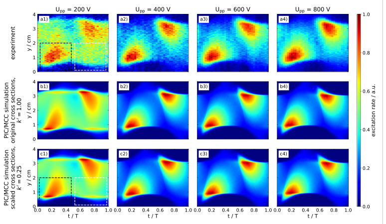
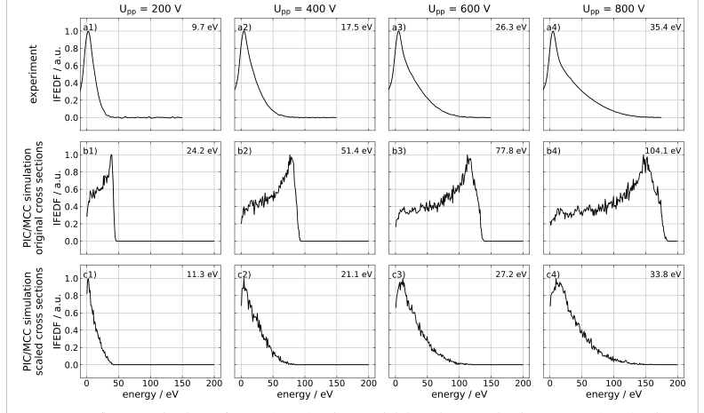
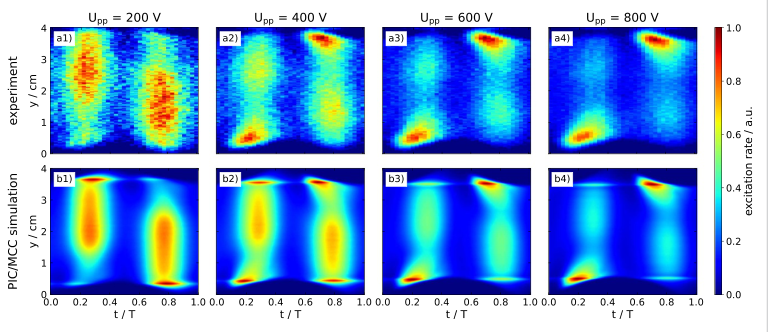

# 纯CF₄对称容性放电PIC/MCC的多诊断校准与验证

## 0. 论文信息与证据口径

- **原题**：Multi-diagnostic experimental validation of PIC/MCC simulations of symmetric capacitively coupled plasmas in CF4。
- **作者**：Constantin Neuroth、Li Wang、Aranka Derzsi、Peter Hartmann、Florian Beckfeld、Maximilian Ryppa、Ranna Masheyeva、Zoltán Donkó、Julian Schulze。
- **期刊及DOI**：Plasma Sources Science and Technology **35** (2026) 115019；[10.1088/1361-6595/aebfc4](https://doi.org/10.1088/1361-6595/aebfc4)。2026-08-13投稿、10-26修回、11-09接受、**11-24发表**。
- **本次实际全文**：[出版社最终VOR PDF](../pdfs/neuroth-2026-cf4-pic-validation.pdf)，26个物理PDF页，含1页下载封面和25页文章；下文同时给文章印刷页与需要时的PDF页，PDF页比印刷页多1。不是预印本或仅接收元数据。
- **方法**：真实对称CF₄容性RF放电的RFEA、hairpin与PROES测量，对比PICit! **1d3v、静电PIC/MCC**；用5 Pa数据调节截面与反应／表面参数，再以同一套参数比较30 Pa。未报告盲测数据划分或独立装置复现。
- **核心边界**：IFEDF和激发图多为每幅各自峰值归一化；实验总离子通量仅任意单位；5 Pa电子密度仍有约2倍差异。论文的“quantitative validation”应按这些实际量和误差范围理解，不能等同于绝对通量、全部中性化学或刻蚀结果已验收。
- **解析与阅读**：MinerU本轮单次认证401后，由主代理记录本地提取／渲染回退；本笔记按全文顺序阅读正文及附录反应表，实际核看关键原页和5幅保留原图，见[阅读证据](../research/cf4_reading.json)。未运行作者代码、下载原始数据或重复实验。

## 1. 摘要：多种可观测量约束不同输入

摘要先指出，PIC/MCC若要成为工艺数字孪生，必须与真实测量定量对应。这里用13.56 MHz、150–900 V峰峰电压、5／30 Pa、4 cm间隙的纯CF₄放电，联合比较到达接地电极的离子通量能谱、中心电子密度和F原子时空激发形态。

原始常用离子–中性截面虽曾能复现光学激发图，却不能给出正确的电极离子能谱。作者把所有离子–CF₄弹性截面乘3、非弹性乘10，同时调整离子–离子复合率、二次电子发射率和电子反射率。改后能谱和模式转变改善，关键参数为离子–离子复合系数。**这是受实验约束的输入校准加跨压力对照，非无调参地从原始截面预测所有测量。**

## 2. 原文1：引言与问题定位（文章1–3页）

**工艺量与电子加热。** 刻蚀／沉积关心到表面的离子与自由基通量及能量分布；这些量由电子加热塑造的EEDF及其电离、解离、附着碰撞共同决定。低压非局域动理学使流体近似不足，PIC/MCC可补充空间和RF相位信息，但代码间基准通过不等于化学输入和真实反应器都正确。

**α、γ与DA模式。** 电正性气体低压常由扩张鞘边加热及双极场贡献α模式；高压／高压幅时，表面二次电子在鞘内倍增可导致γ模式。电负性CF₄则因电子附着而电子贫化、体电导降低，体区漂移场和鞘边双极场增强，形成DA模式。提高电压可使电子数与电导增加、DA贡献下降并转向α；中间存在混合α／DA。模式依压力、电压、间距、表面条件、波形和气体组分变化，不能仅看某个单一相位亮斑命名所有放电。

**为什么多诊断重要。** 先前研究多比对PROES，少有电极离子能谱；某些研究又有自偏压／掺Ne及简化离子组分。CF₄里多种正负离子共存，常用Denpoh–Nanbu（DNT）离子–分子反应集和电子碰撞集未必同时保证鞘层碰撞和体区电子行为。较新的CF₃⁺迁移率约束截面只是部分反应，不能直接替代完整化学网络。

**本作相对前作。** 原文ref55是Wang L等、PSST **35** (2026) 045016，提供PICit!的CF₄处理与相关前作背景；本作Neuroth首作者、115019，任务为多诊断输入验证，是不同作品。正文同样引用以往条纹／模式研究，但此处不把相关作者和代码延续误判成同一篇重复论文，也不声称该Wang前作已经入本库。

## 3. 原文2：实验装置与测量解释（文章4–7页）

### 3.1 对称几何与运行条件

两块相同不锈钢电极直径119 mm、厚10 mm，相距4 cm；外部硼硅玻璃筒内径120 mm。可更换内保护玻璃筒减少CF₄活性组分和离子轰击对光学通道的侵蚀。气体纯度5.0、基压约5×10⁻⁴ Pa；低压和较高压分别使用量程相应的电容计。上电极接13.56 MHz谐波RF源及匹配网络／隔直电容，电压由高压探针监测。

通常直流自偏压不超过峰峰电压的2.5%；插入hairpin后可至<5%，说明几何对称经过约束却非完美。同一外部电压／气压下，有无hairpin的测量不能默认是毫无扰动的同一等离子体，三诊断也不构成全都无扰动的同发全量测量。

### 3.2 RFEA：得到总正离子通量能谱，不是质量分辨速度谱

接地电极内嵌四网栅RFEA，上方同材质薄不锈钢罩保持表面与几何接近一致。入口网栅接地；下一栅排斥电子；正阻滞电位筛掉低法向能量离子；末栅阻止收集器二次电子。收集电流对阻滞电压的负导数给IFEDF的测量量。不同离子质量不同，因此这一总信号不能直接解释为一个共同速度分布，也不能单凭它测出CF₃⁺／CF₂⁺／CF⁺各自丰度。

按照原文的仪器信号定义，平均能量和通量写成：

$$
\overline E_i=\frac{\int_0^{E_{\max}}E f(E)\,dE}
{\int_0^{E_{\max}} f(E)\,dE},\qquad
\Gamma_i=\frac{\int_0^{E_{\max}}f(E)\,dE}{eAT}.
$$

E为与阻滞电位对应的法向能量，f是由收集电流导数得到的谱量，e为元电荷，A为总入口面积，T为网栅透过修正。第一式是谱的一阶矩除以零阶矩；第二式把积分电流除以每离子电荷和有效收集面积。本文正离子模型主要按单电荷处理，实际双电荷实现的附录疑点见后文；不能未经处理把f另定义成速度概率密度再套这两式。

37孔、每孔半径0.4 mm给A=1.86×10⁻⁵ m²。制造商每网栅透过率取0.5，四栅相乘T=0.0625；实际栅相对对准可能改变它，文献报告不同传感器同条件的通量差可达20%。因此作者**只以任意单位报告实验通量，并明确不用于绝对值直接对照**。相对电压趋势仍有意义，不能把图中的实验a.u.纵轴与模拟m⁻²s⁻¹纵轴当同一绝对标定。

### 3.3 Hairpin：鞘修正及探针扰动

浮置U形银线共振器长27 mm、宽15 mm、线半径50 μm，位于放电中心、平行电极，真空谐振约2.2 GHz。矢量网络分析仪扫频，由反射S₁₁最低点得到等离子体中谐振频率。定义真空／等离子体谐振频率分别为fr,0与fr,p，则原式3–4为：

$$
f_{pe}^{2}=\frac{f_{r,p}^{2}-f_{r,0}^{2}}{\xi},\qquad
n_e=\frac{4\pi^2\epsilon_0m_e}{e^2\xi}
\left(f_{r,p}^{2}-f_{r,0}^{2}\right).
$$

第二式把等离子频率定义代入第一式；频率必须用Hz，所得密度单位m⁻³。ξ修正导线旁电子贫化鞘层；忽略它通常低估密度。原文使用的模型为：

$$
\xi=1-\frac{f_{r,0}^2}{f_{r,p}^2}
\frac{\ln[(w_{hp}-r_{hp})/(w_{hp}-r_s)]
+\ln(r_s/r_{hp})}
{\ln[(w_{hp}-r_{hp})/r_{hp}]},
\qquad r_s=r_{hp}+\lambda_D.
$$

宽度whp、线半径rhp和鞘外半径rs决定几何权重；导线附近电场的径向积分产生对数项，电子被排除的鞘区等效介电响应接近真空。λD依赖电子温度与密度；“鞘宽等于一Debye长度”是评价模型假设，非本次直接鞘宽测量。作者以Te=3／5 eV两种修正和ξ=1未修正给范围，3／5 eV修正之间差小不代表共同模型系统误差也小。

插入探针还改变自偏压和对称性。低压不同模式的绝对密度残差可能涉及鞘修正缺项及实验侧壁损失；后者不存在于一维模型，不能以改变k自动弥补所有二维损失。

### 3.4 PROES：观测高能电子激发形态

703.75 nm、F原子3p到3s跃迁用1 nm带宽滤片和ICCD记录。先沿横向分箱、扣去每个外参工况在时空域内的最小发射背景；故保留的是随时空变化的部分。上能级有效寿命17.3 ns，直接激发阈值14.75 eV，主要看高于该阈值的电子动力学，不直接测完整EEDF或全部电子能量吸收。

上能级数N*满足产生减衰减的速率方程，发射强度与N*成正比，于是原式7为：

$$
\frac{dN_*}{dt}=S-\frac{N_*}{\tau_{\rm eff}},\qquad
S(y,t)\propto\frac{\partial I_{703.75}(y,t)}{\partial t}
+\frac{I_{703.75}(y,t)}{\tau_{\rm eff}}.
$$

这说明不能把瞬时亮度直接等同瞬时激发率；需要寿命反卷积。多步激发和级联足够弱是额外适用条件。最终S按峰值归一化。相机门宽2 ns、约170 μm空间分辨，触发为RF频率的1/15≈904 kHz并累积多周期，不能称为单发测量。

## 4. 原文3：PIC/MCC及经验输入修正（文章7–9页）

### 4.1 组分、反应网络与数值口径

PICit!在一个空间维、三个速度维中追踪电子，以及CF₃⁺、CF₂⁺、CF⁺、C⁺、F⁺、CF₃⁻、F⁻，共8种带电组分；CF₃、CF₂、CF、C、F、F₂六种中性分布由稳态扩散方程自洽计算。电子–CF₄考虑17条反应，主要取Kurihara截面，F⁻／CF₃⁻解离附着用Bonham数据。离子–CF₄基于DNT，弹性散射同时有各向同性和各向异性分量。

气体温度固定350 K，空间500–2500格点，每RF周期10,000时间步，收敛后平均1000周期。正文称满足显式静电PIC稳定性／准确性要求，但没有在本作正文给出完整网格、时间步、粒子数扫描和误差条；这里不把作者选择写成独立完成的收敛验收。

### 4.2 为什么原始光学图相似仍不足

原始网络能复现时空电子激发，却低估鞘中离子的碰撞和组分转换，导致到壁低能离子不足。表面复合／猝灭可通过中性化学间接影响能谱，作者判断主要误差仍来自直接控制鞘中能量损失和反应的离子–中性截面；这是结合多诊断的解释，并非每个旁路反应都已排除。

弹性碰撞主要削弱高能峰，非弹性碰撞主要填充低／中能段，因此分别用两个全局倍率：

$$
\sigma_{\rm el}^{\rm adjusted}(E)=3\sigma_{\rm el}^{\rm DNT}(E),
\qquad
\sigma_{\rm inel}^{\rm adjusted}(E)=10\sigma_{\rm inel}^{\rm DNT}(E).
$$

倍率对模型中各离子–CF₄反应族统一应用，包含弹性各向同性／各向异性，**不是电子碰撞截面也乘这些倍数**。截面单位m²，乘数无量纲；碰撞频率约为靶密度乘速度乘截面，所以它直接改变平均自由程及鞘穿越存活概率。统一缩放减少逐反应过拟合自由度，却不等于每条微分截面已被直接测量验证。

原图3把部分CF₃⁺共同反应与较新Jovanović数据比较：几十eV的多条反应较接近，R9仍有明显差别，高能弹性项也分歧；新数据还含本模型未列的3条反应。因此外部截面数据提供支持而非完整独立证明。

### 4.3 复合率与表面系数

离子–离子复合按各正负离子对处理。原文比较的传统k′为1.0／5.5，但最佳低压拟合值为0.25：

$$
k_{ii}=k'\times10^{-13}\ {\rm m^3\,s^{-1}},\qquad
k'=0.25\quad\Rightarrow\quad k_{ii}=2.5\times10^{-14}\ {\rm m^3\,s^{-1}}.
$$

某一反应对的损失率为系数乘正、负离子密度，单位m⁻³s⁻¹；不同文献的系数可能指总反应或每一对，不能不审查定义便相互替换。Table9中10个正负离子反应对都用该最佳系数。电子–正离子复合系数依文献为：

$$
k_{ei}=3.95\times10^{-15}T_i^{-1}T_e^{-1/2}
\ {\rm m^3\,s^{-1}},\quad T_i,T_e\ \text{以eV代入}.
$$

这不是本作重新测量或拟合出的温度标度。表面基准二次电子发射系数γ=0.01、电子反射率R=0.7，并各自扫描。它们是该模型中用作有效输入的常数，不能直接当作该不锈钢表面完整能量／角度依赖测量。

### 4.4 与仪器同口径的合成诊断

RFEA筛选法向能量，因此模拟IFEDF也只用垂直电极速度分量，而不是三维总动能。按近似10 eV仪器能量分辨对模拟谱作移动平均；这个分辨估计来自类似Ar实验，并非本次CF₄的完整响应矩阵标定。F激发不显式影响电子推进，而由自洽F密度、局域EEDF和激发截面后处理计算；所以PROES还混合了F中性密度模型的不确定性。

## 5. 原文4.1：5 Pa校准结果（文章9–14页）

### 5.1 离子能谱：原始网络缺少低能离子

图4的实验谱包含高能末端峰和显著低能段；高能峰来自相对无碰撞穿越鞘且响应多个RF周期的离子，低能段反映碰撞／反应。原始截面给出过强高能峰，平均能量普遍过高>40%；统一缩放后低能段和形态改善。图中每一面板独立峰值归一化，所以形态改善不直接提供绝对通量比例。

横轴法向能量eV，纵轴IFEDF任意单位，每幅峰值为1。四列依次200／400／600／800 V；三行是实验、原始截面和缩放截面，第三行红线为约10 eV平滑后谱。右上是平均能量。图源为本作最终VOR原图，非本地复算。

| 峰峰电压/V | 实验平均能/eV | 原始截面/eV | 缩放截面/eV |
| --- | --- | --- | --- |
| 200 | 30.3 | 43.4 | 29.2 |
| 400 | 47.0 | 77.7 | 44.3 |
| 600 | 68.0 | 111.8 | 60.4 |
| 800 | 89.7 | 143.2 | 77.5 |

数值为实际目视图4各面板标注。改善后高电压仍约低11%–14%，不能声称所有平均能量已完全相等；平滑也没有使总能谱变成绝对标定或质量分辨实验。

图5分离模拟组分，显示更多弹性损失及CF₃⁺转化生成低能CF₂⁺／CF⁺。这些分种类图各自归一化，必须看面板另列的通量才可比丰度；作者对组分的解释依赖模拟，本文RFEA本身没有质量分辨。图6表明壁附近相对组分改变显著，而体区时间平均带电密度大致不变，说明“只看体区电子／激发图”会漏掉表面离子能谱错误。

### 5.2 模转变约300 V，复合率控制最强

图7实验总离子通量趋势、图8中心电子密度在约300 V出现突变，表征混合α／DA向α模式转变。提高k会加快负离子中和，降低电负性，使α模式在更低电压出现；k′>1时所扫电压内几乎一直α模式。k′=0.25最接近测得跃迁。γ在大多数扫描范围影响小，只有0.1明显提高某些通量／密度；R较大减少电子损失，也降低跃迁电压，因而是次要调节量。R趋近1还可能涉及反场／反鞘，不能把它当单纯延长电子寿命而不改变场。

横轴电压V，纵轴电子密度m⁻³、对数轴；左图是未修正及Te=3／5 eV鞘修正后的实验，后三图为逐项改变k′、γ、R的模拟。不同面板拥有各自曲线与基准，不能只看“都有跃迁”就视为绝对值一致。**作者明确承认模拟在低电压混合模式约低估密度2倍，在高电压α模式约高估2倍。** 这可能来自模式依赖的hairpin鞘修正或未建模的侧壁损失，但本作没有分离证明各自贡献。

参数识别依靠跃迁这一敏感可观测量，比只拟合平滑曲线更有力；不过扫描主要逐个改变参数，没有联合不确定度／置信区间，R与k的共同影响也意味着不能把0.25当作已唯一测定、跨工况普适的基本反应常数。

### 5.3 PROES看起来相似不能替代离子验证

横轴一个RF周期的t/T，纵轴从接地电极起的y/cm，色标每面板峰值归一化至1。四列200–800 V；上行实验，中行“原截面+k′=1”，下行“缩放截面+k′=0.25”；γ、R固定。高电压扩张鞘边激发主导，200 V还见体区／塌缩鞘侧贡献，呈混合模式。**中下行同时改变截面和k，不能当成只改截面的控制实验。** 两套图都大致像实验，正说明旧的光学图一致不足以担保离子能谱或化学网络正确。

图10把接地侧半间隙前半RF周期的积分激发除以后半周期积分：

$$
Q_{\alpha/DA}=\frac{\int_0^{T/2}\int_0^{d/2}S(y,t)\,dy\,dt}
{\int_{T/2}^{T}\int_0^{d/2}S(y,t)\,dy\,dt}.
$$

黑／白矩形按原图相位约定分别偏向α／DA贡献，Q高表示α占优。它是给定时空区域的激发代理比值，不是严格将全部电子吸收功率正交分解后的α能量份额。比值随电压跃升与实验较一致，提供形态之外的附加约束；按各图归一化也不影响同图内比值，但仍不能恢复绝对激发率。

## 6. 原文4.2：30 Pa冻结参数对照（文章14–17页）

### 6.1 更碰撞的鞘层消除高能峰

压力升至30 Pa后，实验谱在接近0 eV有峰、随后衰减，高能无碰撞峰消失。原始截面仍保留明显高能峰，平均能约达实测3倍；同一套缩放截面能使低能离子充分填充并抑制高能峰。

坐标和归一化与图4相同，仍为实验／原截面／缩放截面三行及200–800 V四列。右上平均能量实际读数如下；不同压力均使用同一组k′=0.25、γ=0.01、R=0.7。

| 峰峰电压/V | 实验平均能/eV | 原始截面/eV | 缩放截面/eV |
| --- | --- | --- | --- |
| 200 | 9.7 | 24.2 | 11.3 |
| 400 | 17.5 | 51.4 | 21.1 |
| 600 | 26.3 | 77.8 | 27.2 |
| 800 | 35.4 | 104.1 | 33.8 |

缩放后形态和能量量级明显改善，200／400 V平均能仍比实验高约16%／21%。与10 eV近似仪器分辨、能谱归一化和诊断系统误差一起，应避免将“good agreement”改写成所有能量点<10%误差。

图12模拟种类谱、图13平均密度进一步显示壁附近CF₂⁺／CF⁺贡献增加，体区密度相对不变。文章4.2把原始种类能谱误指为“figures 13(a1–a3)”，实际应为图12(a1–a3)；图13是密度剖面，此处依图题／图像保留正确对象而不擅改原文内容。

### 6.2 参数敏感性减弱，不是高压重新识别了同一k

图14总离子通量与图15电子密度随电压近线性增长、模式过渡平缓；改变k的效果小，通量差小于约2倍，R的作用也弱。γ=0.1在较高电压仍可明显增加通量。因为高压缺乏清晰跃迁，作者认为它不适于单独识别k或R。因此30 Pa采用5 Pa确定的参数后仍有较好对应，是在同一装置、两离散压力上的跨条件检验；它不提供所有压力连续区间、其他气体或其他表面上的唯一参数证明。

### 6.3 仍未闭合的自由基分布

横轴t/T、纵轴y/cm，四列200／400／600／800 V，上行实验、下行冻结参数模拟，每幅峰值归一化。低压幅体区和塌缩鞘侧激发较强，随电压增加扩张鞘侧增强，表现DA向α渐变。模拟在塌缩鞘边有更尖锐局部峰，实验不明显；不能因每幅都有两个亮区就忽略此差别。

作者把差别可能归于未验证的F原子密度分布：自由基／中性碰撞、反应率和壁面概率尚不充分。激发率依赖电子分布与F密度，故仅凭激发图无法唯一判断是电子加热场还是中性化学有错。**本文明确把中性自由基密度、通量和能谱验证留给未来**，没有测量刻蚀剖面或材料去除率来闭合工艺预测。

## 7. 原文5、数据声明与附录（文章18–25页）

结论强调多诊断共同约束原始输入缺陷：离子能谱主要检验鞘中碰撞／转换，低压跃迁对复合和电子反射敏感，PROES约束高能电子的时空结构。将弹性／非弹性倍率和k、γ、R从5 Pa固定到30 Pa支持一定可迁移性；它没有消除绝对密度残差、仪器标定及中性化学缺口。

论文给出[ReSeeD数据DOI](https://doi.org/10.60517/0dc96e23-b74e-4ac2-a880-9457f363b551)作为开放数据位置。本轮仅核实论文中的数据声明与URL，没有下载、重算或验证该仓库全部数据／代码可用性；不把链接存在当作独立复现完成。

附录按原顺序给电子–CF₄（表1）、CF₃⁺／CF₂⁺／CF⁺／C⁺／F⁺／CF₃⁻／F⁻与CF₄（表2–8）的能阈和缩放倍率，表9给10个离子对与5个电子–离子复合系数。这些表使实施更可追溯，但应连同原始DNT截面、角散射抽样、边界与数值配置一起固定，单独倍率不够复现整个网络。

**附录实现疑点。** Table1反应R6和R8在最终PDF原图明确列出3e⁻+CF₃²⁺／CF₂²⁺，阈值41／42 eV；正文却只列8种带电组分，正离子均为上述5种单电荷，离子–中性表也只列单电荷反应。文章没有在本作解释双电荷产物如何映射、追踪或排除。此处如实保留，不能擅自声称代码完整推进了双电荷，亦不能把它默认为排版误差；需要作者源码或说明澄清。

## 8. 本库接续、自检与速记

| 已有证据 | 尚未建立的结论／后续核对 |
| --- | --- |
| 5 Pa实验能谱与模式跃迁约束两倍率及k′=0.25 | 无联合参数置信区间；需检查k与R的退化、仪器响应及侧壁效应 |
| 固定参数转至30 Pa，能谱及相位趋势显著改善 | 两压力同装置对照不等于任意气压／几何／表面的独立预测 |
| RFEA测得总正离子能谱形态与平均能量 | 实验通量只有a.u.，无绝对通量或质量分辨组分验收 |
| hairpin修正能给中心密度趋势 | 低压绝对密度仍约2倍残差；Te=3／5 eV差小不是总系统误差小 |
| PROES验证阈值>14.75 eV激发的归一化时空结构 | 非绝对激发率、非全EEDF、非自由基密度和刻蚀产率独立验证 |
| 附录给详细反应及倍率 | 双电荷R6/R8与8组分列表的实现缺口待源码澄清 |

复现应先固定最终PDF、反应集、代码版本及RFEA平滑／接受度，再用一部分工况校准、预留另一压力／材料／装置检验。还需直接约束自由基及表面反应、测量绝对通量并显式计入二维侧壁损失。本轮未执行这些实验或数值任务。

**速记**：电子激发图像“看上去对”仍可能伴随错误的离子到壁能谱；多个具有不同敏感性的测量才能暴露输入缺陷。本文展示两类截面倍率及复合率校准带来的改善，同时保留了绝对通量、2倍电子密度残差和中性化学的证据边界；不能直接外推为激光转换靶、临床剂量或辐射防护验证。
