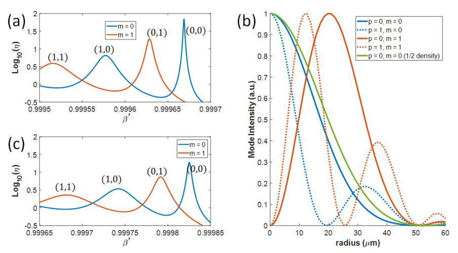
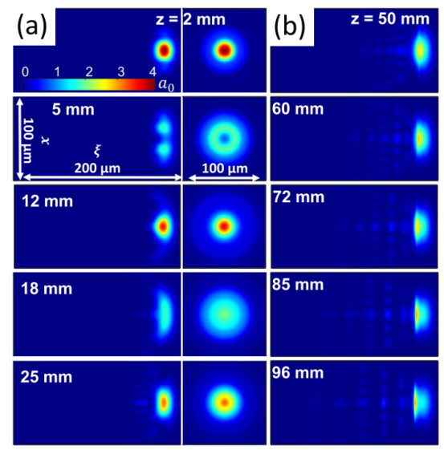
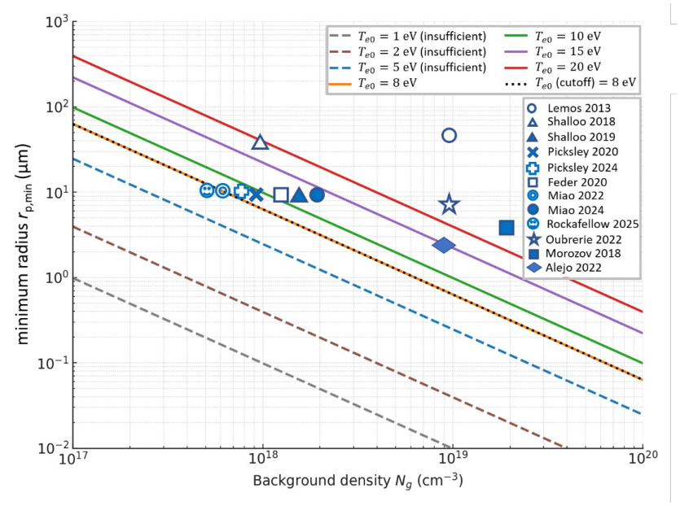
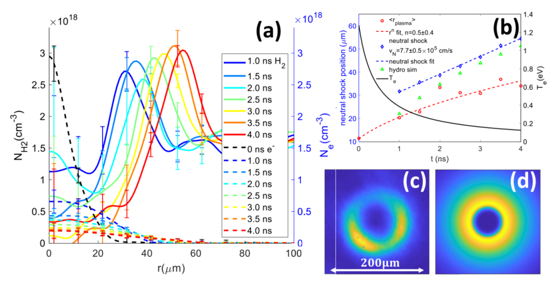
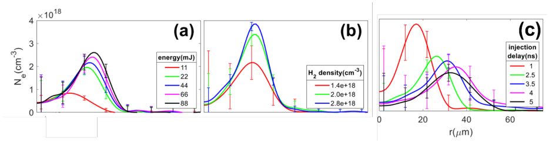
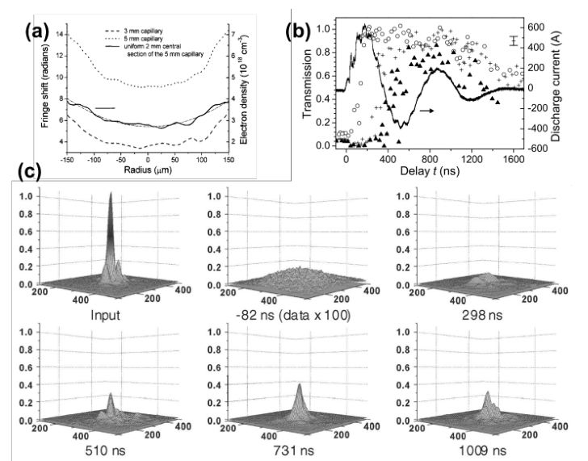
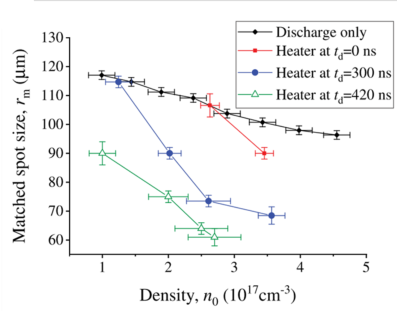
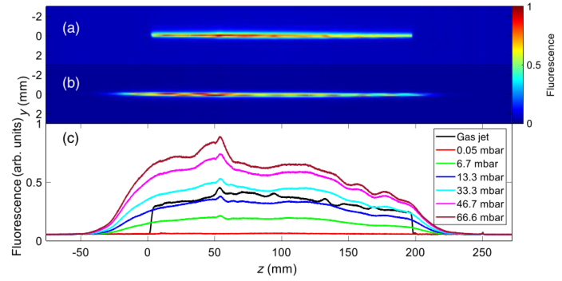
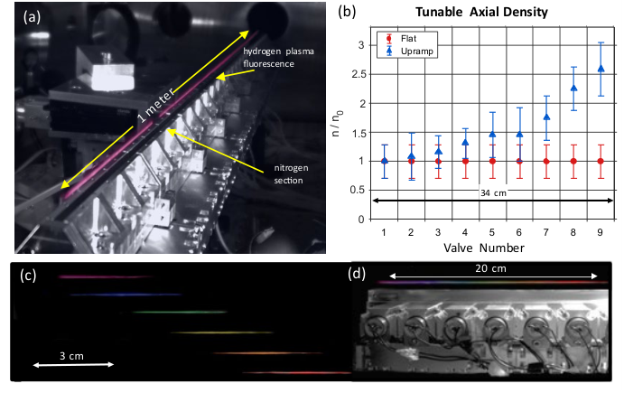

# 高强度激光的等离子体波导：模态、形成方法、诊断与建模

## 0. 论文信息与阅读边界

- J. E. Shrock、B. Miao、E. Rockafellow、H. M. Milchberg，*Plasma waveguides for high-intensity laser pulses*。
- 正式DOI [10.1103/mw87-cjg8](https://doi.org/10.1103/mw87-cjg8)，Crossref在2026-11-24给出RMP接收登记，且将published-online也填为同日，尚无卷／期／页；**不能仅凭此字段认定已正式发表**。APS页面／PDF返回403，官方harvest404，本轮没有取得出版社最终VOR或出版社接收稿。
- 实际阅读[官方作者arXiv 2512.08690v2](https://arxiv.org/abs/2512.08690v2)：初投2025-12-09，v2修订2026-11-03；[本地PDF](../pdfs/shrock-2026-plasma-waveguides.pdf)113页。作者v2早于11-24接收登记，不能称为该日出版社接受版本。正式发表日留空。
- 按摘要、I–VI完整阅读科学正文（至PDF86页）；之后致谢／参考文献仅核结构，未逐条重新读取所有被引论文。综述引述的历史实验与模型分别标明，既有工作不是本轮新实验。
- 本文较长，按research-paper-explainer长文规则由两位阅读者分别处理I–III和IV–VI；主代理完整阅读合并笔记，复核保留图及关键口径。前半21、后半10个不同源页实际目视，9幅原图摘录；主代理额外核首页及主要诊断／公式页。[前半图源](../research/waveguides_early_reading.json) · [后半图源](../research/waveguides_late_reading.json)。
- MinerU本轮一次可用性测试401、user token expired；采用已验证本地布局文本与页面渲染回退。未复跑所引PIC、流体、模态计算或任何实验。

## 1. 摘要与综述定位（PDF p1）

第一段先把问题限定为“在介质中延长高强度光与物质的相互作用长度”。普通玻璃光纤适用于低强度；产生高次谐波、短波长激光或相对论电子束时，介质先被电离，必须用等离子体本身构造导光结构。综述围绕这类“等离子体光纤”的模结构、形成方法、传播演化和诊断展开，特别关注米尺度结构对约10 GeV电子加速的支撑。

这是一篇整合历史实验、解析模型及数值工作的综述，并非报告单一新加速实验。文中“米尺度波导”“10 GeV”“高电荷”来自不同文献和不同装置，不能将各自最高指标拼接成一个已实测工作点。

## 2. I：为什么需要预形成波导（PDF pp1–7）

### 2.1 I.A：衍射、自导引与飞行焦点

引言首段依次举气体HHG、X射线激光、LWFA和betatron辐射：延长作用长度可能提高转换、增益或电子能量，但前提是相位匹配、驱动不耗尽且相关非线性过程仍处于有用区间。

第二段用高斯束量化衍射限制。束腰半径为场幅降至1/e、强度降至1/e²处，真空波长为λ₀，均匀介质折射率为n：

$$
z_R=\frac{n\pi w_0^2}{\lambda_0},\qquad
w(z)=w_0\sqrt{1+(z/z_R)^2},\qquad L_{\rm int}\sim2z_R.
$$

脉冲能量为ε、脉宽为τ时，强度约随ε/(w₀²τ)变化，而瑞利长度随w₀²变化；相乘便得到原文式(2)忽略数值常数的缩放：

$$
I L_{\rm int}\sim\frac{\varepsilon n}{\lambda_0\tau}.
$$

这解释了单纯缩小光斑为何不能免费提高“强度×长度”：强度增加伴随更快衍射。波导要改变的正是这组相互制约。

接下来的非线性自导引讨论先区分两个强度区间：

$$
a_0=\frac{eE_L}{m_ec\omega}
\simeq0.86\lambda_0[\mu{\rm m}]
\sqrt{I/(10^{18}\,{\rm W\,cm^{-2}})}.
$$

这里a₀是激光电场驱动电子的归一化振荡动量；a₀远小于1为非相对论响应，约1以上电子速度上限引入显著相对论非线性。原文的理论式多用Gaussian单位，给出的强度数值则用W/cm²，计算时不能混用电场单位。

在低强度中性气体中，正的Kerr非线性使束心相位落后而自聚焦；光斑收缩至电离阈值后，自生等离子体散焦抑制塌缩，形成细丝。气压约1 atm时，细丝的高强度核心常只有总能量约10%，外围“能量库”不断供能。因此维持很长细丝并不意味着大部分激光能量都处于目标强度。

在相对论气体传播中，脉冲前沿早已电离气体，剩余包络主要与自由电子作用。相对论自聚焦临界功率为：

$$
P_c\simeq17.4\frac{N_{\rm cr}}{N_e}\ {\rm GW},\qquad
N_{\rm cr}=\frac{m_e\omega^2}{4\pi e^2}.
$$

其反密度关系意味着低密度多GeV加速尤其昂贵：800 nm、电子密度约10¹⁷ cm⁻³时，P_c约0.3 PW。聚焦后的有质动力把电子排出束轴，形成自生低密度通道，核心能量占比可远高于普通气体细丝。综述列出的1、2及约10 GeV历史结果分别使用不同功率、脉宽、气体长度和注入方式；这些例子支持自导引的可行性，不是通用效率定律。

随后作者指出自导引的两项设计困难：必须跨越功率阈值，且难以独立指定高强度光斑和轴向演化。飞行焦点把不同孔径区域映射到不同时空位置，可设置亚光速、超光速或反向强度峰，另有去相位LWFA演示；但每个轴向位置只使用总孔径的一部分，达到高强度需付出总能量成本，而且进入会电离的气体后必须重新考虑激光—等离子体耦合，不能直接套用真空光学设计。

### 2.2 I.B：等离子体折射率与两类预形成结构

预形成波导的目标是用介质折射率提供向内的相位曲率，补偿衍射，同时使驱动功率、横向尺寸和通道长度成为相对独立的设计量。玻璃与空心介质光纤在高强度下受到Raman散射、损伤、电离散焦及壁面作用限制；约100 fs、800 nm的固体体损伤阈值10¹²–10¹³ W/cm²远低于LWFA需求。

欠密、无碰撞、充分电离时：

$$
n(r)\simeq\sqrt{1-N_e(r)/N_{\rm cr}}
\simeq1-\frac{N_e(r)}{2N_{\rm cr}}.
$$

自由电子使折射率低于1；电子越少，折射率越高。因此导光核心必须是轴上电子密度最低、周边密度较高的结构。“芯”和“包层”是光学功能名称，并不要求密度为理想阶跃。

原文图1（p6）对比两类典型径向剖面：激光加热气体的圆柱膨胀在外围产生有限厚度冲击壁，壁外密度又下降，因而允许隧穿泄漏；放电毛细管的径向温度和密度分布可近似为向外升高并在高密度平台截止的结构。二者都可在合适参数下导光，但严格的本征谱和损耗不同。

### 2.3 I.C：阅读路线

作者把后文按“什么结构能束缚光—如何形成结构—脉冲如何演化—如何诊断和建模”组织。II节建立模谱、耦合、干涉与非线性传播；III节讨论气体中的激光流体波导；IV节讨论毛细管；V节补诊断、长Bessel焦线、气体靶及模拟选择。对本项目最有用的是把束流输出问题向上追溯到入口匹配、包层结构和驱动沿程演化，而不是只记录出口电子最高能量。

## 3. II：等离子体波导理论（PDF pp8–28）

### 3.1 II.A：折射率对比度需要多大

作者先列三层描述：线性模理论用于给定剖面的耦合、泄漏和群延迟；包络或横向矩模型用于匹配、半径振荡和稳定性；当电离、尾场、耗尽及粒子俘获反馈重要时，才需要全波、PIC或准静态自洽演化。它们回答的问题不同，不能用一个最简单模型验证所有输出。

由高斯束心的Gouy相位变化与介质聚焦相移相抵，得到原文式(4)：

$$
\Delta n=\frac{1}{k_0z_R},\qquad k_0=\omega/c.
$$

其变量Δn指束轴相对于光斑边缘的折射率差。把弱欠密近似代入，并采用抛物电子密度剖面，可得到基模匹配条件：

$$
N_e(r)=N_{e0}+\frac{r^2}{\pi r_ew_{\rm ch}^4},\qquad
\Delta N_e(w_{\rm ch})\gtrsim\frac{1}{\pi r_ew_{\rm ch}^2}.
$$

r_e是经典电子半径，w_ch是匹配基模的1/e场幅半径。推导要点是Δn约等于ΔN_e/(2N_cr)，而k₀z_R约为k₀²w_ch²/2；又有k₀²/N_cr=4πr_e。更窄基模需要更大密度对比，条件涉及“对比度”，而非只涉及轴上密度。

更一般的Drude折射率还含碰撞频率和中性原子/离子的极化率。远离共振、欠密且超短脉冲时，碰撞吸收通常可忽略，但存在未电离气体时，中性折射率项仍可影响诊断与束缚，尤其是低密度OFI波导。

### 3.2 II.B.1–2：辐射模、束缚模与匹配模

弱导光允许忽略波动方程中的极化相关小项，场可分为横向模u和轴向传播因子。原文式(9)–(10)可整理为：

$$
\left[\nabla_\perp^2+\kappa^2(r)\right]u=0,
\qquad \kappa^2(r)=k_0^2n^2(r)-\beta^2.
$$

β是轴向波数；κ²的符号决定局部横向波是传播还是倏逝。所有位置κ²为正时没有横向俘获，为连续辐射模；束心可传播而外部一直倏逝时为离散束缚模；若只在有限包层中倏逝、壁外又可传播，则能量可穿过势垒，为准束缚/泄漏模。气体中的独立流体波导严格属于第三类，强约束极限才可近似成理想束缚模。

对轴对称结构，以方位整数m分离变量，均匀介质的横向解为Bessel函数。Bessel束本身可视为向内、向外圆锥波叠加；“无衍射”并不自动等于光被波导束缚。

无限抛物通道的束缚模是Laguerre–Gauss族。径向阶数p、方位阶数m共同决定轴向波数与群速度：

$$
\beta_{pm}\simeq k_0\left[1-\frac{N_{e0}}{2N_{\rm cr}}
-\frac{2(2p+|m|+1)}{k_0^2w_{\rm ch}^2}\right],
$$

$$
v_{g,pm}=\left(\frac{\partial\beta_{pm}}{\partial\omega}\right)^{-1}
\simeq c\left[1-\frac{N_{e0}}{2N_{\rm cr}}
-\frac{2(2p+|m|+1)}{k_0^2w_{\rm ch}^2}\right].
$$

相同的近似括号并非把相速度当群速度：在固定电子密度及通道结构下，等离子体项与波导项均随ω的负二次方变化，对β求导后得到上述群速表达。高阶模更慢，通道越窄群速差越大，故短脉冲内不同模会纵向分离。

有限深通道只能容纳有限个束缚模。近似截止条件为：

$$
\Delta N_e(r_{\max})\gtrsim
\frac{(2p+|m|+1)^2}{\pi r_er_{\max}^2}.
$$

r_max指密度达到包层最高值的位置。这个条件估计能否形成束缚势垒，不提供完整的泄漏长度。另一个独特性质是，在忽略中性极化率、固定充分电离电子剖面时，横向本征算符可写成不含光频率的形式，因而良好束缚的横向模形状近似与波长无关；传播常数、群速度及泄漏并不因此全部与波长无关。

### 3.3 II.B.3：泄漏模、共振宽度与损耗长度

有限包层外的场用Hankel函数写成入射/出射圆锥波。改变β，数值求解径向波动方程并匹配边界，得到核心场能相对于单位入射圆锥场的共振函数η。η接近1说明弱俘获，窄且高的峰对应强约束准模；η是指定归一化下的共振增强量，不能直接当作激光能量转换效率。

**图3解读（p15，综述计算图）**：(a)(c)横轴为无量纲β/k₀，纵轴为log₁₀η；(b)横轴r为μm，纵轴为任意归一化的模强度。不同p、m的峰分开；整体电子密度减半后，共振峰变宽，绿色基模在壁外的尾部更大，说明泄漏增强。各模强度按图中归一化显示，曲线峰高不能比较实际耦合能量。本图是给定剖面的线性本征/散射计算，不是实测传播损耗曲线。

把准模改用复轴向波数描述，β_c=β_j+iα_j，向前场幅随exp(−α_jz)衰减，功率随exp(−2α_jz)衰减。孤立窄共振近似Lorentz形：

$$
\eta_j(\beta)\propto\frac{1}{\alpha_j^2+(\beta-\beta_j)^2},
\qquad\Delta\beta_{\rm FWHM}=2\alpha_j,
$$

$$
L_{1/e}^{\rm power}=\frac{1}{2\alpha_j}
\simeq\frac{1}{\Delta\beta}
=\frac{1}{k_0\Delta\beta'}.
$$

推导是对只在z大于0存在的指数衰减传播因子作Fourier变换，其模平方产生Lorentz峰。必须保留“场幅/功率”的因子2；评估一根实际波导，应比较功率1/e长度与实际长度，只有前者远大于后者才是高约束。

对于近阶跃剖面，Bessel零点确定横向模；以核心半径20 μm为例，基模束缚要求对比度约高于4×10¹⁷ cm⁻³。包层宽度与形状仍决定实际隧穿损耗，单一截止不等价于足够低损耗。

### 3.4 II.C：入口匹配和侧向耦合

作者把入口场展开成准束缚模与辐射场。在单位归一化且良好约束、模近似正交时，每个模振幅由入口场和该模的共轭重叠积分给出；模功率正比振幅绝对值平方。严格泄漏的非Hermitian问题不能无条件沿用理想正交归一化。

轴对称且正入射只激发m=0；光斑过大/过小、焦面错位会激发p大于0；横向偏移或倾角打破方位对称性后还会激发非零m。对理想抛物通道的高斯入射，令R=w₀/w_ch，基模功率耦合率是原文式(29b)：

$$
\epsilon_{00}=\frac{4R^2}{(1+R^2)^2}
\exp\left[-\frac{(k\theta w_0)^2}{2(1+R^2)}\right].
$$

其来源是两个高斯场的横向重叠：半径不等降低重叠，倾斜场的横向相位坡度又造成相消。R=1且θ=0才达到理想单位耦合；这是线性入口功率比例，不包含后续吸收、泄漏和尾场能量损耗。高阶方位模耦合随阶数呈类似A^|m|/|m|!的分布，倾角可有意选择模阶。

实际入口密度坡会在主通道前改变光斑与波前；把真空束腰设为w_ch仍未必在进入均匀段后匹配。额外漏斗口或定制Bessel束可改善这点。实验报告总透过率时，还应区分入口损失、沿程损失及窄导模中的能量；综述举例的“耦合损失低于4%”和“传播损耗约7 m⁻¹”是特定毛细管实验的分项推断，不能替代本装置测量。

侧向耦合是泄漏的时间反演思路：入射圆锥波以相应角度穿过包层，激发对应准模。改变入射角或波长可选择模；高阶模较易泄漏，也较易侧向加载。原文图4的超连续探针实验是这个选择性的展示，不是推荐以高阶模获得最佳LWFA基模耦合。

### 3.5 II.D.1：拍频、走离与模滤波

同偏振两模传播常数不同，强度交叉项在轴向周期性变化：

$$
\Lambda=\frac{2\pi}{|\beta_1-\beta_2|},\qquad
\mathcal V=\frac{I_{\max}-I_{\min}}{I_{\max}+I_{\min}}
=\frac{2\sqrt{\mathcal R}}{1+\mathcal R}.
$$

这里ℛ是在指定横向位置的较大/较小局部模强度比，而不是任意位置都相同的总功率比。由两个场相加后的正负干涉项直接得到可见度表达。

原文图5（p21）使用实验表征通道剖面做YAPPE传播模拟。约20 μm匹配通道中注入25 μm高斯束，(0,0)与(1,0)的轴上强度比约43仍产生明显拍频。图中固定的是输入峰值强度，改变半径也改变总输入能量，因此过填充曲线的较高输出峰值不能解释为同能量下效率更高。

**图6解读（p23，WarpX PIC示例）**：每行标注传播位置z，左/右方向为脉冲前进方向；图内横纵坐标为共动纵向坐标ξ和横向x，长度标尺为μm，伪彩表示归一化激光矢势a₀。(a)早期混合模造成纵向和横向结构；约18 mm后高阶结构开始脱离脉冲头，约50 mm后出现落后的脉冲串，右侧的横向积分图显示早期模式演变。(b)继续传播时高阶模落后且自陡峭化。此图支持“脉冲头逐渐主要由基模驱动尾场”，不代表落后能量已全部消失或转移给电子。

拍频可以因群速走离或泄漏而减弱。约40 fs、30 μm入射、27 μm通道的示例在约5 cm后高阶模与主脉冲不再重叠；长脉冲则可能只展宽和延迟，要靠高阶泄漏才彻底滤掉。高约束结构中泄漏滤波可需米尺度，不能仅凭拍频变弱推断损耗变大。

### 3.6 II.D.2：包络和平均半径模型的适用性

这一小节回顾从准静态、周期平均、近轴Maxwell—流体方程到源依赖展开和横向矩模型的路线。保留近高斯主分量可导出光斑方程，给出衍射、通道聚焦、相对论自聚焦与尾场聚焦的平衡，以及失配振荡和不稳定性。

非近轴修正还可描述有限带宽导致的展宽、群延迟和拍频相混。它们多数从理想无泄漏束缚模起步，可在特定剖面上补WKB泄漏率；优点是扫描便宜、适合初始匹配设计或从输出半径反推通道强度。若需要真实入口、非抛物截面、截止和多模细节，应回到模理论；若强驱动改变介质，则必须自洽演化。

### 3.7 II.E：相对论脉冲会改变自己的波导

当a₀约1或更大，有质动力与周期平均相对论因子为：

$$
\mathbf F_p=-m_ec^2\nabla\bar\gamma,\qquad
\bar\gamma=\sqrt{1+a_0^2/2}.
$$

脉冲头尾看到的密度不同，入口线性匹配不能保证沿程匹配。弱相对论包络模型揭示自陡峭、前向Raman和自调制；逐切片的“准匹配”可平衡各切片衍射/聚焦，但常忽略耗尽与自陡峭，“超匹配”也只在短于耗尽长度的区间有效。

随后作者把20 cm波导PIC中的演化解释为三阶段：I为初始多模拍频及高阶走离；II为强基模驱动尾场并挖空/修改通道，脉冲前沿红移和侵蚀不断向更窄的改变态输送能量，重新激发改变态的(0,0)/(1,0)拍频；III为严重红移、拉长和峰强塌落。原文图7（p26）的纵轴是峰值a₀，横轴为mm，图中三阶段是模拟解释框架，不是对任意驱动的固定分界位置。

在理想抛物近似中，第二阶段拍频长度随改变态模式半径平方变化：

$$
\Lambda_{00,10}\simeq\frac{\pi^2w_{\rm ch,p}^2}{\lambda_0}.
$$

这由相邻径向模β之差代入拍频式得到。拍频使电离注入时开时关，可在电子谱留下调制。最后耗尽红移降低驱动群速，尾场相速还可低于激光群速，出现比静态估计更早的去相位；因此出口峰能、谱宽和电荷必须与沿程激光演化一起解释。

### 3.8 II.F：为什么10 GeV设计推动低密度和长结构

若电子近光速、线性尾场相速近激光群速，电子滑过约半个等离子周期的距离为：

$$
L_d\simeq\frac{\lambda_p/2}{1-v_g/c}
\sim\lambda_0\left(\frac{N_{e0}}{N_{\rm cr}}\right)^{-3/2}.
$$

推导先用密度项给出1−v_g/c约N_e0/(2N_cr)，再用λ_p随密度负二分之一次方缩放。这里特意忽略模群延迟、非线性尾场相速和脉冲前沿侵蚀；因此是设计量级，不是实验加速长度的精确预测。

在一维弱相对论、脉宽保持共振时，固定a₀和光波长下的泵耗尽长度也随电子密度的 **−3/2** 次幂变化：

$$
\tau\sim\pi/\omega_p\propto N_{e0}^{-1/2},\qquad
L_{\rm pd}\propto\lambda_p^3\lambda_0^{-2}a_0^{-2}
\propto N_{e0}^{-3/2}\quad(a_0,\lambda_0\ \text{固定}).
$$

降低密度允许更长去相位和耗尽长度，也要求更长共振脉冲和足够总能量。原文用800 nm、a₀约2、约10 GeV、约1 m的缩放得到电子密度约2×10¹⁷ cm⁻³，并把它作为本综述“低密度”的工作定义；它不是其他波长、HHG或X射线激光都通用的密度阈值。

## 4. III：激光生成的流体等离子体波导（PDF pp28–52）

### 4.1 历史背景与III.A：碰撞电离/加热

作者先区分早期宽毫米结构的折射/透镜效应和1990年代真正延长高强度传播、具有可分辨低阶光学模的窄波导。后者用约100 ps的Bessel线焦在气体中沉积能量，使加热比流体声学演化快。

早期J₀焦线长度小于约2 cm、中心强度10¹³–10¹⁴ W/cm²，先多光子电离提供种子，再由逆韧致吸收和雪崩继续电离、加热。初始电子密度通常要高于约10¹⁹ cm⁻³，电子温度达数十至约100 eV；接近完全电离或闭壳层离子态，能减轻后续导光脉冲的再电离散焦。

径向压力推动圆柱冲击，中性气体先被压缩，再由热传导和UV辐射电离，成为高电子密度包层；轴心随膨胀密度下降，形成芯。原文图8（p31）是干涉重建剖面、冲击半径和速度随时间的早期实验，半径增长与圆柱爆炸波一致：

$$
R(t)=\sigma_0\left(\frac{E_{\rm th}}{\rho_0}\right)^{1/4}t^{1/2}.
$$

E_th是初始沉积的**单位长度**热能，ρ₀是气体质量密度，σ₀为取决于比热比的约1系数。由能量每长度约ρ₀R²(dR/dt)²得到R⁴/t²常数，即上述平方根时间律；不可把总激光焦耳数直接代入而遗漏有效沉积长度及吸收比例。

另有冲击建立时间τ_s约为离子平均自由程除以声速，通道变化时间τ_ch约为初始半径除以声速。密度约10¹⁹ cm⁻³时，典型量级约50 ps和1 ns；若加热持续得过久，脉冲会耦入自己形成的结构、继续加宽甚至驱动额外冲击和不稳定性。

原文图9用变延迟/焦位展示只支持基模时输出形状近高斯而耦合变化，以及更深通道中高阶方位/径向模出现。归一化到各自峰值后形状相同，并不意味着输出能量相同。

该方法的主要代价是高密度需求：膨胀后轴上密度仍常高于约2×10¹⁸ cm⁻³；局部密度或Bessel强度变化又会造成轴向不均匀和端部收窄。点火—加热双脉冲先OFI提供种子、后长脉冲碰撞加热，可用更高电离势气体；早期波导LWFA以约9 TW、8 μm束腰在2.2 mm、约2×10¹⁹ cm⁻³通道获得约100 MeV。此处是特定历史验证，不是本综述新测量。

本节最后提及高阶Bessel束可直接电离环状包层、留下中性或空心核心。这条路线针对高阶光学或正电子等应用，形成机制不同于流体膨胀，不应一概称为已生成的空心“电子密度最低且充分电离”通道。

### 4.2 III.B：团簇气体提高加热效率并方便轴向调制

团簇内部近固体密度，体平均密度仍可很低。激光先把每个团簇变为致密等离子体小球，小球在亚皮秒尺度爆炸，约10–100 ps内相互并合，再驱动整体流体膨胀。因此单团簇的碰撞吸收强，而宏观气体密度可用团簇数量调整，缓解普通稀薄气体的雪崩加热困难。

综述引用最高约35%吸收和相对于同平均密度非团簇气体约5–10倍增强，这些是指定实验条件的激光吸收，不能写成导光或电子束转换效率。团簇爆炸期间的折射率还可导致非相对论自聚焦，发生强度比相对论自聚焦低约五个数量级。

原文图11展示团簇波导装置、剖面和导模。随后图12/13转向轴向调制：细丝/金属丝可在团簇流中形成密度缺口，由于团簇碰撞自由程约1 mm而丝径25–50 μm，近弹道流动减少普通超声气体易出现的冲击密度尖峰；固定相位板或SLM则通过调制Bessel轴向强度，把加热/电离调制映射到波导结构。它们为准相位匹配HHG、THz或DLA提供可设计结构，但图中的波导制备演示不等于所有下游加速方案已验证。

本节另述不靠流体膨胀的团簇方案：弱预脉冲先解聚轴心团簇，强主脉冲更高效电离外围团簇形成包层。不过轴心仍有中性气体，后续强导光脉冲会再次电离，必须计入折射与模式扰动。

### 4.3 III.C总论：OFI把低密度制备与高效碰撞加热分开

OFI由单原子/分子与光场作用提供电子初始动能，主要依赖强度、波长和偏振，基本不依赖总气体密度，因而适合低密度长波导。综述给出碰撞加热约50–500 mJ/cm，氢OFI约5–10 mJ/cm的典型制备能量需求；这些含不同装置和束形参数，且低密度Bessel OFI吸收最多只有几个百分点，大部分能量以出射圆锥波通过，并不是沉积进等离子体。

电子温度的粗估是出生时的有质势能：

$$
U_p=\frac{e^2E^2}{4m_e\omega^2},\qquad
U_p[{\rm eV}]\simeq9.33\,I[10^{14}{\rm W/cm^2}]\lambda^2[\mu{\rm m}^2].
$$

更准确需对整个脉冲中的电离率加权平均电子残余动能，再用平均能量的2/3换成k_BT。氢的800 nm线偏振OFI初温约10 eV；峰值超过电离阈值后，提高峰强多使电离提前、半径扩大，并不会无限提高同一电子的出生温度。

历史进展依次是短透镜焦线、低密度HOFI、较长Bessel/轴抛物面结构与多GeV加速。1 GeV、5 GeV、9.2 GeV峰和约10 GeV端点/nC级高于1 GeV电荷来自不同研究；摘要中的“约10 GeV”不能替代各实验能谱切选和电荷阈值。

### 4.4 III.C.1：有中性冲击与有电离包层是两件事

OFI初温较低，初始氢等离子体压力虽约为室温周围气体的400倍，仍需中性碰撞足够频繁才能形成明确冲击。先检查中性平均自由程小于初始半径：

$$
\lambda_{nn}=\frac{1}{N_g\sigma_{nn}}<r_p,
\qquad N_g>\frac{1}{\sigma_{nn}r_p}.
$$

取H₂室温截面约3×10⁻¹⁵ cm²，得到N_g[cm⁻³]约大于3×10¹⁸/r_p[μm]；半径10 μm时阈值约3×10¹⁷ cm⁻³。这是简化碰撞尺度判据，不是硬性全球下限；辐射预电离引入中性—离子碰撞，可改变有效阈值。向约10¹⁶ cm⁻³、100 GeV设计推进时，这个条件值得重新核对。

### 4.5 III.C.2：电离冲击壁同时需要能量通量和碰撞尺度

新流入冲击的每个H₂分子需解离、两次电离并保留电子热能，作者估算：

$$
\varepsilon_{\rm req}\simeq4.48+2(13.60)+2(10)
\simeq52\ {\rm eV},\qquad
q_{\rm ioniz}=N_gc_s\varepsilon_{\rm req}.
$$

q_ioniz为单位面积、单位时间必须供应的能量；其中c_s近似冲击速度。最大热流用受限自由流上限估计，只有比例α有效耦合到内冲击壁：

$$
q_{\max}=fN_{e,\rm init}k_BT_{e0}v_{\rm th},\qquad
\alpha q_{\max}>q_{\rm ioniz}.
$$

原文取f约0.1、α约0.5；充分电离初柱中N_e,init=2N_g。由v_th随电子温度平方根、c_s随离子温度尺度平方根，二者比主要由质量比决定，因此上述比较给出约8 eV温度截止。它是取定f、α和52 eV分子能耗后的模型估计，**α不是已测的通用热耦合常数**。

还需要柱半径覆盖数个电子碰撞自由程，才能以传导把能量沉积在壁内，过小半径会使电子近弹道穿过。原文式(38)在部分电离边缘取电子—中性与电子—离子碰撞率同量级、离子密度约N_g，得到：

$$
r_{p,\min}[\mu{\rm m}]
\sim2.3\times10^{17}\,n_{\rm mfp}
\frac{(T_{e0}[{\rm eV}])^2}
{Z^2\ln\Lambda\,N_g[{\rm cm^{-3}}]}.
$$

n_mfp为所需自由程个数，图中取3；Z=1、Coulomb对数约7。温度更高虽然提高热流，却也使平均自由程增大，半径条件更苛刻；两条件应同时满足。

**图14解读（p42，模型曲线叠加历史实验工作点）**：横轴为背景**H₂分子数密度**N_g，单位cm⁻³，纵轴为最小初始等离子体半径r_p,min，单位μm，双对数轴。温度固定曲线随密度增加而降低；实线代表热流在该简模中足够，虚线为不足，黑点线为约8 eV截止。符号是各实验的N_g、r_p估计位置，不能当作新的扫描测量。作者明确忽略快速膨胀和传导冷却，因此临近截止的点仍很边缘；这里只要求内壁被电离，未保证整个冲击厚度都电离，更未直接保证低光学泄漏。

### 4.6 III.C.3：单脉冲OFI结构的实验与诊断分歧

透镜聚焦可生成较宽、初始储能较多的OFI柱，早期8 mm、约10¹⁸–10¹⁹ cm⁻³结构及后来的4 mm、轴上最低约2×10¹⁷ cm⁻³结构落在上述热流条件较充分区域。综述图15给出了阴影、干涉及重建剖面。

图16（p44）的0.4 kHz、6.5小时展示的是透镜生成氢通道的长期重复性，主要由单色干涉相移和重建密度判断，背景分子密度约9×10¹⁸ cm⁻³；它不是同条件GeV电子输出或整米高强度导光的长时验收。

窄Bessel中心峰约7–10 μm时，单位长度热能更少。部分早期1.6 cm及10 cm低密度结构的干涉结果显示低对比冲击，推算功率衰减长度分别约0.5 cm或小于10 cm；高强度探针比低强度探针透过更好提示后续脉冲正在改变结构，不能由弱探针结构直接推断强脉冲处于同样波导。

**图18解读（p46，Feder等2020测量及模拟，综述改编）**：(a)横轴半径r为μm，左纵轴为H₂中性分子密度、右轴为电子密度，均以10¹⁸ cm⁻³量级标度；不同颜色为OFI后约1–4 ns，实线中性环向外移动，虚线电子剖面维持轴心峰并扩散，没有形成显著电离包层。(b)横轴为时间ns，左纵轴实际为中性冲击**位置μm**，右轴为电子温度eV；空心菱形和直线给出近匀速外移，标注拟合速度约7.7×10⁵ cm/s，另有流体模拟点及降温曲线。原图图注使用“speed”一词，但坐标画的是位置，读图按位置解释；(c)实测低功率探针环形导模与(d)传播模拟图，以200 μm标尺和各图伪彩显示形状。环状中性折射率高于周围，能束缚环模；它不能证明已存在能束缚中心强光的等离子体包层。

两色干涉把电子和中性极化率分开，是此处关键。高密高温碰撞波导可用电子主导的单色相移近似；低温低密OFI若中性冲击未充分电离，同一近似可能误判。类似2.3°Bessel角、约2×10¹⁸ cm⁻³分子密度的模拟也给出约10 eV、10 μm初柱且不形成电离冲击。更高密度轴抛物面结构则有更强包层；单脉冲OFI的结果必须结合初始半径、密度、能量与诊断口径逐例分析。

### 4.7 III.C.4(i)：双Bessel束独立制作芯和包层

第一束J₀产生扩散的低密度电子核心与周边中性冲击；约1–3 ns后第二束高阶J₈或J₁₆，把强度环对准已膨胀中性壁并电离成包层。气体密度、两束延迟、圆锥角及环阶数可以在一定范围内分别调轴上密度、壁深与模式大小。

原文图19（p47）把干涉提取剖面与出口导模配对。高对比结构的**计算**功率衰减长度最高约9.8 m，超过该例30 cm实际结构长度；这不是已完成9.8 m传播的实验。约10¹⁷ W/cm²、5 cm氢波导的强光导引是另一个明确实验工作点。

### 4.8 III.C.4(ii)：脉冲前沿建壁的self-waveguiding

延迟注入的强脉冲其远前沿和横向翼可以电离中性冲击内壁，先建立包层，随后束缚自身主体。这里的self-waveguiding与依赖相对论功率阈值的self-guiding机制不同；以20 μm模式半径为例，为让壁处达到氢OFI约10¹⁴ W/cm²，轴心强度约需10¹⁷ W/cm²，而非先达到a₀约1。

原文图20（p49）以FBPIC等模拟显示适度强度仅电离内壁，更高强度可电离整层。后者不只是温度升高，而是场穿过发展中的包层到更外侧后引起快速电离。CHOFI实验的增强透过率和脉冲通过后更厚电子壁与此解释一致，但中性贡献未分离的单色诊断仍应按其具体证据强度解读。

**图21解读（p50，两色干涉测量）**：三幅横轴半径r为μm，纵轴电子密度N_e为cm⁻³，量级10¹⁸。(a)固定2.5 ns延迟和1.6×10¹⁸ cm⁻³ H₂密度，改变注入脉冲能量；(b)固定延迟改变气体密度；(c)改变J₀与注入脉冲的延迟。轮廓表明增加脉冲能量主要把电离范围推向外侧，芯附近变化较小；密度和延迟则共同控制壁高和壁位置。数据在自导波脉冲通过后约5 ps取得，不能当成其尚未到达时的初始全电离波导。

图22的沿程荧光显示更高能量可“烧通”10 cm气体靶；该例脉冲前沿侵蚀约6 mJ/cm，主要来自包层建好前的衍射与泄漏，整个波导的包层电离本身少于1 mJ。此6 mJ/cm是特定装置/束形的总侵蚀量级，不能当作纯电离功或所有波导通用热负荷。另有短、较高密度气体靶的时分干涉图，时间和空间尺度不同，二者不是独立重复同一低密度工作点。

图23（p52）把径向积分荧光随z的调制与模拟拍频比较。延迟由1到5 ns时，测量周期从约1.6到4.5 mm，模拟约1.2到3.1 mm；较大延迟的差异仍存在，尤其最后一组不能写成“所有点完全吻合”。荧光为任意强度单位，不能直接换算导光激光能量；入口饱和与电离响应也影响幅值。

最后，800 nm自导波脉冲与其后5 ps的低功率400 nm探针出口模式半径接近，为充分电离后横向模形状近波长无关提供检验。大尺寸结构中自导波能量随模式半径平方增长，而双Bessel包层束的经验能量缩放约随半径0.63次幂增长；两者的约1 J制备成本与数十焦耳LWFA驱动相比虽小，仍应单列入系统激光能账。实施简单是self-waveguiding在近期多GeV实验被广泛采用的实际理由，不等于双Bessel方案已失去价值。

## 5. 原文IV：毛细管波导（PDF 53–66页）

### 5.1 无放电的空心介质毛细管

本节先把“介质管壁掠入射反射”与“预形成等离子体折射率导引”分开。早期实验用约270 μm内径玻璃管把1 TW亚皮秒脉冲导引至13 cm；增大强度时，管壁电离后反射机制改变，透过率可明显上升。另有100 μm直径、10 cm长管的>10 TW导引约50%透过。这些是各自文献中的实验结果，不能组成统一装置的全参数工作点。

空心介质管支持Bessel型EH混合模；高斯入射束与基模的最佳耦合条件是束腰半径约为内半径的0.645倍。匹配能改善单模传播，但模拍频、指向偏差和管壁损伤使强度超过约10¹⁶ W/cm²的运行困难。锥形入口虽可改善注入，一项约10 J、0.6 ps、10¹⁸ W/cm²实验产生了最高约100 MeV的热谱电子，但毛细管每发被毁；这与可重复工作的高品质LWFA导引不是同一验收目标。

进一步充气会引入电离折射，缺少受控横向密度分布也会降低透过。低于气体电离阈值约10¹³ W/cm²时，充气空心管又有另一用途：束缚电子Kerr自相位调制展宽光谱，继而用色散补偿得到<10 fs脉冲。这里的脉冲压缩并不等于管内已支持相对论强度导引。

### 5.2 放电毛细管：烧蚀、快放电和慢放电

放电使轴心热、管壁冷；径向压力趋平后，温度高处密度低，可得到轴心密度最低的导引通道。管壁附近高密度等离子体通常比激光流体波导提供更强光学约束，模态更接近束缚模。烧蚀式毛细管直接以管壁物质产生等离子体，早期厘米级聚丙烯通道可导引>10¹⁶ W/cm²。双毛细管设计先在短段造等离子体，再让它扩入长段，得到6.6 cm／约5×10¹⁸ cm⁻³和另一工作点的2 cm／>10¹⁷ W/cm²导引。碳的部分电离会引起散焦，依赖烧蚀也限制寿命。

快、慢放电按电流上升时间与径向声穿越时间比较：

$$
\tau_r\ll R_c/c_s\quad\text{（快放电）},\qquad
\tau_r\gtrsim R_c/c_s\quad\text{（慢放电）}.
$$

这里的毛细管半径为Rc，离子声速为cs，两者之比是径向压力重新分配所需时间；它是机制判据而非所有气体通用的电路规格。快放电中轴向电流的自磁场提供向内磁力，形成z箍缩。文献中的约15 ns、5 kA放电在约8 ns后产生约500 ps寿命的瞬态凹密度结构。压缩期从多模变单模，箍缩最强时反而折射散开，随后松弛期仅有较弱泄漏导引。必须分清收集全部出射光的总透过率与光阑选取导引模后的透过率。短时间窗、MHD不稳定性和长距离同步使它较难推广，但深度电离高Z气体有利于软X射线激光增益介质。

慢放电通常在约100 ns至1 μs上升，几百安电流，以热压而非磁箍缩控制。充氢可减少高Z残余电离。一组早期300 μm内径、2–5 cm长实验在约50 ns形成抛物线密度，5 cm通道最高约80%透过，工作窗可延伸至电流衰减以后。导引性能取决于电路电流历程、触发抖动、沿轴阻抗及电流均匀性；重复频率还受充电、气体恢复和管壁冷却限制。

#### 图26：慢放电通道的密度、透过率及模形

原图源自Spence/Hooker与Butler等早期实验、由本综述重排。图(a)横轴半径μm，左轴条纹移动mrad、右轴电子密度10¹⁸ cm⁻³；中心低、边缘高的趋势支持凹密度导引。图(b)横轴相对放电启动的延时ns，左轴透过率、右轴电流A；不同符号对应长度／充气条件，三角形为5 cm、330 mbar H₂，不能混为单一数据集。图(c)是归一化出射强度形状随延时的变化；−82 ns面板另放大100倍，横向像素尺度不能直接当μm。透过率接近80%是该低功率探测条件下的光学结果，不是激光到电子能量效率。

### 5.3 慢放电模型与匹配束腰（原式39–42）

一维MHD给出三个阶段：先近均匀地加热、电离；完全电离后，欧姆加热与冷壁导热在约几十ns内重分配径向密度；随后进入准稳态。它的持续时间也受管口轴向流失和复合影响。简化准静态模型把等离子体欧姆热与向壁导热平衡，得到：

$$
N_{e0}\simeq0.7364ZN_0,
\qquad
w_{\rm ch}[\mu{\rm m}]\simeq
1.48\times10^5\frac{\sqrt{R_c[\mu{\rm m}]}}{(ZN_0[{\rm cm}^{-3}])^{1/4}}.
$$

Ne0是轴心电子密度，N0是初始原子密度，Z是电荷态，wch是基模匹配半径。推导结构是：压力近恒使密度近似反比温度；热平衡确定近轴密度曲率；抛物线折射率波导的高斯基模由衍射与曲率聚焦平衡，因而模式半径随密度曲率的负四分之一次方变化。这里的0.7364与实用单位系数属于该放电模型，不能仅凭量纲分析推出。由式40直接可见，固定半径时降低气体密度会增大模半径，密度和光学匹配不能独立调节。

另一非LTE模型分别处理电子与重粒子、绝缘壁和壁吸附氢，电子先把能量传给重粒子／鞘层再传壁。原文称“nonlocal thermal equilibrium model”，此处依其物理内容按非LTE模型解释；不能把它误认为空间非局域热传导的独立验证。两模型的壁温差别很大：前者约200 °C，后者>1000 °C；两者均非新实测壁温。以初始分子H₂密度表示，经验关系为：

$$
w_{\rm ch}[{\rm m}]=7.3\times10^3
\bigl(N_{0,H_2}[{\rm m}^{-3}]\bigr)^{-1/4}
\bigl(R_c[{\rm m}]\bigr)^{0.5625},
$$

$$
w_{\rm ch}[{\rm m}]=4.7\times10^3
\bigl(N_{0,H_2}[{\rm m}^{-3}]\bigr)^{-1/4}
\bigl(R_c[{\rm m}]\bigr)^{1/2}
\quad\text{（原准静态模型换算）}.
$$

这里的分子密度与上一式的原子密度不可混用。两个模型的半径指数相近但轴心密度不同；方截面毛细管的横向干涉测量较支持非LTE模型，圆柱毛细管尚缺同等直接对照。两公式都不是与密度无关的匹配调节器。

综述随后回顾导引LWFA：3.3 cm放电通道约20–30 TW实现约1 GeV；9 cm、0.3 PW实现>4 GeV。后者低密度的大模半径、非高斯焦斑失配和弱模泄漏使高阶模拍频长期存在，能量靠近壁时可能损伤。低功率透过率更能测导引损耗；相对论强度的透过率下降还包括驱动尾场的能量转移。

### 5.4 辅助加热激光：降低密度与模式半径的耦合约束

为在约10¹⁷ cm⁻³导引约70 μm束腰，单纯减小管径会使强激光和热等离子体接触管壁。辅助ns激光先在已有放电通道中导引，经逆韧致吸收进一步加热中心，再由流体膨胀加深凹槽；后到的脉冲时间片看到更强导引，所以加热过程本身会演化。一个800 μm直径充氢通道中，约6 ns加热脉冲把匹配半径降至约60 μm，在约2×10¹⁷ cm⁻³下导引31 J、35 fs、0.85 PW、a₀=2.2驱动脉冲20 cm，并取得7.8 GeV电子。这里的加热激光能量、放电成本和靶恢复应计入系统成本，7.8 GeV不是任意20 cm通道的通用性能。

#### 图31：加热激光对匹配半径的影响

横轴电子密度以10¹⁷ cm⁻³计，纵轴匹配光斑半径μm；黑色是仅放电，彩色是不同加热延时。相同密度附近，适当加热可显著缩小匹配半径；曲线有误差棒，低密度处也非所有延时均有效。图为Gonsalves等2019年实验结果的综述摘录，体现横向光学参数调节，不是直接展示电子能谱或7.8 GeV重复性。放电密度上坡同时改变模式半径，沿轴密度整形与导引匹配仍须联合设计；同一放电磁场还可作主动等离子体透镜。

## 6. 原文V：实验与建模的实施条件（PDF 66–85页）

### 6.1 诊断：相位反演及其假设

空间干涉以探针与参考光之间的相位差测折射率线积分。沿y方向通过目标，探测平面坐标为x、z时：

$$
\Delta\phi(x,z)=k_0\int\Delta n(x,y,z)\,dy,
\qquad
\Delta n\simeq-\frac{N_e}{2N_{\rm cr}}+\Delta n_0.
$$

k0是探针真空波数，Ncr是该探针频率的临界密度，Δn0是中性粒子的正折射率贡献。第一式由局域波数偏移沿路径积分得到；第二式由冷、低碰撞、低密度等离子体折射率展开得到。电子与中性气体贡献色散不同，只有它们之一可忽略时单色探针才足够；否则必须多色测量，不能把测到的总相位直接全部归为电子密度。

在轴对称且中性贡献已消除的条件下，弦积分的Abel逆变换给出：

$$
N_e(r,z)=\frac{2N_{\rm cr}}{\pi k_0}
\int_r^{r_b}\frac{\partial\Delta\phi(x,z)/\partial x}{\sqrt{x^2-r^2}}\,dx.
$$

由负的电子相位线积分代入标准Abel逆式，两个负号相消，因此此处符号为正；rb是扰动外缘。它要求柱对称、近直线路径及可靠边界相位。噪声微分会被放大，文章所述数千发平均／轴向平均能降低噪声，但不提供单发密度稳定性。非对称通道要用模型拟合或含方位项的反演，不能任意套用柱对称逆变换。

从70 ps、532 nm早期探针到100 fs双颜色探针，可逐渐分辨OFI后电子与中性密度的快速演变。双颜色常用400／800 nm，两个相位各需高质量空间和时间重叠；透明方管虽便于横向探测，也改变了本来圆柱放电的几何。沿轴探测无需Abel反演，却更易被长路径横向折射破坏。由横向位移约为折射率梯度乘长度平方、并要求小于最小分辨尺寸可得近似条件：

$$
L<\sqrt{\frac{2n\,\delta_{\min}}{|\nabla_\perp n|_{\max}}}.
$$

原文OFI冲击层参数给出的允许长度仅约1 mm，远短于实用长通道，不能把短段纵向测量直接扩展到整米。普通不透明毛细管常只能得到沿轴平均密度；Shack–Hartmann波前传感省去参考干涉臂，但受微透镜尺寸制约，通常空间分辨较低，放大成像又牺牲视场。任何方法在窄区域相位跳变超过约2π时都可能产生歧义。

### 6.2 出射模、透过率与光谱的联合诊断

低功率、单一基模时，出射强度像可测匹配半径；多模时，同一图样还取决于未知的模幅与相位。通过系统扫描注入偏心、测出射质心，可以在已知模结构模型下反演基模尺度，但并非无模型地分解所有模式。用校准衰减器及等效像面取得输入／输出通量图，积分比给透过率；只有非相对论、没有明显尾场能量转移时，这一比值才主要反映耦合、泄漏与侵蚀损耗。单基模、可变长度的透过率指数拟合可测衰减长度。

强度接近或超过a₀≈1时，驱动尾场使基模光谱红移；高阶模的频谱演化又不同。长通道中高阶模群速较慢，可能在时间上落后，抑制部分线性拍频，但时间积分出射像仍会把幸存模式加在一起。特别是800 nm基模可能红移至>1 μm，硅CCD／CMOS灵敏度低，此时出射像“高阶模更明显”也可能只是仪器响应造成，不能据此宣布基模能量已消失。应联合宽带或光谱分辨的模成像。沿程Thomson侧散射加窄带滤光可测传播和泄漏，但也须排除等离子体荧光。

### 6.3 米级气体密度：荧光要逐轴位置标定

长狭缝气靶的轴向密度可用Bessel束电离后的复合荧光估计：先在已知均匀背填压力下，对每个轴向位置建立荧光—密度标定，再用同束在脉冲气片中的图像插值。这样Bessel束自身沿轴强度的不均匀性可在位置对应标定中消除；它不是假设荧光与密度处处使用同一常数线性关系。

#### 图33：背填气体标定与脉冲气片荧光

图(a)(b)是脉冲气片和均匀背填气中的氢荧光图像；横轴沿轴位置z，单位mm，图像纵向是横向y、单位mm，色标是相对荧光而非绝对光子数。图(c)横轴z/mm，纵轴荧光任意单位，不同颜色对应背填压力mbar，黑线是气靶信号。应在同一z处按压力族插值，不能把黑线振荡完全归为气体密度变化；荧光也依赖局域束强度。该方法引用Miao等2022年实验，测的是初始中性气体分布，之后的电子密度还取决于电离及流体膨胀。

小角Bessel射线的有效临界密度为普通临界密度乘锥角正弦平方。半径2.5 cm、焦深1 m对应约1.5°，800 nm下约1.2×10¹⁸ cm⁻³；接近这个密度之前就会明显折射。后续膨胀约降密度十倍有助于进入约10¹⁷ cm⁻³范围，但该倍率是所引实验／模型条件的量级，不是任意气体和延时的常数。

### 6.4 Bessel束与广义轴棱锥：径向环如何映射到焦线

理想无限口径Bessel束需要无限能量；实际“Bessel束”指有限能量、近轴形状逼近Bessel函数的束。锥形轴棱锥对径向坐标ρ施加线性相位，使射线以锥角γ向轴传播；沿轴波数为k cosγ、横向波数为k sinγ，近轴干涉生成Bessel轮廓。若要高阶空心束，还要加方位螺旋相位。

几何映射和有限束宽给出：

$$
\rho\simeq z\tan\gamma,\qquad
L_f\simeq\frac{R_b}{\tan\gamma},\qquad
L_f\simeq\frac{R_b-a_h}{\tan\gamma}\quad\text{（中心有注入孔）}.
$$

Rb是入射束半径，ah是中心孔半径。每个入射薄环到达焦线的不同z处，因此相位控制“在哪里会聚”、入射径向幅度控制“该位置得到多少能量”。对锥形轴棱锥，轴向包络满足：

$$
I_{\rm axis}(z)\propto\rho\,|A(\rho)|^2\big|_{\rho=z\tan\gamma}.
$$

这可由薄环功率与映射的轴向长度守恒理解，也与原式43的驻相近似一致。不能把Bessel近轴表达式无限径向积分以推总能量，实际口径必须保留。为了在目标内取得近均匀包络，可让焦线长度超过气靶长度。玻璃折射轴棱锥适于较低峰功率；OFI需要更高峰功率时，反射式或薄衍射轴棱锥有助于减小材料非线性相位。中心孔会缩短有效焦深，实际光学几何必须计算进去。

近场像差被映射为随z变化的焦线畸变，常规只优化一个焦点不够。综述引述用沿焦线强度来重建／修正近场波前的方法，图35展示J₀和J₁₆沿轴截面的改善；这些是有限视场强度图，不能单从整齐外观得到波导损耗和注入成功率。

广义轴棱锥使用非线性的径向相位。定义局域径向波数及驻相雅可比：

$$
k_r(\rho)=\frac{d\Phi}{d\rho}<0,\qquad
z\simeq-\frac{k\rho}{k_r(\rho)},\qquad
D(\rho)=1-\frac{\rho k_r'(\rho)}{k_r(\rho)}.
$$

在单一孤立驻相环、远离口径边缘且D不为零时，原式45给出近轴强度包络：

$$
I(r,z)\propto |A(\rho)|^2\,
\frac{\rho|k_r(\rho)|}{|D(\rho)|}
J_q^2(|k_r(\rho)|r).
$$

它由环积分的驻相权重得到，不能用于焦散D=0附近，也不含有限口径的全部边缘衍射。线性相位时kr常数、D=1，回到上面的锥形结果；对数相位的kr反比ρ、D=2，均匀照明时轴上强度近恒。边缘柔化可抑制轴向振荡。实际广义轴棱锥已经用于约30 cm通道及喇叭形入口；入口较大束斑使单位长度OFI加热和膨胀增强，从而改善注入。Axiparabola把每个环映射到预定有限焦段，既可控制轴向能量，也减少靶外能量沉积；这是设计手段，不等于任意指定电子密度分布已被独立实现。

### 6.5 电离折射与OFI—流体串联模型

半径2 cm、焦深50 cm需要约2.3°锥角，800 nm的有效临界密度约2.7×10¹⁸ cm⁻³。目标初始电子密度约10¹⁸ cm⁻³已足以显著影响Bessel传播，所以直接把真空激光分布当电离初态可能失真。YAPPE计算自洽超短脉冲传播、电离和加热，再把密度／温度映射到SPARC流体模型；图37显示气体存在时轴向峰值强度相对真空被压低和展平，同时改变脉冲形状。图38的密度演化仍在轴心尖峰，没有凭空形成电离态包层。

线偏振与圆偏振的初始电子加热不同，模型原先预言圆偏振膨胀更快，但实验两者较接近。作者提出线偏振更有利的H₂⁺库仑爆炸提高离子初温，图38(c)加入3 eV离子温度改善解释。这是对差异的物理解释及模型修改，不应被写成独立测量已完整确认的唯一机制。

### 6.6 气靶实现：狭缝喷嘴、气室与毛细管的代价

米级低密度LWFA靶希望同时有长距离、光学可达、远离固体边界、可重复运行和纵向可编程。自由气片能减少邻近材料损伤并便于诊断，但带来高真空抽气负载和流动均匀性代价；重复频率不能只由激光标称频率决定。多阀高压供气经过稳定／混合腔、狭喉后在喷口超声速展开，氢低阈值全电离和少量局域氮掺杂分别服务于造波导和电离注入。

20 cm、Mach 4气片的局域掺氮实现重复的约2.5 GeV准单能束。密度或模式收缩还可控制注入，但文中光学环形收缩后加速至1.1 GeV的一项结果是模拟，不能与邻近实验能量混列成全是实测。典型沿轴气体密度RMS起伏约<25%对导引模的影响较小，却仍可能影响电子束质量；“模没有显著改变”不能推出“电子谱不敏感”。

#### 图40：米级模块气靶与密度上坡

图(a)是1 m氢等离子体荧光照片，局域氮段在Hα滤光下呈缺口，不能据此判为没有等离子体。图(b)横轴阀编号1–9，纵轴归一化密度n/n₀；34 cm装置的红点为近均匀配置，蓝点为上坡配置，误差棒是10次气阀脉冲的±1标准差，不是电子能量误差。图(c)(d)比较分阀及合阀后的氢荧光，颜色是人为叠加用来区别阀贡献。图片源于Rockafellow等2026年研究，实际示范了气体供给／密度控制；单看照片不证明1 m全程相对论强度导引或1 m上的10 GeV加速。

综述分别列出30 cm级气靶的9.2 GeV准单能峰、少量电荷延至10 GeV以上，以及1–7 GeV范围nC电荷与最高能附近few-pC特征；这些分母和能窗必须保留，不能合并为“10 GeV、nC准单能束”。1 m氢等离子体由9个约11 cm模块、每模块3段构成，共27阀；34 cm上坡波导达到9.5 GeV的陈述属于综述引用的较新工作。它们是不同装置长度和不同实验的进展，不能把最长靶与最高峰值能量拼在一起。

气室靠端孔容许激光进出，泄漏产生孔径尺度密度坡并带来孔损伤；普通均匀气室的纵向控制较少。无放电蓝宝石毛细管也可用作流动气室，由驱动激光电离并自导引。长期运行的例子是1 Hz、100,000连续束、368 MeV峰能2.4% RMS变化，靶累计超过200,000发后更换；此处明确是自导引气室，不能当作米级预形成波导的寿命数据。双入口7 mm靶的上坡把能量提高超过两倍至260 MeV，也与米级10 GeV案例不同。

毛细管增强方案包括低温沉积可调壁半径、冷却／减蚀电流形状实现kHz造导引通道、入口气喷密度过渡控制注入以及辅助ns加热。kHz通道形成不代表kHz、PW、GeV加速链已完成；每项需要同一工作点的靶、激光、抽气和热负载验收。

### 6.7 建模链的边界条件和跨尺度传递

流体造通道与fs驱动脉冲的时间尺度不同，可以分阶段计算，但阶段间必须传递真实守恒量和组分。早期单流体拉格朗日模型只算冲击演化，后来才加入激光—气体／等离子体自洽传播。HELIOS、SPARC、FLASH等在不同文献中采用不同流体数、温度数和热输运／边界条件；不能因都称“hydrocode”就认为它们给出相同初态与闭合关系。

OFI分阶段链先计算电离与加热，再计算膨胀；SPARC区分电子、离子和中性流体。另一方法以平面波WarpX PIC表格映射到规定空间激光分布，再用COMSOL单流体计算膨胀，可与干涉测量比对，但忽略了造通道激光的电离折射；规定激光场初始化的FLASH案例也有这一限制。

将流体演化到驱动注入时刻的密度／温度转入传播或PIC代码时，自波导形成尤其必须保留中性气体分布，以便模拟驱动脉冲后续电离。LASY可把测量、解析或模拟激光场写为openPMD供WarpX读取；这说明输入接口如何衔接，并不等于综述提供了某个已验证完整开源算例。放电毛细管还必须处理壁鞘、壁吸附及重粒子输热。本轮只读综述，没有运行YAPPE、SPARC、HELIOS、FLASH、COMSOL、LASY或WarpX，也未对所引实验做独立重复。

## 7. 原文VI：结论与前沿边界（PDF 85–86页）

综述的主线是预形成波导通过可控横向模延长强激光相互作用，可降低某些过程所需激光能量，并调节沿轴／横向场。激光流体波导与放电毛细管各有不同的密度、模式、壁损伤、抽气和诊断约束；“自由站立”减少邻近固体破坏，但并不消除气体恢复和激光指向的限制。

前景包括密度上坡延缓失相、广义轴棱锥造入口漏斗及轴向结构、准相位匹配光源和受控注入。短靶OFI上坡的约2 cm／能量提高40%至1.6 GeV是所引实验；向多米、100 GeV延伸仍为路线／提案。更长相互作用需高性能传播、流体和PIC计算及boosted-frame等技术，但计算能力本身不能替代实验闭环。

对本库应用最直接的接续是保留“输入激光—波导组分／密度—真实输运电子相空间—转换靶”完整链。本综述没有给出某一新转换靶γ／中子产额、同位素生产、临床剂量或防护的全链验收；不能把电子最高能量和导引透过率直接转化为这些应用的效率结论。

## 8. 开放问题与复习速记

**建模端：** 入口实测光场、气体／电子／中性组分、流体演化到PIC的时间截面、能量／粒子守恒和真空边界需作为一条有版本的输入链。线性模、本征泄漏、非线性驱动与束流输出分别验收，不能用一次出口光斑或峰值电子能量代替全部验证。

**实验端：** 联合记录每发输入能量、入口指向、径向与轴向密度、输出全带宽光谱／模态及完整电子相空间。把制备光、辅助加热、放电、气体和抽气成本计入，才可比较向转换靶提供同样束流的总效率。

**原文与版本端：** 接收登记与正式发表分开；取得VOR后先核身份和改动，不能把原位换PDF自动称为逐式逐图重新审读。Fig18位置／速度措辞、图23测量／模拟差异、不同公式的原子／分子密度均须保留。

**速记：** 低密度长波导把衍射长度延伸为可设计的相互作用长度；真正决定输出的是入口模耦合、泄漏、群速走离、驱动改变态、气体／电离演化与诊断。最长气靶、最高电子能量、最大电荷和最高重复率应按同一实验工作点引用，不能拼接。
