# 相对论时空等离子体光子晶体的谐波选择与探针放大

## 0. 论文与证据

- Haojie Zhang、Boyuan Li、Xiangyan An、Rong Huang、Feng Liu、Zheng-Ming Sheng、Min Chen，*Relativistic Harmonic Generation in Spatiotemporal Plasma Photonic Crystals*。
- [官方记录](https://arxiv.org/abs/2611.30084v1)；[实际PDF](../pdfs/zhang-2026-plasma-crystals.pdf)。2026-11-23首投，11-24公告，实际为arXiv v1；本轮未核实同作期刊接收或发表。
- 全文13页：主文9页含参考文献，后附4页Supplement 1。正文与补充均已读取；13源页以页面渲染目视，12幅图按原文位置摘录。[核验及图源](../research/crystal_reading.json)。
- **证据类型：解析约化模型＋二维EPOCH PIC。** 不是实际靶实验、实测光谱或独立于PIC的介电函数测量。模型从pump-only PIC取介质，再预测pump-plus-probe PIC，后者是另一次模拟但共享代码和物理设定。
- MinerU单次可用性测试返回401、user token expired，明确用本地布局文本／原页渲染回退；未运行作者代码、PIC或新实验。

## 1. 摘要与引言：把表面振荡写成时空调制介质

摘要依次提出三件事：强泵浦驱动固体表面形成时空周期结构；周期性限定探针散射的频率和角度；复Floquet能带描述调制向探针转移的能量。结果是与PIC的对照，不是已经观测到可调谐晶体放大器。

引言第一段从空间光子晶体、时间光子晶体推广到同时改变频率与动量的介质。第二段将其联系到相对论振荡镜ROM：往返运动的等离子体反射面本就能调制反射光，SPPC是对这一过程的另一种组织方式，不代表证明ROM机制失效。

第三段解释pump–probe的价值：单束同时驱动和被调制，难以独立改变两种角色；正交偏振的两束可分别辨识。第四段给出本文路线：先单pump的频率／角度选择，再由复能带求增益和光谱，最后推广到双pump。

## 2. 物理模型与PIC设置（原文第2节）

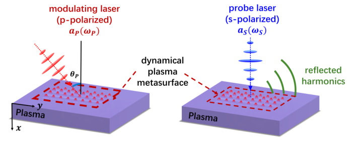

**图1（PDF p2）**是示意图，没有定量坐标。x为靶法向，y为入射平面内表面方向，s探针电场沿z。p泵浦斜入射驱动电子层，正入射s探针反射后形成谐波；示意图本身不证明增益。

首段参数：pump为800 nm、45°、归一化振幅2；probe为347 nm、振幅0.5，频率约为pump的2.305倍。非整数频率比有助于区分probe边带和pump自身谐波。a按各束自己的频率定义，不能直接把a之比平方当强度比。

### 2.1 泵浦相位怎样进入密度响应（式1–8）

泵浦相位为

$$
\Phi_P=\omega_Pt-k_Px\cos\theta_P-k_Py\sin\theta_P,
\qquad a_j=\frac{eE_j}{m_ec\omega_j}.
$$

这里e是正的元电荷大小，m_e为电子质量，c为光速；a无量纲。斜入射p偏振存在法向电场，跨越表面密度梯度驱动电子。

原文先写相对论冷流体连续方程、运动方程和静电Poisson方程，再取小位移、非相对论的线性极限。对连续方程求一次时间导数，代入线性动量方程，并用Poisson方程消去恢复场，局域近似给出

$$
(\partial_t^2+\omega_{pe}^2)\delta n_e
=\frac{e}{m_e}\nabla\cdot(n_0\mathbf E_P),
\qquad \omega_{pe}^2=\frac{e^2n_0}{\epsilon_0m_e}.
$$

n_0和δn_e是平衡密度与扰动，单位m⁻³；ω_pe为局域电子等离子体角频率。恒定系数局域振子受到与泵浦同相位的驱动。横向平面波的场散度为零，故源主要来自法向电场乘密度梯度。远离共振，代入与泵浦同频的特解可得原文式8的幅值关系

$$
\delta n_e\simeq\frac{e}{m_e}\frac{dn_0}{dx}
\frac{E_P\sin\theta_P}{\omega_{pe}^2-\omega_P^2}\cos\Phi_P.
$$

分母来自受迫振子；密度梯度越陡、法向驱动越强，周期扰动越明显。此式只解释相位的来源；实际a_P=2的电子运动是非线性的，作者实际使用pump-only PIC波形，不能用这个线性式直接预测相对论层的幅值。

### 2.2 介电函数是从PIC构造的标量近似（式9–10）

$$
\bar\gamma=1+\frac{\langle K\rangle}{m_ec^2},
\qquad
\epsilon_{\mathrm{eff}}(x,y,t;\omega)
=1-\frac{e^2n_e}{\epsilon_0m_e\bar\gamma\omega^2}.
$$

K是单元平均电子动能，γ̄和相对介电常数ε_eff无量纲。先由PIC求密度和平均动能，再把相对论有效质量m_eγ̄放入无碰撞等离子体色散关系。其直觉是密度增强提高反射、相对论质量增大降低有效等离子体频率。平均γ的标量响应不等同于对任意各向异性分布严格求出的介电张量，也不自动覆盖碰撞和探针对泵浦的反馈。

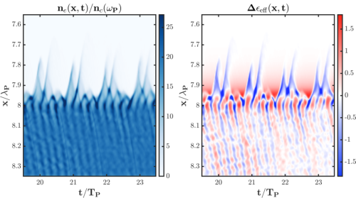

**图2（p3）**横轴t/T_P，纵轴x/λ_P；左色标n_e/n_c(ω_P)，右色标是探针频率下减去这四周期时间平均值后的Δε_eff。图中边界往复和次表面细结构约每个pump周期重复。右图是重构量，并非独立实验测得的介电函数；四周期复现也不能推出整个脉冲严格无限周期。

模拟设置在补充第1节，按原文顺序于后文详列。三种运行分别为pump-only、probe-only、pump-plus-probe，probe-only给出增能基线。

## 3. 谐波产生：几何时空旋转、选择律与增益（原文第3节）

### 3.1 A：局域移动界面的几何旋转

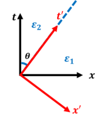

**图3（p3）**横x、纵t为几何示意，ε₁／ε₂分处界面两侧；没有实验单位刻度。作者在c=1约定下写界面为βt−x=0，再令tanθ=β，将新时间轴沿界面放置。

$$
\begin{pmatrix}t'\\x'\end{pmatrix}
=\begin{pmatrix}\cos\theta&\sin\theta\\-\sin\theta&\cos\theta\end{pmatrix}
\begin{pmatrix}t\\x\end{pmatrix},
\qquad
\omega'=\omega\cos\theta-k_x\sin\theta,
\quad k_x'=\omega\sin\theta+k_x\cos\theta.
$$

这些是**欧氏几何坐标旋转**，不是变换到物理惯性系的Lorentz变换。由相位在坐标改写下不变，频率／波数按逆转置变换，产生上式。对单一匀速界面，介质在t′方向恢复平移不变性，故散射守恒ω′。真实表面速度随位置时间改变，作者逐个短时局域使用该近似。

场张量也随坐标变换，补充式S8给出

$$
E_z=\cos\theta E_z'-\sin\theta B_y',\qquad
B_y=\cos\theta B_y'+\sin\theta E_z'.
$$

这里沿用c=1的场归一化；不能把带SI量纲的E和B不加换算直接相加。将坐标导数和场变换代回Maxwell方程，可得原文式24／补充S13的周期系数二阶方程。其系数含介电梯度及旋转引入的混合导数；并非把普通静态晶体色散关系原封不动搬到实验室。

### 3.2 B：时间周期决定边带频率（式22–32）

在局域旋转坐标中，周期长度由时间平移T_P投影而来：l′=T_P|sinθ|。将周期场写成Bloch包络乘平面波，包络再按倒格矢G_n=2πn/l′展开，每个通道的k_x′增加G_n。回到实验室，该波数平移同时造成频率平移G_n sinθ。取sinθ>0并重标整数后得到

$$
\omega_n=\omega_S+n\omega_P.
$$

ω_S是入射probe频率，n为整数通道；反向界面只改变通道标号。这一结论源于周期性，只确定允许位置，**不决定各峰强度**。有限带宽探针对每个入射频率分别应用此规则，因而实际峰有宽度。

### 3.3 C：表面方向的动量选择（式33–37）

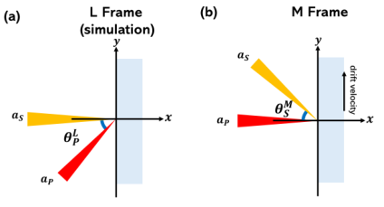

**图4（p5）**也是几何图。此处另引入沿表面的真实Lorentz变换，使pump在M系正入射，切向速度v_d/c=sinθ_P；这与上一节的几何时空旋转是不同操作。平面泵浦／局部平面靶近似下，M系沿表面平移对称，故守恒相应切向动量，变回实验室得到

$$
k_{n,y}=n k_P\sin\theta_P,\qquad
\sin\theta_n=\frac{n\omega_P\sin\theta_P}{\omega_S+n\omega_P}.
$$

推导先将pump每个调制量子的切向动量相加，再用真空出射关系|k_n|=ω_n/c。θ_n遵循作者的有符号角约定；反射波实际k_x<0。只有频率为正且法向波数为实数的通道能作为真空远场传播，任意整数标号不自动代表可观测峰。

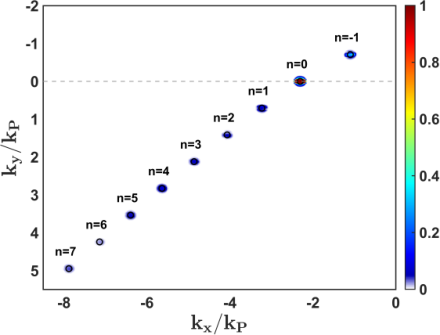

**图5（p5）**横k_x/k_P、纵k_y/k_P；背景是PIC反射场傅里叶幅值|E_z|，色标0–1为图内相对幅值。理论圆圈与峰位置相合。n=0在probe反射方向，高阶逐渐角分散；此图验证峰位置，不给绝对能量转换效率。

### 3.4 D：从复Floquet能带到探针增能

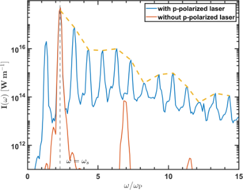

**图6（p6）**横ω/ω_P，纵I(ω)以W m⁻²标注、对数刻度，作者称角积分光谱；蓝线有pump、橙线probe-only，虚线连接主要峰。高频峰高出多个数量级是各谱位置的比较，不能等同总能量提高同样倍数；非单调包络归因于被截断预等离子体产生的亚周期辐射干涉。

作者截取pump-only介质一个周期并周期延拓，以相邻时刻临界面位置求局域速度。在所选y=23.253λ_P时，β=−0.709、θ=−35.33°，probe在新坐标中k′_S=0.548k_P。这里的负θ与先前选择律推导选正θ并无冲突：前者保留实际局域界面方向。

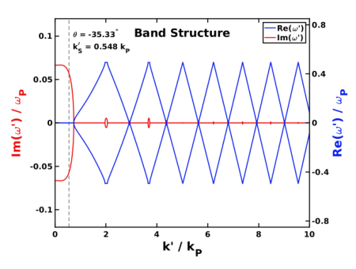

**图7（p6）**横k′/k_P；红色虚部Imω′/ω_P看左轴，蓝色实部Reω′/ω_P看右轴。灰虚线probe位于第一动量禁带的复共轭分支区。取场因子exp(−iω′t′)，正虚部导致场幅增长、能量按exp(2Imω′t′)增长。实验室中的时间增长又伴随空间衰减，不能只拿该图虚部乘总脉宽求增益。

作者按Δx=0.01λ_P、Δy=0.05λ_P、Δt=0.025T_P在皮肤层、横向重叠区域和时间上取样。每个局域点先变回实验室，确定净能量增长率与空间衰减，再对输入探针能量密度累加：

$$
\dot u^{\rm gain}_{S,ijp}=g^{\rm net}_{ijp}u_{S,\rm in}(x_i,y_j,t_p),
\qquad
\Delta W_{S,\rm pred}(t_N)=\sum_{p=1}^{N}\sum_j\sum_i
\dot u^{\rm gain}_{S,ijp}\Delta x_i\Delta y_j\Delta T_p.
$$

g来自实验室频率的2Imω，单位s⁻¹；u是能量密度J m⁻³，空间衰减由2Imk_x确定。乘面积与时间后，二维结果单位是**J m⁻¹，即每单位出平面长度的能量**。剩余场能递交下一时间段，不能把四周期当互不关联的独立增益。

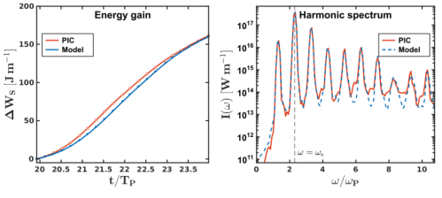

**图8（p7）**左横t/T_P、纵ΔW_S[J m⁻¹]；红PIC、蓝约化模型，四主要周期末分别161.41与160.07 J m⁻¹，按PIC归一化差约0.83%。右横ω/ω_P、纵I(ω)[W m⁻²]对数，灰线为probe频率，红实／蓝虚线比较峰位及绝对纵轴幅度。该0.83%是这个累计量的差，不是所有光谱点、所有参数的统一误差。主文保留至n_max=12的通道。

光谱模型以pump-only密度和平均γ构造无碰撞s场方程：

$$
(\partial_x^2+\partial_y^2)E_z-\frac{1}{c^2}\partial_t^2E_z
-\frac{e^2n_e}{\epsilon_0m_e\bar\gamma c^2}E_z=0.
$$

这是原文式41用μ₀ε₀c²=1改写。密度时变使不同频率耦合。有限持续时间、非严格周期和不均匀性使PIC峰更宽、连续背景更强；匹配的主要峰不代表这些细节均已解释。

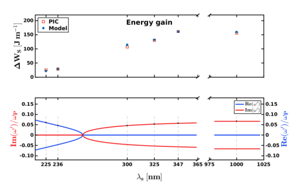

**图9（p7）**上图横λ_S[nm]带断轴，纵ΔW_S[J m⁻¹]，红空方PIC／蓝圆模型；下图为同一代表点的Reω′与Imω′，轴颜色同图7。225、236 nm处所选局域点无虚部、总增能较小；300、325、347、1000 nm有虚部且总增能较大。但总增益累计所有点与时刻，允许带也可能在其他位置入禁带，因此单点Imω′与全域增益不严格成比例。六点扫描不是连续谱全域或域外验证。

## 4. 双pump推广（原文第4节）

两pump对称±45°入射，分别800和1000 nm，a均为2；probe等其他设置不变。非线性共同驱动的介质按整数对通道展开：

$$
\omega_{n_1,n_2}=\omega_S+n_1\omega_{P1}+n_2\omega_{P2},
\qquad
\sin\theta_{n_1,n_2}=
\frac{n_1\omega_{P1}\sin\theta_{P1}+n_2\omega_{P2}\sin\theta_{P2}}
{\omega_S+n_1\omega_{P1}+n_2\omega_{P2}}.
$$

推导与单pump相同，分别相加频移和切向动量，再用真空色散。整数对允许混合非线性通道；实际介质取共同驱动PIC，不能把两次单pump介电函数简单线性叠加。

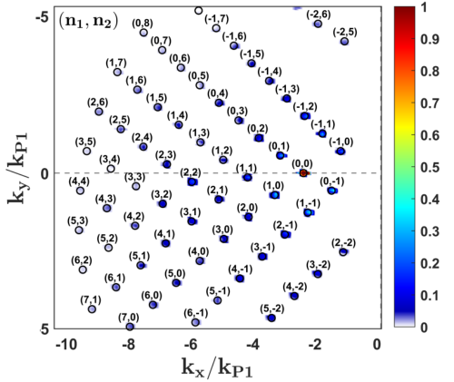

**图10（p8）**横k_x/k_P1、纵k_y/k_P1，背景PIC场幅相对色标0–1，圆圈为选择律，标注(n₁,n₂)。多列分支反映混合频移和动量，不是每个通道等强，也未表示绝对光子数。

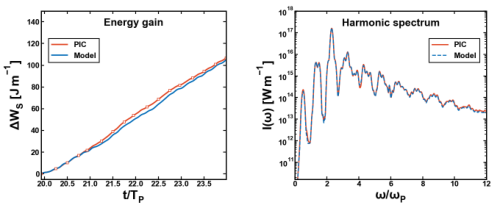

**图11（p8）**左t/T_P1对ΔW_S[J m⁻¹]，右ω/ω_P1对I(ω)[W m⁻²]对数，红PIC／蓝模型。累计增能为模型104.73、PIC106.51 J m⁻¹，差约1.68%。比单pump的161.41更低，说明增加输入束并不自动提高probe总增益，更不能据局域峰声称总效率提高。

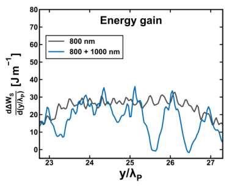

**图12（p8）**横y/λ_P，纵dW_S/d(y/λ_P)，单位J m⁻¹；灰单pump，蓝双pump，积分深度和四周期时间窗相同。蓝线局部更高，但多个深谷使空间积分降低。两个法向电场的相长／相消调制解释这种分布；不同频率使干涉条纹沿表面以Δω_P/Δk_P,y漂移，有限几周期内没有完全洗平。这是作者解释，与图相容，尚缺独立实验／相位扫描。

## 5. 结论（原文第5节）

第一段总结周期对频率／方向的约束和双pump混合通道。第二段总结复能带与增能、光谱对照。第三段提出改变频率、角度、相位、偏振以及LG驱动以设计涡旋辐射；LG与阿秒涡旋属于展望，本篇没有实际三维波前或脉宽诊断。

## 6. Supplement 1：输入参数与数值约化

### 6.1 PIC参数（补充第1节）

| 项目 | 原文值与口径 |
| --- | --- |
| 光斑 | pump 3λ_P，probe 8λ_P；补充未明确这些数值的场／强度半径约定 |
| 包络 | sin²(πt/2τ_j)，τ_P=10T_P、τ_S=5T_P；不要不加说明改称强度FWHM |
| 时序 | 两束强度峰到达靶面同步 |
| 靶 | 厚2λ_P，平台20n_c，n_c=1.7×10²¹ cm⁻³按800 nm；平台始于x₀=8λ_P |
| 前表面 | 指数尺度d=0.1λ_P，按7n_c cosθ_P作截断；是有利于层压缩的特定初态 |
| 箱与网格 | 12λ_P×50λ_P，Δx=Δy=λ_P/250 |
| 宏粒子 | 每格64电子、16离子；离子种类／质量电荷及时间步在这段未给出 |
| 边界 | 左侧按角度注入激光，其他边界开放；二维EPOCH |

不同probe波长下平台都超临界，n_c不能混用各波长定义。没有从离子宏粒子数推断离子质量或是否完全固定；复现还需输入deck和相位／窗口规则。

### 6.2 旋转方程（补充第2节）

先将导数写成新坐标导数线性组合，再代入Faraday定律及Ampère定律。Faraday在这套变量下保持简形式；Ampère产生混合导数及介电梯度项。对t′再求导并令场随exp(−iω′t′)，得到主文式24。该推导使用局部、瞬时本构关系；几何旋转只是在这个模型内方便求解，不证明任意热等离子体均可化为时间无关标量介质。

### 6.3 多阶Floquet传输矩阵（补充第3节，式S14–S25）

将有效等离子体频率平方和场按pump频率作时间Fourier展开，令ω_m=ω+mω_P。横向选择律给k_m,y=m k_P sinθ_P，代回波动方程得到

$$
\frac{d^2E_m}{dx^2}+\sum_n C_{mn}E_n=0,
\qquad
C_{mn}=\left(\frac{\omega_m^2}{c^2}-k_{m,y}^2\right)\delta_{mn}
-\frac{(\omega_{pe,\rm eff}^2)_{m-n}}{c^2}.
$$

C的量纲m⁻²；对角项是各通道自由传播，非对角项由介质的Fourier分量转移频率。保留m=−M…M后，定义由场和空间导数组成的状态向量，可把二阶系统化成一阶：

$$
\Psi=(\mathbf E,\partial_x\mathbf E)^T,\qquad
\frac{d\Psi}{dx}=\begin{pmatrix}0&I\\-C&0\end{pmatrix}\Psi
=\mathcal A\Psi,
\qquad P_i=\exp(\mathcal A_i\Delta x_i).
$$

在每层常系数近似下用矩阵指数传播，按靶法向有序相乘；顺序不能交换。再用左右端本征模矩阵Q分离正／负向模，T=Q_R⁻¹PQ_L。将T分块，解出出射与入射的关系，例如

$$
E_L^-= -T_{22}^{-1}T_{21}E_L^+ + T_{22}^{-1}E_R^-.
$$

这一步假定T₂₂可逆，实际求解需要关注倏逝模、病态矩阵与通道截断。对连续入射频率分别计算，再把各输出边带归到其频率、对横向和时段求谱。文中报告主要峰对照，但没有提供完整代码、所有局域窗口／双pump双指标矩阵实现或统一截断／网格收敛表；本轮没有自行补写为已复现。

## 7. 开放问题与项目用途

1. **能量口径。** ΔW_S是相对probe-only额外s场能，二维J/m；不等于绝对三维焦斑能量，也不是以全部pump＋probe输入归一的激光转换效率。需要Poynting通量、剩余粒子／场能和输入能量联合账本。
2. **模型独立性。** 介质由同一PIC代码的pump-only运行生成，对pump-plus-probe运行作交叉预测，有解释力，但不是脱离模拟的实测预测。应加入探针强度扫描、反馈／张量响应、碰撞和有限对比度靶表面敏感性。
3. **局域周期和传播。** 一个周期延拓、短时匀速、皮肤层取样及通道截断都需独立收敛；图7单点禁带不能当全脉冲全靶严格能带。图谱轴写I(ω)[W/m²]，未显式给每Hz／每角频率的谱密度归一规则，不能直接用图积分推总焦耳。
4. **实验与扩展。** 需要正交偏振分离后的绝对角谱、入射能量及独立密度／时序诊断；三维有限光斑、离子运动、相位抖动未验收。没有展示γ、光核、中子、临床或屏蔽链条。
5. **可用思想。** 对相干辐射PIC可以先用频率—切向波矢选择律检查峰归属，再用独立能量账检验“放大”；不要仅凭增强峰把总能量效率也判作提高。

## 8. 复习速记

周期决定允许的频率和角度，复Floquet模描述pump向probe输能。单／双pump的约0.83%／1.68%是特定二维累计增能与PIC的差；双pump局部增强却总增能下降，且全部仍是模拟与约化解释。
