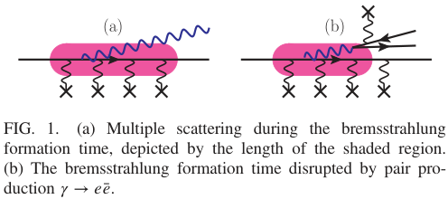
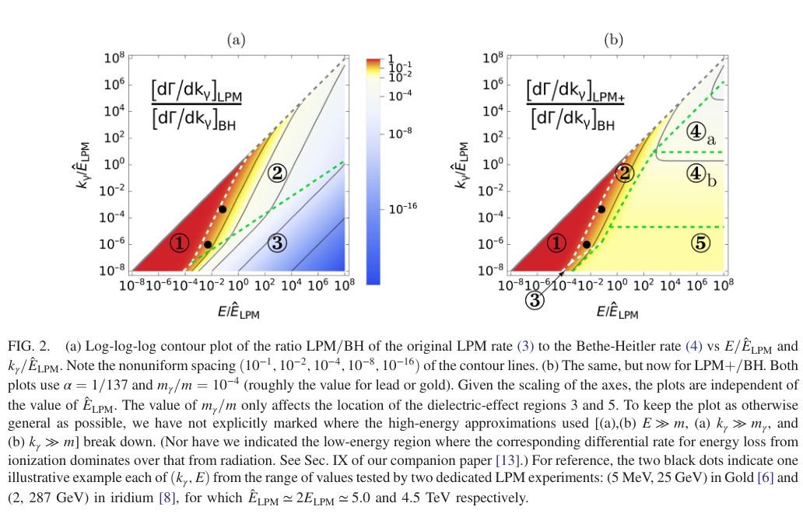
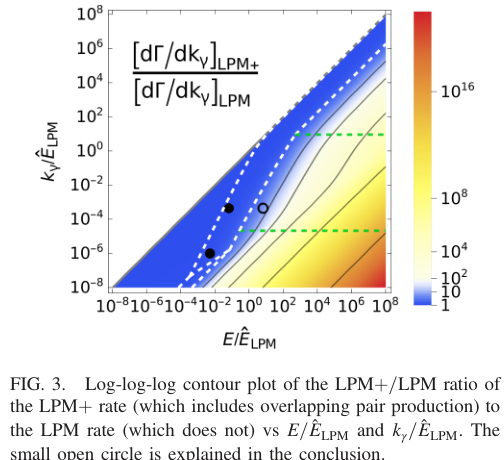

# 对产生打断形成过程如何减弱LPM抑制：中文笔记

## 0. 论文、版本与研究对象

- **原题**：Extremely High-Energy Bremsstrahlung in Matter。
- **作者**：Peter Arnold、Joshua Bautista、Omar Elgedawy、Shahin Iqbal。
- **正式记录**：Physical Review Letters **137,221603 (2026)**，[10.1103/rk4d-45t9](https://doi.org/10.1103/rk4d-45t9)。出版社首页确认05-08收到、09-03修订、10-06接收、**11-25发表**。
- **实际全文**：[APS官方harvest](https://harvest.aps.org/v2/journals/articles/10.1103/rk4d-45t9/fulltext)取得的[7页最终PDF](../pdfs/arnold-2026-bremsstrahlung.pdf)，含第6–7页End Matter，不是只读前5页。Crossref明确把[2604.18685](https://arxiv.org/abs/2604.18685)关联为同作预印本，本库只入一个作品。
- **证据性质**：均匀厚介质中的解析QED、极限公式及其数值绘图；无新束流实验、转换靶实测或光核产额测量。正文与End Matter全部读取，参考文献仅核结构；7页总览、3／4／6／7页单页及3幅原图实际目视。MinerU本轮零请求，采用本地布局／渲染回退，未运行作者Mathematica代码。
- **伴随长文**：[PRD 114,093008，10.1103/8rg8-tmgg](https://doi.org/10.1103/8rg8-tmgg)及2605.03002是不同论文的详细计算，非本篇身份别名。取得38页文件后仅检查首页／结构，未精读、未单独入库；临时PDF／文本已清理，不能据其内容声明完成推导复核。

## 1. 从单原子散射到跨越多个散射的形成过程

Bethe–Heitler（BH）把高能电子经过原子场时的韧致辐射作为基本过程。电子能量升高或所考虑光子足够软时，辐射的形成时间$t_{\rm form}$变长；在光子“形成”期间电子已经历多次弹性散射，不同振幅相干叠加，导致Landau–Pomeranchuk–Migdal（LPM）抑制。

本文式(1)先给参数量级关系

$$
\left[\frac{d\Gamma}{dk_\gamma}\right]_{\rm LPM}
\sim \min\!\left(1,\sqrt{\frac{k_\gamma E_{\rm LPM}}{E(E-k_\gamma)}}\right)
\left[\frac{d\Gamma}{dk_\gamma}\right]_{\rm BH}.
$$

$E$为初始电子能量、$k_\gamma$为辐射过程转移的光子能量尺度。$E_{\rm LPM}$依赖材料：文中金约2.5 TeV、空气约234 PeV。即使$E<E_{\rm LPM}$，足够软的光子仍可能受LPM抑制；不能仅凭电子能量低于TeV就排除全部介质相干效应。

**图1（PDF第1页）**是示意，无定量坐标。粉色段表示形成时间／长度，交叉为介质弹性散射；右图的光子在形成过程尚未结束时已发生$\gamma\to e^-e^+$。关键不是在一次已经结束的普通发射后再独立叠加一个吸收概率，而是两个量子形成过程重叠。

## 2. 新效应的方向：相对LPM增加，不等于超过BH或逸出光子变多

历史直觉曾认为，光子提前对产生会进一步降低韧致辐射。作者前作在忽略质量的极高能极限发现相反趋势：提前终止长相干过程会削弱原有LPM的相消，本文式(2)用

$$S_{\rm extra}\sim\max(1,\Gamma_{\rm pair}t_{\rm form})$$

表达相对原LPM率的参数增强。本篇的新内容是把电子质量$m$和介质诱导光子质量$m_\gamma$纳入，延伸到$k_\gamma\lesssim E_{\rm LPM}$并连接介电效应区。不能把“此前方向判断被推翻”全部当作本篇首次结果。

尤其要区分可观测量：作者计算的是**初始硬电子辐射损失的微分率**$d\Gamma/dx_\gamma$，$x_\gamma=k_\gamma/E$，其中同时包含没有后续实对产生的$e\to e\gamma$及形成重叠的$e\to e\gamma\to ee\bar e$。$d\Gamma$仍是率，不是能量加权后的总能损；后者还需按$Ex_\gamma$积分。因此本文的增强既不是靶后逸出光子计数增强，也不是激光／电子到伽马的能量转换效率。新效应重要的区域主要在$x_\gamma\ll1$，此时末态高能电子与软的成对电子才容易区分。

## 3. 输入量、近似和两种LPM能标

作者采用$\hbar=c=1$，形成时间与长度数值同义。介质多重散射由

$$\langle\Delta p_\perp^2\rangle_{\rm typical}\simeq\hat q\Delta t,
\qquad \widehat E_{\rm LPM}=m^4/\hat q$$

表征。低能区有$\widehat E_{\rm LPM}\simeq2E_{\rm LPM}$，图中横纵轴使用带帽能标，不能错用金的2.5 TeV直接换算为图的单位；对金对应约5 TeV。

约束包括：介质比形成长度厚、形成区内近似均匀；采用原子屏蔽大对数的leading-log处理；假设$Z\gg1$并忽略$1/Z$项；为简洁固定$\hat q$，不跟踪其缓慢的能量对数变化（作者指出所考察范围可达约2倍）。只算纯QED，未把光核反应纳入。文中的约10²⁰ eV光核竞争说明针对极高能区，**不是说实验室MeV光核反应不存在**。

介质诱导$m_\gamma$来自前向Compton散射的折射效应，约$m_\gamma^2\simeq4\pi\alpha Zn/m$，其中$n$是原子数密度。它不是激光强场QED参数$\chi$，也不是把真空光子赋予静质量。

## 4. 图2与表I／II：应如何使用分区图

**图2（第3页）**横轴$E/\widehat E_{\rm LPM}$，纵轴$k_\gamma/\widehat E_{\rm LPM}$，均对数；左图颜色为LPM/BH，右图为LPM⁺/BH。参数$\alpha=1/137$、$m_\gamma/m=10^{-4}$，后者约对应铅／金。色标等级为1、10⁻¹、10⁻²、10⁻⁴、10⁻⁸、10⁻¹⁶，**不是等间隔线性色阶**。

左图分BH、深LPM和介电抑制三类；右图出现4a、4b与5区，原本继续下降的率被重叠对产生修正。4a对应前作近似质量可忽略的区；4b和5需要质量／介电修正。颜色提升是相对于LPM的恢复，图中对BH的比值仍需单独看，不能用图3的大倍数替换这里的绝对归一化。

图未标出所有近似失效边界：LPM⁺使用$E\gg m$、$k_\gamma\gg m$，也未叠加低能电离损失的主导区。不能把图下缘外推到任意keV光子。两黑点分别为既有金靶$(k_\gamma,E)=(5\,\mathrm{MeV},25\,\mathrm{GeV})$及铱靶$(2\,\mathrm{GeV},287\,\mathrm{GeV})$的代表实验条件，它们不是新实验点。

表I是各区**远离边界**的渐近率，表II列参数边界；绘图用相邻渐近式相等来画分界，不能当作物理相变。4／5区的leading-log直观图像是对产生率乘一个等效Weizsäcker–Williams光子分布，但非leading-log常数和有／无实对产生的合并贡献仍需完整表达式。

## 5. 图3与实验展望：大比值为何仍不代表已测到

**图3（第4页）**使用相同横纵轴，颜色现在是LPM⁺/LPM，从1到10¹⁶以上，分母已改变。两个历史实验黑点远离显著修正区，所以既有LPM验证不能视为LPM⁺验证。空心圈是未来概念工作点：作者设想约50 TeV**质子**束并把既有CERN电子束实验能标提高约100倍；不是已经获得50 TeV电子束的实验。

若做靶后光谱实验，还要将有／无实对产生的通道分开，并处理有限靶边界。显著LPM⁺区中形成长度与对产生平均自由程同量级，不能同时要求靶对形成过程足够厚、又对光子转对足够薄。

第5页关于有限厚度的表述是**尚未显式计算验证的定性预期**：当$L\gtrsim1/\Gamma_{\rm pair}$时增强不会超过$O(\Gamma_{\rm pair}L)$；当$L\ll1/\Gamma_{\rm pair}$时预计不显著。本笔记保留其预期属性，未把它写成已验证有限靶模型。

## 6. End Matter：完整公式的组合方式与数值分支

附录A1以完整Migdal率为基线，乘以“1＋无量纲修正／软光子极限基线”。分子分为中间横向和纵向偏振光子两部分（A4–A6）；A7–A9给参数、对产生核及三个积分$I_1,I_2,I_3$，A10定义广义Stieltjes常数。这里的偏振分解是内部计算贡献，不是已经完成外部偏振测量。

特别需要保留第7页实现警告：公式中的$\log\Gamma(z)$采用沿负实轴的连续分支；直接把复数$\Gamma(z)$送进通常主值$\log$会产生错误的不连续。实现应使用适当的直接LogGamma函数，并验证分区极限、积分稳定性及实部组合。作者提供[Zenodo代码DOI](https://doi.org/10.5281/zenodo.22283988)，本轮仅从论文记录链接，未下载核验或运行，不能声称数值复现。

## 7. 与转换靶、PIC／MC和核应用的关系

**主题关键词**：bremsstrahlung、converter、LPM、pair production、QED、材料、韧致辐射、输运模型。

本文适合用作极高能输运模型的适用性检查：先确定材料$\hat q$／$E_{\rm LPM}$、目标光子能窗、形成长度和真实靶厚，再判断是否需要重叠形成过程。它没有对指定Geant4／FLUKA物理表作基准，也没有提供可直接插入普通独立碰撞MC的逸出光子核。

要连接激光电子束打转换靶，应另给完整入射相空间、几何与边界、电子能损和光子出射联合谱，再耦合光核／中子及剂量响应。本篇没有这些产额、核素纯度、临床剂量或防护验收。接续优先精读伴随PRD并固定代码版本，对有限靶的可测量量进行分通道推导，不能先把相对LPM增强乘进现有伽马产额。
