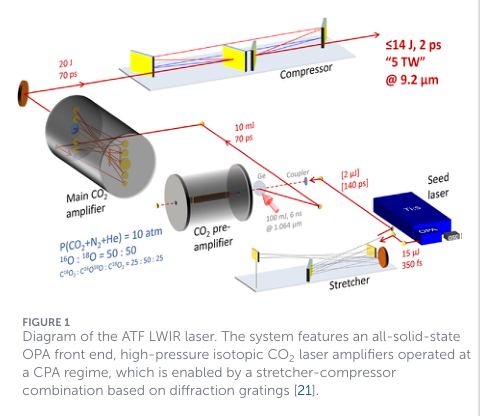
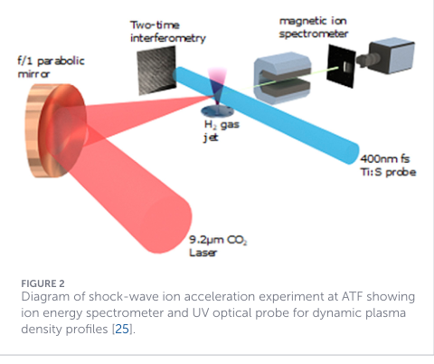
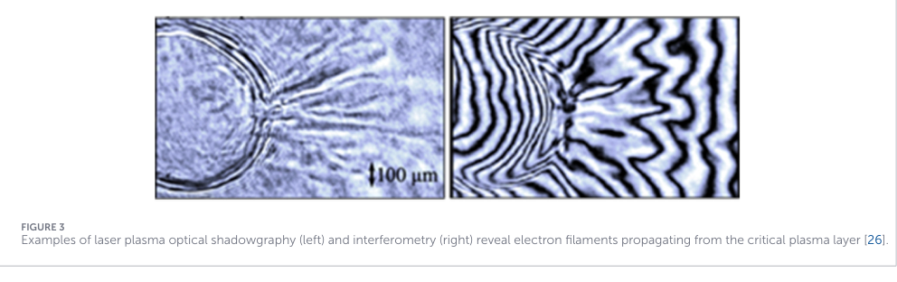
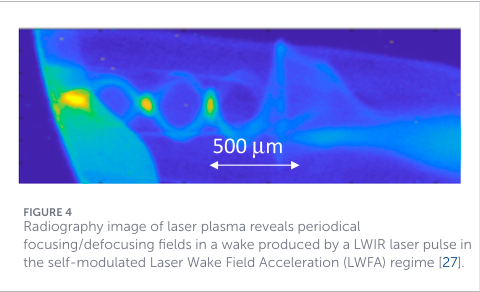
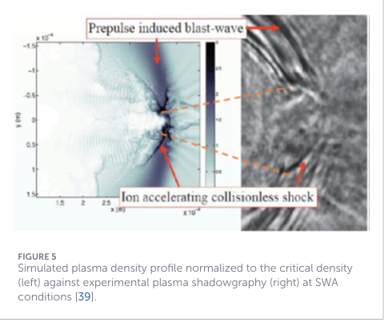
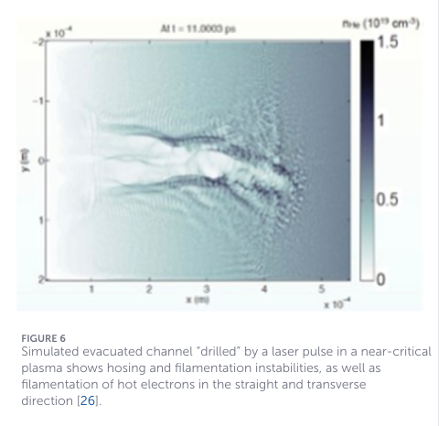
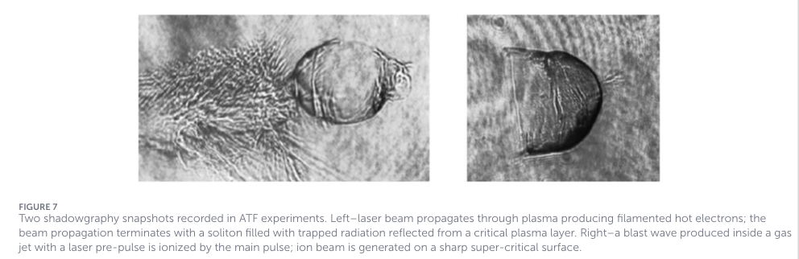

# 长波红外激光作为快点火／冲击点火相似实验平台：中文笔记

## 0. 论文、版本与证据类型

- **原题**：Long wave infrared laser platform for plasma studies relevant to inertial fusion。
- **作者**：Igor V. Pogorelsky；Brookhaven National Laboratory，ATF。
- **正式记录**：Frontiers in Physics **14:1969078**，[10.3389/fphy.2026.1969078](https://doi.org/10.3389/fphy.2026.1969078)。最终PDF首页确认2026-08-15收稿、09-21修订、10-29接收、**11-25发表**。
- **实际阅读**：[出版社9页最终PDF](../pdfs/pogorelsky-2026-lwir.pdf)，由[官方PDF入口](https://www.frontiersin.org/journals/physics/articles/10.3389/fphy.2026.1969078/pdf)取得。网络搜索缓存仍显示“最终版即将发表”，但本次直接取得的页面元数据及最终PDF已更新，版本判断以后者为准。
- **性质**：平台与物理机会综述；归纳既有实验／PIC示例并提出未来实验与升级，不能当作一次新的点火、重离子源或能量耦合实验。
- **阅读方式**：正文第1–4节、图1–7及声明完整读取，参考文献只核结构与图源指向；9页总览、关键第7页单页及7幅保留图实际目视。使用本地布局文本和渲染；本轮未请求MinerU，历史401未复测。未复跑所引PIC或实验。

## 1. 引言：为何重新使用曾被放弃的CO₂波段

作者先区分直接／间接驱动，再把关注点移向冲击点火（SI）和快点火（FI）。长波CO₂激光早期用于压缩燃料时，低临界密度使能量沉积位置偏外，强热电子又会提前加热燃料、妨碍压缩。本文的动机是把这些效应用于研究晚时刻的热电子、离子产生和输运，而非重新宣称长波激光已解决整靶压缩。

在SI语境，适当时刻的较低能热电子可帮助冲击驱动；文中引用的示例能窗为小于约100 keV。FI则需要能穿过高面密度物质并在核心局域沉积的更高能电子／离子。文中约10 MeV电子、约1 g/cm²射程是FI背景量级，不是本平台本轮的实测束流工作点，更不是普适最优能量。

## 2. 相似缩放：匹配哪些量，才能谈可比性

正文第2页的无碰撞、充分电离模型使用

$$
\tilde t=\omega t,\qquad \tilde x=\omega x/c,\qquad
\tilde n_e=n_e/n_c,\qquad
n_c=\frac{m_e\epsilon_0\omega^2}{e^2},\qquad
a_0\simeq0.855\lambda[\mu\mathrm m]\sqrt{I/(10^{18}\,\mathrm{W\,cm^{-2}})}.
$$

超相对论相似参数为 $S=n_e/(a_0n_c)$。在匹配相应无量纲输入时，延长波长使相同$a_0$所需强度与相同$n_e/n_c$所需密度均按$\lambda^{-2}$下降。9.2 μm相对0.35 μm的平方比约691；10 μm相对0.35 μm约816，因此文中“约三个数量级”是量级说法。

这种缩放尤其有利于诊断：对LWIR已经过临界的气体，对短波光学探针仍可能透明。它没有自动保持碰撞频率、原子电离、辐射输运、热传导、材料面密度和整靶几何；仅匹配S也不等于任意有限$a_0$实验都具有完整ICF相似性。迁移前应同时列出密度比、脉宽周期数、尺度／波长、离子荷质比及被忽略的过程。

## 3. ATF现有能力与计划能力分开列出

| 项目 | 本文表述与边界 |
| --- | --- |
| 已有LWIR系统 | 9.2 μm、约2 ps、5 TW；约25 μm高斯焦斑，强度量级10¹⁷ W/cm²。由$a_0$公式估得约2.5，仅作数值一致性检查。 |
| 拟升级 | 新种子／单级高压CO₂放大与后压缩，100 fs、25–40 TW为**模拟／预期值**，不是已交付的逐发性能。 |
| 辅助激光 | NIR及谐波、ns／ps／fs脉宽，用于造靶、预脉冲、阴影和干涉；Faraday旋转可辅助磁场诊断。 |
| 电子探针 | 文中概述75 MeV皮秒级电子束，并讨论亚皮秒束探测场的方案。探针参数与LWIR升级参数不能拼为一次已完成联合实验。 |
| 靶 | 可调气体喷流、刀口喷嘴／爆炸波整形，以及辅助激光烧蚀形成的冠层；Kr、Xe重离子束为拟开展研究。 |

**图1（PDF第3页，引用文献21）**是光路示意，无统计坐标轴。展示OPA种子、混合同位素CO₂预／主放大与CPA展宽压缩；图上不超过14 J、2 ps、约5 TW是已有链路标签。它不能证明未来100 fs和25–40 TW升级已完成，也不提供抖动／对比度／长期可用率。

**图2（第4页，文献25）**是H₂喷流实验布置：9.2 μm驱动、400 nm fs探针、双时刻干涉及磁离子谱仪。无能谱或效率纵轴；价值在于把造靶密度结构和离子能谱放在同一测量链，不能从布局本身读出束荷、发散或重离子产额。

## 4. 光学与电子探针分别约束什么

**图3（第5页，文献26）**左为阴影、右为干涉条纹，左图比例尺100 μm。临界层附近出现向外延伸的细丝结构。阴影对折射率梯度敏感，干涉相位约束视线积分电子密度；图中没有给出反演后的绝对密度色标或误差条，不能把图像亮度直接当电子数／温度或局域磁场。这是所引既有实验的例图。

**图4（第5页，文献27）**给出电子照相屏像，比例尺500 μm，呈周期聚焦／散焦。颜色是探针在屏上的分布，没有电场强度标定色条，故不能直接读成GV/m。图注称self-modulated LWFA，而引用文献27标题称blowout regime；本文没有提供足够的原始实验参数来消除这个工况命名差异。应回原文核对，不能用本图单独判定尾场区制。

## 5. 离子驱动FI：密度整形、谱宽与输运仍需同时闭合

TNSA由热电子鞘场驱动，优点是束流强，问题是宽能谱和发散；文中15%实验转换与30%理论预测来自不同引用，不能当作ATF此次结果。RPA和冲击波加速（SWA）提供较窄谱的可能。SWA中上游离子被移动的静电冲击反射，非相对论近似下$v_i\simeq2v_s$，所以$E_i/A\simeq2m_uc^2(v_s/c)^2$。

作者把10 MeV/amu与约0.06c冲击速度并列为量级：若严格采用静止上游反射关系，0.06c对应约6.7 MeV/amu，而10 MeV/amu约需0.073c。此处作为近似量级保留，不能直接用来设置精密模拟输入；需要原实验的上游流速和冲击定义。Kr／Xe还受荷质比与加速长度限制，文中未给出这两类束流已测谱。

**图5（第6页，文献39）**左侧模拟的x、y以m标示并带10⁻⁴倍率，颜色为$n_e/n_c$；右为未作同一绝对密度归一化的实验阴影。预脉冲爆炸波与离子加速冲击面的形状可作形态对照，但两种量不是逐像素同一观测量。图未给离子能谱／谱宽／总数，因此“形状相合”不能代替这些指标或点火耦合效率验收。

## 6. 不稳定性与自聚焦：通道形成不等于稳定传输

作者提出用LWIR分别研究压缩／SI时的流体不稳定性，以及FI时的hosing、成丝和通道传播。第7页给出

$$P_{\rm RSF}\simeq17(\omega/\omega_p)^2\ \mathrm{GW}.$$

固定背景密度时，长波降低所需功率；文中以$n_e=10^{17}$ cm⁻³比较9.2 μm约2 TW与0.35 μm约1.4 PW。它是近似阈值估计，不能替代有限光斑、密度坡、脉宽和离子运动下的稳定通道测试。正文也承认，接近过临界界面时反射、热电子及束流成丝会降低核心能量沉积。

**图6（第7页，文献26）**是模拟，不是实验照片；时刻11 ps，x、y单位m并带10⁻⁴倍率，色标$n_e$单位10¹⁹ cm⁻³。低密度通道弯曲、分裂，周围有细丝。这里只展示单时刻形态，没有增长率拟合、噪声种子／网格收敛，也没有证明特定抑制策略有效。

**图7（第8页）**是ATF两幅阴影例图。作者把左图解释为成丝热电子与临界层反射后的俘获辐射结构，右图解释为预脉冲爆炸波和后续陡界面相互作用。图中未给比例尺、延时或绝对密度色标；不据此提取速度、离子能量、溶子寿命或误差，也不把图注的机制解释升级为独立反演结果。

## 7. 对本库研究方向的用途与接续

**主题关键词**：LWIR、CO₂、ICF、fast ignition、shock ignition、诊断、相似缩放、hot-electron、SWA、靶设计、PIC。

本文可用于设计“密度剖面—场结构—电子／离子相空间”的联合诊断验证。若进一步连接转换靶、韧致辐射、光核／中子应用，需要另测输入束流的能角相关性、总电荷、时间结构与到靶输运，再闭合次级产额和能量预算；本文没有这些全链结果。

接续重点是核实图4工况与原始场反演，固定实际激光对比度／脉形及气体密度，量化相似缩放失效项，再对电子／离子谱、发散和逐发变化作同步检验。平台升级、Kr／Xe束流和点火增益仍是待验证事项。
