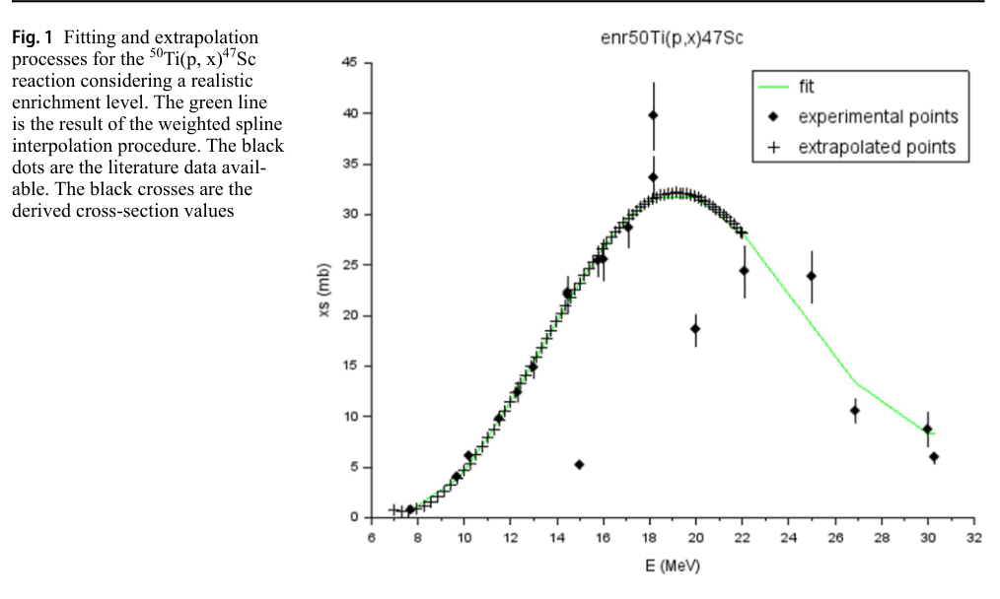
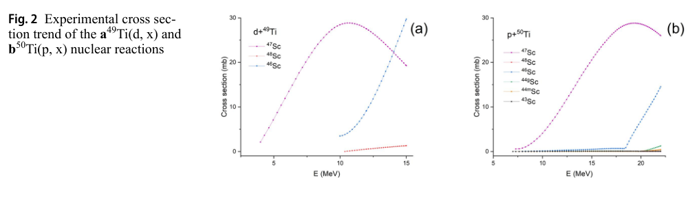
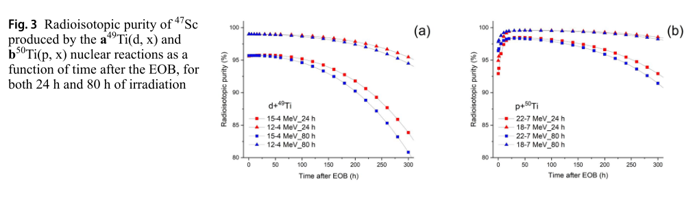
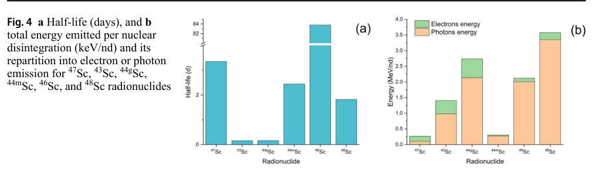
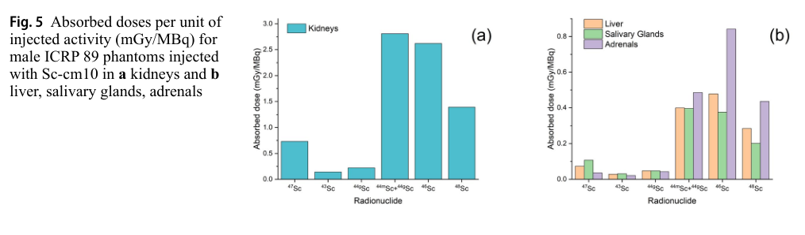
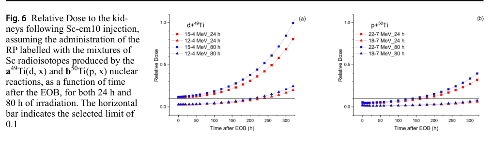

# 富集钛的⁴⁷Sc制备：能窗、同位素纯度与剂量标准为何给出不同选择

## 0. 论文与实际版本

- **原题**：Computational assessment of 47Sc production for theranostic applications via proton and deuteron irradiation of enriched 50Ti and 49Ti targets。
- **作者**：Lucia De Dominicis、Laura Meléndez-Alafort、Laura De Nardo；EJNMMI Physics，[DOI 10.1186/s40658-026-00968-z](https://doi.org/10.1186/s40658-026-00968-z)。06-23收到、11-11接收、11-26在线发表。
- **实际全文**：[14页出版社PDF](../pdfs/dedominicis-2026-sc47.pdf)，首页明确 **Article in Press**，不是最终编辑版。网页元数据的普通PDF路径404，实际下载锚点为[官方_reference.pdf](https://link.springer.com/content/pdf/10.1186/s40658-026-00968-z_reference.pdf)。
- [官方补充DOCX](../supplements/dedominicis-2026-sc47-tables.docx)确实是本文S1–S3科学表格，已读取Word XML并经本地转换的5页总览目视；转换PDF仅作临时核验，不当成出版社PDF。
- **证据**：已有截面数据的样条拟合、SRIM阻止本领积分、衰变计算和动物到人体的模型剂量估算；没有新厚靶辐照实验或临床治疗。主文Background至Conclusions及补充三表完整读取，参考文献只核结构。14页总览、关键公式／表2单独加看、6图重开；MinerU零请求，沿用已知认证失效后的本地回退；未运行Scilab、SRIM、CoKiMo或OLINDA。

## 1. Background：比较对象与纯度定义

文章先说明⁴⁷Sc的β⁻治疗与159 keV γ成像价值，再回顾中子、α、质子和光核制备。这里对历史实验的描述不是本研究新增测量。本文真正比较的是富集⁵⁰Ti受质子照射和富集⁴⁹Ti受氘核照射；不是激光电子束—韧致辐射转换靶方案。

作者假设**不同元素的副产物能通过化学分离去除**，只统计残余Sc同位素。因此RIP（radioisotopic purity）分母是所考虑的Sc活度总和，不能无条件等同于包含所有元素污染的RNP，更不是化学／放射化学纯度。作者选RIP≥99%与肾脏附加剂量RelD≤0.1作比较条件；这是本文筛选情景，不构成药品获批或临床放行标准的证明。

DOTA-folate cm10是选定的示例药物。其受体表达、生物分布和肾积聚决定剂量权重；换成另一配体、人体性别／模型或病人，结果不能直接沿用。

## 2. Methods：从截面到EOB活度

### 2.1 富集靶与数据拟合

表1商业富集组成：⁴⁹Ti靶含⁴⁹Ti **96.25%**，其余⁴⁶／⁴⁷／⁴⁸／⁵⁰Ti为0.22／0.22／2.71／0.60%；⁵⁰Ti靶含⁵⁰Ti **83.10%**，其余⁴⁶／⁴⁷／⁴⁸／⁴⁹Ti为1.69／1.29／12.51／1.41%。这不是两个同等纯度的理想单同位素靶。已有实验截面按实际富集度重标，并按误差加权样条拟合。

**图1，PDF第4页**：横轴质子能量MeV，纵轴截面mb；黑点为旧实验、绿线为加权拟合、十字是拟合曲线上取值，并非新增测量。约18–19 MeV附近达峰，图中个别数据与拟合差异明显；曲线取点不能当作独立证据或完整不确定度传播。

### 2.2 厚靶积分与单位（原式1）

用正的线性阻止本领S(E)=−dE/dx，原式可整理为

$$
A_j^{\rm EOB}=n_T\dot N_b\left(1-e^{-\lambda_j t_i}\right)
\int_{E_{\rm out}}^{E_{\rm in}}\frac{\sigma_j(E)}{S(E)}\,dE.
$$

n_T是原子数密度，粒子率为每秒入射粒子数，λ是衰变常数，t_i为照射时长。对电荷数z的离子，电流除以ze才是粒子率；这里质子／氘核均z=1。若使用质量阻止本领，必须相应改用质量归一的原子数，不能混用单位。

推导：薄层的反应率为粒子率乘n_Tσdx；以dx=dE/S换元后积分得到恒定生成率R；由dN_j/dt=R−λ_jN_j，零初态给出A_j=λ_jN_j=R(1−exp(−λ_jt_i))。因此表2的“yield”实际为EOB**活度／电流 MBq/μA**，并非粒子／入射粒子，也不是MBq/(μA·h)。24 h和80 h照射必须分别使用其饱和因子；高电流线性放大还没有考虑靶热工和束流退化。

### 2.3 母女衰变（原式2）

⁴⁴mSc以b=0.988支路喂入⁴⁴gSc。EOB后先解母核指数衰变，再将其代入女核方程并用积分因子，得

$$
A_g(t)=A_g(0)e^{-\lambda_gt}
+bA_m(0)\frac{\lambda_g}{\lambda_g-\lambda_m}
\left(e^{-\lambda_mt}-e^{-\lambda_gt}\right).
$$

A_m和A_g在这里是活度，不能把核数版Bateman系数直接照搬。短寿命污染随等待减小、长寿命污染相对增加，正是两路线RIP时间曲线不同的原因。

## 3. Methods：人体剂量如何得到

原式3把雌性裸鼠KB肿瘤模型的每克组织注射活度百分比，按器官／体重相对质量缩放到ICRP 89**男性**模型：

$$
F_{H,o}(t)=f_{A,o}(t)\frac{M_{H,o}}{M_{H,\rm body}}M_{A,\rm body}.
$$

f_A的单位是%IA/g，乘鼠体重25 g再乘人体器官质量份额，得到人体%IA/organ；这是一种假设的尺度外推，不是人体药代测量。三指数拟合TAC，经各核素物理衰变修正后积分，得到TIAc；OLINDA 2.2.3把它映射成器官剂量。血液TIAc的10%分给心内容物、90%分给remaining，肌肉也并入remaining，肠道按质量分区，骨活度置于皮质骨表面。这些分配都是模型输入。

原式4–5应明确归一化：令d_j为每单位**该核素**注射活度的器官剂量系数，r_j(t)=A_j(t)/A_47(t)，则对固定的1 MBq⁴⁷Sc基准，

$$
d_{\rm mix}(t)=d_{47}+\sum_{j\ne47}r_j(t)d_j,
\qquad \mathrm{RelD}(t)=\frac{\sum_{j\ne47}r_j(t)d_j}{d_{47}},
\qquad \mathrm{RIP}(t)=\frac{1}{1+\sum_{j\ne47}r_j(t)}.
$$

第一式只是线性叠加：每种污染核素活度乘自己的剂量系数。r_j之和不要求为1，**不是占混合物总活度的份额**。RIP只按活度加权，RelD还按药代／辐射能／人体几何加权，因此两者不能互换。

⁴⁴mSc产生的⁴⁴gSc假设留在形成它的器官直到衰变，无再分布／排泄。剂量表的“44mSc+44gSc”是每初始母核素活度的链贡献，应与独立生成的⁴⁴gSc区分，不能额外再重复加入同一母核喂入贡献。

## 4. Results：产额、污染与RIP

**图2，第6页**：a为氘核—⁴⁹Ti，b为质子—⁵⁰Ti；横轴MeV、纵轴mb，曲线取自已有截面处理。⁴⁷Sc通道上升时污染也会增多，限制最高入射能可降低污染，但牺牲积分产额。不是只看截面峰值就能决定厚靶最优能窗。

表2的⁴⁷Sc EOB活度如下，均MBq/μA；能窗写作Ein→Eout：

| 路线与能窗 | 24 h | 80 h |
| --- | ---: | ---: |
| d，15→4 MeV | 70.68 | 188.42 |
| d，12→4 MeV | 44.74 | 119.27 |
| p，22→7 MeV | 187.59 | 500.08 |
| p，18→7 MeV | 97.45 | 259.78 |

氘核窄窗约损失40%⁴⁷Sc，⁴⁶／⁴⁸Sc污染降约85–90%；质子窄窗约损失一半产额。已目视核表2最后行：p、18→7 MeV、80 h的⁴⁴mSc为**0.43**、⁴⁶Sc为**0.37**、⁴⁸Sc为破折号；不能沿布局提取误把0.37移到⁴⁸Sc列。

**图3，第7页**：横轴EOB后小时，纵轴RIP%，a为d、b为p；红／蓝区分24／80 h照射，符号区分能窗。d路线最纯时在EOB，随后长寿命⁴⁶Sc占比增加；p路线短寿命⁴³／⁴⁴gSc先衰变，使纯度先升后降。没有统计误差带，不能把曲线当成已知精度的生产保证。

以**表3**为精确引用：d、12→4 MeV的RIP≥99%窗口为0–60 h（24 h照射）、0–30 h（80 h）；p、18→7 MeV为10–240 h和10–220 h。正文曾把后两者概括为约220 h，应按表格区分。两个宽窗均不满足99%条件，不能拿宽窗高产额配窄窗高纯度。

## 5. Results：为什么低纯度仍可能通过该剂量条件

**图4，第8页**：a横轴核素、纵轴半衰期天，⁴⁶Sc处使用断轴；b为每次核衰变电子／光子能堆叠，**图轴MeV/nd，图注写keV/nd，二者不一致**。补充S1的0.271、1.404、2.733、0.307、2.122、3.574 MeV/nd与柱高匹配，笔记按MeV解释；不把⁴⁴mSc单次衰变能与完整母女链能混同。

**图5，第8页**：横轴核素／母女链；a为肾，b为肝、唾液腺、肾上腺；纵轴mGy/MBq，按**相应核素初始注射活度**归一。S3的肾系数为⁴⁷Sc 0.731、⁴³Sc 0.143、⁴⁴gSc 0.223、⁴⁴m+gSc 2.81、⁴⁶Sc 2.62、⁴⁸Sc 1.39。短寿命⁴³／⁴⁴gSc即使每次衰变能高，累计器官剂量仍较低；同为1%活度污染，剂量影响可很不一样。这里是作者剂量计算，非组织实测。

**图6，第9页**：横轴EOB后h，纵轴无量纲RelD，即污染附加剂量／纯⁴⁷Sc剂量；0.1表示**增加10%**，不是总剂量只剩10%。两图纵轴同口径，所选cm10模型中p路线容许窗更长。

表3给RelD≤0.1窗口：d、12→4 MeV为0–240／0–220 h；p、22→7 MeV为0–180／0–140 h；p、18→7 MeV为0–380／0–360 h（依次24／80 h照射）。d、15→4 MeV没有合格窗口。宽窗p的RIP不达99%，却可在本文肾剂量条件下通过，不能据此宣布临床可用。

## 6. Discussion与Conclusions：可用结论和待闭环项

作者明确没有传播截面、富集度、束流能散及RIP相关协方差；也没有传播药代拟合、TIAc与剂量计算不确定度，鼠到人外推被认为是主要不确定来源。因此本研究适合比较路线和能窗，不能直接给某真实生产装置的交付活度／病人剂量保证。

提高⁵⁰Ti富集度会减少部分污染，但成本和靶回收未解决。作者还指出p、18→7 MeV、80 h的约260 MBq/μA与旧natV路线约279相近，商业优势不能只比本篇p与d。natV约2 mm加⁵⁰Ti约1 mm双层靶、35 MeV入射是建议设计；“产额约翻倍”和100 μA、80 h、24 h处理等待后足够4–9人的说法依赖**100%化学收率**等理想假设，未做制造／热工／回收／质量控制或患者验证。

对激光核应用，能借鉴的是“入射谱—沿程能损—多核素生成—冷却—化学分离—剂量响应”完整账本。激光宽能谱、脉冲电流与非均匀靶温度需另积分并核实验；本文没有韧致辐射源、光核转换效率、中子产额或屏蔽验收。

接续应固定原始截面与协方差、重建厚靶几何和入射能散、加入分离／回收效率，再用真实药代和多个器官联合限制。复习时记住：**RIP按活度相加，RelD按器官剂量权重相加；同一个能窗和同一个EOB后时刻才能比较。**
