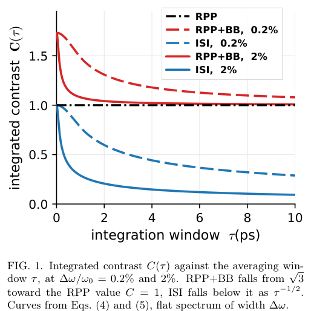
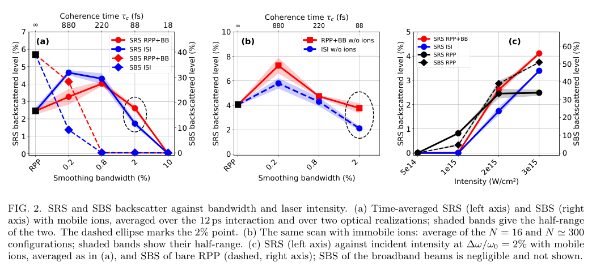
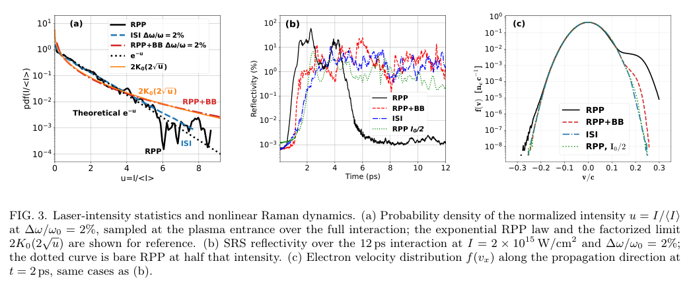

# 同样的带宽为何有不同的Raman背散射：散斑更新的PIC证据

## 0. 论文、版本与阅读范围

- **原题**：Speckle renewal, not bandwidth alone, mitigates kinetic Raman scattering at moderate bandwidth。
- **作者**：P.-E. Masson-Laborde、G. Bouchard、R. Capdessus、C. Ruyer、A. Debayle、A. Fusaro（CEA／Université Paris-Saclay）。
- [arXiv:2611.33971v1](https://arxiv.org/abs/2611.33971)，11-25首投、11-26公告，PDF正文dated11-26；[官方6页PDF](../pdfs/massonlaborde-2026-speckle.pdf)。有界Crossref原题前3检索未核实同作期刊，保持预印本身份；源文件名含PRL并不证明已投稿／接收／发表。
- 本文是作者二维全电磁Smilei PIC与随机光场统计分析，没有新装置实验。完整正文及式1–6已读，参考只核结构；6页总览和3幅原图实际查看。引用[50]所说Supplement未附在这6页中，官方source包只有主TeX、参考和图PDF，没有独立补充；下述统计推导是从正文定义展开，不声称读过作者补充。
- MinerU零请求，已知认证失效后本地布局／渲染回退；未运行Smilei、光学场生成或作者原始数据。

## 1. 背景与问题设定

开头先回顾宽带光对SBS／SRS等不稳定性的预期，以及电子俘获、非线性频移和横向逸出对动理学SRS的影响。引用Kunwu、PHELIX等实验属于背景证据，不能当成本文直接实验。

真正的控制变量是**相同功率谱和一阶场相干函数，改变不同频率在空间上的相位关联**。RPP+BB让所有频率共享同一相位板，散斑固定、亮度随时间呼吸；理想ISI让每个频率拥有独立相位板，干涉热点随相干时间更新。这同时改变强度概率分布和持续性，作者没有把这两项因果贡献独立剥离。

## 2. 光场构造（式1–2）

去掉中心载频后，正文场可写为

$$
E_{\mathrm{RPP+BB}}(x,y,t)=E_s(x,y;\phi)\sum_{m=1}^{M}w_m e^{i(\varphi_m-\Omega_mt)},
\qquad
E_{\mathrm{ISI}}(x,y,t)=\sum_{m=1}^{M}w_mE_{s,m}(x,y;\psi_m)e^{-i\Omega_mt},
\qquad \sum_m|w_m|^2=1.
$$

Ω_m是相对载频失谐，w_m为模式幅度；平坦功率谱取|w_m|²=1/M。RPP+BB的空间因子能提到求和外，所有频率共享φ；ISI各模式的空间相位ψ_m独立。这里理想echelon尺寸与相位板元素一致，不代表任意现实ISI光路都达到这个独立性。

两场的归一化一阶相干函数为

$$
g(\theta)=\frac{\langle E(t)E^*(t+\theta)\rangle}{\langle|E|^2\rangle}.
$$

平均对相位板和光谱相位集合进行。功率谱相同可以约束g，却不固定四阶强度关联；这是本文区别于只用带宽作判据的关键。

## 3. 有限时间对比度（式3–5）及其推导

令u=I/⟨I⟩，κ(θ)=⟨u(t)u(t+θ)⟩−1。时间窗内平均强度及其对比度满足

$$
\bar u_\tau=\frac1\tau\int_0^\tau u(t)\,dt,
\qquad C^2(\tau)=\frac{2}{\tau}\int_0^\tau\left(1-\frac{\theta}{\tau}\right)\kappa(\theta)\,d\theta.
$$

推导先将Var(平均强度)写成时间方形区域上协方差的二重积分。平稳性使被积函数只依赖时间差；把方形按相同时间差分组，长度权重为2(τ−θ)，再除以τ²即得上式。C是无量纲强度标准差／均值，不是SRS反射率。

理想充分发展散斑的统计给出：静态RPP有κ=1；复高斯ISI用四阶矩分解得κ=|g|²；RPP+BB的空间和时间强度独立，空间归一化二阶矩为2、时间相关为1+|g|²，所以协方差为2(1+|g|²)−1。定义

$$
S(\tau)=\frac2\tau\int_0^\tau\left(1-\frac\theta\tau\right)|g(\theta)|^2d\theta,
\qquad C_{\rm RPP}=1,\quad C_{\rm RPP+BB}=\sqrt{1+2S},\quad C_{\rm ISI}=\sqrt S.
$$

短窗S趋1，对比度分别是1、√3、1。长窗远大于积分相干时间时，S约为τ_c/τ，ISI持续平滑而RPP+BB趋向静态空间底噪1。有限离散光谱还需限定在复现时间之前，不能无限延长而忽略模式离散性。

**图1，PDF第2页**：横轴积分窗τ、ps，纵轴无量纲C；红是RPP+BB、蓝是ISI，实／虚线区分2%／0.2%带宽，黑线静态RPP。曲线由上述公式和平坦谱得到，不是PIC反射率。光谱相同的两场并不保持相同的时间积分强度起伏。

## 4. PIC模型、参数和统计口径

| 项目 | 本文设置 |
| --- | --- |
| 等离子体 | 均匀CH，电子1 keV、离子0.3 keV，电子密度0.05 n_c |
| 激光 | 波长527 nm，平均入射强度5×10¹⁴–3×10¹⁵ W/cm²，f数6 |
| 计算域／网格 | 传播方向512λ₀、横向256λ₀；格距λ₀/32；原文写128 particles/cell，未在正文分列各物种口径 |
| 光学 | 相位板N=16或约300；横向散斑约6λ₀、纵向约360λ₀，N=16焦斑约192λ₀ |
| 带宽 | 0.2／0.8／2／10%，对应相干时间880／220／88／18 fs |
| 模式 | 0.2%用M=20，2%用M=200，δΩ约10⁻⁴ω₀，复现时间约17.6 ps |
| 相互作用 | 12 ps；可动离子与固定离子两组 |

可动离子的每个配置仅**两个独立光学实现**，带宽扫描取12 ps时间平均再取两实现平均，阴影为半极差，不是标准误或置信区间。固定离子图把N=16和约300的两种空间采样配置平均，**它们不是同一光学集合的两次独立随机实现**。正文没有提供可直接复跑的完整输入、边界和所有收敛信息。

## 5. 背散射结果：先看SBS竞争，再看2%对照

**图2，第4页**：a横轴为带宽百分比，上轴对应τ_c、fs；左纵轴SRS背散射%、右轴SBS背散射%，可动离子。b固定离子，只看SRS；c横轴强度W/cm²、固定2%带宽，左轴SRS，右轴仅裸RPP的SBS。分母是入射光能／功率口径的反射份额，不是激光到热电子转换效率；左右纵轴不能混读。

SBS随着带宽增加快速下降；SRS却先升后降。0.2%时RPP+BB的SBS约28%、ISI约9%，而SRS反而RPP+BB较低，说明泵浦耗尽竞争会改变排序。10%时两者都强抑制，但作者说该带宽超出当前设施能力，不能当作现有装置工作点。

到2%且2×10¹⁵ W/cm²，可动离子的SRS为RPP+BB **2.61±0.16%**、ISI **1.73±0.17%**，差0.88个百分点、相对减少约34%，并非减少34个百分点。此时整个强度扫描两宽带场的SBS均低于0.1%。裸RPP对应2.45±0.20%，RPP+BB与它的范围重叠；ISI低于两者。

固定离子时仍为3.76±0.41%对2.11±0.17%，ISI排序保持，因此**SBS泵耗并非ISI优势的必要原因**，却没有排除所有其他混杂因素。至3×10¹⁵ W/cm²，两宽带场SRS都可超过受强SBS限制的裸RPP；“ISI在全部强度下优于单色光”不是本文结论。

## 6. 强度分布与非线性增长（式6）

若RPP+BB归一化空间强度X和时间强度Y均独立指数分布，u=XY的密度由变量代换得到

$$
P_{\mathrm{RPP+BB}}(u)=\int_0^\infty\frac{dx}{x}e^{-x-u/x}=2K_0(2\sqrt u),
\qquad P_{\rm ISI}(u)=P_{\rm RPP}(u)=e^{-u}.
$$

积分中的1/x为乘积变量的Jacobian，K₀是第二类修正Bessel函数。该式是模式数充分多／充分发展散斑的理想因子化极限；有限实现未必完全达到。由E[X²]E[Y²]=4可得Var(u)=3，和上一节短窗√3一致。

**图3，第5页**：a横轴u=I/⟨I⟩，纵轴概率密度对数；2%场在入口全程取样，RPP+BB较厚尾，约u>5的概率为ISI三倍，但未完全达到理想K₀曲线。b横轴时间ps，纵轴反射率%对数；绿点为一半强度的裸RPP。c在2 ps取电子纵向速度分布，横轴v_x/c，纵轴f以n_c/c为单位、对数。肩部是波粒作用的动力学特征，不是全能谱或绝对热电子产额。

初始反射率从10⁻³%升到1%的阶段，作者拟合

$$R(t)\propto e^{2t/\tau_g}.$$

RPP／RPP+BB的τ_g约0.16 ps，ISI约0.5 ps；因反射率是场强度量，指数中系数2不能漏掉。用0.16 ps窗口算ISI对比度约0.66，说明与Raman增长相近的时窗已能感到平滑。这是与增长历史相容的解释，**C并非预测非线性Raman增益的闭合模型**。

电子在相速度约0.153c以上产生平台／超热肩；ISI早期接近半强度RPP，但12 ps平均反射率1.73%是半强度RPP 0.81%的约两倍。因此“ISI等效降低一半强度”仅是首个爆发阶段的近似，不能全程替代。

## 7. 结论、缺口与可检验接续

作者的可靠新对照是：在本二维、均匀CH、特定带宽和强度下，同功率谱／相干时间不足以预测非线性SRS，ISI的空间更新与更小时间积分对比度伴随较低反射；固定离子组排除了SBS竞争作为必要原因。其证据没有独立分离瞬时厚尾和时间持续性，也没有验证三维、密度梯度、多束交叉、现实光路／抖动或ICF总耦合／靶增益。

接续先恢复未附Supplement、完整输入和随机种子；用同一强度PDF但不同相关时间、或同一相关时间而不同PDF的场做因果消融，并增多光学实现、做空间／粒子／时间收敛与三维检验。诊断同时保存功率谱、g、κ、有限窗C、分离SRS／SBS的时间谱及电子相空间；不能把“宽带”一个标签直接映射为固定抑制因子。

复习：**带宽控制一阶相干，散斑时空组织决定更高阶强度统计；34%是指定PIC对照的相对SRS减少，不是实验效率提升。**
