# 动理学应力为何打破Nernst与热流的等比例抑制：中文笔记

## 0. 论文、版本与阅读范围

- **原题**：Plasma transport by carrier electrons: Nernst advection beyond the heat-flow analogy due to kinetic stress。
- **作者**：C. A. Walsh，Lawrence Livermore National Laboratory。
- **实际全文**：[arXiv:2611.34766v1](https://arxiv.org/abs/2611.34766v1)，11月25日首投、11月26日公告，PDF内署11月26日；[本地15页PDF](../pdfs/walsh-2026-nernst.pdf)。本轮未核实同作正式期刊版本，不把作者预印本写成VOR。
- **同系列去重**：本文是系列第三篇；第一篇[2610.30303](https://arxiv.org/abs/2610.30303)讨论经典输运载流电子，第二篇[2610.32085](https://arxiv.org/abs/2610.32085)讨论热流离域长度，后者已在本库10月27日入库。二者是不同论文，均非本文身份别名；本轮没有重读它们的全文。
- **证据性质**：作者的一维Vlasov–Fokker–Planck（VFP）数据库、谐波分解与拟合闭合，以及一个外加静态磁场的非线性热前沿算例；没有新实验，没有自洽ICF整靶演化或磁通保持测量。
- **阅读证据**：摘要、I–VII正文和附录A/B/C完整读取；参考文献只核结构／系列身份。15页总览和下列12幅原图实际目视，裁框／来源页／SHA见[阅读记录](../research/walsh_reading.json)。MinerU本轮零请求，既有401认证失败未复测，明确使用本地布局文本、PyMuPDF与渲染回退；未下载或运行作者代码、未重跑模型。

## 1. 摘要与引言：相似的载流电子，不保证相同的动理学修正

传统图像把沿温度梯度的Nernst磁场输运与热流紧密相联：二者都主要由电子分布高能尾承担，因而常把热流的非局域抑制系数同时乘到Nernst项。作者指出，这会漏掉二阶分布谐波所承载的动理学应力。它允许具有横向动量的电子流相互穿过，而不在相遇处立即各向同性化，降低维持零净电流所需的横向电场，进而降低磁场输运。

这里的“非局域”不只由温度长度控制。即使温度分布足够缓、热流接近经典，只要磁场纹理比电子轨迹短，应力仍可改变磁场输运；低Z等离子体相对纯Nernst受影响尤其明显。作者把这个效应称为热流黏性在动理学区的形式，前人已在磁重联中研究其局域形式，不能把应力机制的全部历史归为本篇首次发现。

经典Nernst速度（原文式1）写为

$$
\mathbf v_N^c=-\frac{\tau_B}{m_e}\left(\gamma_\perp^c\nabla T_e+\gamma_\wedge^c\hat{\mathbf b}\times\nabla T_e\right).
$$

温度以能量单位表示；$\tau_B$是Braginskii碰撞时间、$m_e$为电子质量、$\hat{\mathbf b}=\mathbf B/|\mathbf B|$，无量纲系数依赖离化度$Z$和Hall参数$\chi$。第一项沿负温度梯度平流磁场，第二项是cross-gradient Nernst。本文几何取温度梯度沿x、磁场沿z；不能把这一维结论直接等同于完整多维感应方程。

热流也可定义比较用的速度（式2）

$$
\mathbf v_q=-\frac{2\tau_B}{5m_e}\left(\kappa_\perp^c\nabla T_e+\kappa_\wedge^c\hat{\mathbf b}\times\nabla T_e\right).
$$

写成速度只是在焓流尺度下作比较，热传导本身仍是扩散过程。两式系数不同，不能直接令两种速度相等。

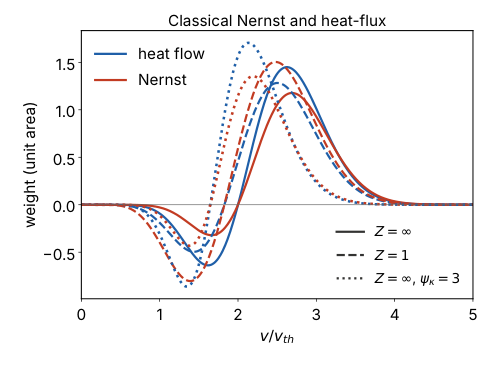

**图1，PDF第2页。** 横轴$v/v_{th}$，$v_{th}=\sqrt{2T_e/m_e}$；纵轴是单位积分面积归一化的每速率权重，不是电子总数或实际热流。蓝色热流、红色Nernst；实线Lorentz极限$Z=\infty$，虚线$Z=1$，点线为$Z=\infty,\psi_\kappa=3$。低速负瓣对应回流，正尾承载净输运。Lorentz未磁化峰值约为2.62与2.69倍热速，说明经典两过程载流群相近；这是形成旧类比的理由，尚不能证明二阶应力会对二者产生同样修正。

沿用前作的热流离域长度与Hall参数，本文使用

$$
\lambda_d=\lambda_{ei}\frac{Z}{\sqrt{Z+4.45}},\qquad
\psi_d=13.4\chi\frac{Z}{Z+4.45},\qquad
\lambda_{d\perp}=\frac{\lambda_d}{1+\psi_d^{1.6}}.
$$

这些是本文所用拟合约定；$\lambda_{ei}$与碰撞时间的具体定义须与同一系列保持一致，不能拿另一种平均自由程约定直接代数值。

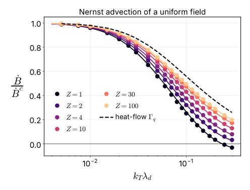

**图2，第2页。** 横轴$k_T\lambda_d$为对数，纵轴为磁场变化率相对经典值$\dot B/\dot B^c$，不是磁场强度比。均匀弱磁场、静止离子下，虚线是热流抑制函数$\Gamma_q$，点列按Z分组。低Z的总磁场响应比热流更受抑制，并可过零；单一热流离域参数未能合并不同Z。这里的负值先是线性模态响应符号变化，不能据此宣布实验磁场普遍逆温度梯度输运。

## 2. I A：截断在一阶分布时，Nernst确实像热流

球谐展开中，$f_0$含密度与各向同性能量，$\mathbf f_1$含粒子／热流，二阶张量$\underline{\underline f}_2$含各向异性与应力。直接截在$f_1$会漏掉高阶谐波反馈；“二阶自身不承载净通量”不意味着它不影响一阶通量。

在稳态、静止离子、零电流的Lorentz极限，式3–4为

$$
\mathbf v_N=\frac{\langle\mathbf v v^3\rangle}{2\langle v^3\rangle},\qquad
\langle\mathbf v v^3\rangle=\frac{4\pi}{3n_e}\int_0^\infty v^6\mathbf f_1(v)\,dv,
\qquad \langle v^3\rangle=\frac{4\pi}{n_e}\int_0^\infty v^5 f_0(v)\,dv.
$$

推导直觉是：电子冻结磁场的贡献按保持运动方向的时间加权，Lorentz碰撞时间随速度三次方增长，所以高能尾权重很大；对方向积分产生$4\pi/3$，分母作载流归一化。分子量纲为速度四次方、分母为速度三次方，结果为速度。系数1/2和具体权重依赖这里的近似，不能把此式当作任意Z、任意电流的一般定义。

一维几何由Faraday定律给出

$$
\partial_t B_z=-\partial_x E_y=-\partial_x(v_{N,x}B_z).
$$

因此本文实际读出的是保证零净电流的电场$E_y$，再求其空间导数；并非追踪磁力线的实验位移。

## 3. I B：二阶分布的两种剪切应力来源

高能电子从热区进入冷区而尚未散射各向同性化，会形成$T_{xx}\ne T_{yy}$。在弱场中还可形成$T_{xy}$：x向运动与y动量相关，即使所有空间梯度只沿x也能存在。

第一条路径是原本的$f_{1x}$被磁场部分旋转成$f_{1y}$，后者沿x变化再驱动$f_{2xy}$，称flux-driven shear。第二条路径是磁场直接旋转已有的法向各向异性$f_{2xx}-f_{2yy}$，称anisotropy-driven shear。前者与旋转后的热流结构相关，后者还取决于原始应力与磁场纹理的相对结构。

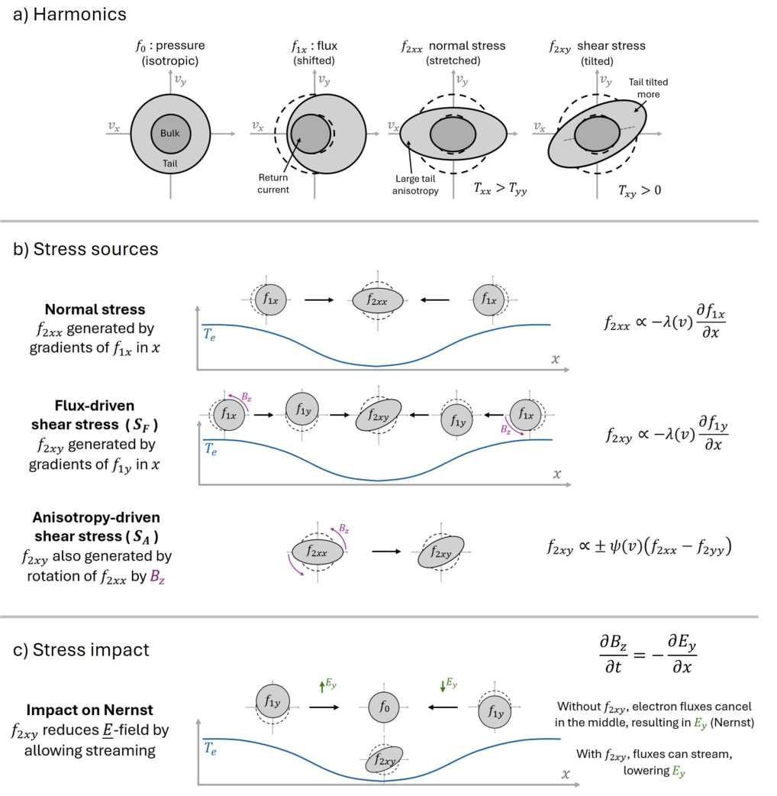

**图3，第5页。** 这是一组无定量刻度的速度空间与实空间示意；浅灰高能尾、深灰主体不能按面积读成粒子比例。(a)依次表示各向同性、偏流、法向拉伸和倾斜剪切；(b)两种剪切来源；(c)相向电子流在$f_1$处相消时，有$f_{2xy}$可继续穿流，所需$E_y$变小。图中flux-driven shear明确是$f_{1y}$沿x的梯度；原文式7后文字写“gradients of f1x in y”，与该图和一维设定不符，本笔记保留为原稿表述疑点，不将其另立为二维物理机制。

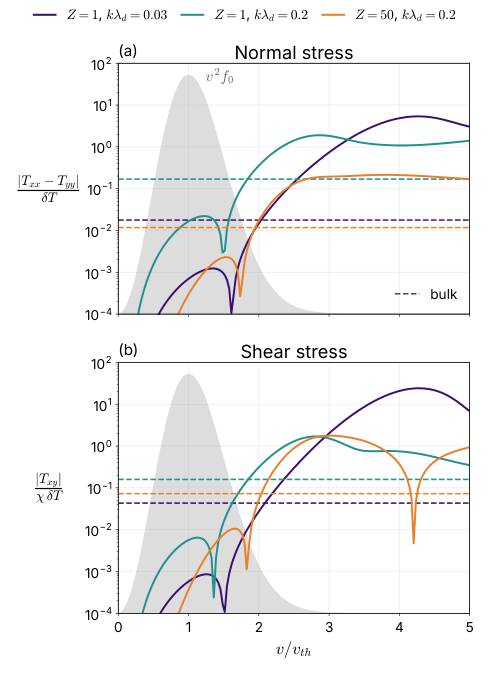

**图4，第6页。** 横轴$v/v_{th}$；(a)纵轴$|T_{xx}-T_{yy}|/\delta T$，(b)$|T_{xy}|/(\chi\delta T)$，均为对数，实线逐速率、虚线主体矩，灰色$v^2f_0$仅作电子分布参照。比较$Z=1,k\lambda_d=0.03/0.2$和$Z=50,k\lambda_d=0.2$。高于约两倍热速的尾部应力可远大于主体矩；不能因主体温度近各向同性就删除尾部应力。按绝对值绘图的谷点可能涉及符号变化，不代表相关速度处没有电子。

## 4. I C与表I：把纯Nernst、两种应力分开

原文式6把电场分成纯Nernst项与载电流电子所加权的$f_{2xy}$散度；后者再经Faraday定律改变磁场。其电流载流权重$\langle\cdot\rangle_w$依赖碰撞算子，本文没有给出可脱离同一系列定义的完整实现，本轮未独立重构这一权重。

对温度波数$k_T$与磁场波数$k_B$，相互作用模态为$k=k_T+k_B$。式7–9给

$$
\frac{E_y}{v_N^cB}=\Gamma_N(k_T)-S_F(k_T,k)-S_A(k_T,k),
$$

$$
\Gamma_N\simeq1-c_N(k_T\lambda_d)^2,\qquad
S_F\simeq F(k\lambda_d)^2,\qquad
S_A\simeq A(k_T\lambda_d)(k\lambda_d).
$$

$\Gamma_N$只描述纯Nernst抑制；$S_F$是通量驱动剪切，$S_A$是各向异性驱动剪切。$S_A$随带符号的波数乘积变号，不能把所有$S$都理解成恒正耗散率。在弱场、小波数极限，$Z=1$的$(c_N,F,A)=(231,90,138)$，$Z=100$为$(301,4.9,3.9)$。相应热流系数为224、248；低Z总差异主要来自两种应力，而非纯Nernst与热流本身的那一点差别。

从Fourier空间回到实空间，用$\partial_x^2\leftrightarrow-k^2$即可理解式10的正号导数如何产生抑制：

$$
\partial_tB_z=-\partial_x\!\left[
 B_z\!\left(v_N^c+\lambda_d^2c_N\partial_x^2v_N^c\right)
 +\lambda_d^2F\partial_x^2(v_N^cB_z)
 +\lambda_d^2A\partial_x\!\left(B_z\partial_xv_N^c\right)
\right].
$$

第一修正由温度结构决定；第二项平滑整个Nernst通量；第三项混合温度与磁场结构。原文要求弱非局域$k\lambda_d\lesssim0.05$、均匀背景和弱场。把该有限阶梯度展开直接用于更短波长会产生不受控外推，应改用后文滤波闭合。

表I把这些过程的驱动、波数、短波修正、磁化参数与载流峰速并列；应力约由3.3倍热速电子承担，高于纯Nernst约2.69倍和热流约2.62倍。表内系数是在各过程自身的经典基准下定义，不能把“某应力绝对值小”直接等同于“相对纯Nernst不重要”。

## 5. II：VFP数据库、因果分项与收敛范围

温度与磁场各含一个Fourier扰动，式11为

$$
T=T_0+\delta T\cos k_Tx,\qquad B=B_0+\delta B\cos k_Bx.
$$

背景Maxwell分布和密度均匀，温度线性于$\delta T$、磁扰动只保留一阶；通常保留至$f_6$，含完整电子—电子碰撞算子。高阶谐波准静态，而温度模态取最慢衰减本征模，**不是加热强行保持的稳态温度模**。电场由零电流条件直接求出。

有磁场空间结构时Ampère定律本应给非零电流；作者人为设置$J=0$，等于剔除电阻扩散和电阻率—温度耦合／Ohmic加热，认为热而稀薄目标区这些项小。这是模型适用假设，不能把数据库称为完整自洽电磁VFP或包含所有HED感应项的验证。

每个数据点解三次：全旋转；只让磁场旋转$f_1$且不传到$f_2$得到纯Nernst；只旋转$f_1$但允许其驱动$f_2$以保留$S_F$、去掉$S_A$。差值给分项。这是作者在同一求解器中的机制控制实验，不是三套独立数值代码的交叉验证。

弱场8736点覆盖14个Z、24个$k_T\lambda_d=0.002$至0.4、26个$k_B/k_T=-8$至12；磁化集合增至约15万点，另补细磁场纹理，总计含分辨率检查约22万解。$f_{10}$抽样相对$f_6$在$|k|\lambda_d\le0.5$使归一化电场最多变0.010，纯Nernst不变。速度网格256／512／768验证一阶误差，弱场用$2X_{512}-X_{256}$外推，最大改0.006；磁化集合用子网格改正插值。本轮只核原文陈述，没有重新验证全数据库和插值误差。

## 6. III A：均匀弱场中，低Z主要多出应力修正

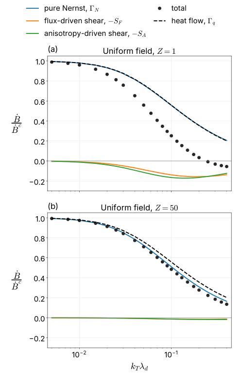

**图5，第7页。** 横轴$k_T\lambda_d$对数，纵轴$\dot B/\dot B^c$；蓝纯Nernst、橙$-S_F$、绿$-S_A$、黑点总值、虚线热流。(a)$Z=1$时纯Nernst与热流相差小于0.01，但应力使总响应在$k_T\lambda_d>0.24$过零；(b)$Z=50$时两种应力相对经典Nernst小很多。原因是经典Nernst系数由$Z=1$约0.88升到Lorentz约9.84，而不是“高Z没有应力”。图的不同分项不能直接当作全局磁能增减。

## 7. III B：弱磁场也有独立的结构非局域尺度

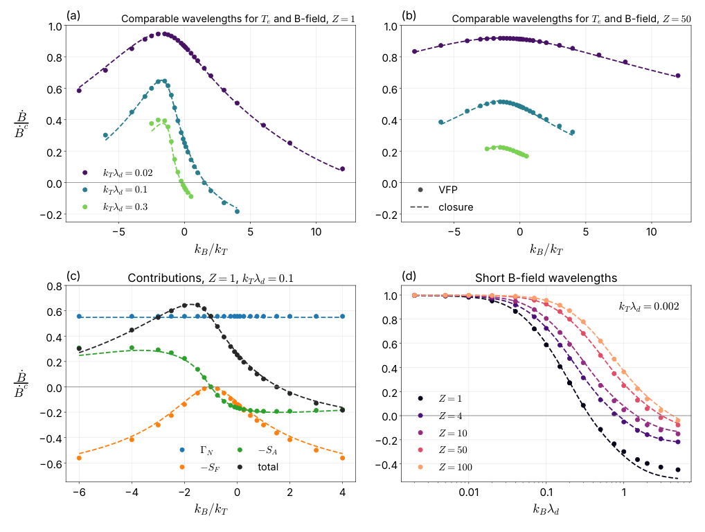

**图6，第8页。** (a,b,c)横轴带符号$k_B/k_T$，(d)横轴$k_B\lambda_d$对数；纵轴均相对经典磁场变化率。(a)$Z=1$、(b)$Z=50$展示不同温度非局域度；点为VFP、虚线拟合闭合，不能算独立真值。(c)$Z=1,k_T\lambda_d=0.1$分项：纯Nernst不随磁场波数变，$-S_F$恒降，$-S_A$在$k_B/k_T=-1$两侧换号。这里是模态波数混频关系，正负波数不能任意替换成两个温度／磁场峰的简单几何位置关系。

(d)固定$k_T\lambda_d=0.002$，热流抑制小于1%，但细磁场结构仍让Nernst大幅下降；$Z=1$约在$k_B\lambda_d=0.12$减半，$Z=100$约0.69。电子尚未碰撞就被磁场波纹往复转向，局域模型的单向偏转图像失效。这是需要独立磁场结构Knudsen数的直接依据，不能只看$\chi\ll1$或温度梯度缓就宣称输运全局经典。

## 8. IV：磁化重新局域化，但不同项速率不完全相同

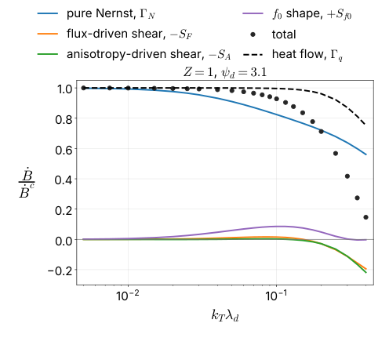

**图7，第9页。** 与图5(a)同类归一化，$Z=1,\psi_d=3.1$。在$k_T\lambda_d=0.1$热流接近局域$\Gamma_q=0.996$，纯Nernst仍抑制18%；紫色$S_{f0}$使总值部分高于纯Nernst，是磁场对各向同性尾部形状的非均匀重填，不能归为两种剪切应力的“反增强”。大非局域度时应力再出现。

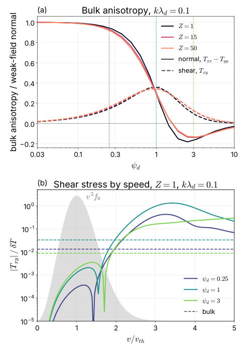

**图8，第10页。** (a)横轴$\psi_d$对数，纵轴主体各向异性除以各自弱场法向值，实线法向、虚线剪切；$k\lambda_d=0.1$，不同Z近似重合。法向在旋转超过约45°后变号，剪切在$\psi_d\sim1$达峰再降。(b)横轴$v/v_{th}$，纵轴$|T_{xy}|/\delta T$对数，$Z=1$，实线逐速率、虚线主体。应力仍由高于约两倍热速承担。这里(a)有符号、(b)绝对值，不能把两种纵轴混读。

均匀场经验闭合使用

$$
P(K)=\frac{1+27.29K}{1+27.29K+294.5K^2},\qquad
R_U(k_T)=1-S_N[1-P(k_T\lambda_N)],
$$

$$
\lambda_N=1.15\frac{Z+0.67}{Z+0.30}\lambda_d,\qquad
S_N=1.03\frac{Z+6.32}{Z+4.81}.
$$

原文式12–13中的$R_U=E_y/(v_N^cB)$在$k_T\lambda_d\le0.3$为0.009 RMS拟合误差。纯Nernst近似$P(1.10k_T\lambda_d)$；定义$S_U=\Gamma_N-R_U$，式14再分别以$1+(0.78\psi_d)^{1.6}$和$1+\psi_d^{1.6}$缩小两个参数，表示纯Nernst重新局域化慢于应力。误差约0.03 RMS、$Z=1$约0.06，部分来自未显式保留的$S_{f0}$。这些是作者数据库内拟合误差，不是实验误差或任意非线性流体代码误差。

## 9. V：Nernst与Righi–Leduc也共享一次磁旋转

Righi–Leduc是垂直温度梯度与磁场的横向热流，来自$f_{1x}$被旋转为$f_{1y}$；Nernst则来自取消这一旋转电流所需的$E_y$。单载流近似给式15–16：

$$
\kappa_\wedge^c\approx\psi_\kappa\kappa_\perp^c,\qquad
\gamma_\perp^c\sim\frac{\kappa_\wedge^c}{\psi_\kappa}\approx\kappa_\perp^c.
$$

推导直觉是弱场下横向偏转约正比Hall参数，因而横向热流约为纵向热流乘偏转；再除去偏转量可看出Nernst与热流同源。它只是解释性近似，原文给弱场误差12–28%，不是精确系数恒等式。双载流图像还要区分高能热流与低能回流的能量差、旋转差，因此不能据此抹掉载流峰速和磁化速率差异。

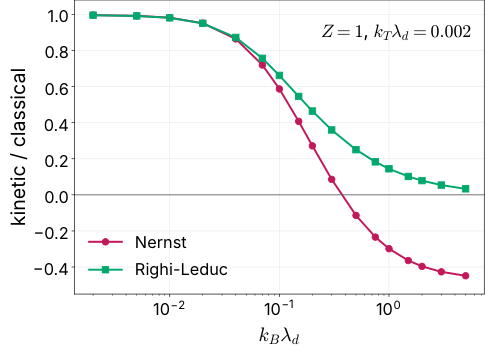

**图9，第11页。** 横轴$k_B\lambda_d$对数，纵轴动理学／经典响应；$Z=1,k_T\lambda_d=0.002$。两条曲线均明显下降，Righi–Leduc在$k_B\lambda_d=1$降低超过80%，但保持正号，Nernst可负。不能把Nernst的反号结论转给Righi–Leduc。磁化ICF热点的应用仍需多维自生场／热流耦合，原文这里只给应重新评价旧估计的动机。

cross-gradient Nernst来自二次旋转后的电流抵消；原文指出其载流电子略快。本文未对其给出同等完整的磁场结构修正数据库，不能由前两条曲线自动生成该项闭合。

## 10. VI：非线性热前沿验证的是瞬时磁场变化率

氢等离子体$Z=1$、离子固定；初始温度由1降到0.5 keV，tanh宽度$16\lambda_d$，热端$\lambda_{ei}=21.9\,\mu m$、$\tau_{ei}=1.17\,ps$。外加磁场为背景叠高斯层，高斯宽度$4\lambda_d$、中心在温降方向$9.6\lambda_d$，热端$\chi=0.03$。空间2.4 mm／800格，速度192格至$6v_{th}$。

**关键边界是磁场被外加且保持静态**。作者让电子分布／温度前沿响应后，在$t=10.8\,ps$用$-\partial_xE_y$评价若允许演化时的磁场变化率；并在同一VFP温度剖面上计算流体闭合，滤波长度用磁场峰位置温度。这不是磁场自洽自由演化到晚时的磁通保持比较，也不是独立温度真值上的盲预测。

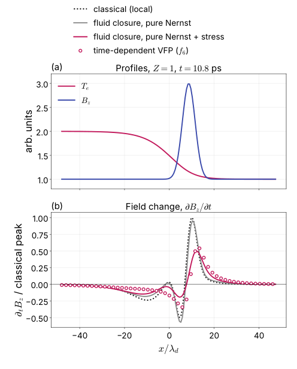

**图10，第11页。** 横轴$x/\lambda_d$；(a)温度／磁场仅任意单位归一化，不能由图读出绝对磁场T；(b)纵轴$\partial_tB_z$除以经典峰值，有正负瓣。灰线纯Nernst闭合几乎与经典点线重合，加应力红线与时间依赖VFP红圈接近，峰值变化约下降50%。这个“50%”是此算例的场变化率幅度口径，非实验磁场强度增益、总磁通保持率或ICF产额提升。

## 11. VII：新的磁场结构Knudsen数及适用边界

结论式17定义

$$
Kn_B=14.8\frac{Z+0.40}{Z+4.86}\frac{\lambda_{ei}}{L_B}.
$$

$L_B$为磁场结构长度；正弦波纹用$L_B=1/k_B$，不是完整波长$2\pi/k_B$。定义前因子使$Kn_B=1$约对应应力导致Nernst减半。它是由数据库塌缩与半抑制点确定的经验尺度，不是从量纲分析唯一推导出的普适常数。

推导量级：电子在相邻碰撞间走过$\lambda_{ei}$，若$\lambda_{ei}/L_B$不小，沿途磁偏转不再局部；Z相关因子吸收载流群／碰撞差异，再乘14.8归一到半抑制点。代$Z=1$得$L_B\approx3.54\lambda_{ei}$，$Z=100$得约$14.17\lambda_{ei}$，与文中给出的约3.5／14一致。这只是定义的内部一致性，不是本轮重跑VFP。

此指标要求**弱场且温度非局域$Kn_d\ll1$**。若背景上叠小幅细波纹，$|B|/|\nabla|B||$会受背景幅度影响而漏掉波纹长度，不能直接替代$L_B$。作者预期低Z磁化HED退磁更慢，并提出可能解释实验拟合常用的任意Nernst乘子，但并未完成实验辨识或证明某个0.1乘子的唯一来源。

## 12. 附录A：主体应力拟合不是Nernst闭合的替代品

法向／剪切主体各向异性都写成小波数$(k\lambda_{ei})^2$律乘三个Helmholtz滤波器的加权和：

$$
\frac{T_{xx}-T_{yy}}{\delta T}=-a(Z)(k\lambda_{ei})^2\sum_{j=1}^3\frac{w_j}{1+(s_jk\lambda_d)^2},
$$

$$
\frac{T_{xy}}{\chi\delta T}=-a_S(Z)(k\lambda_{ei})^2\sum_{j=1}^3\frac{w_j^S}{1+(s_j^Sk\lambda_d)^2}.
$$

法向振幅为$a=(10395/144)(Z^2+0.0363Z)/(Z^2+7.432Z+8.211)$，剪切振幅$a_S=1123(Z^2-0.343Z)/(Z^2+11.99Z+43.68)$；$w,s$由A3/A6给出。低k时滤波器趋1恢复二次梯度律，高k时限制无限增长，物理上体现尾部离域。原文强调这些主体矩拟合**不用于本文磁场输运闭合**，后者由载电流／非局域尾部应力决定；不能把主体压力各向异性直接代回式6。

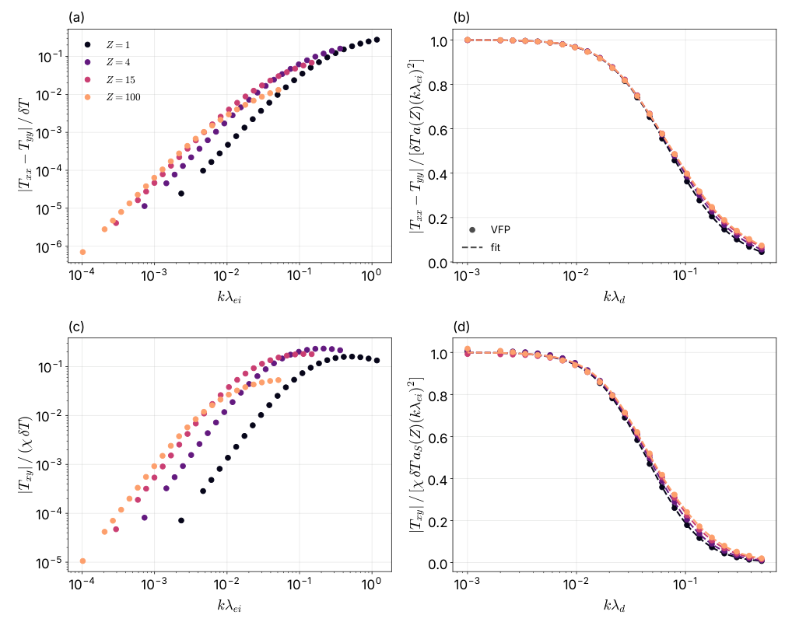

**图11，第14页。** (a,c)横轴$k\lambda_{ei}$，纵轴分别$|T_{xx}-T_{yy}|/\delta T$、$|T_{xy}|/(\chi\delta T)$；(b,d)横轴$k\lambda_d$，纵轴再除$a(Z)(k\lambda_{ei})^2$或$a_S(Z)(k\lambda_{ei})^2$。点为VFP，虚线拟合；重新缩放后不同Z趋同。法向在$Z=1$至100、$k\lambda_d\le0.5$内最大约1.3%、0.33% RMS；剪切约1.9%／3.3%、1% RMS。此为同数据库拟合误差，未含实验系统误差。

## 13. 附录B：衰减模态与保持稳态的温度模态有差别

最慢衰减温度本征模配准静态高阶谐波，与外部加热保持温度不变的“stationary”定义不同。原文给弱场归一化电场两定义差0.012 RMS、最大0.06；它们不能因都称线性响应就混用。

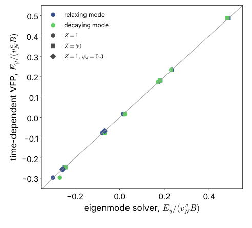

**图12，第15页。** 横轴为本征模求解器$E_y/(v_N^cB)$，纵轴为时间依赖VFP同一归一量；斜线为一致关系，颜色区分relaxing／decaying标记、点形区分Z及$\psi_d=0.3$。包括负响应点的接近一致支持准静态本征模处理；正文称$Z=1/50$在经典值尺度内差不超过0.6%。图是少数控制点，不代表22万点逐一通过时间演化对照。

## 14. 附录C：结构磁场闭合为何需要非局域滤波

附录把$k=k_T+k_B$、$H(x)=1/(1+x^2)$代入三个加权滤波和，分别构造$\Gamma_N,S_F,S_A$。$\Gamma_N$只滤温度；$S_F$同时滤$k_T$和组合波数$k$，前因子为$F(k\lambda_{ei})^2$；$S_A$前因子为$A(k_T\lambda_{ei})(k\lambda_{ei})$，另有混合滤波因子，保留符号和结构相位关系。实空间的Helmholtz滤波来自求解$(1-\ell^2\partial_x^2)u=f$，因为Fourier变换后的乘子恰是$H(\ell k)$。这解释为什么它是跨邻域平滑，而不是每格乘局部常数。

表II给三种长度27.05／8.896／2.114及每过程权重、$r_F=0.6509,r_A=0.8388,g=0.887$；实现还须完整保留Z相关长度、F/A系数和混合项，不能只摘上述三个常数。原文在$|k|\lambda_d\le0.5$给0.006 RMS，$\Gamma_N$滤波版本与简单P函数在$k_T\lambda_d\le0.3$差不超0.02。推导及推广留待后续工作；有限域边界条件、非均匀系数、强场与多维耦合尚未在本文完整解决。

## 15. 接续判断与复习速记

对HEDP计算最有用的检查是同时比较温度与磁场纹理长度，核实求解器是否保留能影响$f_1$的$f_2$应力，而不是把同一热流限幅器无条件给Nernst。接续应固定作者数据库／碰撞时间定义／滤波实现及边界，先复现同模态、同零电流近似，再加入自洽电流、移动离子、B场反馈和多维结构，以实验诊断响应区分应力与其他Nernst修正来源。

**速记**：纯Nernst仍大体跟随热流，但总磁场输运还受到高能尾剪切应力与独立磁场纹理尺度控制。本文的“减半”是特定弱场尺度或静态外加场算例中的响应，不是已实测的ICF磁化增益。
