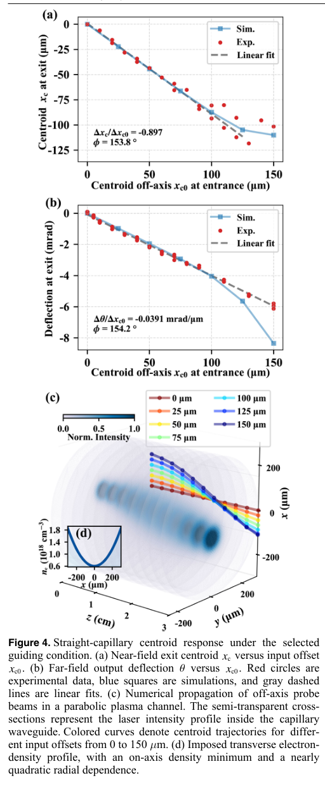
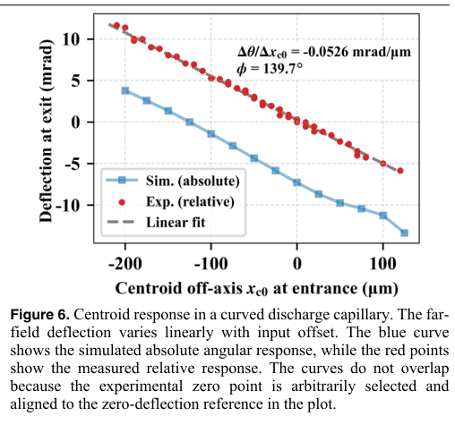

# 近场位置加远场角度：直／弯放电波导的质心振荡诊断

## 0. 文献、版本与阅读范围

- **原题**：Near- and far-field centroid-oscillation diagnostics of straight and curved discharge plasma waveguides。
- **作者**：Laifu Man（满来福）、Yiting Yan（严怡婷，共同第一作者）等18人；通讯作者Chen Lin（林晨），北京大学／北京激光加速创新中心等。
- *Plasma Science and Technology* **28** (2026) 124004，[DOI](https://doi.org/10.1088/2058-6272/aea103)，实际阅读[期刊官方8页最终PDF](../pdfs/man-2026-waveguide.pdf)。PDF首页写2026-09-01接收、11-27发表，与当前IOP在线日／Crossref一致；合作期刊网页旧接收日期与9月早期上线元数据不同，按最终PDF记录，不能将11-27误当首次公开或接收日。
- IOP PDF入口200但为订阅HTML；合作期刊HTTPS证书主机名不匹配，未禁用证书核验。其正常HTTP文章页给出官方`citation_pdf_url`。首次30 s、直连45 s均只得到部分PDF，断点续传报不支持Range；之后一次完整直连传输成功，6,810,430字节与Content-Length一致，才进行PDF核验和入库。部分文件从未当作有效全文。
- 8页正文与式1–9已读，参考仅核结构；8源页总览，关键图另放大。本轮未重跑COMSOL、放电流体模型、反演拟合或实验。MinerU零请求，历史401未复测；采用本地布局提取和源页目视。

## 1. 测了什么，尚未测什么

这是CLAPA-I平台的**弱探针光学实验＋解析反演＋作者三维COMSOL电磁传播对照**。探针800 nm、约35 fs、0.8 μJ；光阑使焦斑近Airy主瓣，分析用w₀≈36 μm的高斯参考。它验证所选放电状态的导光与诊断，不是高强度LWFA电子束、分级加速增益或束流发射度实测。

直管与弯管均长30 mm、内半径300 μm；弯管曲率半径1.25 m。He充气60–300 Torr，主要离轴扫描用60 Torr／15 kV。60 Torr考虑压降后估计中性He为8.75×10¹⁷ cm⁻³，完全电离平均电子密度可为其2倍；这些是初始密度尺度，不能替代径向密度凹陷Δneff。

近场放大率约39.1，测出口强度质心；远场f=150 mm傅里叶成像，以θ=ΔXCCD/f转角度。两个分支是**相同设定下不同发次切换测量**，并非同发完整相空间成像。近场成像不确定度约10 μm、远场约0.15 mrad、入射偏置定位<3 μm；重复测量出口位置RMS<2.7 μm、角RMS<0.25 mrad，是不同统计口径。

## 2. 反演公式与近远场互补性

近轴抛物密度ne(r)=n₀+Δnch r²/rch²、弱探针线性导光下，匹配半径满足

$$
\frac{\Delta n_{ch}}{r_{ch}^2}=\frac{1}{\pi r_e w_m^4},\qquad
x_c''+k_\beta^2x_c=0,\qquad k_\beta=\frac{\lambda_0}{\pi w_m^2}.
$$

平行离轴注入给x(0)=x₀、x′(0)≈0，所以x(z)=x₀ cos(kβz)，θ(z)=−kβx₀ sin(kβz)。定义φ=kβLeff，拟合斜率

$$
A=\frac{\Delta x_{out}}{\Delta x_0}=\cos\phi,\qquad
B=\frac{\Delta\theta}{\Delta x_0}=-\frac{\phi}{L_{eff}}\sin\phi.
$$

先由近场A约束相位投影，再由远场偏转方向／B和已选导光窗口、长度约束分支。单一cos并不能分辨±φ+2πn；双投影减少歧义，但本工作并未证明在任意未知长度、初始角、传播周数下存在全局唯一解。

**图1，PDF第3页**给质心轨迹、(x,θ)相平面与两成像分支，图像坐标μm或mrad、强度独立归一化。它说明位置和角是同一质心运动的不同投影；空管衍射与等离子体导光图不是相同物理分布。

**图2，PDF第4页**是装置光路／时序，无定量能量色标，明确近／远场切换、激光与放电同步（时序精度优于25 ns）。

## 3. 直管的结果与原文待澄清点

**图3，PDF第5页**：上为不同延迟的出口图，x、y以μm标注，各强度图归一化；下横轴延迟μs，左为归一化峰强度a.u.，右为电流A。约0.9 μs有紧凑亮斑与峰强度最大，不等于透射能量效率最大。

**同页原文存在时序差异**：§3.1／§3.4说选约0.9 μs，§3.2却写用于质心扫描的固定延迟0.75±0.05 μs。实际页面已核对，两者不在同一标称范围内，本笔记不将其默默合并；要做严格复现需作者说明不同扫描／时零／数据子集。

**图4，PDF第6页**：(a)横入射偏置x₀、纵出口质心x，均μm；(b)同横轴、纵偏转角mrad；红实验、蓝COMSOL、灰拟合。(c)三维传播z轴cm、横向μm，截面显示归一化光强；(d)是输入的抛物ne，单位10¹⁸ cm⁻³。大偏置逐渐偏离直线，说明近轴抛物模型的范围有限。

| 直管反演量 | 作者结果与口径 |
|---|---|
| A | −0.897±0.028，近场结合偏转方向给φ=153.8°±3.6° |
| B | −0.0391±0.0007 mrad/μm，以Leff=30 mm先估，得φ=154.2°±0.6°；此步不含全部系统误差 |
| 匹配半径 | wm=53.3±1.5 μm |
| 有效径向凹陷 | Δneff=(1.25±0.07)×10¹⁸ cm⁻³，非n₀或初始中性密度 |
| 联合长度一致性 | Leff≈30.3⁺²·⁹₋₃·⁶ mm，约11%相对不确定度，不是独立精密长度测量 |

用两个投影共同估计Leff时，近场接近转折点使误差放大。由约154°和30 mm代回kβ、wm可核对量级，但不能将给定误差条当作完整联合后验。特别是Δn∝wm⁻⁴，各数值误差是否包含同一组长度／半径／拟合协方差，正文没有完整说明。

COMSOL使用**反演得到的**Δnch=1.25×10¹⁸ cm⁻³、由平均密度估计n₀=1.13×10¹⁸ cm⁻³，扫描25–100 μm响应近线性、更大偏置有边缘效应。它检验传播与该抛物通道相容，不是独立密度真值；没有自洽计算放电流体形成或相对论尾场。

## 4. 弯管：相对光学参考，不是已标定的绝对轴

**图5，PDF第7页**为弯管几何和对应近／远场图，空间坐标μm、角分布mrad、归一化强度。作者用入射切线、空管衍射参考和导光质心定义可重复零点；机械中心线不自动等于最小质心振荡轨迹。

**图6，PDF第7页**：横为相对入射偏置μm、纵为偏转mrad。蓝线模拟绝对角响应，红点实验相对角响应；两者零点定义不同，图注明确不会重合，不能从平移量直接声称测得绝对轴误差。拟合φ=139.7°±1.5°，wm=56.0±0.3 μm、Δneff=(1.03±0.09)×10¹⁸ cm⁻³。

曲率引入的理想外移估计

$$
x_{eq}\simeq-\frac{\pi^2w_m^4}{\lambda_0^2\rho_{ch}}=-\frac{1}{k_\beta^2\rho_{ch}}
$$

正方向取向弯曲中心，外移为负。代wm≈56 μm给约−121 μm，符合作者“100 μm量级”；这只是式9印刷参数的算术，不是绝对零点实测。实际轴、纵向密度坡和几何校准仍未闭合。

## 5. 接续与适用范围

可复用的诊断思想是先定义观测算子和参考零点，以出口位置与角度共同约束通道；同时记录Leff、入射角和偏置范围。对分级LPA，需补同发联合观测、原始图像与像素标定、重复次数和shot选择、0.9／0.75 μs时序澄清、长度与密度协方差、弯管绝对参考及独立干涉／放电模型。

从弱探针推广到高强度驱动时还需自聚焦、尾场、束载、实际电子束指向／发射度验证。本轮没有新增GeV束流、分级加速或应用端性能验收。已有库中“Damping dynamics of the centroid oscillation of a relativistic laser pulse in a plasma channel”是另一篇相对论传播作品；本篇低能探针实验作为独立作品入库，不作该条的版本替换。
