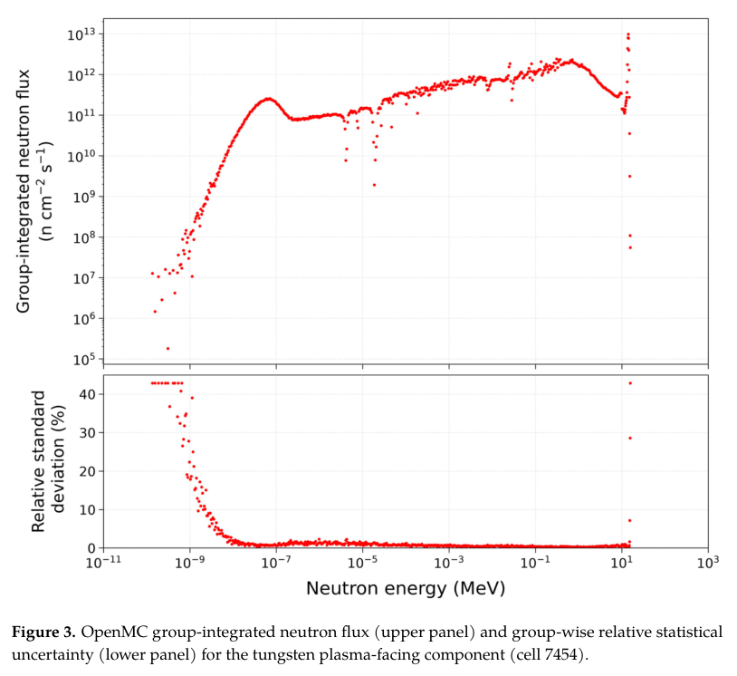
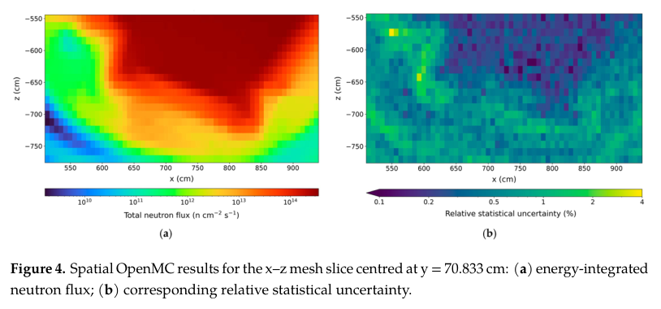
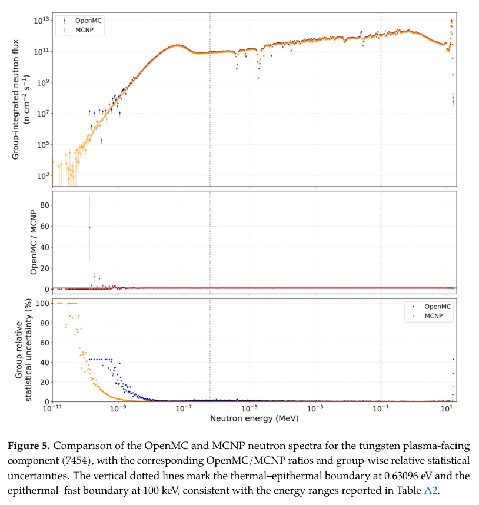

# DEMO偏滤器中子谱的OpenMC–MCNP对比：先对齐归一化，再评估谱差

## 0. 来源、版本和核验范围

- **原题**：OpenMC Modelling of Neutron Spectra in the EU DEMO HCPB Divertor and Comparison with Reference MCNP Results。
- **作者**：Ieva Skališiūtė、Simona Breidokaitė、Gediminas Stankūnas，Lithuanian Energy Institute。
- *Applied Sciences* **16**(23),11775，2026-11-21接收、11-27发表，[DOI／正式页面](https://www.mdpi.com/2076-3417/16/23/11775)。实际阅读[出版社16页最终版](../pdfs/openmc-2026-divertor.pdf)，主站HTTP403后从官方`mdpi-res.com`静态PDF恢复。
- 正文、式1–10、Tables1–3与附录A/B的A1–A3已读；参考文献只核结构。16源页总览，图3–5单独放大，关键单位与数字对照页面。外置补充S1–S18的阅读状态另见末节，不将正文概述当逐图独立核验。
- 签名、MIME、SHA、pdfinfo／pypdf／PyMuPDF页数与逐页文本检查通过。本轮MinerU零请求，历史401未复测，本地提取／渲染回退；没有运行OpenMC、MCNP、几何转换、核库处理或原始tally后处理。

## 1. 问题与实验／模拟边界

这是**作者固定源Monte Carlo的跨代码对比**，参考MCNP也是计算结果。对象是EU DEMO HCPB包层配置下的偏滤器，源为D–T聚变中子；不属于激光转换靶测量，也没有新增中子产额或辐射防护实验。它对本项目的价值是中子谱、体积、源权重和统计量的可追溯比较方法。

模型从MCNP的构造实体几何转为OpenMC XML，用`openmc_mcnp_adapter`，版本OpenMC0.16.0。11.25°扇区占全环1/32。比较十个cell，涉及W、W–CuCrZr–H₂O均匀混合层、Ti合金、INCONEL、EUROFER及水；体积沿用参考MCNP。

**图1，PDF第5页**是标号1–10的MCNP几何图及L&Rp／wishbone局部视图，没有定量坐标或通量色标，作用是映射Table1的cell身份。水管7090体积仅0.662744 cm³，大水冷通道8484为41200.400 cm³；不能把体积平均通量相近解释为两者总中子数相近。

**图2，PDF第6页**给EU DEMO2017源截面，横R、纵Z，单位cm，等值线为磁通几何／源形状示意，并非输运中子通量。R₀=8.938 m、a=2.883 m、κ=1.650、δ=0.330。OpenMC出生能量为均值14.1 MeV、σ=0.294713 MeV高斯分布。

| 设置 | OpenMC | 参考MCNP |
|---|---|---|
| 历史数 | 50批×2×10⁶=10⁸ | 10¹⁰ |
| 源表示 | openmc-plasma-source，离散空间源／上述高斯能谱 | 用户SOURCE子程序，名义14.1 MeV、温度参数15.4 keV，另有径向峰化参数1.508 |
| 核库 | 主要FENDL-3.2b；缺失As、Cd、O、Sr、Ta等用ENDF/B-VIII.0 | FENDL-3.2与ENDF/B-VII.1 |
| 能群 | 谱tally用CCFE-709原始群，无平滑 | 同能群比较 |
| 方差缩减 | MAGIC权窗，68×4×104=28288空间bin，四能组0／100 eV／100 keV／1 MeV／20 MeV | 本文参考既有计算，非本轮重跑 |

四组权窗是方差缩减网格，不是709群谱，也不是附录的三段能区。源、核库、历史数和几何转换都存在差异；本文没有消融量化各项贡献。

## 2. 源归一化与统计量

TO,i是每源历史的加权轨迹长度，未除cell体积V；S=7.093538×10²⁰ n/s为全装置源强，OpenMC的物理群积分通量为

$$
\Phi_{O,i}=\frac{S}{32V}T_{O,i}\quad[\mathrm{n\,cm^{-2}\,s^{-1}}].
$$

MCNP初始源粒子权重已含0.03125，F4的SD4体积除数设为1，故其相应原始tally应按S/V归一。若导出数字已含FM源强，就只能再除V，不能重复乘S或再除32。作者例子7090的OpenMC原始总tally1.940430×10⁻⁶ cm/源，给6.490305×10¹³ n/(cm² s)；其标准误4.308280×10⁻⁸同乘系数得到1.441023×10¹²。这个算术与A3舍入值相符；它不代替源实现和原始statepoint核验。

群统计量的通量加权相对不确定度

$$
R_{fw}=\frac{\sum_i\Phi_i u_i}{\sum_i\Phi_i}
$$

只对正通量且u有限的群求和，分别对两代码计算。它是描述群谱质量的加权平均，**不是总通量的相对标准误**。总通量及误差来自另一个无能量过滤器的cell tally，不能将群误差无协方差地相加来替代。

谱差定义

$$
D_{fw}=100\%\frac{\sum_i|\Phi_{O,i}-\Phi_{M,i}|}{\sum_i\Phi_{M,i}},\qquad
R_{int}=\frac{\Phi_{O,tot}}{\Phi_{M,tot}}.
$$

D以MCNP归一、非对称、不按统计不确定度加权，并不只是谱形距离。式10对群比值采用两代码独立的一阶误差传播。正文方法给完整709群定义，结果Table3则对正MCNP群且O/M≤20的共同保留集重算；不能将两口径无说明合并。

## 3. 能谱、空间图与代码比较

**图3，PDF第9页**：横轴中子能量MeV、对数；上纵轴每能群积分通量n/(cm² s)，下为群相对标准差%。没有除ΔE，也没有除ΔlnE，所以不同群宽会改变曲线外观；不能当dΦ/dE或每单位lethargy谱。快区包含D–T源，低能区含散射／慢化贡献；极低通量能群误差明显增大。

**图4，PDF第10页**：x–z截面坐标cm，固定y=70.833 cm。左为能量积分体素平均通量，色标n/(cm² s)、对数；右为相对统计误差%，自身色标。原3D网格60×30×20，体素约7.167×8.333×11.600 cm³，截面1200体素均正通量。作者给范围1.68×10⁹–3.52×10¹⁴ n/(cm² s)，误差中位0.503%、最大3.872%。这描述该粗网格截面的精度，不代表0.66 cm³小水管的709群谱也有同样误差。

**图5，PDF第12页**：横轴MeV；上为W层7454两代码群积分通量及1标准误，中为O/M、下为各自群误差%。竖线0.63096 eV与100 keV把热／超热／快区分开，来源于已有CCFE群边界。中图极低能处的大比值应结合下图的大误差与极小通量，不能用单个比值判断整体模型失效。文中±10%仅视觉参照。

Table2中九区OpenMC的中位与通量加权群误差<10%；7090却为24.038%、22.934%，算术平均26.103%。Ti区7990算术平均12.737%，但加权6.424%，表明各统计量关注不同能群。

| cell／材料 | Table3筛选谱差D，% | 筛选O/M总比 | 解释 |
|---|---:|---:|---|
| 7454／W | 10.51 | 1.11 | 差异主要伴随整体幅度偏高 |
| 7990／Ti | 17.65 | 1.11 | 九个非小水管区域中谱差最大 |
| 7090／小水管 | 58.16 | 1.10 | 总量接近不代表能量分布接近 |
| 8484／大水冷通道 | 8.36 | 1.07 | 不能推广为所有水区均好 |

十区筛选后未舍入积分比1.0742–1.1310，即OpenMC高7.42–13.10%；九区谱差8.36–17.65%，小水管58.16%。按cell顺序7454、7810、7990、8009、8005、8006、7108、8070、7090、8484，O/M>20排除群数为1、1、0、3、0、0、0、2、0、19。作者称它们占各区OpenMC谱通量≤0.0011%，对总谱差影响小，但本轮没有原始谱独立重算这一比例。

## 4. 附录核对与容易误读的结论

A1给参考MCNP群误差，如7090加权7.795%；不能把参考谱视作无误差真值。A2不作20倍截断，按10⁻⁵–0.63096 eV、0.63096–10⁵ eV、10⁵–10⁹ eV三段汇总。10⁹ eV是tally结构上界，并非源真实含1 GeV中子。7090热／超热／快谱差65.590／65.685／44.974%，说明偏差存在于多个能区。

A3是直接无能量过滤器总tally，完全不作20倍筛选；7090的O/M为6.49×10¹³／5.87×10¹³，OpenMC标准误1.44×10¹²，即约2.2%。这个2.2%与22.934%的群加权误差各自成立，不能择一来否定另一个。A3大水通道8484的3.29×10¹²／3.06×10¹²同样不能拿来重建未舍入Table3的所有位数。

相同源强／体积归一化、群积分定义与保留能群集合先对齐，再讨论核库／源差。谱差8–18%不是工程验收容差，跨代码对比也不是对实验的验证；当前尚未计算反应率、dpa、活化或剂量的响应积分及其核数据不确定度。

## 5. 外置补充与接续

正文声明另有S1–S9九区OpenMC谱和S10–S18九区双代码对比，入口[官方补充页](https://www.mdpi.com/article/10.3390/app162311775/s1)。本笔记明确区分已读的内置附录A/B和外置补充；本轮该入口HTTP403、413字节HTML，未取得外置文件，S1–S18未读；不影响对已取得主文及内置附录阅读范围的说明。

下一步应获得固定版本的两代码输入、源抽样、材料／温度／S(α,β)、核库及statepoint／参考tally；在同核库同源同体积下做受控差异分解，增加7090的能群采样，报告未筛选谱与响应加权反应率。用于激光光中子或材料活化时，还必须换成真实源的联合能角分布和时空归一化，不能直接沿用DEMO的D–T谱与S。
