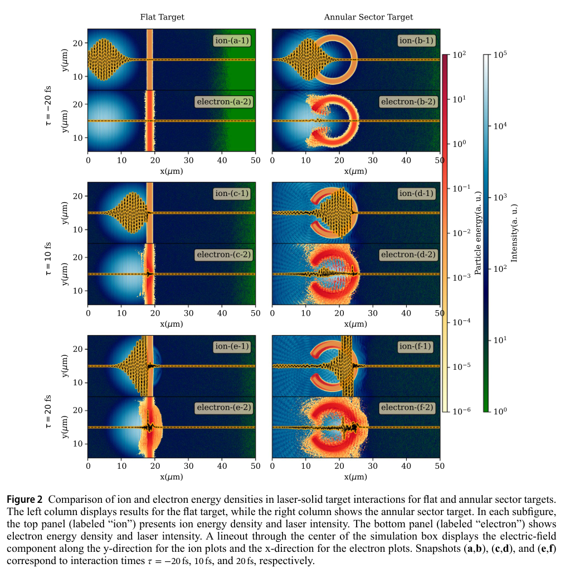
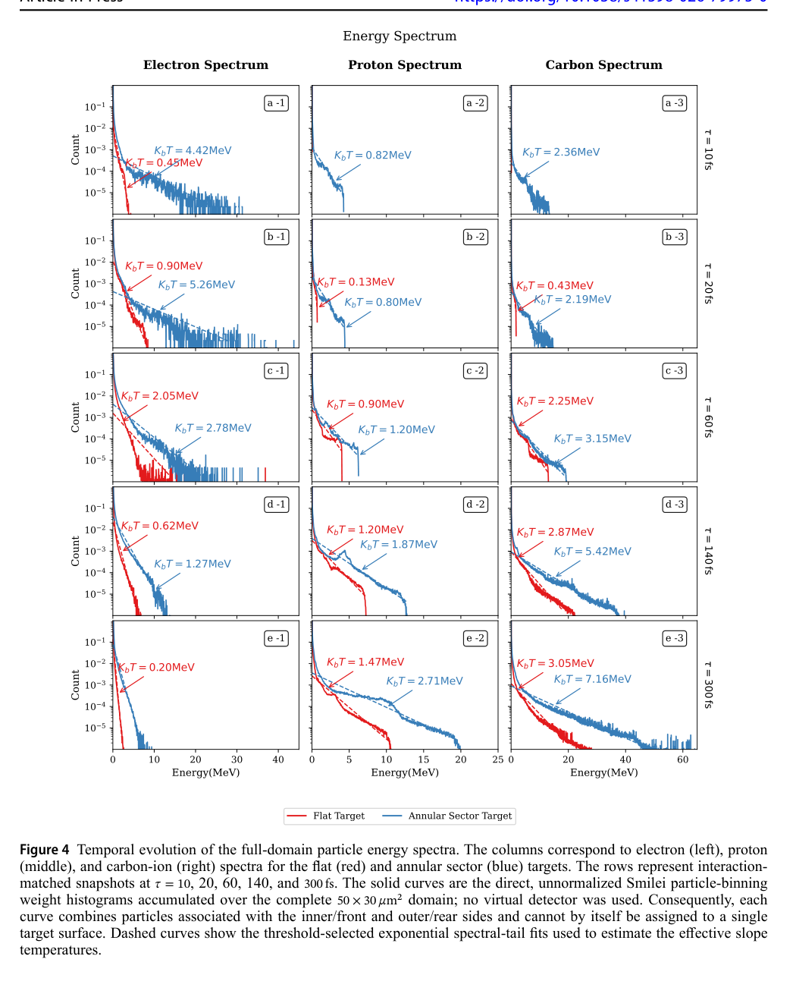
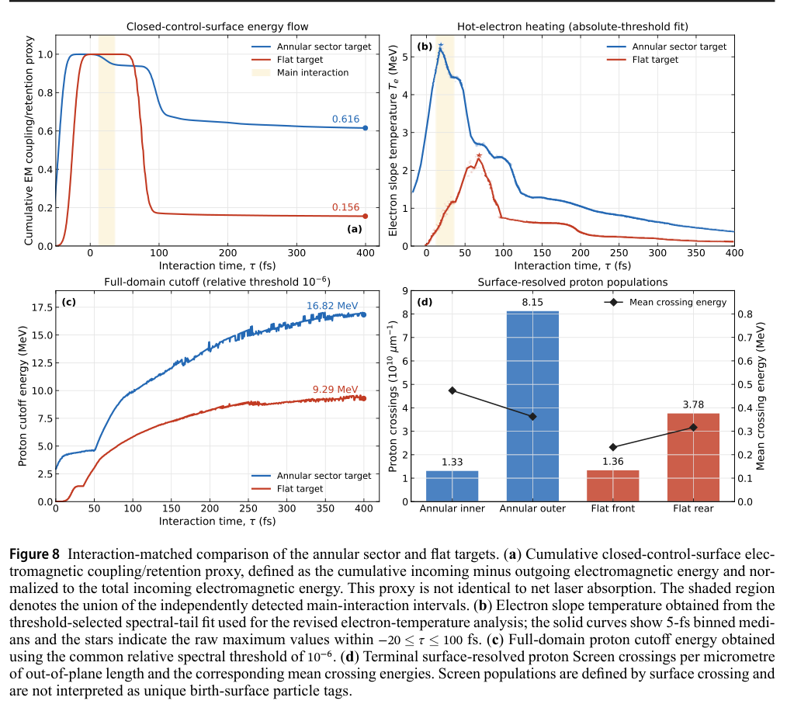
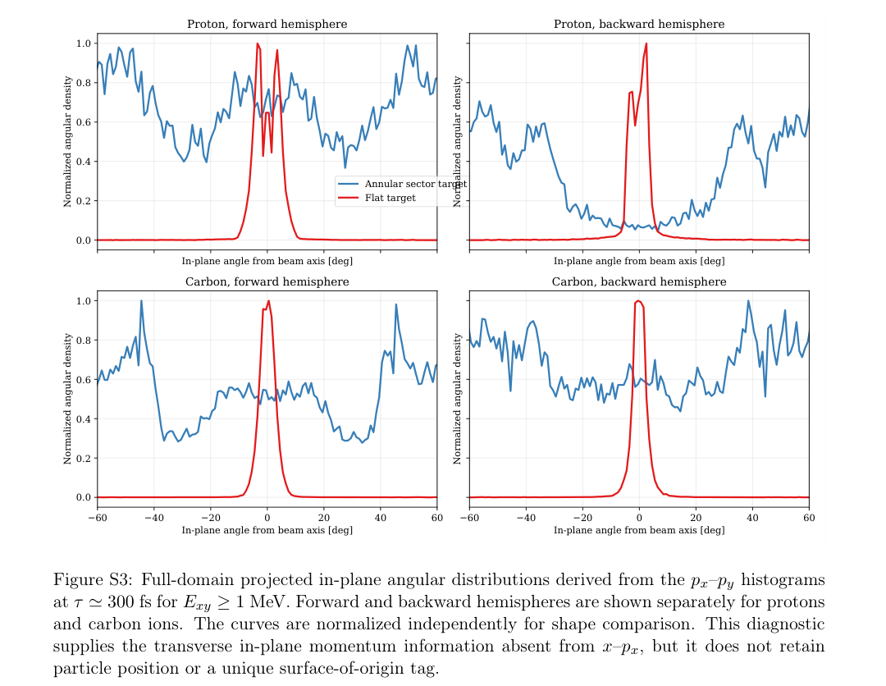
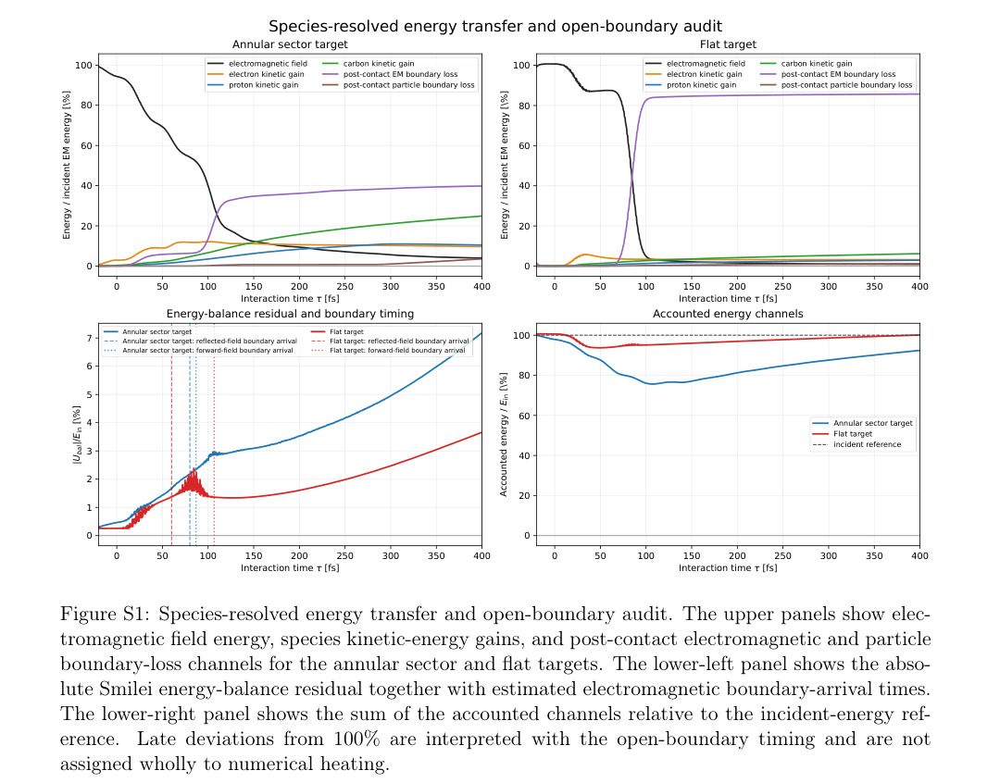
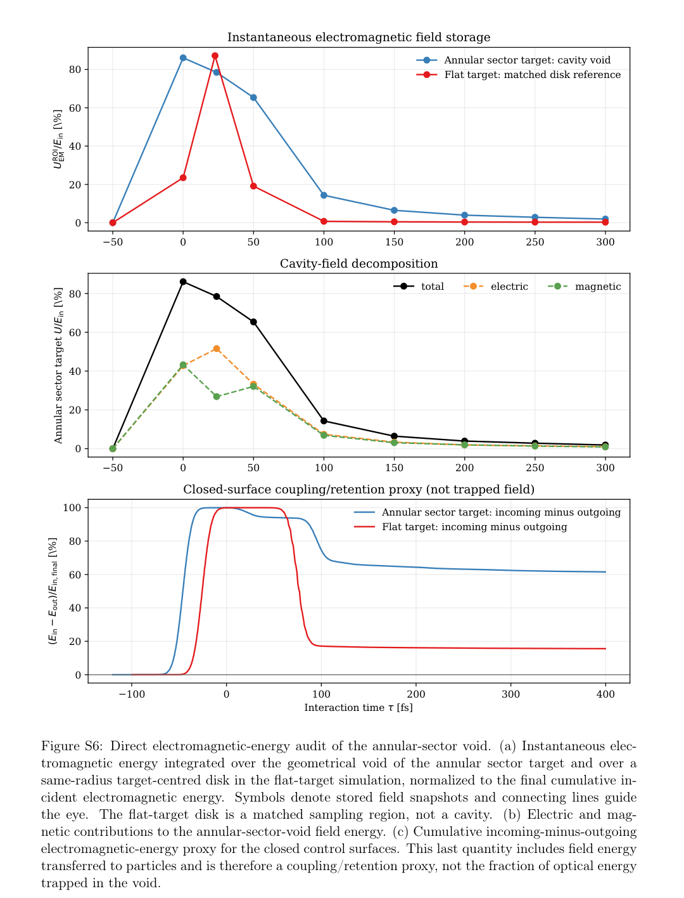

# 环扇形靶为何提高TNSA截止能量：耦合、粒子输运与二维诊断边界

## 0. 来源、版本和阅读范围

- **原题**：Enhanced laser-driven ion acceleration through electromagnetic energy coupling in annular sector targets。
- **作者**：Mohammad Rezaei-Pandari、Mahdi Shayganmanesh、Mohammad Hossein Mahdieh，Iran University of Science and Technology。
- [正式DOI／出版社页面](https://www.nature.com/articles/s41598-026-79975-0)，2026-11-04接收、11-27在线。实际阅读[17页Article in Press](../pdfs/rezaeipandari-2026-annular.pdf)，不是最终编辑VOR；网页的`citation_pdf_url`与真正下载锚点不同，本轮采用后者`_reference.pdf`。
- [8页科学补充材料](../pdfs/rezaeipandari-2026-annular-supplement.pdf)标题、作者及内容匹配，含Table S1、S1–S6图与7节正文；已完整阅读。主文正文、结论、数据声明已读，参考文献仅核结构，未逐篇追溯。
- 25页已做签名、MIME、SHA、三路页数、逐页文本和源页总览；6张关键原图另行放大核对。PDF公式提取存在重字／占位符，关键数值对照实际页面。MinerU零请求，历史401未复测；本地文本／渲染回退，未运行Smilei或作者分析代码。
- 网页检索另见同作者、同C形CH场景的早期Research Square稿，标题含“Optical Confinement and Geometric Plasma Focusing”；它是同作版本线索，未作为独立论文入库、未全文复核。旧摘要中的22 MeV等数值不能替代本轮正式早期版的定义和结果。

## 1. 问题与方法

作者比较平箔与部分包围激光的C形靶，关注能量如何进入电子、再经鞘场传给离子。几何改变既可延长场的停留，也可改变局部表面法向和粒子去向；这两件事需要不同诊断，不能由空间聚集直接推断独立的能量增益。

| 输入／诊断 | 本文设定 |
|---|---|
| 代码与维度 | 二维笛卡尔Smilei PIC；场Silver–Müller开放边界、到边界粒子移除 |
| 计算域／网格 | 50×30 μm²，λ₀/32≈25 nm，CFL系数0.96；25 PPC，各做λ₀/40、49 PPC检查 |
| 激光 | 800 nm、a₀=10、25 fs FWHM、w₀=4 μm、y线偏振、沿+x入射，焦面x=18 μm |
| 初始材料 | CH，nC=nH=26.44 nc；H⁺、C³⁺，初始ne≈106 nc；ADK允许C至C⁶⁺ |
| 平箔 | x=18–19 μm，宽27 μm，厚1 μm |
| C形靶 | 中心(18,15) μm，内半径6 μm、厚1 μm，300°材料弧、迎光60°开口 |
| 初始界面 | 双曲正切梯度δ=0.10 μm；另扫0.05／0.20 μm，不是实测对比度驱动的流体预等离子体 |
| 开关 | 未启用辐射反作用／光子发射；本文不是强场QED或转换靶产额计算 |

主图1（PDF第3页）先给几何与相互作用示意，没有定量坐标／色标，作用是说明开口与入射方向；不能据图估计绝对场强。两靶受光位置不同，作者分别检测接触时刻：C形120.008 fs、平箔99.630 fs，比较使用τ=t−tcontact，避免将约20.38 fs飞行差当成机制提前。

## 2. 场与等离子体演化：主图2、3、7

**图2，PDF第5页**：横纵轴x、y，单位μm；两列为平箔／C形，三行τ=−20、10、20 fs。每组上方离子、下方电子；图注称能量密度，但色标实际写`Particle energy (a.u.)`，激光强度也为a.u.，归一化／量纲细节未从图中闭合。中心线分别叠加Ey和Ex，不能把它们按另一色标读成绝对V/m。C形内壁多个位置受热，支持重复场—表面相互作用；未唯一分离J×B与Brunel等微观加热贡献。

**图3，PDF第6页**沿用相同坐标、配色和任意单位，时间改为τ=60、140、300 fs。C形空腔逐渐被多流等离子体填充；后期Ex结构说明集体场仍存在，不能单独证明几何会聚增加最大离子能量。

**图7，PDF第13页**上／中为腔口纵向Poynting通量的时空条纹，下为中心探针时间迹；横轴为τ(fs)，上图纵轴y(μm)，下图为归一化Sx。C形有额外反射带，后期残余信号很弱。它支持再相互作用，不支持“入射峰值光场维持整个300 fs”或特定反射次数／高Q本征模。

## 3. 能谱与耦合：主图4、5、8及Table 1

**图4，PDF第8页**：三列为电子／质子／碳离子，横轴每粒子能量MeV（碳不是MeV/u），纵轴对数`Count`，按文中定义是完整域内未经额外归一化的宏粒子权重直方图；它不是探测器计数。五行τ=10、20、60、140、300 fs，红平箔、蓝C形，虚线为选定谱尾拟合。不同粒种／时间不能只看峰高比较实际输出粒子数，也不能把全域谱归到单一表面。

**图5，PDF第10页**横轴τ(fs)、纵轴电子／质子／碳的有效斜率温度MeV。它拟合非热平衡全域谱，混合前后／内外两侧群体。电子斜率先高后降，离子谱尾持续变化；群体曲线的台阶不等于某个离子经历第二次离散加速。

**图8，PDF第14页**四个子图分别量化：(a)封闭控制面累积能流，纵轴无量纲；(b)电子斜率温度MeV，实线为5 fs分箱中位数，星号为原始峰，浅色为主相互作用区间并集；(c)公共相对谱阈值10⁻⁶定义的截止MeV；(d)表面穿越权重，以10¹⁰ μm⁻¹计，右轴为平均穿越能量MeV。柱高可能包括反复穿越，并不是唯一粒子发射数。

| 指标 | 平箔 | C形靶 | 解释 |
|---|---:|---:|---|
| 末态耦合／留存代理量 | 0.156 | 0.616 | 作者未舍入值比值3.95；不是不可逆吸收或离子转换效率 |
| 0≤τ≤50 fs电子斜率温度中位数 | 0.94 MeV | 4.46 MeV | 作者未舍入值比值4.73，非热力学温度 |
| τ≈400 fs质子截止 | 9.29 MeV | 16.82 MeV | 公共相对阈值10⁻⁶，约1.81倍 |
| 同时刻碳离子截止 | 21.27 MeV | 40.61 MeV | 每离子能量，非每核子 |

谱尾拟合保留S(E)≥2×10⁻⁶的bin，至少6个bin时拟合lnS=a+bE，并取Tslope=−1/b（b<0）；R²监测但不作硬接受门槛。这个谱尾选择与截止的相对10⁻⁶阈值是不同规则。

由Poynting定理，固定空腔ROI满足

$$
\frac{dU_{\rm EM}^{\rm void}}{dt}=-\oint_{\partial A}\mathbf S\cdot\hat{\mathbf n}\,dl-\int_A\mathbf J\cdot\mathbf E\,dA.
$$

图8a把历时流入减流出除以最终入射能量，包含控制体内剩余场能及传给等离子体的能量。把0.616写成“61.6%的光一直困在空腔”或“61.6%变为可用离子束”都会改变物理量。

## 4. 粒子来源、做功与束流品质

**图6，PDF第12页**为全域x–px投影：横轴x(μm)，纵轴px/(me c)，色标为粒子权重；三行为电子、质子、碳，左右比较两靶，τ≈300 fs。C形的X形结构缺少py与初始侧标签，不能单独认定束流在焦平面相交。Screen定义穿越位置，tracking才给初始内／外侧，二者不可互换。

tracking中约15.5%的加权内侧质子、16.2%的内侧碳进入r<6 μm，证明存在向腔内输运；高能尾却由外侧初始粒子更强地承载。>5 MeV样本内／外侧质子末态均值7.00／8.81 MeV。21.31 MeV是某追踪质子的最大值，不能替换全谱阈值截止16.82 MeV。

逐粒子电场做功Wx+Wy+Wz与动能变化相符，主要由Wx贡献；每物种每几何最高能60个追踪粒子的事件分类均为0/60次明确分离的第二阶段。作者证据更符合持续更强的鞘加速；这仍是有限样本／分类器范围，不能证明任意粒子和参数下绝无多阶段。

**S3，补充第4页**：τ≈300 fs，依据px–py，阈值Exy≥1 MeV；没有保留pz，故与真实三维动能筛选不同。横轴相对全局束轴的角度°，纵轴各曲线独立归一化密度。C形分布明显更宽，不能称为全局准直改善。**S4，补充第5页**改为相对各Screen局部外法向、真实动能E≥1 MeV；C形质子内／外68%半角3.52°／1.49°，是局部穿越群体，不能当全局三维发散。

## 5. 补充核验、能量账本与局限

**S1，补充第2页**横轴τ(fs)，上为场能、各物种动能增量、场／粒子边界损失，统一除以最终入射能量；下左为全局残差及预计到边界时刻，下右为已计入通道之和。τ=150 fs残差C形2.97%、平箔1.36%；晚期残差增长且通道和偏离100%，作者明确边界记账限制，不能写成严格能量闭合。C形总离子增量从τ=150到400 fs由17.99%升至35.27%，电子37.62%降至24.89%；这是域内物种能量增量，不是送达应用端的效率。

**S2，补充第3页**以相同时间横轴给质子／碳截止、电子斜率温度和总离子增量；两靶后期截止继续增大但增速降低。最后有限域快照不等于无穷远最终束能。

**Table S1，补充第1页**：相互作用前静默窗口动能漂移所有测试<0.015%。49 vs25 PPC使质子截止+0.64%、电子温度−2.01%、Ex指标+0.22%、质子动能+5.20%；40 vs32 cells/λ使相应量−0.64%、−3.24%、+2.32%、−0.21%。说明测试范围内数值加热不占主导，不能据此宣称所有观测量渐近收敛。

**S5，补充第6页**：横轴τ(fs)，上为截止MeV、下为斜率温度MeV；两几何分别成列，δ=0.05／0.10／0.20 μm三曲线。τ=150 fs C形截止11.36／12.00／10.92 MeV，平箔5.25／7.24／7.63 MeV，排序保留但倍率敏感；0.05 μm仅两个基准网格，是边缘分辨测试。

**S6，补充第8页**：(a)空腔／匹配平箔圆盘的瞬时场能，(b)C形ROI电／磁分解，(c)控制面累积代理量，横轴均τ(fs)、纵轴为入射能量百分比。两ROI峰值86.1%／87.3%相近，峰后1/e持续时间83.3／22.1 fs，差别主要在停留。τ≈300 fs空腔剩余1.9%，不能把末态61.6%代理量当作仍储存的光能。平箔圆盘只是相同半径采样区。

## 6. 对项目的启发与接续

可复用的是“独立接触时钟→控制面能流与瞬时ROI储能分开→物种能量→逐粒子做功→来源标签与角谱”的诊断链。对PIC机制研究，先固定粒子ID、权重、阈值和ROI，再设计能排除几何输运混淆的对照。

后续需获取作者所称Zenodo保留DOI[10.5281/zenodo.22730238](https://doi.org/10.5281/zenodo.22730238)的实际可访问版本、输入与分析SHA（本轮未下载核验）、核对开放边界能账与诊断单位、进行同条件完整3D及由实测激光对比度约束的几何专属预等离子体模拟。60°开口破坏方位对称，准柱坐标不能直接代替完整3D。需共同测量电子、离子角能谱、绝对产额和开口透射；本文没有新实验、转换靶中子／同位素产额、临床或防护验收。
